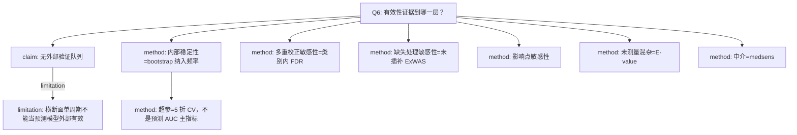

# 问题
如何证明分析有效？验证与敏感性、E-value？

# AI-A 初稿
# AI-A Decision Tree Round 1

paper_id: paper_004
question_id: Q6
task_type: literature_decision_tree_reasoning
question: 论文如何证明分析有效？内部/外部验证、敏感性、E-value？
source_file: adversarial_lit_reading/chunks/paper_004_ewas_new.md

## 1. Evidence Map

| evidence_id | location | evidence_summary | used_by_node |
|---|---|---|---|
| E1 | Methods 2.5 / Supp Table 5 | ERS 变量选择用 1000 次 bootstrap 纳入频率 | N2 |
| E2 | Methods 2.5 | 弹性网 5 折交叉验证选 alpha/lambda | N3 |
| E3 | Results 3.3 | 类别内 FDR 与主 FDR 相互印证 | N4 |
| E4 | Results 3.7 | 未插补数据重做 ExWAS（Supp Fig.5、Table 7） | N5 |
| E5 | Results 3.7 | 影响点检查，结论写不是个别观测驱动（指向 Supp Table 1 的表述需谨慎） | N6 |
| E6 | Methods 2.5 / Supp Table 11 | E-value 量化未测量混杂要多强才能解释掉关联 | N7 |
| E7 | Results 3.6 Supp Fig.4 | medsens：rho 增大时 ACME 仍讨论方向 | N8 |
| E8 | Discussion | 无外部队列；单周期横断面 | N9 |

## 2. Decision Tree - Mermaid

## 3. Node Table

| node_id | node_type | claim | evidence_location | evidence_summary | confidence | risk_tag |
|---|---|---|---|---|---|---|
| N0 | question | 有效性证据层级 | Q6 | 本问 | high | 证据不足 |
| N1 | claim | 没有第二队列 | Discussion | 外推限制 | high | 证据不足 |
| N2 | method | 1000 bootstrap 选变量稳定性 | Methods 2.5 Supp Table 5 | 纳入频率>80% 的核心毒物 | high | 证据不足 |
| N3 | method | 5 折 CV 只调惩罚参数 | Methods 2.5 Fig.4B-C | 不是 AUC 竞赛 | high | 方法误读 |
| N4 | method | 类别内 FDR | Results 3.3 | Supp Table 2 | high | 证据不足 |
| N5 | method | 完整病例/未插补 ExWAS | Results 3.7 | Supp Fig.5 Table 7 | high | 证据不足 |
| N6 | method | 影响点 | Results 3.7 | 原文称非个别点驱动 | medium | 证据不足 |
| N7 | method | E-value | Methods 2.5 Supp Table 11 | 连续与分类 ERS | high | 证据不足 |
| N8 | method | medsens | Results 3.6 | Supp Fig.4 | high | 因果过度 |
| N9 | limitation | 不能声称预测外部有效 | Discussion | 无时间/外部验证 | high | 证据不足 |

## 4. Provisional Answer

有效性证据是内部的：交叉验证调弹性网、bootstrap 看变量是否反复入选、更换 FDR 族、去掉插补、检查影响点、用 E-value 和 medsens 看未测量混杂。没有区分度/校准度作为主结论，也没有外部队列。因此本文证明的是关联估计对若干分析选择的稳健，不是临床预测模型已验证。

## 5. Uncertainty List

- U1: 影响点段落把「Supplementary Table 1」当作证据位置，该表在补充里是毒物特征表，位置可能是笔误，证据强度降为 medium。
- U2: 未见 Hosmer-Lemeshow 或校准图。
- U3: bootstrap 是只计纳入频率，还是也给 OR 的百分位区间，正文强调频率。

## 6. Follow-up Questions

1. Supp Fig.5 未插补后显著毒物数是否仍为 29？
2. E-value 是针对 ERS 还是也针对每个 ExWAS 毒物？

# 补充统计要点
补充材料统计要点（从 docx 抽取，非全文）：
LOD：>90%低于检出限或缺失>40%剔除；>30%低于检出限则二分类且未检出=0；其余 ln。
mice：rexposome imputation，m=5，迭代5，PMM/logreg。种子插补123456，bootstrap 2024。
ExWAS 不加权，理由是权重与人口学协变量同时调整可能过调整。
描述、RCS、亚组、中介用复杂抽样。
弹性网：连续 Z 分数，二分类0/1，alpha 0到1共11个，lambda 网格，5折CV，gcdnet。
WQS：gWQS q=4 B=1000。
中介：mediation 包，顺序可忽略性，medsens。
E-value 见 Supplementary Table 11。

# 原文 CHUNK
# Page 1

Exposome-wide association study of environmental toxicants and 
periodontitis among United States adults
Xixi Dong a,1, Xuejing Zhong b,1, Jinmei Wu b,1, Yichen Lin a, Baochang He a, Jing Wang c,  
Fuhua Yan d, Yanfen Li d, Lingjun Yan e,*, Fa Chen a,**
a Department of Epidemiology and Health Statistics, Fujian Provincial Key Laboratory of Environment Factors and Cancer, School of Public Health, Fujian Medical 
University, Fuzhou, China
b Longyan First Affiliated Hospital of Fujian Medical University, Longyan, China
c Laboratory Center, The Major Subject of Environment and Health of Fujian Key Universities, School of Public Health, Fujian Medical University, Fuzhou, China
d Nanjing Stomatological Hospital, Affiliated Hospital of Medical School, Research Institute of Stomatology, Nanjing University, Nanjing, China
e Department of Neurosurgery, Neurosurgery Research Institute, The First Affiliated Hospital, Fujian Medical University, Fuzhou, China
A R T I C L E I N F O
Edited by Dr Hyo-Bang Moon
Keywords:
Periodontitis
Environmental toxicants
Exposome-wide association study
Mediation analysis
Population-based study
NHANES
A B S T R A C T
Objectives: To systematically evaluate associations between environmental toxicants and periodontitis and to 
quantify the mediating role of systemic inflammatory biomarkers.
Methods: We extracted data from National Health and Nutrition Examination Survey (NHANES) 2013–2014. The 
study covers 73 environmental toxicants spanning 12 categories. Exposome-wide association study (ExWAS) was 
used to identify individual toxicant associations, and adaptive elastic net regularization was employed to develop 
an environmental risk score (ERS). Mediation analysis quantified the contribution of inflammatory biomarkers to 
observed associations
Results: Among 1210 participants, 49.4 % were male and 50.6 % were female. The ExWAS identified 29 toxicants 
across 9 categories significantly associated with periodontitis. Notably, detectable monohydroxybutenyl mer­
capturic acid (MHBMA2) levels were associated with a 2.798-fold higher periodontitis odds (95 % CI: 
1.799–4.352) versus undetectable levels. Stratified analyses revealed that associations were stronger among 
males and younger adults (< 60 years). The ERS, derived from 17 prioritized toxicants via elastic net regression, 
demonstrated a significant positive dose-response relationship with periodontitis risk, where each IQR increase 
was associated with a 59.7 % higher disease risk (OR = 1.597). Mediation analysis indicated that white blood cell 
count (11.5 %), neutrophils (10.2 %), monocytes (5.1 %), systemic immune-inflammation index (6.3 %), 
neutrophil-to-lymphocyte ratio (5.7 %), and systemic inflammation response index (7.4 %) significantly medi­
ated toxicant-periodontitis associations.
Conclusions: This nationally representative exposome-wide investigation identified significant associations be­
tween multiple environmental toxicants and periodontitis, with inflammatory pathways partially mediating 
these relationships. These findings establish potential environmental etiological factors for periodontitis and 
highlight specific toxicants as targets for exposure reduction strategies to improve periodontal health at the 
population level.
1. Introduction
Periodontitis is a chronic inflammatory disease caused by microor­
ganisms present in dental plaque, characterized by the destruction of 
connective tissue attachment and alveolar bone loss (Slots, 2017). The 
disease represents a significant global health burden(Yan et al., 2025c), 
with advanced stages potentially leading to tooth mobility and loss, 
significantly impairing masticatory function and quality of life (Yin 
* Correspondence to: The First Affiliated Hospital, Fujian Medical University, No.20 Chazhong Road, Fuzhou 35004, China.
** Correspondence to: Department of Epidemiology and Health Statistic, School of Public Health, Fujian Medical University, No.1 Xuefu North Road, Fuzhou 
350122, China.
E-mail addresses: lingjun_yan@fjmu.edu.cn (L. Yan), chenfa@fjmu.edu.cn (F. Chen). 
1 Contributed equally to this work.
Contents lists available at ScienceDirect
Ecotoxicology and Environmental Safety
journal homepage: www.elsevier.com/locate/ecoenv
https://doi.org/10.1016/j.ecoenv.2025.119544
Received 21 September 2025; Received in revised form 27 November 2025; Accepted 7 December 2025  
Ecotoxicology and Environmental Safety 309 (2026) 119544 
Available online 10 December 2025 
0147-6513/© 2025 The Author(s). Published by Elsevier Inc. This is an open access article under the CC BY-NC-ND license ( http://creativecommons.org/licenses/by- 
nc-nd/4.0/ ).

# Page 2

et al., 2022). Furthermore, growing evidence demonstrates a bidirec­
tional relationship with systemic conditions such as diabetes, cardio­
vascular diseases, and neurological disorders(Herrera et al., 2023; 
Liccardo et al., 2020; Yan et al., 2025a). According to the 2009–2014 
National Health and Nutrition Examination Survey (NHANES), 
approximately 42 % of U.S. adults suffer from periodontitis, with severe 
cases accounting for 7.8 %(Eke et al., 2018). Given this substantial 
prevalence and its systemic implications, periodontitis has emerged as a 
significant public health concern, necessitating effective preventive 
strategies to understand and mitigate its risk factors.
While traditional risk factors such as smoking, poor oral hygiene, 
dietary factors, and genetic predisposition have been well-established 
(Amarasena et al., 2002; Chen et al., 2024; Wu et al., 2023; Yan et al., 
2025b), mounting evidence suggests that environmental pollutant 
exposure represents an emerging and underappreciated contributor to 
periodontal disease pathogenesis. Studies indicate that exposure to 
hundreds of natural and synthetic toxicants, including heavy metals 
(lead, mercury, cadmium, arsenic, chromium, etc.)(Yang et al., 2024a, 
2024b), ethylene oxide(Miao et al., 2024), brominated flame retardants, 
(Pan et al., 2024) polycyclic aromatic hydrocarbons(Wu et al., 2024), 
and volatile organic compounds(Dong et al., 2024), are associated with 
periodontitis. However, existing studies have predominantly adopted a 
single-exposure approach, examining individual chemicals or isolated 
chemical classes. This methodological limitation fails to capture the 
real-world complexity of simultaneous exposure to multiple environ­
mental toxicants, potentially leading to underestimated effect sizes and 
omitted variable bias.
The exposome concept, introduced in 2005, offers a novel approach 
to address this methodological limitation. This framework systemati­
cally evaluates the health effects of all environmental exposures (i.e., 
non-genetic factors), providing a scientific basis for understanding the 
biological consequences of mixed exposures while minimizing selective 
reporting and confounding biases(Vermeulen et al., 2020; Wild, 2005). 
Despite the conceptual appeal and analytical advantages of the expo­
some approach, no comprehensive exposome-wide association study 
(ExWAS) has specifically investigated the relationship between complex 
environmental mixtures and periodontitis in a representative population 
sample.
To address this critical knowledge gap, we conducted an ExWAS 
utilizing data from the 2013–2014 NHANES to comprehensively 
examine associations between environmental toxicant exposure and 
periodontitis in United States adults. Our study aims to systematically 
identify environmental toxicants associated with periodontitis risk, 
assess the combined effects of multiple exposures, and provide insights 
into the complex interplay between environmental factors and peri­
odontal health that could inform future prevention strategies and public 
health policies.
2. Methods
2.1. Study population
This study utilized data from the 2013–2014 cycle of the NHANES, a 
stratified, multistage probability sampling survey designed to generate 
nationally representative estimates of the noninstitutionalized US pop­
ulation. NHANES is conducted by the Centers for Disease Control and 
Prevention’s National Center for Health Statistics (NCHS), with study 
protocols approved by the NCHS Institutional Ethics Review Board and 
written informed consent obtained from all participants.
The analytical cohort comprised survey respondents aged 20 years or 
older who had complete periodontitis examination data and environ­
mental toxicant measurements. Individuals with missing periodontitis 
data or missing values for environmental toxins exceeding one-third of 
the analytes were excluded, resulting in a final sample of 1210 partici­
pants (Fig. 1). Data are publicly available in NHANES and can be 
accessed at: https://www.cdc.gov/nchs/nhanes/index.htm.
2.2. Periodontitis assessment
Periodontitis status was determined using clinical examination data 
from NHANES, specifically derived from the periodontal file ("OHXPER. 
Doc"). Classification followed the surveillance case definitions jointly 
established by the Centers for Disease Control and Prevention and the 
American Academy of Periodontology (CDC/AAP)(Du et al., 2023; Eke 
et al., 2015), based on thresholds of clinical attachment loss (CAL) and 
periodontal probing depth (PPD). Severe periodontitis was defined as 
CAL ≥6 mm in ≥2 proximal sites (affecting different teeth) and PPD 
≥5 mm in ≥1 proximal site. Moderate periodontitis was defined as ≥2 
proximal sites (affecting different teeth) with CAL ≥4 mm or PPD 
≥5 mm. Mild periodontitis was defined as CAL ≥3 mm in ≥2 proximal 
Fig. 1. Flow chart of the study population in this study. Abbreviation: NHANES, National Health and Nutrition Examination Survey.
X. Dong et al.                                                                                                                                                                                                                                    
Ecotoxicology and Environmental Safety 309 (2026) 119544 
2

# Page 3

sites (different teeth), plus PPD ≥4 mm in ≥2 proximal sites (different 
teeth) or PPD ≥5 mm in ≥1 site.
In this study, participants were categorized as having periodontitis 
(mild, moderate, or severe) or non-periodontitis.
2.3. Exposure assessment
Environmental toxicant exposure was assessed through biochemical 
analysis of blood and urine specimens collected during the NHANES 
examination. Initially, 89 environmental toxicants across 13 chemical 
categories were evaluated (Supplementary Table 1). Analytical meth­
odologies included: quantification of hemoglobin adducts for reactive 
organic compounds (e.g., acrylamide, glycidamide, ethylene oxide, 
formaldehyde), expressed as adduct quantity per milligram of hemo­
globin; and determination of urinary concentrations for inorganic ele­
ments and metallic toxicants, adjusted for urinary creatinine 
concentration to account for dilution effects. Following standardized 
procedures for handling values below the limit of detection and missing 
data (Methods in Supplementary material), 73 toxicants across 12 
chemical categories were retained for primary analysis.
2.4. Covariates
Demographic, socioeconomic, behavioral, and clinical covariates 
were selected based on established associations with periodontitis and 
potential confounding relationships. These included: age, gender, race, 
education level, marital status, poverty-income ratio, BMI, alcohol 
consumption, the time since last dental visit, mouthwash use, flossing 
frequency, and estimated glomerular filtration rate (eGFR). A directed 
acyclic graph (DAG) was developed to assess potential confounding 
structures (Supplementary Figure 1). A more detailed explanation of 
covariates is in the Methods section of the supplementary material.
2.5. Statistical analyses
All analyses accounted for the complex survey design of NHANES 
(2013–2014 cycle), including sample weights (wtsa2yr), stratification 
variables, and primary sampling units (PSUs) to ensure nationally 
representative estimates, unless otherwise specified for methodological 
reasons. This applied to descriptive statistics, restricted cubic spline 
(RCS) analyses, subgroup analyses, and mediation analysis.
An exposome-wide association study (ExWAS) was conducted using 
the "rexposome" package to systematically evaluate associations be­
tween 
individual 
environmental 
toxicants 
and 
periodontitis 
(Hernandez-Ferrer et al., 2019). All associations were assessed using 
two-sided p-values, with multiple testing correction performed via the 
Benjamini-Hochberg procedure to control the false discovery rate (FDR) 
(Tzoulaki et al., 2012). Within the ExWAS framework, which involves 
fitting independent regression models for each exposure, we reported 
unweighted results to maintain methodological consistency with prior 
investigations and to avoid potential over-adjustment bias(Guo et al., 
2024; James-Todd et al., 2012; Lewis et al., 2015).
The Environmental Risk Score (ERS) was constructed using an elastic 
net regression framework implemented via the "gcdnet" package. We 
performed comprehensive parameter tuning by systematically evalu­
ating 11 α values (ranging from 0 to 1) and 50 λ values (from 10 ³ to 
10-²). The optimal parameter combination was identified through 5-fold 
cross-validation. To evaluate the robustness of variable selection, we 
conducted a bootstrap analysis with 1000 resampling iterations and 
calculated the inclusion frequency for each variable. Participants were 
dichotomized into high/low ERS groups based on median value. The 
association between ERS and periodontitis was evaluated using 
weighted logistic regression in 2 models: Model 1 was unadjusted, and 
Model 2 adjusted for all aforementioned covariates.
To evaluate potential nonlinearity, we employed restricted cubic 
splines (RCS) with 3 knots to model the association between the ERS and 
periodontitis. As a complementary mixture analysis, we conducted 
Weighted Quantile Sum (WQS) regression using the gWQS package, 
setting the number of quantiles to 4 and using 1000 bootstrap iterations.
Mediation analysis was explicitly framed as exploratory and was 
conducted to generate hypotheses rather than establish causal path­
ways. We used the "mediation" package in R with 1000 bootstrap iter­
ations. A formal sensitivity analysis was performed using the medsens 
function to assess the robustness of findings to potential unmeasured 
confounding.
In all association analyses presented in the main text, we report odds 
ratios (ORs) per interquartile range (IQR) increase in environmental 
exposures to facilitate clinical interpretation. Effect estimates based on 
original measurement units are provided in the Supplementary Material. 
E-values were calculated to quantify the potential impact of unmeasured 
confounding required to explain away the observed associations.
All statistical analyses were performed using R software (version 
4.5.0). Statistical significance was defined as two-tailed P < 0.05, unless 
otherwise specified for multiple comparisons using false discovery rate 
correction. More details are described in the Methods in Supplementary 
material.
3. Results
3.1. Characteristics of the study population
Table 1 presents general characteristics of 1210 NHANES 2013–2014 
participants (49.4 % male, 50.6 % female). Significant differences 
(P < 0.05) between the non-periodontitis and periodontitis groups were 
observed for sex, age, race/ethnicity, education level, marital status, 
poverty-income ratio, dental floss use, time since last dental visit, and 
BMI (P < 0.05). Participants with periodontitis were more likely to be 
male, aged ≥60 years, have higher proportions of overweight/obesity, 
and report significantly lower frequencies of dental floss use and dental 
visits compared to non-periodontitis individuals. No significant inter­
group differences (P > 0.05) were found in eGFR, alcohol consumption, 
or mouthwash use.
3.2. Data preprocessing and correlation structure of environmental 
toxicants
Of the 89 environmental toxicants initially evaluated, 73 met in­
clusion criteria based on data sufficiency. 16 toxicants underwent 
dichotomization based on detection limits, while the remaining 57 were 
log-transformed (natural logarithm) to approximate normal distribution 
(Supplementary Table 1). As shown in Supplementary Figure 2, varying 
degrees of correlation existed among the 73 environmental toxicants 
investigated.
3.3. Exposome-wide association Study (ExWAS) Findings
In the fully adjusted ExWAS model, which accounted for multiple 
testing using the Benjamini-Hochberg false discovery rate (FDR) pro­
cedure, we identified 29 toxicants significantly associated with peri­
odontitis risk (FDR-corrected q-value < 0.05). These significant 
toxicants spanned nine distinct chemical categories: acrylamide, aro­
matic amines (n = 3), nicotine metabolites (n = 3), ethylene oxide, 
heterocyclic aromatic amines (n = 2), metals (n = 3), polycyclic aro­
matic hydrocarbons (n = 6), perchlorate, nitrate and thiocyanate com­
pounds (n = 1), and volatile organic compound (VOC) metabolites 
(n = 9). A sensitivity analysis implementing family-wise FDR control 
within each chemical class corroborated the robustness of these findings 
(Supplementary Table 2). Notably, individuals with detectable levels of 
the VOC metabolite MHBMA2 exhibited a 2.798-fold increased risk of 
periodontitis (95 % CI: 1.799–4.352) compared to those with unde­
tectable levels. Furthermore, each IQR increase in 2-Aminonaphthalene 
was associated with an 85.2 % higher probability of periodontitis (OR: 
X. Dong et al.                                                                                                                                                                                                                                    
Ecotoxicology and Environmental Safety 309 (2026) 119544 
3

# Page 4

1.852, 95 % CI: 1.413–2.426), and each IQR increase in Total Cotinine 
was associated with an 84.9 % increased risk (OR: 1.849, 95 % CI: 
1.477–2.315). The detailed results of the ExWAS are presented in 
Table 2 and visualized in the volcano plot in Fig. 2.
3.4. Stratified analyses by age and sex
The analysis was stratified by age and sex. The findings suggest that 
more types of environmental toxicants were associated with periodon­
titis among men (25 toxicants) and individuals younger than 60 years 
(32 toxicants) compared with women and older adults, respectively, 
particularly for VOC metabolites and Polycyclic Aromatic Hydrocarbons 
(Fig. 3 and Supplementary Table 3–4).
3.5. Construction and validation of the environmental risk score (ERS)
An ERS was constructed using 17 priority pollutants identified 
through adaptive elastic-net regularization. Bootstrap resampling (1000 
iterations) demonstrated high variable selection stability for a core set of 
toxicants, including o-Toluidine, 2-Naphthol, 2-Aminonaphthalene, 
Lead, and TTCA, all with inclusion frequencies exceeding 80 % 
(Supplementary Table 5). Both continuous and categorical ERS mea­
sures demonstrated significant positive associations with periodontitis 
(P < 0.05). After adjusting for potential confounders, robust associa­
tions persisted, with each interquartile range (IQR) increase in the 
continuous ERS associated with a 59.7 % higher risk of periodontitis 
(OR = 1.597; 95 % CI: 1.418–1.800), while participants in the high ERS 
group had a 2.552-fold increased risk (95 % CI: 1.894–3.440) compared 
to those in the low ERS group. Restricted cubic spline analysis revealed 
no evidence of nonlinearity (P for nonlinear=0.348); however, peri­
odontitis risk demonstrated a consistent dose-response relationship with 
increasing ERS levels. Furthermore, higher ERS values correlated with 
decreased tooth count and increased probing pocket depth and clinical 
attachment loss (Fig. 4).
Subgroup analyses demonstrated consistent positive associations 
between ERS and periodontitis risk across most demographic and 
behavioral strata after confounder adjustment (P < 0.05), with excep­
tions noted among high school graduates and non-drinkers 
(Supplementary Figure 3). No significant effect modification was 
detected in stratified analyses.
3.6. Exploratory mediation analysis by immunoinflammatory biomarkers
Mediation analyses evaluated the role of immunoinflammatory 
biomarkers in the ERS-periodontitis association. All six assessed medi­
ators demonstrated statistically significant indirect effects: white blood 
cell count (WBC), neutrophil count (NEUT), monocyte count (MONO), 
systemic immune-inflammation index (SII), neutrophil-to-lymphocyte 
ratio (NLR), and systemic inflammation response index (SIRI). The 
respective mediation proportions were 11.494 %, 10.188 %, 5.050 %, 
6.317 %, 5.710 %, and 7.351 % (Fig. 5 and Supplementary Table 6).
To assess the robustness of these findings against potential unmea­
sured confounding, formal sensitivity analyses were conducted. The 
results indicated that the observed mediation effects might be 
Table 1 
Demographic characteristics of the study population in NHANES 2013-2014.
Variables
Total (n = 1210)
Nonperiodontitis (n = 677)
Periodontitis (n = 533)
P
eGFR (mL/min/1.73 m2), median (Q25 %, Q75 %)
90.3 (77.0,104.1)
89.7 (76.9103.8)
91.2 (77.1104.7)
0.945
Sex, n (%)
0.003
Female
606 (50.6)
397 (55.8)
209 (41.3)
​
Male
604 (49.4)
280 (44.2)
324 (58.7)
​
Age (years), n (%)
< 0.001
<60
837 (72.5)
522 (77.1)
315 (64.4)
​
≥60
373 (27.5)
155 (22.9)
218 (35.6)
​
Ethnicity, n (%)
0.004
Mexican American
176 ( 9.2)
88 ( 7.9)
88 (11.6)
​
Non-Hispanic Black
238 (10.9)
107 ( 8.6)
131 (15.0)
​
Non-Hispanic White
523 (67.3)
319 (70.8)
204 (61.0)
​
Other
273 (12.6)
163 (12.7)
110 (12.4)
​
Education, n (%)
< 0.001
High school
254 (20.9)
122 (17.0)
132 (27.8)
​
Less than high school
246 (13.2)
89 ( 8.5)
157 (21.7)
​
Some college or above
710 (65.9)
466 (74.5)
244 (50.5)
​
Marital, n (%)
0.030
Married
700 (62.3)
413 (65.8)
287 (56.0)
​
Never married
160 (12.0)
84 (10.1)
76 (15.3)
​
Unmarried but have/had partner
350 (25.7)
180 (24.1)
170 (28.7)
​
Poverty, n (%)
< 0.001
<1.3
347 (19.4)
140 (13.6)
207 (33.0)
​
> 3.5
403 (43.4)
301 (57.0)
102 (26.3)
​
1.3–3.5
377 (31.7)
191 (29.4)
186 (40.8)
​
Alcohol use, n (%)
0.568
No
166 (10.4)
95 (11.5)
71 ( 10.0)
​
Yes
970 (84.2)
545 (88.5)
425 (90.0)
​
Mouthwash use, n (%)
0.950
No
509 (43.6)
284 (43.7)
225 (43.4)
​
Yes
701 (56.4)
393 (56.3)
308 (56.6)
​
Dental floss use, n (%)
0.030
No
350 (25.0)
155 (21.5)
195 (31.1)
​
Yes
860 (75.0)
522 (78.5)
338 (68.9)
​
Last time visit a dentist, n (%)
< 0.001
1 year or less
730 (65.1)
477 (75.0)
253 (47.4)
​
More than 1 year
480 (34.9)
200 (25.0)
280 (52.6)
​
BMI (kg/m²), n (%)
0.029
Normal
337 (27.0)
201 (30.4)
136 (21.3)
​
Obese
489 (38.8)
271 (36.0)
218 (44.2)
​
Overweight
378 (33.8)
204 (33.6)
174 (34.5)
​
Abbreviations: NHANES, National Health and Nutrition Examination Survey; BMI, body mass index; eGFR, estimated glomerular filtration rate.
X. Dong et al.                                                                                                                                                                                                                                    
Ecotoxicology and Environmental Safety 309 (2026) 119544 
4

# Page 5

Table 2 
Exposome-wide association study of 73 environmental toxicants exposure with periodontitis among 1210 US adults.
Exposure family by toxicant exposure
Processing
Median (IQR)
Model 1
Model 2
OR (95 %CI)
p-values
q-values
OR (95 %CI)
p-values
q-values
Acrylamide & Glycidamide
​
​
​
​
​
​
Acrylamide
log (ln)
-0.633 
(-1.235, 0.070)
1.122 
(0.945, 1.331)
0.188
0.240
1.307 
(1.049, 1.629)
0.016
0.042
Glycidamide
log (ln)
-0.797 
(-1.373, −0.154)
1.021 
(0.865, 1.206)
0.804
0.849
1.209 
(0.975, 1.499)
0.083
0.160
Aromatic Amines
​
​
​
​
​
​
1-Aminonaphthalene
2 categories
NA
1.778 
(1.370, 2.307)
< 0.001
< 0.001
1.336 
(0.961, 1.856)
0.084
0.160
2-Aminonaphthalene
log (ln)
1.543 
(0.678, 2.207)
2.150 
(1.740, 2.657)
< 0.001
< 0.001
1.852 
(1.413, 2.426)
< 0.001
< 0.001
4-Aminobiphenyl
log (ln)
1.699 
(0.215, 2.389)
1.535 
(1.294, 1.821)
< 0.001
< 0.001
1.443 
(1.152, 1.809)
0.001
0.004
o-Anisidine
log (ln)
-0.551 
(-1.127, 0.065)
0.940 
(0.809, 1.091)
0.414
0.498
1.043 
(0.866, 1.255)
0.660
0.735
2, 6-Dimethylaniline
2 categories
NA
1.402 
(1.090, 1.802)
0.008
0.016
1.153 
(0.839, 1.583)
0.379
0.533
o-Toluidine
log (ln)
1.312 
(0.868, 1.768)
1.196 
(1.039, 1.376)
0.012
0.022
1.231 
(1.034, 1.464)
0.019
0.047
Arsenics - Speciated
​
​
​
​
​
​
Arsenous Acid
2 categories
NA
1.107 
(0.866, 1.415)
0.416
0.498
1.078 
(0.782, 1.488)
0.646
0.735
Arsenobetaine
2 categories
NA
0.924 
(0.736, 1.160)
0.495
0.582
0.978 
(0.734, 1.305)
0.882
0.920
Arsenocholine
2 categories
NA
0.868 
(0.648, 1.162)
0.340
0.428
1.082 
(0.748, 1.564)
0.676
0.736
Monomethylarsonic Acid
2 categories
NA
1.070 
(0.837, 1.369)
0.589
0.672
0.905 
(0.666, 1.230)
0.525
0.661
Dimethylarsinic Acid
log (ln)
-3.303 
(-3.760, −2.865)
0.960 
(0.833, 1.106)
0.568
0.658
1.142 
(0.936, 1.394)
0.191
0.301
Nicotine Metabolites
​
​
​
​
​
​
Total Cotinine
log (ln)
-5.561 
(-6.460, −1.807)
1.859 
(1.578, 2.190)
< 0.001
< 0.001
1.849 
(1.477, 2.315)
< 0.001
< 0.001
Total Hydroxycotinine
log (ln)
-4.984 
(-6.060, −1.273)
1.901 
(1.609, 2.247)
< 0.001
< 0.001
1.834 
(1.456, 2.310)
< 0.001
< 0.001
TNE-2
log (ln)
-9.703 
(-10.714, −6.104)
1.892 
(1.600, 2.237)
< 0.001
< 0.001
1.846 
(1.466, 2.324)
< 0.001
< 0.001
Ethylene Oxide
​
​
​
​
​
​
Ethylene Oxide
log (ln)
-1.352 
(-2.033, −0.489)
1.486 
(1.273, 1.734)
< 0.001
< 0.001
1.521 
(1.246, 1.858)
< 0.001
< 0.001
Formaldehyde
​
​
​
​
​
​
Formaldehyde
log (ln)
0.405 
(-0.073, 1.007)
0.778 
(0.650, 0.932)
0.006
0.014
0.925 
(0.729, 1.175)
0.523
0.661
Heterocyclic Aromatic Amines
​
​
​
​
​
​
A-α-C
2 categories
NA
1.743 
(1.385, 2.194)
< 0.001
< 0.001
1.874 
(1.391, 2.524)
< 0.001
< 0.001
Harman
log (ln)
0.468 
(-0.136, 1.138)
0.971 
(0.833, 1.133)
0.709
0.772
1.160 
(0.949, 1.417)
0.146
0.243
MeA-α-C
2 categories
NA
2.857 
(2.106, 3.876)
< 0.001
< 0.001
2.643 
(1.789, 3.906)
< 0.001
< 0.001
Norharman
log (ln)
5.805 
(5.170, 6.482)
1.244 
(1.061, 1.460)
0.007
0.015
1.099 
(0.899, 1.344)
0.356
0.509
Ph1P
2 categories
NA
1.036 
(0.823, 1.305)
0.763
0.819
0.954 
(0.712, 1.280)
0.756
0.811
Iodine
​
​
​
​
​
​
Iodine
log (ln)
0.331 
(-0.153, 0.956)
0.984 
(0.849, 1.140)
0.826
0.849
1.007 
(0.832, 1.220)
0.940
0.953
Metals
​
​
​
​
​
​
Mercury
log (ln)
-5.627 
(-6.338, −4.888)
0.686 
(0.580, 0.811)
< 0.001
< 0.001
0.878 
(0.706, 1.092)
0.242
0.353
Copper
log (ln)
0.250 
(-0.291, 0.845)
0.808 
(0.687, 0.951)
0.010
0.019
1.071 
(0.861, 1.332)
0.538
0.665
Selenium
log (ln)
0.361 
(-0.137, 0.945)
0.815 
(0.692, 0.959)
0.013
0.024
1.005 
(0.811, 1.244)
0.966
0.966
Zinc
log (ln)
-0.109 
(-0.639, 0.464)
0.785 (0.666, 0.926)
0.004
0.009
0.942 
(0.760, 1.166)
0.582
0.685
Manganese
2 categories
NA
1.220 
(0.937, 1.589)
0.140
0.183
1.104 
(0.793, 1.537)
0.558
0.668
Barium
log (ln)
-4.418 
(-4.978, −3.782)
0.792 
(0.683, 0.917)
0.002
0.004
0.976 
(0.802, 1.187)
0.806
0.853
Cadmium
log (ln)
-6.202 
(-6.819, −5.660)
1.429 
(1.221, 1.672)
< 0.001
< 0.001
1.535 
(1.235, 1.909)
< 0.001
< 0.001
Cobalt
log (ln)
-5.496 
(-5.893, −5.116)
0.969 
(0.847, 1.109)
0.646
0.725
1.265 
(1.048, 1.527)
0.013
0.036
(continued on next page)
X. Dong et al.                                                                                                                                                                                                                                    
Ecotoxicology and Environmental Safety 309 (2026) 119544 
5

# Page 6

Table 2 (continued)
Exposure family by toxicant exposure 
Processing 
Median (IQR) 
Model 1 
Model 2
OR (95 %CI) 
p-values 
q-values 
OR (95 %CI) 
p-values 
q-values
Cesium
log (ln)
-3.065 
(-3.373, −2.730)
0.813 
(0.699, 0.947)
0.007
0.015
1.068 
(0.859, 1.330)
0.553
0.668
Molybdenum
log (ln)
-0.997 
(-1.415, −0.624)
0.989 
(0.866, 1.130)
0.871
0.871
1.039 
(0.873, 1.237)
0.665
0.735
Lead
log (ln)
-5.621 
(-6.093, −5.176)
1.599 
(1.371, 1.866)
< 0.001
< 0.001
1.538 
(1.254, 1.887)
< 0.001
< 0.001
Antimony
log (ln)
-7.710 
(-8.060, −7.292)
1.132 
(0.993, 1.290)
0.063
0.092
1.064 
(0.902, 1.256)
0.460
0.600
Tin
log (ln)
-5.506 
(-6.109, −4.896)
1.119 
(0.976, 1.283)
0.105
0.145
0.989 
(0.826, 1.183)
0.902
0.927
Strontium
log (ln)
0.017 
(-0.430, 0.377)
0.988 
(0.865, 1.130)
0.863
0.871
1.177 
(0.977, 1.417)
0.085
0.160
Thallium
log (ln)
-6.420 
(-6.763, −6.048)
0.735 
(0.638, 0.847)
< 0.001
< 0.001
0.954 
(0.793, 1.149)
0.621
0.720
Tungsten
log (ln)
-7.531 
(-8.103, −6.875)
1.070 
(0.920, 1.245)
0.380
0.470
1.076 
(0.889, 1.302)
0.450
0.598
Uranium
log (ln)
-9.903 
(-10.378, −9.210)
1.132 
(0.986, 1.298)
0.077
0.108
1.157 
(0.967, 1.383)
0.111
0.188
Polycyclic Aromatic Hydrocarbons
​
​
​
​
​
​
1-Naphthol
log (ln)
2.677 
(2.078, 3.707)
1.450 
(1.244, 1.690)
< 0.001
< 0.001
1.418 
(1.177, 1.708)
< 0.001
< 0.001
2-Naphthol
log (ln)
3.871 
(3.188, 4.570)
1.551 
(1.308, 1.838)
< 0.001
< 0.001
1.759 
(1.405, 2.203)
< 0.001
< 0.001
3-Hydroxyfluorene
log (ln)
-0.384 
(-0.830, 0.476)
1.670 (1.444, 1.930)
< 0.001
< 0.001
1.665 
(1.374, 2.019)
< 0.001
< 0.001
2-Hydroxyfluorene
log (ln)
0.499 
(0.103, 1.201)
1.639 (1.414, 1.900)
< 0.001
< 0.001
1.690 
(1.389, 2.056)
< 0.001
< 0.001
1-Hydroxyphenanthrene
log (ln)
0.100 
(-0.327, 0.553)
1.124 
(0.975, 1.295)
0.107
0.145
1.230 
(1.022, 1.480)
0.027
0.066
1-Hydroxypyrene
log (ln)
0.326 
(-0.087, 0.864)
1.313 
(1.127, 1.530)
< 0.001
0.001
1.441 
(1.174, 1.768)
< 0.001
0.001
2&3-Hydroxyphenanthrene
log (ln)
0.243 
(-0.178, 0.705)
1.408 
(1.211, 1.636)
< 0.001
< 0.001
1.454 
(1.200, 1.762)
< 0.001
< 0.001
Perchlorate, Nitrate & Thiocyanate
​
​
​
​
​
​
Perchlorate
log (ln)
-3.507 
(-3.982, −3.046)
0.847 
(0.738, 0.971)
0.016
0.028
0.894 
(0.752, 1.063)
0.205
0.305
Nitrate
log (ln)
6.146 
(5.768, 6.537)
0.833 
(0.729, 0.951)
0.006
0.014
1.077 
(0.906, 1.281)
0.401
0.553
Thiocyanate
log (ln)
2.448 
(1.826, 3.091)
1.297 
(1.128, 1.492)
< 0.001
0.001
1.346 
(1.118, 1.621)
0.002
0.005
Volatile Organic Compound Metabolites
​
​
​
​
​
​
GAMA
2 categories
NA
1.377 
(1.089, 1.740)
0.008
0.015
1.273 
(0.949, 1.708)
0.107
0.187
HEMA
2 categories
NA
1.451 
(1.152, 1.829)
0.002
0.004
1.451 
(1.082, 1.945)
0.013
0.036
MHBMA2
2 categories
NA
2.992 
(2.106, 4.250)
< 0.001
< 0.001
2.798 
(1.799, 4.352)
< 0.001
< 0.001
PHEMA
2 categories
NA
1.671 
(1.315, 2.125)
< 0.001
< 0.001
1.367 
(1.010, 1.848)
0.043
0.092
PMA
2 categories
NA
1.202 
(0.944, 1.530)
0.135
0.180
1.236 
(0.915, 1.670)
0.167
0.271
2MHA
log (ln)
-1.003 
(-1.780, −0.239)
1.225 
(1.035, 1.449)
0.018
0.030
1.192 
(0.964, 1.473)
0.104
0.186
3&4 MHA
log (ln)
0.821 
(0.061, 1.792)
1.205 
(1.009, 1.438)
0.039
0.058
1.098 
(0.877, 1.376)
0.413
0.559
AAMA
log (ln)
-0.701 
(-1.169, −0.163)
1.284 
(1.098, 1.502)
0.002
0.004
1.295 
(1.057, 1.587)
0.012
0.036
AMCC
log (ln)
0.515 
(-0.109, 1.118)
1.190 
(1.022, 1.384)
0.024
0.039
1.245 
(1.020, 1.521)
0.031
0.072
ATCA
log (ln)
0.175 
(-0.570, 0.760)
0.983 
(0.842, 1.147)
0.824
0.849
1.255 
(1.009, 1.560)
0.040
0.089
BMA
log (ln)
-2.684 
(-3.219, −2.069)
0.843 
(0.738, 0.964)
0.012
0.022
0.894 
(0.755, 1.059)
0.195
0.301
BPMA
log (ln)
-3.171 
(-4.130, −2.336)
0.967 
(0.823, 1.137)
0.688
0.761
1.206 
(0.981, 1.483)
0.076
0.154
CEMA
log (ln)
-0.101 
(-0.592, 0.440)
1.401 
(1.219, 1.609)
< 0.001
< 0.001
1.358 
(1.140, 1.617)
0.001
0.002
CYMA
log (ln)
-4.013 
(-4.547, −2.959)
1.368 
(1.229, 1.524)
< 0.001
< 0.001
1.348 
(1.170, 1.554)
< 0.001
< 0.001
DHBMA
log (ln)
1.052 
(0.760, 1.331)
1.157 
(1.024, 1.307)
0.018
0.030
1.172 
(1.007, 1.363)
0.038
0.086
2HPMA
log (ln)
-1.296 
(-1.793, −0.682)
1.157 
(1.010, 1.326)
0.035
0.054
1.311 
(1.104, 1.558)
0.002
0.006
(continued on next page)
X. Dong et al.                                                                                                                                                                                                                                    
Ecotoxicology and Environmental Safety 309 (2026) 119544 
6

# Page 7

influenced by unobserved confounders, such as unmeasured lifestyle 
factors, environmental exposures, or genetic predispositions. Using re­
sidual correlation coefficients (ρ) to quantify the impact of potential 
confounding, we found that as the sensitivity parameter ρ increa­
sed—reflecting greater potential confounding—the average causal 
mediation effects (ACME) for all biomarkers, while varying in magni­
tude, remained statistically significant across a wide range of ρ values 
(Supplementary Figure 4).
Furthermore, we examined how the mediation effects might be 
influenced by varying levels of R̃²_M (coefficient of determination for the 
mediator model) and R̃²_Y (coefficient of determination for the outcome 
model), which represent the proportion of variance explained by un­
observed confounders. The results suggested that the mediation effects 
remained 
relatively 
robust 
under 
these 
sensitivity 
scenarios 
(Supplementary Figure 4.). Finally, although mediation analyses pro­
vide valuable mechanistic insights, they cannot establish definitive 
causal pathways, thereby requiring further validation through experi­
mental studies.
3.7. Sensitivity and robustness analyses
To strengthen analytical robustness, sensitivity ExWAS analyses 
were performed using unimputed datasets (Supplementary Figure 5 and 
Supplementary Table 7).
Outlier assessment confirmed that the majority of pollutants 
exhibited acceptable outlier proportions (<10 %), and the results were 
not driven by influential observations (Supplementary Table 1).
To assess the potential confounding effect of tobacco smoking, we 
performed two sets of analyses. First, we observed extensive and sig­
nificant correlations between smoking status and multiple environ­
mental pollutants (Supplementary Figure 6). Against this background, 
the associations of most pollutants were substantially attenuated after 
additional adjustment for smoking status. Conversely, analysis restricted 
to the subpopulation of never-smokers identified lead, 2HPMA, and 2- 
Naphthol as being significantly and positively associated with peri­
odontitis risk (Supplementary Table 8–9).
The robustness of the identified toxicant mixture was mutually 
reinforced by the WQS and ERS approaches. The WQS model identified 
2-Naphthol (weight = 0.098), Lead (weight = 0.078), and 2-Amino­
naphthalene (weight = 0.030) as the primary contributors to the 
overall mixture effect. Notably, these high-weight compounds in the 
WQS analysis also exhibited significant non-zero coefficients in the ERS 
construction, demonstrating a high degree of methodological concor­
dance. Furthermore, several additional compounds—including MeA- 
α-C, MHBMA2, TTCA, Manganese, A-α-C, and Thiocyanate—were 
consistently identified as important mixture components by both 
analytical methods, reinforcing the stability of these specific toxicants 
within the complex exposure profile (Supplementary Figure 7).
4. Discussion
In this first exposome-wide association study of periodontitis among 
U.S. adults, we systematically evaluated the relationship between 
complex environmental mixtures and periodontal disease. Our analysis 
identified 29 environmental toxicants across nine chemical categories 
significantly associated with periodontitis risk after rigorous false dis­
covery rate correction. Key individual toxicants included MHBMA2 (OR 
= 2.798), 2-Aminonaphthalene (OR = 1.852 per IQR), and Total Co­
tinine (OR = 1.849 per IQR). Furthermore, an environmental risk score 
(ERS) constructed from 17 priority toxicants demonstrated a robust 
dose-response relationship with periodontitis, with each IQR increase in 
ERS associated with 59.7 % higher disease risk (OR = 1.597) and in­
dividuals in the high ERS group facing a 2.552-fold increased risk. 
Stratified analyses revealed heightened susceptibility among males and 
adults under 60 years of age. Mediation analyses indicated that systemic 
inflammatory biomarkers explained 5.05 %–11.49 % of the association 
between ERS and periodontitis. These findings underscore the role of 
environmental toxicant mixtures as potentially modifiable risk factors 
for periodontal disease.
The observed associations between environmental toxicants and 
periodontitis align with established mechanistic pathways involving 
oxidative stress and inflammatory dysregulation. Acrylamide, a toxic 
substance widely found in industrial products and the environment, is 
primarily metabolized through two pathways in the body: one is 
conjugation with glutathione (GSH) to form non-toxic metabolites; the 
other is bioactivation by cytochrome P450 enzymes (CYP2E1) to form 
the more toxic glycidamide(Cantrell and McDougal, 2021). Our results 
indicated a significant positive correlation between acrylamide expo­
sure and the incidence of periodontitis. Studies have demonstrated that 
glycidamide can induce excessive reactive oxygen species (ROS) 
Table 2 (continued)
Exposure family by toxicant exposure 
Processing 
Median (IQR) 
Model 1 
Model 2
OR (95 %CI) 
p-values 
q-values 
OR (95 %CI) 
p-values 
q-values
3HPMA
log (ln)
0.774 
(0.285, 1.425)
1.370 
(1.180, 1.591)
< 0.001
< 0.001
1.477 
(1.218, 1.790)
< 0.001
< 0.001
MA
log (ln)
0.289 
(-0.151, 0.707)
1.155 
(1.015, 1.314)
0.028
0.044
1.172 
(0.995, 1.380)
0.055
0.115
MHBMA3
log (ln)
-2.904 
(-3.348, −2.242)
1.483 
(1.284, 1.713)
< 0.001
< 0.001
1.523 
(1.267, 1.831)
< 0.001
< 0.001
PGA
log (ln)
0.685 
(0.328, 1.035)
1.139 
(1.007, 1.287)
0.037
0.057
1.106 
(0.948, 1.290)
0.198
0.301
HPMMA
log (ln)
0.766 
(0.376, 1.548)
1.436 
(1.240, 1.663)
< 0.001
< 0.001
1.470 
(1.222, 1.769)
< 0.001
< 0.001
TTCA
2 categories
NA
0.804 
(0.635, 1.019)
0.071
0.101
0.782 
(0.583, 1.049)
0.101
0.183
Model 1 was unadjusted. Model 2 adjusted for age, sex, race/ethnicity, education, marital status, poverty, BMI, alcohol use, dental visit frequency, mouthwash/dental 
floss use, and eGFR. The q-value is a metric for statistical significance that has been corrected for multiple hypothesis testing using the False Discovery Rate (FDR) 
procedure. It estimates the proportion of false discoveries among all significant findings.
Abbreviations: 1-Naphthol, 1-Hydroxynapthalene; 2&3-Hydroxyphenanthrene, 2-Hydroxyphenanthrene & 3-Hydroxyphenanthrene; 2-Naphthol, 2-Hydroxynaptha­
lene; 2HPMA, N-Acetyl-S- (2-hydroxypropyl)-L-cysteine; 2MHA, 2-Methylhippuric acid; 3&4 MHA, 3- and 4-Methylhippuric acid; 3HPMA, N-Acetyl-S- (3-hydrox­
ypropyl)-L-cysteine; A-α-C, 2-Amino-9H-pyrido[2,3-b]indole; AAMA, N-Acetyl-S- (2-carbamoylethyl)-L-cysteine; AMCC, N-Acetyl-S- (N-methylcarbamoyl)-L-cysteine; 
ATCA, 2-Aminothiazoline-4-carboxylic acid; BMA, N-Acetyl-S- (benzyl)-L-cysteine; BPMA, N-Acetyl-S- (n-propyl)-L-cysteine; CEMA, N-Acetyl-S- (2-carboxyethyl)-L- 
cysteine; CYMA, N-Acetyl-S- (2-cyanoethyl)-L-cysteine; DHBMA, N-Acetyl-S- (3,4-dihydroxybutyl)-L-cysteine; ExWAS, exposome-wide association study; GAMA, N- 
Acetyl-S- (2-carbamoyl-2-hydroxyethyl)-L-cysteine; HEMA, N-Acetyl-S- (2-hydroxyethyl)-L-cysteine; HPMMA, N-Acetyl-S- (3-hydroxypropyl-1-methyl)-L-cysteine; 
MA, Mandelic acid; MHBMA2, N-Acetyl-S- (2-hydroxy-3-butenyl)-L-cysteine; MHBMA3, N-Acetyl-S- (4-hydroxy-2-butenyl)-L-cysteine; MeA-α-C, 2-Amino-3-methyl- 
9H-pyriodo[2,3-b]indole; PGA, Phenylglyoxylic acid; PHEMA, N-Acetyl-S- (phenyl-2-hydroxyethyl)-L-cysteine.
X. Dong et al.                                                                                                                                                                                                                                    
Ecotoxicology and Environmental Safety 309 (2026) 119544 
7

# Page 8

generation within cells, triggering oxidative stress responses that lead to 
DNA damage, lipid peroxidation, and apoptosis(Juan et al., 2021). The 
core pathological feature of periodontitis is the destruction of peri­
odontal 
supporting 
tissues 
caused 
by 
dysregulated 
host 
immune-inflammatory responses to plaque biofilms, which may indi­
rectly explain the observed correlation(Sczepanik et al., 2020).
Similarly, ethylene oxide (EO)-a prevalent toxicant-undergoes hy­
drolytic metabolism to form ethylene glycol(Moayed and Mahdavian, 
2017). It also conjugates with glutathione (GSH), generating S-carbox­
ymethylglutathione and S-carboxymethylhomocysteine. This depletes 
GSH reserves, induces oxidative stress, and may ultimately contribute to 
periodontitis pathogenesis(Miao et al., 2024). Aromatic amine toxicants 
may be converted via multiple metabolic pathways in the body into 
substances with oxidant and pro-inflammatory properties, thereby 
damaging periodontal tissues(Bellamri et al., 2021). The development of 
periodontitis may be promoted by cellular oxidative stress induced by 
oxidative metabolites of polycyclic aromatic hydrocarbons(Shamsedini 
et al., 2022). Furthermore, in vitro evidence indicates that PAH exposure 
participates in the pathophysiological processes of periodontitis 
(Monnouchi et al., 2016). Volatile Organic Compounds demonstrate 
high volatility, environmental mobility, and degradation resistance 
(David and Niculescu, 2021). Human exposure pathways include direct 
oral contact via inhalation or periodontal tissue interaction through 
ingestion of contaminated food/water(Kwon et al., 2018). In vitro 
studies establish that aromatic VOC exposure triggers inflammatory 
responses 
through 
NF-κB 
activation 
and 
reactive 
oxygen 
species-mediated oxidative stress(B¨onisch et al., 2012).
A recent scoping review emphasized that periodontal tissue damage 
from heavy metals (e.g., lead and cadmium) involves oxidative stress, 
inflammatory responses, and dysregulated bone metabolism-consistent 
with this meta-analysis(Coelho et al., 2025). Corroborating this, 
Huang et al. (2022) reported elevated periodontitis prevalence in a large 
U.S. cohort with increased blood levels of trace elements containing 
heavy metals, reinforcing environmental pollutants’ role in periodontal 
disease(Huang et al., 2022). Nicotine, a toxic constituent of tobacco, 
represents a significant risk factor for periodontitis(Isik Andrikopoulos 
et al., 2019). Experimental evidence indicates that nicotine markedly 
enhances autophagic activity in human periodontal ligament cells 
(hPDLCs) and promotes IL-1β and IL-8 secretion through α7 nicotinic 
acetylcholine receptor (nAChR) signaling, thereby exacerbating in­
flammatory responses in periodontal tissues and advancing periodontitis 
pathogenesis(Du et al., 2021). While this biological plausibility supports 
the observed associations, a methodological caution is warranted in 
their interpretation. Specifically, when nicotine metabolites (Total Co­
tinine, Total Hydroxycotinine, TNE-2) and other environmental expo­
sures are simultaneously included as predictor variables in regression 
Fig. 2. Exposome-wide association study of 73 environmental toxicants exposures with periodontitis among 1210 United States adults. Note: Adjusted for age, sex, 
race/ethnicity, education, marital status, poverty, BMI, alcohol use, dental visit frequency, mouthwash/dental floss use, and eGFR. Measurement units by chemical 
category are as follows: Acrylamide & Glycidamide: pmol/g Hb; Aromatic Amines: pg/mL; Arsenic Species: μg/L; Nicotine Metabolites: Total Cotinine and Total 
Hydroxycotinine in ng/mL, TNE-2 in nmol/mL; Ethylene Oxide: pmol/g Hb; Formaldehyde: nmol/g Hb; Heterocyclic Aromatic Amines: pg/mL; Iodine: ng/mL; 
Metals: all metals in μg/L except Mercury in ng/mL; Polycyclic Aromatic Hydrocarbons: ng/L; Perchlorate, Nitrate & Thiocyanate: ng/mL; Volatile Organic Com­
pound Metabolites: μg/L. Abbreviations: 1-Naphthol, 1-Hydroxynapthalene; 2&3-Hydroxyphenanthrene, 2-Hydroxyphenanthrene & 3-Hydroxyphenanthrene; 2- 
Naphthol, 2-Hydroxynapthalene; 2HPMA, N-Acetyl-S- (2-hydroxypropyl)-L-cysteine; 2MHA, 2-Methylhippuric acid; 3&4 MHA, 3- and 4-Methylhippuric acid; 
3HPMA, N-Acetyl-S- (3-hydroxypropyl)-L-cysteine; A-α-C, 2-Amino-9H-pyrido[2,3-b]indole; AAMA, N-Acetyl-S- (2-carbamoylethyl)-L-cysteine; AMCC, N-Acetyl-S- 
(N-methylcarbamoyl)-L-cysteine; ATCA, 2-Aminothiazoline-4-carboxylic acid; BMA, N-Acetyl-S- (benzyl)-L-cysteine; BMI, body mass index; BPMA, N-Acetyl-S- (n- 
propyl)-L-cysteine; CEMA, N-Acetyl-S- (2-carboxyethyl)-L-cysteine; CYMA, N-Acetyl-S- (2-cyanoethyl)-L-cysteine; DHBMA, N-Acetyl-S- (3,4-dihydroxybutyl)-L- 
cysteine; eGFR, estimated glomerular filtration rate; GAMA, N-Acetyl-S- (2-carbamoyl-2-hydroxyethyl)-L-cysteine; HEMA, N-Acetyl-S- (2-hydroxyethyl)-L-cysteine; 
HPMMA, N-Acetyl-S- (3-hydroxypropyl-1-methyl)-L-cysteine; MA, Mandelic acid; MHBMA2, N-Acetyl-S- (2-hydroxy-3-butenyl)-L-cysteine; MHBMA3, N-Acetyl-S- (4- 
hydroxy-2-butenyl)-L-cysteine; MeA-α-C, 2-Amino-3-methyl-9H-pyriodo[2,3-b]indole; PGA, Phenylglyoxylic acid; PHEMA, N-Acetyl-S- (phenyl-2-hydroxyethyl)- 
L-cysteine.
X. Dong et al.                                                                                                                                                                                                                                    
Ecotoxicology and Environmental Safety 309 (2026) 119544 
8

# Page 9

models, conditioning on these variables—which share “smoking” as a 
common cause—may induce collider bias. This statistical phenomenon 
can open non-causal pathways between exposures or distort the true 
effect estimates. Therefore, although mechanistically supported, the 
independent associations for nicotine metabolites should be interpreted 
with this limitation in mind. Overall, sufficient evidence supports our 
research into the exposome of toxicants. Implementing targeted mea­
sures based on these findings may play a crucial role in the prevention 
and treatment of periodontitis.
The differential susceptibility patterns observed across demographic 
groups warrant particular attention. Males and younger adults demon­
strated greater numbers of significant toxicant-periodontitis associations 
compared with females and older individuals. This pattern may reflect 
sex-specific differences in toxicant metabolism and detoxification ca­
pacity, as estrogen activates the Nrf2 pathway, enhancing antioxidant 
enzyme expression and reducing female susceptibility to oxidative tox­
icants(Straub, 2007). Additionally, younger adults may experience 
higher acute exposure levels due to occupational and lifestyle factors, 
emphasizing the importance of targeted surveillance in this population 
(Chu et al., 2025).
Mediation analyses revealed that environmental toxicants may in­
fluence 
periodontitis 
through 
immunomodulatory 
mechanisms. 
Specifically the association between toxicant exposure and periodontitis 
is partially mediated by white blood cell count, neutrophil count, 
monocytes, and composite inflammatory indices (SII, NLR, SIRI). These 
factors function in the body’s immune and inflammatory responses. 
Studies demonstrate that inflammation stimulates immune cells to 
produce chemokines and cytokines, which recruit monocytes, leuko­
cytes, and polymorphonuclear neutrophils to sites of oxidative stress 
(M¨orbt et al., 2009). While the mediation proportions in this study were 
relatively modest (5 %-11 %), they provide mechanistic insights into 
potential pathways linking environmental exposures to periodontal 
disease.
To our knowledge, this represents the first ExWAS examining 
comprehensive environmental toxicant exposure in relation to peri­
odontitis, analyzing 73 toxicants across 12 chemical categories using 
nationally representative data. However, this study has several limita­
tions. First, the cross-sectional design of NHANES precludes causal 
inference and cannot rule out reverse causality. The use of a single 
survey cycle (2013–2014) also limits the assessment of long-term 
exposure trends and within-individual variation. Second, for most tox­
icants, exposure assessment relied on single spot urine measurements, 
which may lead to exposure misclassification, particularly for com­
pounds with short half-lives, as a single measurement may not 
Fig. 3. Adjusted association between environmental toxicants (73 exposures) and periodontitis in 1210 adults (exposome-wide association study analysis) stratified 
by age, and sex. Note: Adjusted for age, sex, race/ethnicity, education, marital status, poverty, BMI, alcohol use, dental visit frequency, mouthwash/dental floss use, 
and eGFR. Measurement units by chemical category are as follows: Acrylamide & Glycidamide: pmol/g Hb; Aromatic Amines: pg/mL; Arsenic Species: μg/L; Nicotine 
Metabolites: Total Cotinine and Total Hydroxycotinine in ng/mL, TNE-2 in nmol/mL; Ethylene Oxide: pmol/g Hb; Formaldehyde: nmol/g Hb; Heterocyclic Aromatic 
Amines: pg/mL; Iodine: ng/mL; Metals: all metals in μg/L except Mercury in ng/mL; Polycyclic Aromatic Hydrocarbons: ng/L; Perchlorate, Nitrate & Thiocyanate: 
ng/mL; Volatile Organic Compound Metabolites: μg/L. Abbreviations: 1-Naphthol, 1-Hydroxynapthalene; 2&3-Hydroxyphenanthrene, 2-Hydroxyphenanthrene & 3- 
Hydroxyphenanthrene; 2-Naphthol, 2-Hydroxynapthalene; 2HPMA, N-Acetyl-S- (2-hydroxypropyl)-L-cysteine; 2MHA, 2-Methylhippuric acid; 3&4 MHA, 3- and 4- 
Methylhippuric acid; 3HPMA, N-Acetyl-S- (3-hydroxypropyl)-L-cysteine; A-α-C, 2-Amino-9H-pyrido[2,3-b]indole; AAMA, N-Acetyl-S- (2-carbamoylethyl)-L- 
cysteine; AMCC, N-Acetyl-S- (N-methylcarbamoyl)-L-cysteine; ATCA, 2-Aminothiazoline-4-carboxylic acid; BMA, N-Acetyl-S- (benzyl)-L-cysteine; BMI, body mass 
index; BPMA, N-Acetyl-S- (n-propyl)-L-cysteine; CEMA, N-Acetyl-S- (2-carboxyethyl)-L-cysteine; CYMA, N-Acetyl-S- (2-cyanoethyl)-L-cysteine; DHBMA, N-Acetyl-S- 
(3,4-dihydroxybutyl)-L-cysteine; eGFR, estimated glomerular filtration rate; GAMA, N-Acetyl-S- (2-carbamoyl-2-hydroxyethyl)-L-cysteine; HEMA, N-Acetyl-S- (2- 
hydroxyethyl)-L-cysteine; HPMMA, N-Acetyl-S- (3-hydroxypropyl-1-methyl)-L-cysteine; MA, Mandelic acid; MHBMA2, N-Acetyl-S- (2-hydroxy-3-butenyl)-L-cysteine; 
MHBMA3, N-Acetyl-S- (4-hydroxy-2-butenyl)-L-cysteine; MeA-α-C, 2-Amino-3-methyl-9H-pyriodo[2,3-b]indole; PGA, Phenylglyoxylic acid; PHEMA, N-Acetyl-S- 
(phenyl-2-hydroxyethyl)-L-cysteine.
X. Dong et al.                                                                                                                                                                                                                                    
Ecotoxicology and Environmental Safety 309 (2026) 119544 
9

# Page 10

Fig. 4. (A) Correlation of 73 environmental toxicants exposures; (B) Alpha tuning in elastic net regression via cross-validation; (C) Lambda selection in elastic net: 
binomial deviance across Log(λ). 17 environmental toxicants (2-Aminonaphthalene, 2-Naphthol, 3-Hydroxyfluorene, A-α-C, BMA, CYMA, Iodine, Lead, Manganese, 
MeA-α-C, MHBMA2, o-Toluidine, Thiocyanate, TNE-2, Total Cotinine, and TTCA) were selected; (D) Forest plot illustrating the logistic regression analysis of the 
association between the environmental risk score and periodontitis. (E) Restricted cubic spline plots of the environmental risk score and periodontitis. (F) Forest plot 
illustrating the linear regression analysis of the association between the environmental risk score and tooth number, probing pocket depth, and clinical attachment 
loss. Model 1 was unadjusted. Model 2 adjusted for age, sex, race/ethnicity, education, marital status, poverty, BMI, alcohol use, dental visit frequency, mouthwash/ 
dental floss use, and eGFR. Abbreviation: ERS, environmental risk score. Abbreviations: 2-Aminonaphthalene, 2-Naphthol, 2-Hydroxynapthalene; 3-Hydroxy­
fluorene, A-α-C, 2-Amino-9H-pyrido[2,3-b]indole; BMA, N-Acetyl-S- (benzyl)-L-cysteine; BMI, body mass index; CYMA, N-Acetyl-S- (2-cyanoethyl)-L-cysteine; eGFR, 
estimated glomerular filtration rate; MeA-α-C, 2-Amino-3-methyl-9H-pyriodo[2,3-b]indole; MHBMA2, N-Acetyl-S- (2-hydroxy-3-butenyl)-L-cysteine.
Fig. 5. The mediating roles of systemic inflammatory biomarkers in the association between the environmental risk score and periodontitis. (A) For white blood cell 
counts; (B) For neutrophils; (C) For monocytes. (D) For systemic immune-inflammation index; (E) For neutrophil-to-lymphocyte ratio; (F) For systemic inflammatory 
response index. Abbreviation: DE, direct effect; ERS, environmental risk score; IDE, indirect effect; MONO, monocyte; NEUT, neutrophil; NLR, neutrophil-to- 
lymphocyte ratio; SII, systemic immune-inflammation index; SIRI, systemic inflammatory response index; WBC, white blood cell.
X. Dong et al.                                                                                                                                                                                                                                    
Ecotoxicology and Environmental Safety 309 (2026) 119544 
10

# Page 11

accurately reflect long-term internal exposure levels. Third, the 73 
toxicants investigated represent only a fraction of the human exposome; 
future studies would benefit from broader suspect screening or non- 
targeted analytical techniques. Fourth, although NHANES data are na­
tionally representative, the generalizability of our findings to non-U.S. 
populations may be limited due to differences in environmental regu­
lations, lifestyle factors, and genetic backgrounds. Finally, despite 
extensive confounder adjustment, residual confounding cannot be 
entirely ruled out, although E-values suggest that unmeasured con­
founding is unlikely to fully explain the observed associations 
(Supplementary Table 11). The mediation analyses provide preliminary 
mechanistic insights but require further validation through longitudinal 
or experimental studies.
5. Conclusions
This exposome-wide association study identified 29 environmental 
toxicants across 9 chemical categories that were significantly associated 
with periodontitis risk after false discovery rate correction. Notable in­
dividual toxicants included the MHBMA2 (OR = 2.798) and 2-Amino­
naphthalene (OR = 1.852 per IQR). The constructed environmental 
risk score (ERS), comprising 17 priority toxicants, demonstrated a 
robust dose-response relationship with periodontitis, where each IQR 
increase was associated with a 59.7 % higher disease risk (OR = 1.597). 
Stratified analyses revealed heightened susceptibility among males and 
adults younger than 60 years. Exploratory mediation analysis suggested 
that systemic inflammatory biomarkers partially mediate these associ­
ations. These findings highlight environmental toxicant exposure as a 
potentially modifiable risk factor for periodontitis, informing both 
public health policy and clinical prevention strategies. Future research 
should focus on prospective validation of these associations and eluci­
dation of underlying biological mechanisms through experimental 
approaches.
CRediT authorship contribution statement
Xuejing Zhong: Writing – review & editing, Writing – original draft, 
Conceptualization. Xixi Dong: Writing – review & editing, Writing – 
original draft, Methodology, Formal analysis, Conceptualization. Fa 
Chen: Writing – review & editing, Validation, Supervision, Methodol­
ogy, Conceptualization. Lingjun Yan: Writing – review & editing, 
Validation, Supervision, Methodology, Conceptualization. Yanfen Li: 
Writing – review & editing, Validation, Supervision. Fuhua Yan: 
Writing – review & editing, Validation, Supervision. Jing Wang: 
Writing – review & editing, Validation, Supervision. Baochang He: 
Writing – review & editing, Validation, Supervision. Yichen Lin: 
Writing – review & editing, Validation, Supervision. Jinmei Wu: 
Writing – review & editing, Writing – original draft, Conceptualization.
Ethics approval and consent to participate
The National Center for Health Statistics Research Ethics Review 
Board reviewed and approved NHANES, and all participants provided 
written informed consent.
Consent for publication
No applicable.
Funding
This research is supported by the National Natural Science Founda­
tion of China (No. 82301071), and Longyan City Science and Technol­
ogy Plan Project (No. 2024LYF17083).
Declaration of Competing Interest
The authors declare that they have no competing interests.
Acknowledgements
We thank the participants and the staff of NHANES for their dedi­
cations and contributions.
Appendix A. Supporting information
Supplementary data associated with this article can be found in the 
online version at doi:10.1016/j.ecoenv.2025.119544.
Data Availability
Data from the National Health and Nutrition Examination Survey 
(NHANES) 2013–2014 are publicly available online (https://www.cdc. 
gov/nchs/nhanes/ index.htm).
References
Amarasena, N., Ekanayaka, A.N.I., Herath, L., Miyazaki, H., 2002. Tobacco use and oral 
hygiene as risk indicators for periodontitis. Community Dent. Oral. Epidemiol. 30, 
115–123. https://doi.org/10.1034/j.1600-0528.2002.300205.x.
Bellamri, M., Walmsley, S.J., Turesky, R.J., 2021. Metabolism and biomarkers of 
heterocyclic aromatic amines in humans. Genes Environ. 43, 29. https://doi.org/ 
10.1186/s41021-021-00200-7.
B¨onisch, U., B¨ohme, A., Kohajda, T., M¨ogel, I., Schütze, N., von Bergen, M., Simon, J.C., 
Lehmann, I., Polte, T., 2012. Volatile organic compounds enhance allergic airway 
inflammation in an experimental mouse model. PLoS One 7, e39817. https://doi. 
org/10.1371/journal.pone.0039817.
Cantrell, M.S., McDougal, O.M., 2021. Biomedical rationale for acrylamide regulation 
and methods of detection. Compr. Rev. Food Sci. Food Saf. 20, 2176–2205. https:// 
doi.org/10.1111/1541-4337.12696.
Chen, Q., Ge, R., Wu, Yuxuan, Wu, Yuying, Yang, H., Yu, Y., Deng, Q., Qiu, Y., He, B., 
Yan, F., Li, Y., Chen, F., 2024. The associations of coffee consumption, coffee types, 
and caffeine metabolites with periodontitis: results from NHANES 2009-2014. 
J. Periodo 95, 778–788. https://doi.org/10.1002/JPER.23-0322.
Chu, L., Wang, R., Gross, C.P., Wei, J., Lu, Y., Krumholz, H.M., Ma, X., Chen, K., 2025. 
Joint exposure to ozone and temperature and acute myocardial infarction among 
adults aged 18–64 years in the United States. Circulation. https://doi.org/10.1161/ 
CIRCULATIONAHA.124.073614.
Coelho, T., Cardoso, C.N., Carvalho, M.J.F., dos Santos, J.N., Ribeiro, D.A., Cury, P.R., 
2025. The Impact of heavy metal contamination in humans and periodontitis: a 
scoping review. Biol. Trace Elem. Res 203, 2471–2477. https://doi.org/10.1007/ 
s12011-024-04357-4.
David, E., Niculescu, V.-C., 2021. Volatile Organic Compounds (VOCs) as environmental 
pollutants: occurrence and mitigation using nanomaterials. Int J. Environ. Res Public 
Health 18, 13147. https://doi.org/10.3390/ijerph182413147.
Dong, H., Wang, X., Xiao, N., Yang, X., Zhang, X., Niu, P., Chen, T., 2024. Association 
between volatile organic compounds exposure and periodontitis: a representative 
cross-sectional study. J. Clin. Periodo 51, 1359–1368. https://doi.org/10.1111/ 
jcpe.14041.
Du, M., Mo, Y., Li, A., Ge, S., Peres, M.A., 2023. Assessing the surveillance use of 2018 
EFP/AAP classification of periodontitis: a validation study and clustering analysis. 
J. Periodo 94, 1254–1265. https://doi.org/10.1002/JPER.23-0088.
Du, Y., Yang, K., Zhou, Z., Wu, L., Wang, L., Chen, Y., Ge, X., Wang, X., 2021. Nicotine 
regulates autophagy of human periodontal ligament cells through α7 nAchR that 
promotes secretion of inflammatory factors IL-1β and IL-8. BMC Oral. Health 21, 
560. https://doi.org/10.1186/s12903-021-01894-5.
Eke, P.I., Dye, B.A., Wei, L., Slade, G.D., Thornton-Evans, G.O., Borgnakke, W.S., 
Taylor, G.W., Page, R.C., Beck, J.D., Genco, R.J., 2015. Update on prevalence of 
periodontitis in adults in the United States: NHANES 2009–2012. J. Periodo 86, 
611–622. https://doi.org/10.1902/jop.2015.140520.
Eke, P.I., Thornton-Evans, G.O., Wei, L., Borgnakke, W.S., Dye, B.A., Genco, R.J., 2018. 
Periodontitis in US Adults: National Health And Nutrition Examination Survey 2009- 
2014. J. Am. Dent. Assoc. 149, 576–588.e6. https://doi.org/10.1016/j. 
adaj.2018.04.023.
Guo, J., Garshick, E., Si, F., Tang, Z., Lian, X., Wang, Y., Li, J., Koutrakis, P., 2024. 
Environmental toxicant exposure and depressive symptoms. JAMA Netw. Open 7, 
e2420259. https://doi.org/10.1001/jamanetworkopen.2024.20259.
Hernandez-Ferrer, C., Wellenius, G.A., Tamayo, I., Basaga˜na, X., Sunyer, J., Vrijheid, M., 
Gonzalez, J.R., 2019. Comprehensive study of the exposome and omic data using 
rexposome bioconductor packages. Bioinformatics 35, 5344–5345. https://doi.org/ 
10.1093/bioinformatics/btz526.
Herrera, D., Sanz, M., Shapira, L., Brotons, C., Chapple, I., Frese, T., Graziani, F., 
Hobbs, F.D.R., Huck, O., Hummers, E., Jepsen, S., Kravtchenko, O., Madianos, P., 
Molina, A., Ungan, M., Vilaseca, J., Windak, A., Vinker, S., 2023. Association 
X. Dong et al.                                                                                                                                                                                                                                    
Ecotoxicology and Environmental Safety 309 (2026) 119544 
11

# Page 12

between periodontal diseases and cardiovascular diseases, diabetes and respiratory 
diseases: Consensus report of the Joint Workshop by the European Federation of 
Periodontology (EFP) and the European arm of the World Organization of Family 
Doctors (WONCA Europe). J. Clin. Periodontol. 50, 819–841. https://doi.org/ 
10.1111/jcpe.13807.
Huang, H., Yao, J., Yang, N., Yang, L., Tao, L., Yu, J., Gao, Y., Liu, Z., 2022. Association 
between levels of blood trace minerals and periodontitis among United States adults. 
Front Nutr. 9, 999836. https://doi.org/10.3389/fnut.2022.999836.
Isik Andrikopoulos, G., Farsalinos, K., Poulas, K., 2019. Electronic nicotine delivery 
systems (ends) and their relevance in oral health. Toxics 7, 61. https://doi.org/ 
10.3390/toxics7040061.
James-Todd, T., Stahlhut, R., Meeker, J.D., Powell, S.-G., Hauser, R., Huang, T., Rich- 
Edwards, J., 2012. Urinary phthalate metabolite concentrations and diabetes among 
women in the national health and nutrition examination survey (NHANES) 2001- 
2008. Environ. Health Perspect. 120, 1307–1313. https://doi.org/10.1289/ 
ehp.1104717.
Juan, C.A., P´erez de la Lastra, J.M., Plou, F.J., P´erez-Lebe˜na, E., 2021. The Chemistry of 
reactive oxygen species (ROS) revisited: outlining their role in biological 
macromolecules (dna, lipids and proteins) and induced pathologies. Int J. Mol. Sci. 
22, 4642. https://doi.org/10.3390/ijms22094642.
Kwon, J.-W., Park, H.-W., Kim, W.J., Kim, M.-G., Lee, S.-J., 2018. Exposure to volatile 
organic compounds and airway inflammation. Environ. Health 17, 65. https://doi. 
org/10.1186/s12940-018-0410-1.
Lewis, R.C., Johns, L.E., Meeker, J.D., 2015. Serum biomarkers of exposure to 
perfluoroalkyl substances in relation to serum testosterone and measures of thyroid 
function among adults and adolescents from NHANES 2011-2012. Int J. Environ. Res 
Public Health 12, 6098–6114. https://doi.org/10.3390/ijerph120606098.
Liccardo, D., Marzano, F., Carraturo, F., Guida, M., Femminella, G.D., Bencivenga, L., 
Agrimi, J., Addonizio, A., Melino, I., Valletta, A., Rengo, C., Ferrara, N., Rengo, G., 
Cannavo, A., 2020. Potential bidirectional relationship between periodontitis and 
alzheimer’s disease. Front Physiol. 11, 683. https://doi.org/10.3389/ 
fphys.2020.00683.
Miao, D., Zhao, L., Cao, R., 2024. Association between ethylene oxide exposure and 
periodontitis: a cross-sectional study from NHANES 2013-2014. BMC Public Health 
24, 195. https://doi.org/10.1186/s12889-024-17735-3.
Moayed, M., Mahdavian, L., 2017. Recycling monoethylene glycol (meg) from the 
recirculating waste of an ethylene oxide unit. Open Chem. 15, 167–174. https://doi. 
org/10.1515/chem-2017-0018.
Monnouchi, S., Maeda, H., Yuda, A., Serita, S., Wada, N., Tomokiyo, A., Akamine, A., 
2016. Benzo[a]pyrene/aryl hydrocarbon receptor signaling inhibits osteoblastic 
differentiation and collagen synthesis of human periodontal ligament cells. 
J. Periodontal Res 51, 779–788. https://doi.org/10.1111/jre.12355.
M¨orbt, N., M¨ogel, I., Kalkhof, S., Feltens, R., R¨oder-Stolinski, C., Zheng, J., Vogt, C., 
Lehmann, I., von Bergen, M., 2009. Proteome changes in human broncho-alveolar 
cells following styrene exposure indicate involvement of oxidative stress in the 
molecular response mechanism. Proteomics 9, 4920–4933. https://doi.org/ 
10.1002/pmic.200800836.
Pan, Y., Chen, Q., Yu, Y., Yang, H., Liu, Z., Xie, B., Huang, Y., He, B., Yan, F., Chen, F., 
Li, Y., 2024. Association between brominated flame retardants (BFRs) and 
periodontitis: Results from a large population-based study. BMC Oral. Health 24, 
1025. https://doi.org/10.1186/s12903-024-04796-4.
Sczepanik, F.S.C., Grossi, M.L., Casati, M., Goldberg, M., Glogauer, M., Fine, N., 
Tenenbaum, H.C., 2020. Periodontitis is an inflammatory disease of oxidative stress: 
We should treat it that way. Periodontol 2000 84, 45–68. https://doi.org/10.1111/ 
prd.12342.
Shamsedini, N., Dehghani, M., Samaei, M., Azhdarpoor, A., Hosseini, M., Fararoei, M., 
Bahrany, S., 2022. Exposure to polycyclic aromatic hydrocarbon-induced oxidative 
stress in individuals living near restaurants: a cross-sectional study in Shiraz, Iran. 
Environ. Monit. Assess. 194, 285. https://doi.org/10.1007/s10661-022-09868-y.
Slots, J., 2017. Periodontitis: facts, fallacies and the future. Periodontol 2000 75, 7–23. 
https://doi.org/10.1111/prd.12221.
Straub, R.H., 2007. The complex role of estrogens in inflammation. Endocr. Rev. 28, 
521–574. https://doi.org/10.1210/er.2007-0001.
Tzoulaki, I., Patel, C.J., Okamura, T., Chan, Q., Brown, I.J., Miura, K., Ueshima, H., 
Zhao, L., Van Horn, L., Daviglus, M.L., Stamler, J., Butte, A.J., Ioannidis, J.P.A., 
Elliott, P., 2012. A nutrient-wide association study on blood pressure. Circulation 
126, 2456–2464. https://doi.org/10.1161/CIRCULATIONAHA.112.114058.
Vermeulen, R., Schymanski, E.L., Barab´asi, A.-L., Miller, G.W., 2020. The exposome and 
health: where chemistry meets biology. Science 367, 392–396. https://doi.org/ 
10.1126/science.aay3164.
Wild, C.P., 2005. Complementing the genome with an “exposome”: the outstanding 
challenge of environmental exposure measurement in molecular epidemiology. 
Cancer Epidemiol. Biomark. Prev. 14, 1847–1850. https://doi.org/10.1158/1055- 
9965.EPI-05-0456.
Wu, Yuxuan, Yang, H., Jin, W., Wu, Yuying, Yu, Y., Chen, Q., He, B., Yan, F., Li, Y., 
Chen, F., 2024. Association between polycyclic aromatic hydrocarbons and 
periodontitis: Results from a large population-based study. J. Clin. Periodo 51, 
441–451. https://doi.org/10.1111/jcpe.13919.
Wu, Yuying, Qiu, Y., Wu, Yuxuan, Deng, Q., Yu, Y., Yang, H., Chen, Q., He, B., Yan, F., 
Li, Y., Chen, F., 2023. Association between plasma trans fatty acids and chronic 
periodontitis: Results from a nationally representative cross-sectional survey. 
J. Periodo 94, 976–985. https://doi.org/10.1002/JPER.22-0654.
Yan, L., Liu, Z., Xie, B., Huang, Y., Wu, Y., He, B., Li, Y., Luo, L., Yan, F., Chen, F., 2025b. 
Risk Factors of Periodontitis: Evidence From Two-Sample Mendelian Randomization 
and Meta-Analysis. J. Periodontal Res. https://doi.org/10.1111/jre.70001.
Yan, L., Huang, Y., Xie, B., Liu, Z., Luo, L., He, B., Ding, C., Fang, W., Lin, Y., Kang, D., 
Chen, F., 2025a. Association of periodontitis and periodontal parameters with 
migraine and mortality in people with migraine disease: A nationally representative 
observational study. Headache 65, 578–588. https://doi.org/10.1111/head.14893.
Yan, L., Xie, B., Li, Y., Liu, Z., Huang, Y., He, B., Qiu, Y., Luo, L., Yan, F., Chen, F., 2025c. 
Global burden of oral disorders with projections over the next 30 years. J. Periodo. 
https://doi.org/10.1002/JPER.24-0638.
Yang, H., Wang, J., Chen, Q., Wu, Yuxuan, Wu, Yuying, Deng, Q., Yu, Y., Yan, F., Li, Y., 
He, B., Chen, F., 2024b. Associations of Urinary Total Arsenic and Arsenic Species 
and Periodontitis. Int Dent. J. 74, 713–721. https://doi.org/10.1016/j. 
identj.2024.01.025.
Yang, H., Hu, X., Luo, L., Chen, S., Ma, Q., Liang, Y., Cheng, Y., Ye, Z., He, B., Wang, J., 
Chen, F., 2024a. Association of individual and combined exposures of 10 metals with 
periodontitis: Results from a large population-based study. J. Periodontal Res 59, 
669–678. https://doi.org/10.1111/jre.13270.
Yin, J., Li, Y., Feng, M., Li, L., 2022. Understanding the feelings and experiences of 
patients with periodontal disease: a qualitative meta-synthesis. Health Qual. Life 
Outcomes 20, 126. https://doi.org/10.1186/s12955-022-02042-5.
X. Dong et al.                                                                                                                                                                                                                                    
Ecotoxicology and Environmental Safety 309 (2026) 119544 
12

