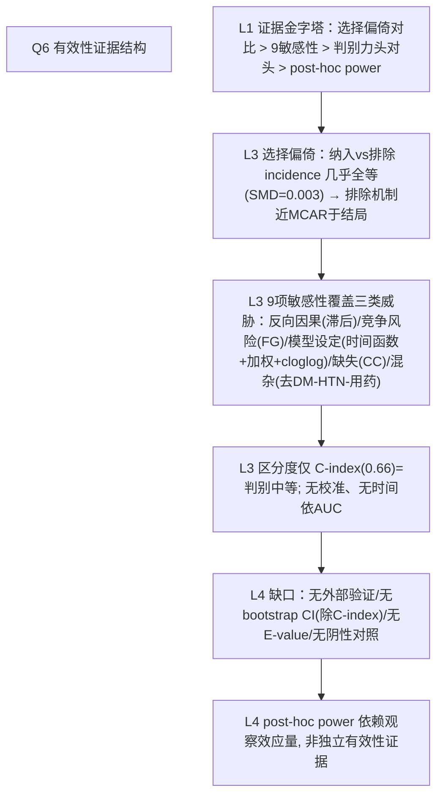

# 攻击任务（AI-B）

## 问题
Q6 论文如何证明分析有效？（内部验证AUC/C-index、bootstrap、交叉验证；外部验证队列；敏感性分析；阴性对照；E-value评估未测混杂）。证据强度如何？

## AI-A 决策树初稿全文

# AI-A Decision Tree Round 1

paper_id: paper_013
question_id: Q6
task_type: literature_decision_tree_reasoning
question: Q6 论文如何证明分析有效？（内部验证 C-index/bootstrap/CV；外部验证；敏感性分析；阴性对照；E-value）
source_file: adversarial_lit_reading/chunks/paper_013_joint_traj_tyg_cvd_elsa.md

## 1. Evidence Map

| evidence_id | location | evidence_summary | used_by_node |
|---|---|---|---|
| E1 | Supp Table 1 / Results L385–400 | 纳入 vs 排除（n=1808 vs 7624）基线对比：CVD  incidence 14.7% vs 14.8%（P=0.933, SMD=0.003）→选择偏倚方向性证据 | N1 |
| E2 | Results L1249–1273 + Supp Table 7 | **9 项敏感性分析**全部支持主结论：2年滞后、Fine-Gray、去DM/HTN、CC、去降糖降脂药、概率加权、cloglog、线/三次函数、中位数交叉分类 | N2 |
| E3 | Supp Table 8 / L1275–1287 | 区分度：C-index 0.663/0.660（复 CVD），头对头 ΔC=0.003 P=0.723；NRI/IDI 均不显著 | N3 |
| E4 | Results L786–793 | post-hoc power（卒中 65.2%/81.3%）量化次终点阴性 | N4 |
| E5 | Methods/Results | 无外部验证队列（单一 ELSA）；无 bootstrap/CV 内部验证；无校准曲线；无 E-value；无阴性对照 | N5 |
| E6 | Fig 4 log-rank 全部 P<0.001; Fig 5 BH-FDR 存活 | 内部一致性证据 | N6 |

## 2. Decision Tree - Mermaid

## 3. Node Table

| node_id | node_type | claim | evidence_location | evidence_summary | confidence | risk_tag |
|---|---|---|---|---|---|---|
| N0 | question | 如何证明有效？ | — | — | high | |
| N1 | method | 纳入 vs 排除全基线对比+结局率对比 | Supp Table 1; L385–400 | SMD=0.003 | high | |
| N2 | evidence | 9 敏感性全支持、方向量级不变 | Supp Table 7; L1249–1273 | 最高组 HR 4.62–5.52 | high | |
| N3 | evidence | C-index≈0.66 中等判别；两法无差异 | Supp Table 8 | ΔC P=0.723 | high | |
| N4 | method | post-hoc power 解释卒中阴性 | L786–793 | 65.2%/81.3% | medium | 逻辑跳跃 |
| N5 | limitation | 无外部验证/bootstrap/E-value/阴性对照 | 全文 | 单队列推断上限 | high | 可迁移性不足 |
| N6 | evidence | log-rank+BH-FDR 内部一致 | Fig 4/5 | 全存活 | high | |

## 4. Provisional Answer

有效性论证是"**稳健性重型、验证轻型**"：作者用 (a) 纳入 vs 排除人群全基线对比（结局率几乎相同，SMD=0.003）堵住选择偏倚质疑；(b) **9 项敏感性**系统覆盖反向因果（2 年滞后）、竞争风险（Fine–Gray）、模型设定（概率加权 Cox、cloglog、线/三次时间函数）、缺失（完整病例）、药物混杂（去降糖降脂使用者）、分类替代（中位数交叉）——全部方向与量级一致（最高组 HR 4.62–5.52）；(c) 两法头对头 ΔC/NRI/IDI 无差异。但缺外部验证队列（单 ELSA）、无 bootstrap/CV、无校准证据（C≈0.66 只讲判别）、无 E-value 量化未测混杂、无阴性对照。post-hoc power 用观察效应量反算，属自我循环，不算独立证据。

## 5. Uncertainty List

- U1: C-index 的 95%CI 来自何种方法（DeLong/bootstrap）未注明。
- U2: 9 项敏感性均只报"最高组 HR"，非单调或翻转的次级组风险未被披露。
- U3: NRI/IDI 参照模型（base model 含哪些变量）未定义，重分类指标解释力打折。

## 6. Follow-up Questions

1. 若加 E-value，HR≈5 对未测混杂的稳健阈值大约多少？（可复现时补算）
2. 时间依赖 AUC/IDI（Uno's）比全期 C-index 更贴合同伴随访设计，作者未做——复现时是否补充？

---

## 论文原文全文（chunk）

# Page 1

RESEARCH
Open Access
Cardiovascular Diabetology
Liu et al. Cardiovascular Diabetology          (2026) 25:207 
https://doi.org/10.1186/s12933-026-03279-w
Joint longitudinal trajectories of the 
triglyceride-glucose index combined with BMI 
and waist-to-height ratio and incident 
cardiovascular disease: a prospective cohort 
study from the English longitudinal study 
of ageing
Zhengyang Liu1†, Qiyu Li1†, Bo Wang1†, Ying Zhou1†, Yuanyuan Dong2†, Bo Tang3, Hongmei Yang1* and Shasha Yu1*
​​†​​Z​h​e​n​g​y​a​n​g Liu, Qiyu Li, Bo Wang, Ying Zhou and Yuanyuan Dong 
have contributed equally to this work.
*Correspondence:
Hongmei Yang
yanghongmei419@sina.cn
Shasha Yu
yuss@cmu1h.com
Full list of author information is available at the end of the article
© The Author(s) 2026. Open Access  This article is licensed under a Creative Commons Attribution-NonCommercial-NoDerivatives 4.0 
International License, which permits any non-commercial use, sharing, distribution and reproduction in any medium or format, as long as you 
give appropriate credit to the original author(s) and the source, provide a link to the Creative Commons licence, and indicate if you modified the 
licensed material. You do not have permission under this licence to share adapted material derived from this article or parts of it. The images or 
other third party material in this article are included in the article’s Creative Commons licence, unless indicated otherwise in a credit line to the 
material. If material is not included in the article’s Creative Commons licence and your intended use is not permitted by statutory regulation or 
exceeds the permitted use, you will need to obtain permission directly from the copyright holder. To view a copy of this licence, visit ​h​t​t​p​:​/​/​c​r​e​a​t​i​
v​e​c​o​m​m​o​n​s​.​o​r​g​/​l​i​c​e​n​s​e​s​/​b​y​-​n​c​-​n​d​/​4​.​0​/​.​
Abstract
Background  The triglyceride-glucose (TyG) index and its composite obesity indices have been linked to 
cardiovascular disease (CVD) risk. However, most prior studies relied on single baseline measurements, and few have 
employed group-based multi-trajectory modeling to capture concurrent longitudinal changes in metabolic and 
anthropometric indicators. This study aimed to identify joint longitudinal trajectory groups of TyG combined with 
body mass index (BMI) and waist-to-height ratio (WHtR) using parallel approaches and evaluate their associations 
with incident CVD in middle-aged and older adults.
Methods  This prospective cohort study included 1808 CVD-free participants aged ≥ 50 years from the English 
Longitudinal Study of Ageing. Group-based multi-trajectory modeling was applied to jointly identify latent trajectory 
classes using repeated measurements of TyG with BMI and TyG with WHtR across three waves over approximately 
8 years. Cox proportional hazards models with four sequential adjustment models estimated hazard ratios (HRs) 
and 95% confidence intervals (CIs) for incident composite CVD, heart disease, and stroke. Subgroup analyses were 
stratified by age, gender, smoking, diabetes, and hypertension status. Nine sensitivity analyses were conducted to 
assess robustness.
Results  During follow-up, 263 participants (14.5%) developed incident CVD. Four trajectory groups were identified 
for each approach. In fully adjusted BMI + TyG models, compared with the normal weight–low TyG reference group,

# Page 2

Page 2 of 18
Liu et al. Cardiovascular Diabetology          (2026) 25:207 
​Research Insights
What is currently known about this topic?
 	•
The triglyceride-glucose (TyG) index and its 
composite obesity indices (TyG-BMI, TyG-WC, 
TyG-WHtR) are established surrogate markers of 
insulin resistance and have been associated with 
cardiovascular disease (CVD) risk across diverse 
populations.
 	•
TyG-WC and TyG-WHtR generally demonstrate 
superior predictive performance for CVD compared 
with TyG-BMI in cross-sectional and single-
timepoint cohort studies.
 	•
Longitudinal trajectories of individual TyG-related 
indices provide better CVD prediction than single 
baseline measurements, but joint multi-trajectory 
approaches remain underexplored.
What is the key research question?
Are joint longitudinal trajectory groups of TyG com­
bined with BMI versus WHtR differentially associated 
with incident CVD in middle-aged and older adults?
What is new?
 	•
This is the first study to apply group-based multi-
trajectory modeling to simultaneously identify joint 
composite CVD risk increased progressively across the overweight–moderate TyG (HR 2.31, 95% CI 1.40–3.83), obese–
high TyG (HR 2.72, 95% CI 1.63–4.52), and severely obese–high TyG groups (HR 5.06, 95% CI 3.01–8.51). The WHtR + TyG 
approach demonstrated a consistent dose–response pattern, with HRs of 2.22, 2.75, and 5.12 for ascending risk 
groups. For stroke, only the highest-risk groups reached statistical significance (HR 6.74 and 5.00, respectively). Formal 
discriminative comparison showed no significant difference between the two approaches (C-statistic difference 0.003, 
P = 0.723). All nine sensitivity analyses consistently corroborated the primary findings.
Conclusions  Both approaches yield robust and comparable dose–response gradients, supporting further validation 
of serial TyG-related composite index monitoring for cardiovascular risk stratification in aging populations.
Keyword  Triglyceride-glucose index, Group-based multi-trajectory modeling, Cardiovascular disease, Obesity 
indicators, Longitudinal cohort study
Graphical abstract
inline-fig-Figa

# Page 3

Page 3 of 18
Liu et al. Cardiovascular Diabetology          (2026) 25:207 
longitudinal trajectories of TyG with BMI and TyG 
with WHtR within the same cohort.
 	•
Both approaches revealed strong dose–response 
associations with incident CVD, with hazard ratios 
reaching 5.06 and 5.12 in the highest-risk trajectory 
groups, respectively.
 	•
Smoking status significantly modified these 
trajectory-CVD associations in both modeling 
approaches.
How might this study influence clinical practice?
Serial monitoring of TyG-related composite indices 
through joint trajectory assessment may enable ear­
lier identification of high-risk individuals and support 
targeted cardiovascular prevention strategies in aging 
populations.
Introduction
Cardiovascular disease (CVD) remains the leading cause 
of mortality worldwide, accounting for approximately 
19.2 million deaths in 2023 and imposing an enormous 
economic burden estimated at €282 billion annually in 
the European Union alone [1, 2]. Despite considerable 
advances in prevention and treatment, the global preva­
lence of CVD has more than doubled since 1990, driven 
largely by population aging and rising metabolic risk fac­
tor exposure, particularly elevated body mass index and 
fasting plasma glucose [2, 3]. In China, the CVD burden 
is especially pronounced, with a crude incidence rate of 
620.33 per 100,000 reported in 2023, underscoring the 
urgent need for accessible and effective risk stratification 
tools [4].
Insulin resistance (IR) has been increasingly recog­
nized as a pivotal contributor to atherosclerosis and 
CVD pathogenesis. The triglyceride-glucose (TyG) index, 
calculated from fasting triglycerides and glucose, has 
emerged as a convenient surrogate marker of IR and has 
demonstrated significant associations with CVD inci­
dence and mortality across diverse populations [5, 6]. 
To further enhance predictive performance, research­
ers have combined the TyG index with anthropometric 
obesity indicators, generating composite indices such as 
TyG-BMI, TyG-WC, and TyG-WHtR. A recent meta-
analysis of 85 studies confirmed that per 1-SD increase, 
these composite indices were associated with 17–20% 
higher CVD risk and 22–32% higher cardiovascular mor­
tality risk, with TyG-WHtR and TyG-WC generally out­
performing TyG-BMI [7]. Several cohort studies have 
further demonstrated that longitudinal trajectories of 
TyG-related indices, rather than single baseline measure­
ments, provide superior predictive capacity for incident 
CVD [8–10]. Recent studies have also begun to compare 
multiple TyG-derived obesity indices simultaneously and 
to evaluate their longitudinal trajectories in relation to 
cardiovascular outcomes in prospective cohorts [11].
However, important gaps remain. While recent studies 
have advanced the field by examining longitudinal trajec­
tories of individual TyG-related composite indices, most 
have modeled TyG and obesity indicators as pre-com­
bined products (e.g., TyG-BMI as a single variable) rather 
than jointly modeling TyG and anthropometric measures 
as separate but concurrent trajectories, which may bet­
ter capture the independent and synergistic dynamics 
of metabolic and adiposity changes over time. Further­
more, few studies have directly compared BMI-based and 
WHtR-based approaches within the same cohort using 
formal discriminative metrics, leaving it unclear whether 
these two anthropometric dimensions provide differen­
tial predictive value for cardiovascular events [12, 13]. 
Additionally, the existing evidence derives predominantly 
from East Asian populations, and data from European 
older adult cohorts remain limited [14, 15].
Therefore, the present study aimed to identify joint 
longitudinal trajectory groups of TyG combined with 
BMI and TyG combined with WHtR using group-based 
multi-trajectory modeling in a prospective cohort of 
middle-aged and older adults from the English Longitu­
dinal Study of Ageing (ELSA). By jointly modeling TyG 
and anthropometric indicators as separate concurrent 
trajectories rather than using pre-combined composite 
indices, this approach allows the identification of latent 
subgroups defined by distinct patterns of metabolic and 
adiposity change. We sought to compare these two par­
allel approaches using formal discriminative metrics and 
evaluate their associations with incident composite CVD, 
heart disease, and stroke through Cox proportional haz­
ards regression, with comprehensive subgroup and sensi­
tivity analyses to assess robustness [16–18].
Materials and methods
Study design and population
This prospective cohort study utilized data from the 
English Longitudinal Study of Ageing (ELSA), a nation­
ally representative panel study of community-dwelling 
adults aged 50 years and older in England [19]. ELSA col­
lects data biennially through face-to-face interviews, self-
completion questionnaires, and nurse visits. Biomedical 
assessments, including fasting blood samples and anthro­
pometric measurements, were obtained during nurse 
visits conducted at even-numbered waves only (Waves 
2, 4, 6, etc.); these data were not collected at odd-num­
bered waves (Waves 3, 5). The present analysis used data 
from Wave 2 (2004–2005) as baseline through Wave 6 
(2012–2013) for trajectory modeling. Follow-up for inci­
dent CVD ascertainment began at Wave 2 and extended 
through Wave 9 (2018–2019), with events recorded at 
each subsequent wave. Only exposure data collected

# Page 4

Page 4 of 18
Liu et al. Cardiovascular Diabetology          (2026) 25:207 
membership is estimated rather than directly observed, 
posterior probability–weighted Cox models were addi­
tionally fitted as a sensitivity analysis to account for clas­
sification uncertainty.
Outcome ascertainment
The primary outcome was incident composite CVD, 
defined as a new diagnosis of heart disease (including 
heart attack, heart failure, angina, or heart rhythm disor­
der) or stroke reported during follow-up waves. Second­
ary outcomes were incident heart disease and incident 
stroke, analyzed separately. Outcomes were ascertained 
through self-reported physician diagnoses at each follow-
up wave interview. Because exact event dates were not 
available and events were reported between successive 
wave interviews, the data are interval-censored in nature. 
Follow-up time was calculated in months from the Wave 
2 interview date to the midpoint between the last event-
free wave and the wave at which the event was first 
reported, or to the end of follow-up (Wave 9), whichever 
occurred first. The median follow-up time was 11.2 years 
(interquartile range 8.4–13.6). Participants who died 
without a CVD event were censored at the time of death.
Covariates
Covariates were selected a priori based on clinical rele­
vance and existing literature [11]. Demographic variables 
included age (continuous), gender, race/ethnicity (White 
vs. non-White, based on ELSA harmonized masked race 
variable), and education level. Lifestyle factors included 
smoking status and drinking status. Comorbidities 
included hypertension, diabetes mellitus, hypercholester­
olemia, chronic lung disease, arthritis, osteoporosis, and 
cancer, all ascertained by self-report at baseline. Medi­
cation use was recorded from nurse visit medication 
inventories and included antihypertensive medication, 
antidiabetic medication (insulin and oral antidiabetic 
agents), and cholesterol-lowering medication. Choles­
terol-lowering medication data were obtained from Wave 
3 due to unavailability at Wave 2. Forced vital capac­
ity (FVC), measured in liters during the nurse visit, was 
included as a proxy for cardiorespiratory fitness. Depres­
sive symptoms were assessed using the eight-item Centre 
for Epidemiological Studies Depression Scale (CES-D 8), 
with a score of 3 or above indicating clinically significant 
depressive symptoms. The proportion of missing data 
for each covariate is reported in Supplementary Table 2. 
Missing values for education (8.68%), drinking status 
(4.81%), forced vital capacity (18.53%), and depressive 
symptoms (0.17%) were handled using multiple impu­
tation by chained equations (MICE) with 20 imputed 
datasets, and results were pooled using Rubin's rules. 
A complete case analysis was conducted as a sensitivity 
analysis.
prior to the first reported CVD event were used for tra­
jectory construction; post-event measurements were 
excluded (see Statistical Analysis for details). From an 
initial pool of 9432 participants at Wave 2, we excluded 
individuals aged below 50 years (n = 89), those with miss­
ing triglyceride-glucose index (TyG) data (n = 4125), 
missing body mass index (BMI) data (n = 1058), missing 
waist-to-height ratio (WHtR) data (n = 868), and those 
with prevalent CVD at baseline (n = 1484). The final ana­
lytic sample comprised 1808 participants free of CVD at 
baseline. The study population was predominantly White 
(98.7%), consistent with the demographic composition of 
ELSA. A comparison of baseline characteristics between 
included and excluded participants is presented in Sup­
plementary Table 1. This study was conducted in accor­
dance with the principles of the Declaration of Helsinki 
and followed the Strengthening the Reporting of Obser­
vational Studies in Epidemiology (STROBE) guidelines.
Exposure assessment
The TyG index was calculated as ln[fasting triglycerides 
(mg/dL) × fasting glucose (mg/dL)/2]. BMI was com­
puted as weight in kilograms divided by height in meters 
squared. WHtR was derived by dividing waist circum­
ference by standing height. All three indicators were 
measured at Waves 2, 4, and 6, providing three repeated 
assessments over approximately 8 years.
Group-based multi-trajectory modeling
We employed group-based multi-trajectory model­
ing (GBMTM) using the flexmix package in R to jointly 
identify latent trajectory classes over the repeated mea­
surements at Waves 2, 4, and 6. Two parallel model­
ing approaches were conducted: (1) BMI combined 
with TyG, and (2) WHtR combined with TyG. For each 
approach, both indicators were standardized using 
z-score transformation prior to model fitting. Quadratic 
polynomial functions of time were specified within each 
trajectory class, with Gaussian distributions assumed for 
both outcomes. Models were estimated for K = 2 through 
K = 6 groups. In addition to quadratic polynomials, linear 
and cubic time functions were evaluated as a sensitivity 
analysis. The optimal number of groups was determined 
by comparing BIC, AIC, entropy, average posterior prob­
ability of assignment (AvePP; threshold ≥ 0.80), odds of 
correct classification (OCC), minimum class proportion, 
and clinical interpretability. Detailed model fit indices 
for all candidate solutions are reported in Supplemen­
tary Table 4. The four-group solution (K = 4) was selected 
as optimal for both approaches. Trajectory groups were 
labeled according to their baseline metabolic-anthropo­
metric profiles in ascending risk order. Individuals were 
assigned to the trajectory group for which they had the 
highest posterior probability. Because trajectory group

# Page 5

Page 5 of 18
Liu et al. Cardiovascular Diabetology          (2026) 25:207 
Statistical analysis
Baseline characteristics were compared between par­
ticipants with and without incident CVD, and separately 
between included and excluded participants, using t-tests 
or Wilcoxon rank-sum tests for continuous variables and 
chi-squared or Fisher's exact tests for categorical vari­
ables. Standardized mean differences (SMDs) were cal­
culated to quantify between-group imbalances. Baseline 
characteristics stratified by trajectory group membership 
are presented in Tables 2 and 3. Cumulative incidence 
of cardiovascular outcomes across trajectory groups 
was estimated using the Kaplan–Meier method, with 
between-group differences assessed by log-rank tests. 
Cox proportional hazards regression models were used 
to estimate hazard ratios (HRs) with 95% confidence 
intervals for the association between trajectory group 
membership and incident CVD outcomes. Four sequen­
tial models were fitted: Model 1 adjusted for age, gender, 
race/ethnicity, and education level; Model 2 additionally 
adjusted for smoking status and alcohol consumption; 
Model 3 further adjusted for hypertension, diabetes mel­
litus, hypercholesterolemia, chronic lung disease, arthri­
tis, osteoporosis, and depressive symptoms; Model 4 
further adjusted for antihypertensive medication, antidi­
abetic medication, cholesterol-lowering medication, and 
forced vital capacity. The proportional hazards assump­
tion was assessed for all models using Schoenfeld residual 
tests, with both individual covariate-level and global tests 
reported. The lowest-risk trajectory group served as the 
reference category in all models. Subgroup analyses were 
performed stratified by age group (< 65 vs. ≥ 65  years), 
gender, education level, diabetes status, hypertension sta­
tus, and smoking status, with multiplicative interaction 
terms tested using likelihood ratio tests. Nine sensitivity 
analyses were conducted to evaluate the robustness of 
the primary findings: (1) excluding CVD events occur­
ring within the first 2 years of follow-up to minimize 
reverse causation; (2) Fine–Gray subdistribution haz­
ard regression treating non-CVD death as a competing 
event; (3) excluding participants with baseline diabetes 
or hypertension; (4) complete case analysis without mul­
tiple imputation; (5) excluding users of lipid-lowering 
or glucose-lowering medications to address potential 
confounding by pharmacological modification of TyG 
components; (6) posterior probability–weighted Cox 
models to account for uncertainty in trajectory group 
assignment; (7) complementary log–log regression mod­
els to address interval censoring of event times [20]; (8) 
re-estimation of trajectory models using alternative time 
functions (linear and cubic polynomials); and (9) cross-
classified analysis based on median-split BMI × TyG and 
WHtR × TyG categories to assess concordance between 
trajectory-based and categorical approaches. The Ben­
jamini–Hochberg false discovery rate (FDR) procedure 
was applied to adjust for multiple comparisons across 
trajectory groups. Statistical power for each trajectory 
group comparison was estimated post hoc. Discrimina­
tive performance of the BMI + TyG and WHtR + TyG 
approaches was formally compared using differences in 
Harrell's C-statistic, the net reclassification improvement 
(NRI), and the integrated discrimination improvement 
(IDI). All analyses were performed using R version 4.3.0, 
and two-sided P values less than 0.05 were considered 
statistically significant.
Results
Baseline characteristics
A total of 9432 ELSA participants were initially identi­
fied at Wave 2. After applying the exclusion criteria, 1808 
individuals free of CVD at baseline were included in the 
final analysis, of whom 263 (14.5%) developed incident 
CVD during follow-up (Fig. 1). A comparison of baseline 
characteristics between included (n = 1808) and excluded 
(n = 7624) participants is presented in Supplemen­
tary Table 1. The two groups were broadly similar with 
respect to age, gender, race/ethnicity, education, smok­
ing status, diabetes, and depression (all SMD < 0.12). 
Included participants were more likely to report alcohol 
consumption (94.6% vs. 91.9%, P < 0.001) and less likely to 
have hypertension (29.0% vs. 34.4%, P < 0.001) or arthri­
tis (29.8% vs. 33.3%, P = 0.005). Importantly, the incidence 
of CVD was virtually identical between the two groups 
(14.7% vs. 14.8%, P = 0.933, SMD = 0.003), suggesting that 
missingness was not substantially associated with the 
primary outcome. The proportion of missing data for 
each baseline covariate in the analytic sample is reported 
in Supplementary Table 2; most variables had no miss­
ing values, with the exceptions of forced vital capacity 
(18.53%), education (8.68%), drinking status (4.81%), and 
depression score (0.17%).
The baseline characteristics of the analytic sample strat­
ified by incident CVD status are presented in Table 1. The 
study population was predominantly White (98.7%). The 
median age was comparable between those who did and 
did not develop CVD (62.00 vs. 60.00  years, P = 0.401), 
and the gender distribution was well balanced (55.5% vs. 
57.0% female, P = 0.712). Participants who subsequently 
developed CVD had significantly higher baseline TyG 
index (median 8.63 vs. 8.55, P = 0.005), BMI (median 
28.90 vs. 26.89 kg/m2, P < 0.001), and WHtR (median 0.59 
vs. 0.56, P < 0.001). The prevalence of diabetes mellitus 
(4.6% vs. 2.1%, P = 0.034), hypercholesterolemia (21.7% 
vs. 15.4%, P = 0.014), and the use of oral antidiabetic med­
ication (3.4% vs. 1.3%, P = 0.023) and cholesterol-lower­
ing medication (20.5% vs. 15.0%, P = 0.027) were higher 
in the incident CVD group. No significant differences 
were observed for education, marital status, smoking,

# Page 6

Page 6 of 18
Liu et al. Cardiovascular Diabetology          (2026) 25:207 
drinking, hypertension, forced vital capacity, antihyper­
tensive medication use, or depression.
Temporal distributions of exposure variables
The distributions of TyG index, BMI, and WHtR across 
the study period are summarized in Supplementary 
Table 3 and Fig. 2A–C. The mean TyG index remained 
remarkably stable from Wave 2 (8.61 ± 0.51) to Wave 6 
(8.59 ± 0.48), whereas BMI showed a modest upward 
trend from 27.75 ± 4.73 to 28.14 ± 4.99 kg/m2. WHtR fol­
lowed a similar pattern, rising slightly from 0.57 ± 0.07 
to 0.58 ± 0.08. These temporal patterns indicated that 
metabolic status as reflected by TyG remained largely 
unchanged over the eight-year period, while anthro­
pometric indicators exhibited a gradual increasing 
tendency.
Identification of joint trajectory groups
GBMTM was applied to identify latent trajectory classes 
based on the repeated measurements. For the BMI + TyG 
approach, the four-group solution yielded the lowest AIC 
(24,235.7) and BIC (24,466.7) among all candidate models 
(K = 2–6) and was selected as optimal (Fig. 3A). Similarly, 
for the WHtR + TyG approach, the four-group solution 
demonstrated the best fit (AIC 25,612.5, BIC 25,843.4; 
Fig.  3B). Detailed model fit indices for K = 2–6 solu­
tions, including entropy, average posterior probability, 
odds of correct classification, and minimum class pro­
portion, are provided in Supplementary Table 4. For the 
selected four-group models, the average posterior prob­
abilities were 0.82 (BMI + TyG) and 0.81 (WHtR + TyG), 
with entropy values of 0.75 and 0.74, respectively, indi­
cating acceptable classification quality. In the BMI + TyG 
approach (Fig.  3C), the four groups were labeled as 
normal weight-low TyG (n = 339, 18.8%), overweight-
moderate TyG (n = 625, 34.6%), obese-high TyG (n = 556, 
30.7%), and severely obese-high TyG (n = 288, 15.9%). The 
WHtR + TyG approach (Fig. 3D) yielded non-abdominal 
obesity-low TyG (n = 211, 11.7%), mild abdominal obe­
sity-moderate TyG (n = 542, 30.0%), moderate abdominal 
obesity-high TyG (n = 694, 38.4%), and severe abdominal 
obesity-high TyG (n = 361, 20.0%). All trajectory groups 
maintained relatively stable levels across waves. The base­
line characteristics of participants stratified by trajectory 
group are presented in Table 2 (BMI + TyG) and Table 3 
(WHtR + TyG). In both approaches, higher-risk trajec­
tory groups were characterized by progressively greater 
prevalence of hypertension, diabetes mellitus, arthritis, 
and medication use (antihypertensive, antidiabetic, and 
cholesterol-lowering), as well as higher levels of depres­
sion and lower forced vital capacity, whereas education 
level decreased across ascending groups.
Cumulative incidence and cox regression analyses
Kaplan–Meier analysis revealed significant differences in 
cumulative incidence across trajectory groups for all out­
comes in both approaches (all log-rank P < 0.001; Fig. 4A–
F). In the BMI + TyG approach, event rates increased 
Fig. 1  Flow diagram of participant selection from the English Longitudinal Study of Ageing (ELSA)

# Page 7

Page 7 of 18
Liu et al. Cardiovascular Diabetology          (2026) 25:207 
Table 1  Baseline characteristics of the study population stratified by incident cardiovascular disease status
Characteristics
Category
Overall (n = 1808)
Non-CVD (n = 1545)
Incident CVD (n = 263)
P value
SMD
Age, years
61.00 [57.00, 67.00]
60.00 [57.00, 67.00]
62.00 [57.00, 67.00]
0.401
0.045
Gender
Female
1026 (56.7)
880 (57.0)
146 (55.5)
0.712
0.029
Male
782 (43.3)
665 (43.0)
117 (44.5)
Race/Ethnicity
White
1784 (98.7)
1524 (98.6)
260 (98.9)
1.000
0.020
Non-white
24 (1.3)
21 (1.4)
3 (1.1)
Education level
High
327 (18.5)
288 (19.1)
39 (15.1)
0.279
0.111
Low
492 (27.8)
414 (27.4)
78 (30.2)
Medium
948 (53.7)
807 (53.5)
141 (54.7)
Marital status
Divorced
221 (12.2)
189 (12.2)
32 (12.2)
0.817
0.065
Married
1349 (74.6)
1154 (74.7)
195 (74.1)
Single
75 (4.1)
66 (4.3)
9 (3.4)
Widowed
163 (9.0)
136 (8.8)
27 (10.3)
Smoking status
No
1610 (89.0)
1377 (89.1)
233 (88.6)
0.881
0.017
Yes
198 (11.0)
168 (10.9)
30 (11.4)
Drinking status
No
99 (5.6)
78 (5.2)
21 (8.0)
0.085
0.116
Yes
1672 (94.4)
1432 (94.8)
240 (92.0)
TyG index
8.57 [8.25, 8.94]
8.55 [8.23, 8.92]
8.63 [8.35, 9.01]
0.005
0.213
Body mass index, kg/m2
27.03 [24.54, 30.25]
26.89 [24.33, 29.74]
28.90 [25.88, 32.66]
 < 0.001
0.452
Waist-to-height ratio
0.56 [0.52, 0.61]
0.56 [0.51, 0.60]
0.59 [0.55, 0.65]
 < 0.001
0.506
Forced vital capacity, L
3.36 [2.77, 4.14]
3.36 [2.77, 4.18]
3.28 [2.76, 4.04]
0.389
0.036
Hypertension
No
1263 (69.9)
1091 (70.6)
172 (65.4)
0.103
0.112
Yes
545 (30.1)
454 (29.4)
91 (34.6)
Diabetes mellitus
No
1763 (97.5)
1512 (97.9)
251 (95.4)
0.034
0.135
Yes
45 (2.5)
33 (2.1)
12 (4.6)
Hypercholesterolemia
No
1513 (83.7)
1307 (84.6)
206 (78.3)
0.014
0.162
Yes
295 (16.3)
238 (15.4)
57 (21.7)
Cancer
No
1712 (94.7)
1462 (94.6)
250 (95.1)
0.890
0.019
Yes
96 (5.3)
83 (5.4)
13 (4.9)
Chronic lung disease
No
1746 (96.6)
1491 (96.5)
255 (97.0)
0.849
0.025
Yes
62 (3.4)
54 (3.5)
8 (3.0)
Arthritis
No
1267 (70.1)
1092 (70.7)
175 (66.5)
0.200
0.089
Yes
541 (29.9)
453 (29.3)
88 (33.5)
Osteoporosis
No
1750 (96.8)
1491 (96.5)
259 (98.5)
0.136
0.127
Yes
58 (3.2)
54 (3.5)
4 (1.5)
Antihypertensive medication
No
1613 (89.2)
1384 (89.6)
229 (87.1)
0.270
0.078
Yes
195 (10.8)
161 (10.4)
34 (12.9)
Antidiabetic medication
No
1778 (98.3)
1524 (98.6)
254 (96.6)
0.031
0.135
Yes
30 (1.7)
21 (1.4)
9 (3.4)
Insulin use
No
1805 (99.8)
1542 (99.8)
263 (100.0)
1.000
0.062
Yes
3 (0.2)
3 (0.2)
0 (0.0)
Oral antidiabetic medication
No
1779 (98.4)
1525 (98.7)
254 (96.6)
0.023
0.141
Yes
29 (1.6)
20 (1.3)
9 (3.4)
Cholesterol-lowering medication
No
1523 (84.2)
1314 (85.0)
209 (79.5)
0.027
0.146
Yes
285 (15.8)
231 (15.0)
54 (20.5)
Depression (CES-D 8 ≥ 3)
No
1526 (84.4)
1302 (84.3)
224 (85.2)
0.780
0.025
Yes
282 (15.6)
243 (15.7)
39 (14.8)
Values are presented as mean ± SD, median (IQR), or n (%). P values were calculated using t-test or Wilcoxon rank-sum test for continuous variables, and chi-squared 
test for categorical variables. SMD = standardized mean difference. Race was categorized as White vs Non-white based on ELSA harmonized masked race variable. 
Depression was defined as CES-D 8 score ≥ 3. Cholesterol-lowering medication data were obtained from Wave 3 due to unavailability at Wave 2. CVD composite 
endpoint includes heart disease, heart attack, heart failure, angina, heart rhythm disorder, and stroke

# Page 8

Page 8 of 18
Liu et al. Cardiovascular Diabetology          (2026) 25:207 
progressively from the lowest- to the highest-risk group: 
composite CVD ranged from 5.6% (19/339) in the normal 
weight–low TyG group to 27.1% (78/288) in the severely 
obese–high TyG group, heart disease from 5.0 (17/339) 
to 18.8% (54/288), and stroke from 1.8% (6/339) to 11.8% 
(34/288) (Table 2). A similar gradient was observed in the 
WHtR + TyG approach, with composite CVD rates span­
ning from 5.2 (11/211) to 25.5% (92/361), heart disease 
from 4.7 (10/211) to 19.7% (71/361), and stroke from 1.9 
(4/211) to 9.1% (33/361) (Table 3).
Cox proportional hazards regression analyses con­
firmed these associations across four progressively 
adjusted models (Figure 5 and Supplementary Table 5). 
The global Schoenfeld residual tests indicated no vio­
lation of the proportional hazards assumption for any 
model (all global P > 0.05). In the fully adjusted model 
(Model 4) of the BMI + TyG approach, the risk of 
Fig. 2  Ridge density plots showing the distributions of A TyG index, B BMI, and C WHtR across Waves 2, 4, and 6. Red diamonds indicate mean values; 
vertical lines within distributions represent medians

# Page 9

Page 9 of 18
Liu et al. Cardiovascular Diabetology          (2026) 25:207 
composite CVD rose progressively relative to the normal 
weight–low TyG reference group: overweight–moderate 
TyG (HR 2.31, 95% CI 1.40–3.83), obese–high TyG (HR 
2.72, 95% CI 1.63–4.52), and severely obese–high TyG 
(HR 5.06, 95% CI 3.01–8.51; all P ≤ 0.001). For heart dis­
ease, corresponding HRs were 2.48 (95% CI 1.46–4.22), 
2.66 (95% CI 1.55–4.56), and 3.78 (95% CI 2.15–6.65; all 
P ≤ 0.001). For stroke, only the severely obese–high TyG 
group reached statistical significance (HR 6.74, 95% CI 
2.75–16.54, P < 0.001), while the overweight–moderate 
TyG and obese–high TyG groups showed non-significant 
elevations (HR 1.81 and 2.06, respectively), consistent 
with limited statistical power for this endpoint (65.2% 
and 81.3%, respectively). All associations survived cor­
rection for multiple testing using the Benjamini–Hoch­
berg false discovery rate procedure (Fig. 5).
In the WHtR + TyG approach (Model 4), a consistent 
dose–response pattern emerged for composite CVD, with 
HRs of 2.22 (95% CI 1.16–4.24), 2.75 (95% CI 1.46–5.18), 
and 5.12 (95% CI 2.68–9.77) across ascending groups rel­
ative to the non-abdominal obesity–low TyG reference. 
For heart disease, significant associations were observed 
for mild abdominal obesity–moderate TyG (HR 2.14, 95% 
CI 1.08–4.22), moderate abdominal obesity–high TyG 
(HR 2.54, 95% CI 1.30–4.95), and severe abdominal obe­
sity–high TyG (HR 4.10, 95% CI 2.06–8.14). For stroke, 
only the severe abdominal obesity–high TyG group was 
statistically significant (HR 5.00, 95% CI 1.71–14.63, 
P = 0.003). These associations remained robust and con­
sistent in direction and magnitude across all four adjust­
ment models (Models 1–4), with minimal attenuation 
upon sequential addition of covariates including comor­
bidities and medication use.
Subgroup and sensitivity analyses
Subgroup analyses were conducted across strata of age 
(< 65 vs. ≥ 65  years), gender, smoking status, education 
level, hypertension, and diabetes mellitus (Supplemen­
tary Table 6). The dose–response gradient between tra­
jectory groups and composite CVD risk was broadly 
preserved across most strata in both approaches. Inter­
action tests identified significant effect modification by 
gender for heart disease in the WHtR + TyG approach 
(P for interaction = 0.021), and by hypertension for heart 
disease in the WHtR + TyG approach (P for interac­
tion = 0.020). In the WHtR + TyG approach, a significant 
interaction by education level was observed for stroke (P 
for interaction = 0.018). No significant interactions were 
Fig. 3  Model selection and trajectory visualization for group-based multi-trajectory modeling. A AIC and BIC values across K = 2–6 groups for BMI + TyG 
joint trajectories. B AIC and BIC values across K = 2–6 groups for WHtR + TyG joint trajectories. C Mean trajectories of BMI and TyG index across waves for the 
four identified trajectory groups (BMI + TyG approach). D Mean trajectories of WHtR and TyG index across waves for the four identified trajectory groups 
(WHtR + TyG approach). Shaded areas represent standard errors. Dashed horizontal lines indicate clinical reference thresholds

# Page 10

Page 10 of 18
Liu et al. Cardiovascular Diabetology          (2026) 25:207 
Characteristics
Category
Overall 
(n = 1808)
Normal 
weight-Low TyG 
(n = 339)
Overweight-
Moderate TyG 
(n = 625)
Obese-High 
TyG (n = 556)
Severely 
obese-High 
TyG (n = 288)
P value SMD
Age, years
61.00 [57.00, 
67.00]
61.00 [56.00, 
66.00]
62.00 [57.00, 
67.00]
61.00 [57.00, 
67.00]
59.00 [55.00, 
65.00]
0.001
0.146
Gender
Female
1026 (56.7)
228 (67.3)
318 (50.9)
288 (51.8)
192 (66.7)
 < 0.001
0.220
Male
782 (43.3)
111 (32.7)
307 (49.1)
268 (48.2)
96 (33.3)
Race/Ethnicity
White
1784 (98.7)
337 (99.4)
615 (98.4)
547 (98.4)
285 (99.0)
0.512
0.058
Non-white
24 (1.3)
2 (0.6)
10 (1.6)
9 (1.6)
3 (1.0)
Education level
High
327 (18.5)
87 (26.1)
118 (19.2)
84 (15.5)
38 (13.6)
 < 0.001
0.206
Low
492 (27.8)
71 (21.3)
160 (26.1)
168 (31.0)
93 (33.3)
Medium
948 (53.7)
175 (52.6)
335 (54.6)
290 (53.5)
148 (53.0)
Marital status
Divorced
221 (12.2)
40 (11.8)
78 (12.5)
68 (12.2)
35 (12.2)
0.232
0.142
Married
1349 (74.6)
245 (72.3)
466 (74.6)
419 (75.4)
219 (76.0)
Single
75 (4.1)
22 (6.5)
30 (4.8)
18 (3.2)
5 (1.7)
Widowed
163 (9.0)
32 (9.4)
51 (8.2)
51 (9.2)
29 (10.1)
Smoking status
No
1610 (89.0)
289 (85.3)
562 (89.9)
511 (91.9)
248 (86.1)
0.005
0.125
Yes
198 (11.0)
50 (14.7)
63 (10.1)
45 (8.1)
40 (13.9)
Drinking status
No
99 (5.6)
27 (8.0)
23 (3.7)
26 (4.8)
23 (8.2)
0.008
0.117
Yes
1672 (94.4)
311 (92.0)
591 (96.3)
513 (95.2)
257 (91.8)
TyG index
8.57 [8.25, 8.94]
8.27 [8.03, 8.59]
8.49 [8.24, 8.87]
8.71 [8.41, 9.05]
8.83 [8.50, 9.11]
 < 0.001
0.632
Body mass index, kg/m2
27.03 [24.54, 
30.25]
22.66 [21.23, 
23.45]
25.77 [24.81, 
26.63]
29.34 [28.26, 
30.55]
34.64 [32.80, 
37.21]
 < 0.001
2.913
Waist-to-height ratio
0.56 [0.52, 0.61]
0.48 [0.46, 0.51]
0.54 [0.51, 0.57]
0.59 [0.57, 0.62]
0.66 [0.63, 0.70]
 < 0.001
2.128
Forced vital capacity, L
3.36 [2.77, 4.14]
3.36 [2.82, 4.19]
3.54 [2.85, 4.26]
3.34 [2.80, 4.12]
3.02 [2.52, 3.77]
 < 0.001
0.257
Hypertension
No
1263 (69.9)
281 (82.9)
469 (75.0)
350 (62.9)
163 (56.6)
 < 0.001
0.340
Yes
545 (30.1)
58 (17.1)
156 (25.0)
206 (37.1)
125 (43.4)
Diabetes mellitus
No
1763 (97.5)
338 (99.7)
618 (98.9)
535 (96.2)
272 (94.4)
 < 0.001
0.195
Yes
45 (2.5)
1 (0.3)
7 (1.1)
21 (3.8)
16 (5.6)
Hypercholesterolemia
No
1513 (83.7)
292 (86.1)
510 (81.6)
467 (84.0)
244 (84.7)
0.290
0.065
Yes
295 (16.3)
47 (13.9)
115 (18.4)
89 (16.0)
44 (15.3)
Cancer
No
1712 (94.7)
324 (95.6)
598 (95.7)
515 (92.6)
275 (95.5)
0.078
0.066
Yes
96 (5.3)
15 (4.4)
27 (4.3)
41 (7.4)
13 (4.5)
Chronic lung disease
No
1746 (96.6)
324 (95.6)
604 (96.6)
539 (96.9)
279 (96.9)
0.721
0.038
Yes
62 (3.4)
15 (4.4)
21 (3.4)
17 (3.1)
9 (3.1)
Arthritis
No
1267 (70.1)
266 (78.5)
446 (71.4)
381 (68.5)
174 (60.4)
 < 0.001
0.209
Yes
541 (29.9)
73 (21.5)
179 (28.6)
175 (31.5)
114 (39.6)
Osteoporosis
No
1750 (96.8)
320 (94.4)
605 (96.8)
541 (97.3)
284 (98.6)
0.020
0.123
Yes
58 (3.2)
19 (5.6)
20 (3.2)
15 (2.7)
4 (1.4)
Antihypertensive 
medication
No
1613 (89.2)
320 (94.4)
565 (90.4)
487 (87.6)
241 (83.7)
 < 0.001
0.190
Yes
195 (10.8)
19 (5.6)
60 (9.6)
69 (12.4)
47 (16.3)
Antidiabetic medication
No
1778 (98.3)
339 (100.0)
622 (99.5)
541 (97.3)
276 (95.8)
 < 0.001
0.189
Yes
30 (1.7)
0 (0.0)
3 (0.5)
15 (2.7)
12 (4.2)
Insulin use
No
1805 (99.8)
339 (100.0)
625 (100.0)
553 (99.5)
288 (100.0)
0.080
0.052
Yes
3 (0.2)
0 (0.0)
0 (0.0)
3 (0.5)
0 (0.0)
Oral antidiabetic 
medication
No
1779 (98.4)
339 (100.0)
622 (99.5)
542 (97.5)
276 (95.8)
 < 0.001
0.188
Yes
29 (1.6)
0 (0.0)
3 (0.5)
14 (2.5)
12 (4.2)
Cholesterol-lowering 
medication
No
1523 (84.2)
305 (90.0)
531 (85.0)
460 (82.7)
227 (78.8)
0.001
0.166
Yes
285 (15.8)
34 (10.0)
94 (15.0)
96 (17.3)
61 (21.2)
Depression (CES-D 8 ≥ 3)
No
1526 (84.4)
293 (86.4)
536 (85.8)
472 (84.9)
225 (78.1)
0.014
0.114
Yes
282 (15.6)
46 (13.6)
89 (14.2)
84 (15.1)
63 (21.9)
Incident CVD
No
1545 (85.5)
320 (94.4)
544 (87.0)
471 (84.7)
210 (72.9)
 < 0.001
0.317
Yes
263 (14.5)
19 (5.6)
81 (13.0)
85 (15.3)
78 (27.1)
Incident heart disease
No
1585 (87.7)
322 (95.0)
548 (87.7)
481 (86.5)
234 (81.2)
 < 0.001
0.225
Yes
223 (12.3)
17 (5.0)
77 (12.3)
75 (13.5)
54 (18.8)
Table 2  Baseline characteristics of participants stratified by BMI + TyG joint trajectory groups

# Page 11

Page 11 of 18
Liu et al. Cardiovascular Diabetology          (2026) 25:207 
detected for age, diabetes, or smoking status in either 
approach for composite CVD or heart disease. Stroke-
specific subgroup analyses were limited by small event 
numbers in several strata, with many estimates non-esti­
mable, and should be interpreted with caution.
Nine sensitivity analyses consistently corroborated the 
primary findings (Supplementary Table 7). After exclud­
ing early CVD events within the first 2 years, applying 
Fine–Gray competing risk models, removing participants 
with baseline diabetes or hypertension, and conducting 
complete case analysis, the dose–response gradient was 
preserved, with the highest-risk group retaining HRs 
ranging from 4.62 to 5.52 for composite CVD across both 
approaches. Further analyses excluding users of lipid- or 
glucose-lowering medications yielded similar results (HR 
5.38 and 5.48 for the highest-risk groups in the BMI + TyG 
and WHtR + TyG approaches, respectively). Posterior 
probability–weighted Cox models, which accounted for 
uncertainty in trajectory group assignment, produced 
nearly identical estimates (HR 4.78 and 4.84). Comple­
mentary log–log models addressing interval censoring 
confirmed the robustness of the findings (HR 5.14 and 
5.20). Analyses using alternative time functions (linear 
and cubic polynomials) in the trajectory models yielded 
comparable results (HR 4.88 and 4.94). Finally, cross-
classified analyses based on median-split BMI × TyG and 
WHtR × TyG categories demonstrated that both high 
adiposity and high TyG independently contributed to 
elevated CVD risk, with the combined high–high group 
showing the strongest associations (HR 3.48 and 3.62 for 
composite CVD), supporting the concordance between 
the trajectory-based and categorical approaches. All P for 
trend were < 0.001 across sensitivity analyses.
Formal comparison of discriminative performance 
between the two trajectory approaches is presented in 
Supplementary Table  8. The C-statistics for composite 
CVD were 0.663 (95% CI 0.629–0.697) for the BMI + TyG 
approach and 0.660 (95% CI 0.626–0.694) for the 
WHtR + TyG approach, with a non-significant difference 
of 0.003 (P = 0.723). Similar patterns were observed for 
heart disease (0.652 vs. 0.650, P = 0.811) and stroke (0.704 
vs. 0.699, P = 0.685). The NRI and IDI comparisons also 
yielded no statistically significant differences between the 
two approaches for any endpoint (all P > 0.8).
Discussion
Summary of principal findings
In this prospective cohort study of 1808 middle-aged and 
older adults from the English Longitudinal Study of Age­
ing, we employed group-based multi-trajectory model­
ing to jointly identify four distinct longitudinal trajectory 
groups of TyG combined with BMI and TyG combined 
with WHtR over approximately 8 years. Our primary 
finding was that membership in higher-risk trajectory 
groups was associated with progressively elevated risks 
of incident composite CVD, heart disease, and stroke 
in a clear dose–response manner. In the fully adjusted 
BMI + TyG models (Model 4), the severely obese–high 
TyG group exhibited a 5.06-fold increased risk of com­
posite CVD compared with the normal weight–low TyG 
reference group, while the corresponding highest-risk 
group in the WHtR + TyG approach showed a 5.12-fold 
elevation. For stroke specifically, only the highest-risk 
trajectory groups reached statistical significance in both 
approaches, with hazard ratios of 6.74 and 5.00, respec­
tively, consistent with limited statistical power for this 
endpoint. Subgroup analyses revealed significant effect 
modification by gender and hypertension status for heart 
disease in the WHtR + TyG approach, and by education 
level for stroke. Formal comparison of discriminative 
performance showed no significant difference between 
the BMI + TyG and WHtR + TyG approaches (C-statistic 
difference 0.003, P = 0.723 for composite CVD). All nine 
sensitivity analyses consistently corroborated the primary 
findings, with hazard ratios for the highest-risk groups 
ranging from 4.62 to 5.62 for composite CVD across both 
approaches.
Comparison with cross-sectional and single-timepoint 
evidence
Our findings are broadly consistent with the growing 
body of evidence linking TyG-related composite indices 
to cardiovascular outcomes. In a cross-sectional analy­
sis of 11,937 NHANES participants, Dang et al. reported 
that TyG-WC and TyG-WHtR demonstrated superior 
diagnostic efficacy for CVD compared with TyG alone, 
with TyG-WHtR being the strongest predictor of CVD 
mortality (HR 1.66, 95% CI 1.21–2.29) [5]. Similarly, a 
UK Biobank study of 97,331 MASLD patients found that 
Characteristics
Category
Overall 
(n = 1808)
Normal 
weight-Low TyG 
(n = 339)
Overweight-
Moderate TyG 
(n = 625)
Obese-High 
TyG (n = 556)
Severely 
obese-High 
TyG (n = 288)
P value SMD
Incident stroke
No
1725 (95.4)
333 (98.2)
603 (96.5)
535 (96.2)
254 (88.2)
 < 0.001
0.212
Yes
83 (4.6)
6 (1.8)
22 (3.5)
21 (3.8)
34 (11.8)
Values are presented as mean ± SD, median (IQR), or n (%). P values were calculated using ANOVA or Kruskal–Wallis test for continuous variables, and chi-squared or 
Fisher's exact test for categorical variables. SMD = standardized mean difference. Race was categorized as White vs Non-white based on ELSA harmonized masked 
race variable. Depression was defined as CES-D 8 score ≥ 3. Cholesterol-lowering medication data were obtained from Wave 3 due to unavailability at Wave 2. CVD 
composite endpoint includes heart disease, heart attack, heart failure, angina, heart rhythm disorder, and stroke
Table 2  (continued)

# Page 12

Page 12 of 18
Liu et al. Cardiovascular Diabetology          (2026) 25:207 
Characteristics
Category
Overall 
(n = 1808)
Non-abdominal 
obesity-Low TyG 
(n = 211)
Mild abdomi­
nal obesity-
Moderate TyG 
(n = 542)
Moderate 
abdominal 
obesity-High 
TyG (n = 694)
Severe 
abdominal 
obesity-High 
TyG (n = 361)
P value SMD
Age, years
61.00 [57.00, 
67.00]
60.00 [56.00, 
65.00]
61.00 [57.00, 
66.00]
61.00 [57.00, 
67.00]
60.00 [56.00, 
67.00]
0.022
0.133
Gender
Female
1026 (56.7)
164 (77.7)
309 (57.0)
341 (49.1)
212 (58.7)
 < 0.001
0.313
Male
782 (43.3)
47 (22.3)
233 (43.0)
353 (50.9)
149 (41.3)
Race/Ethnicity
White
1784 (98.7)
210 (99.5)
533 (98.3)
684 (98.6)
357 (98.9)
0.608
0.064
Non-white
24 (1.3)
1 (0.5)
9 (1.7)
10 (1.4)
4 (1.1)
Education level
High
327 (18.5)
62 (30.4)
110 (20.6)
113 (16.7)
42 (12.0)
 < 0.001
0.291
Low
492 (27.8)
39 (19.1)
128 (23.9)
199 (29.4)
126 (35.9)
Medium
948 (53.7)
103 (50.5)
297 (55.5)
365 (53.9)
183 (52.1)
Marital status
Divorced
221 (12.2)
27 (12.8)
69 (12.7)
76 (11.0)
49 (13.6)
0.295
0.133
Married
1349 (74.6)
150 (71.1)
398 (73.4)
531 (76.5)
270 (74.8)
Single
75 (4.1)
12 (5.7)
30 (5.5)
25 (3.6)
8 (2.2)
Widowed
163 (9.0)
22 (10.4)
45 (8.3)
62 (8.9)
34 (9.4)
Smoking status
No
1610 (89.0)
187 (88.6)
484 (89.3)
630 (90.8)
309 (85.6)
0.085
0.084
Yes
198 (11.0)
24 (11.4)
58 (10.7)
64 (9.2)
52 (14.4)
Drinking status
No
99 (5.6)
19 (9.1)
21 (3.9)
33 (4.8)
26 (7.5)
0.014
0.124
Yes
1672 (94.4)
190 (90.9)
512 (96.1)
648 (95.2)
322 (92.5)
TyG index
8.57 [8.25, 8.94]
8.16 [7.95, 8.39]
8.43 [8.16, 8.75]
8.72 [8.41, 9.02]
8.83 [8.49, 9.14]
 < 0.001
0.831
Body mass index, kg/m2
27.03 [24.54, 
30.25]
22.39 [20.82, 
23.45]
24.99 [23.55, 
26.25]
28.19 [26.55, 
30.00]
33.26 [30.82, 
36.31]
 < 0.001
2.178
Waist-to-height ratio
0.56 [0.52, 0.61]
0.46 [0.44, 0.48]
0.52 [0.50, 0.54]
0.58 [0.56, 0.60]
0.66 [0.63, 0.69]
 < 0.001
3.016
Forced vital capacity, L
3.36 [2.77, 4.14]
3.31 [2.84, 4.04]
3.47 [2.88, 4.36]
3.44 [2.82, 4.15]
3.00 [2.50, 3.80]
 < 0.001
0.240
Hypertension
No
1263 (69.9)
179 (84.8)
421 (77.7)
468 (67.4)
195 (54.0)
 < 0.001
0.389
Yes
545 (30.1)
32 (15.2)
121 (22.3)
226 (32.6)
166 (46.0)
Diabetes mellitus
No
1763 (97.5)
211 (100.0)
534 (98.5)
679 (97.8)
339 (93.9)
 < 0.001
0.206
Yes
45 (2.5)
0 (0.0)
8 (1.5)
15 (2.2)
22 (6.1)
Hypercholesterolemia
No
1513 (83.7)
184 (87.2)
452 (83.4)
574 (82.7)
303 (83.9)
0.485
0.065
Yes
295 (16.3)
27 (12.8)
90 (16.6)
120 (17.3)
58 (16.1)
Cancer
No
1712 (94.7)
198 (93.8)
520 (95.9)
653 (94.1)
341 (94.5)
0.471
0.050
Yes
96 (5.3)
13 (6.2)
22 (4.1)
41 (5.9)
20 (5.5)
Chronic lung disease
No
1746 (96.6)
203 (96.2)
525 (96.9)
674 (97.1)
344 (95.3)
0.451
0.054
Yes
62 (3.4)
8 (3.8)
17 (3.1)
20 (2.9)
17 (4.7)
Arthritis
No
1267 (70.1)
168 (79.6)
396 (73.1)
487 (70.2)
216 (59.8)
 < 0.001
0.230
Yes
541 (29.9)
43 (20.4)
146 (26.9)
207 (29.8)
145 (40.2)
Osteoporosis
No
1750 (96.8)
199 (94.3)
516 (95.2)
680 (98.0)
355 (98.3)
0.002
0.134
Yes
58 (3.2)
12 (5.7)
26 (4.8)
14 (2.0)
6 (1.7)
Antihypertensive 
medication
No
1613 (89.2)
196 (92.9)
506 (93.4)
608 (87.6)
303 (83.9)
 < 0.001
0.180
Yes
195 (10.8)
15 (7.1)
36 (6.6)
86 (12.4)
58 (16.1)
Antidiabetic medication
No
1778 (98.3)
211 (100.0)
539 (99.4)
683 (98.4)
345 (95.6)
 < 0.001
0.185
Yes
30 (1.7)
0 (0.0)
3 (0.6)
11 (1.6)
16 (4.4)
Insulin use
No
1805 (99.8)
211 (100.0)
542 (100.0)
693 (99.9)
359 (99.4)
0.208
0.065
Yes
3 (0.2)
0 (0.0)
0 (0.0)
1 (0.1)
2 (0.6)
Oral antidiabetic 
medication
No
1779 (98.4)
211 (100.0)
539 (99.4)
684 (98.6)
345 (95.6)
 < 0.001
0.183
Yes
29 (1.6)
0 (0.0)
3 (0.6)
10 (1.4)
16 (4.4)
Cholesterol-lowering 
medication
No
1523 (84.2)
194 (91.9)
469 (86.5)
581 (83.7)
279 (77.3)
 < 0.001
0.221
Yes
285 (15.8)
17 (8.1)
73 (13.5)
113 (16.3)
82 (22.7)
Depression (CES-D 8 ≥ 3)
No
1526 (84.4)
182 (86.3)
466 (86.0)
591 (85.2)
287 (79.5)
0.037
0.094
Yes
282 (15.6)
29 (13.7)
76 (14.0)
103 (14.8)
74 (20.5)
Incident CVD
No
1545 (85.5)
200 (94.8)
481 (88.7)
595 (85.7)
269 (74.5)
 < 0.001
0.311
Yes
263 (14.5)
11 (5.2)
61 (11.3)
99 (14.3)
92 (25.5)
Table 3  Baseline characteristics of participants stratified by WHtR + TyG joint trajectory groups

# Page 13

Page 13 of 18
Liu et al. Cardiovascular Diabetology          (2026) 25:207 
TyG-WHtR yielded the highest hazard ratio for overall 
CVD incidence at 1.39 when comparing the highest to 
lowest quartiles, outperforming TyG-BMI and TyG-WC 
[12]. A meta-analysis by Rao et al. involving 871,728 sub­
jects confirmed that the highest TyG-BMI category was 
associated with a 62% increased CVD risk compared 
to the lowest category [18]. More recently, the most 
comprehensive meta-analysis to date, encompassing 
85 studies, demonstrated that per 1-SD increase, TyG-
WHtR and TyG-WC generally conferred greater risk 
increments than TyG-BMI for CVD incidence and car­
diovascular mortality [7]. Our study extends these find­
ings by demonstrating that the magnitude of association 
is substantially amplified when longitudinal trajec­
tory patterns rather than single baseline measurements 
are considered, with hazard ratios in the highest-risk 
Fig. 4  Cumulative incidence curves of cardiovascular outcomes by trajectory group. Left column: BMI + TyG trajectory groups; right column: WHtR + TyG 
trajectory groups. Rows from top to bottom: A, B composite CVD, C, D heart disease, E, F stroke. Shaded areas represent 95% confidence intervals. P values 
were derived from log-rank tests
 
Characteristics
Category
Overall 
(n = 1808)
Non-abdominal 
obesity-Low TyG 
(n = 211)
Mild abdomi­
nal obesity-
Moderate TyG 
(n = 542)
Moderate 
abdominal 
obesity-High 
TyG (n = 694)
Severe 
abdominal 
obesity-High 
TyG (n = 361)
P value SMD
Incident heart disease
No
1585 (87.7)
201 (95.3)
487 (89.9)
607 (87.5)
290 (80.3)
 < 0.001
0.249
Yes
223 (12.3)
10 (4.7)
55 (10.1)
87 (12.5)
71 (19.7)
Incident stroke
No
1725 (95.4)
207 (98.1)
525 (96.9)
665 (95.8)
328 (90.9)
 < 0.001
0.174
Yes
83 (4.6)
4 (1.9)
17 (3.1)
29 (4.2)
33 (9.1)
Values are presented as mean ± SD, median (IQR), or n (%). P values were calculated using ANOVA or Kruskal–Wallis test for continuous variables, and chi-squared or 
Fisher's exact test for categorical variables. SMD = standardized mean difference. Race was categorized as White vs Non-white based on ELSA harmonized masked 
race variable. Depression was defined as CES-D 8 score ≥ 3. Cholesterol-lowering medication data were obtained from Wave 3 due to unavailability at Wave 2. CVD 
composite endpoint includes heart disease, heart attack, heart failure, angina, heart rhythm disorder, and stroke
Table 3  (continued)

# Page 14

Page 14 of 18
Liu et al. Cardiovascular Diabetology          (2026) 25:207 
groups reaching 5.06–5.12, considerably exceeding those 
reported in cross-sectional or single-timepoint analyses.
Longitudinal trajectory approaches and added predictive 
value
A key contribution of our study lies in the application of 
joint multi-trajectory modeling, which captures the het­
erogeneity in concurrent metabolic and anthropometric 
changes over time. This approach aligns with emerging 
evidence that longitudinal assessment of TyG-related 
indices enhances CVD prediction beyond static base­
line values. Wang et al., using CHARLS data from 3505 
participants, demonstrated that longitudinal trajecto­
ries of TyG combined with obesity indices, particularly 
TyG-WC and TyG-CVAI, exhibited superior CVD risk 
assessment performance compared with baseline mea­
surements alone [9]. Feng et al. identified four distinct 
TyG-BMI trajectories and found that individuals in the 
high-stable group had 1.694-fold higher CVD odds than 
those in the low-stable group using longitudinal targeted 
maximum likelihood estimation [10]. Zhu et al. similarly 
reported that changes in TyG-WC showed the stron­
gest association with incident CVD, with progressive 
risk elevation across K-means-derived trajectory classes 
[8]. Furthermore, Ren et al. found that participants with 
high and slowly increasing TyG-WHtR trajectories had 
significantly elevated CVD risk (OR 1.58) compared to 
those with consistently low levels [15]. Zeng et al. con­
firmed that cumulative average TyG-WHtR indepen­
dently predicted incident CVD with an 18.3% higher risk 
per 1-SD increase [21]. Our study advances this literature 
by simultaneously comparing BMI-based and WHtR-
based trajectory approaches within the same cohort. For­
mal discriminative comparison using C-statistics, NRI, 
and IDI revealed no statistically significant differences 
between the two approaches for any cardiovascular end­
point (all P > 0.68), indicating that the two approaches 
provide comparable predictive performance in this popu­
lation of older adults.
Differential performance of BMI-based versus WHtR-based 
composite indices
The parallel comparison of BMI- and WHtR-based 
approaches represents a notable aspect of our analysis. 
Both approaches identified robust dose–response associ­
ations of comparable magnitude (Model 4 HRs for com­
posite CVD: 5.06 vs. 5.12 for the highest-risk groups), 
and formal discriminative comparisons confirmed no 
statistically significant differences in predictive perfor­
mance. This equivalence may reflect the distinct but 
complementary pathophysiological dimensions captured 
by these anthropometric measures. WHtR is recognized 
as a superior indicator of central adiposity compared 
with BMI, which cannot differentiate between lean and 
fat mass [22]. Park et al. reported in the Ansung-Ansan 
cohort that TyG-WC and TyG-WHtR showed signifi­
cantly higher C-indices than TyG-BMI for predicting 
new-onset CVD in non-diabetic participants, with TyG-
WC achieving the highest hazard ratio of 2.37 in the 
highest tertile [23]. In hypertensive populations, Li et al. 
Fig. 5  Forest plots of hazard ratios (95% CI) for the association between joint trajectory groups and incident cardiovascular outcomes. Results are pre­
sented for both BMI + TyG and WHtR + TyG approaches across three adjustment levels: Model 1 (age, gender, race/ethnicity, education), Model 2 (Model 
1 + smoking, drinking), Model 3 (Model 2 + hypertension, diabetes mellitus, hypercholesterolemia, chronic lung disease, arthritis, osteoporosis, depressive 
symptoms), and Model 4 (Model 3 + antihypertensive medication, antidiabetic medication, cholesterol-lowering medication, forced vital capacity). The 
lowest-risk trajectory group served as the reference category

# Page 15

Page 15 of 18
Liu et al. Cardiovascular Diabetology          (2026) 25:207 
found TyG-WHtR exhibited the strongest mortality asso­
ciations, with each 1-unit increase linked to 41.7% and 
48.1% higher risks of all-cause and cardiovascular mor­
tality, respectively [6]. He et al. confirmed that among 
MetS patients, TyG-WC demonstrated the strongest 
associations with total CVD incidence (HR 1.42 for high­
est vs. lowest quartile) and provided the greatest incre­
mental predictive value [17]. However, it is noteworthy 
that some studies have reported context-dependent 
variations. For instance, in COPD patients, TyG-BMI 
showed no significant association with all-cause mor­
tality whereas TyG-WHtR demonstrated the strongest 
and most consistent predictive value [24]. Additionally, 
among diabetic patients, Xiao et al. observed a U-shaped 
relationship between TyG-BMI and mortality, suggest­
ing that the prognostic utility of BMI-based indices may 
vary across metabolic subpopulations [25]. The recently 
proposed TyG-WWI has also shown promising predic­
tive capacity for cardiovascular mortality, achieving the 
highest AUC among TyG-related indices in NHANES 
data [14, 26]. These observations collectively support 
the notion that central obesity indicators integrated with 
metabolic markers may provide more nuanced cardio­
vascular risk stratification than BMI-based composites 
alone.
Nevertheless, it is important to note that in older 
adults, the interpretation of BMI is complicated by age-
related sarcopenia. BMI tends to decline after approxi­
mately age 65 due to loss of lean muscle mass, even as 
central and visceral adiposity increases. In our cohort, 
with a baseline age of ≥ 50 years and 8 years of follow-up, 
a substantial proportion of participants crossed the age-
65 threshold during the trajectory observation period. 
Age-driven BMI decline could therefore be misinter­
preted by the trajectory model as a favorable metabolic 
trajectory, and the normal weight–low TyG reference 
group may disproportionately include older individuals 
whose BMI fell due to sarcopenia rather than genuine 
metabolic improvement. WHtR is less susceptible to this 
age-related artifact because waist circumference tends 
to increase with age even as BMI falls, reflecting central 
fat redistribution. This differential susceptibility to sar­
copenic misclassification may partly explain why the two 
approaches yielded similar rather than divergent discrim­
inative performance in our older cohort, and should be 
considered when interpreting BMI-based trajectory find­
ings in aging populations. The age-stratified subgroup 
analyses showed no statistically significant interaction by 
age group in either approach (all P for interaction > 0.2), 
though the point estimates were somewhat attenuated in 
participants aged ≥ 65 years, which is consistent with this 
hypothesis.
Potential mechanisms and population-specific 
considerations
The biological plausibility of our findings is supported 
by converging mechanistic evidence. Insulin resistance, 
as reflected by the TyG index, promotes endothelial dys­
function, chronic inflammation, and atherogenic dys­
lipidemia, while central obesity further amplifies these 
pathways through visceral adipose tissue-mediated secre­
tion of pro-inflammatory cytokines and adipokines [27]. 
Hu et al. provided novel mechanistic insights by demon­
strating that biological age acceleration partially medi­
ates the associations between TyG-related obesity indices 
and incident CVD, with mediation proportions ranging 
from 10.03 to 25.46% [22]. The significant effect modifi­
cations observed in our study, including by gender and 
hypertension status for heart disease in the WHtR + TyG 
approach, are biologically plausible. Sex differences in fat 
distribution and hormonal regulation of insulin sensitiv­
ity may contribute to differential associations, while the 
interaction with hypertension status may reflect the het­
erogeneous metabolic effects of different antihyperten­
sive drug classes on TyG components, as both thiazide 
diuretics and beta-blockers can raise triglycerides and 
glucose levels whereas ACE inhibitors and ARBs have 
more neutral metabolic profiles. Notably, our findings in 
a European cohort complement the predominantly Asian 
evidence base. Most longitudinal TyG trajectory stud­
ies have utilized Chinese cohorts such as CHARLS [13, 
28, 29], and cross-sectional evidence has largely derived 
from NHANES [30–33]. Evidence from UK populations 
has primarily focused on baseline TyG measurements in 
the UK Biobank [34, 35]. Our use of ELSA data provides 
important validation that longitudinal TyG-obesity tra­
jectory associations with CVD are generalizable to older 
European populations.
Strengths and limitations
This study has several strengths. First, we employed 
group-based multi-trajectory modeling with three 
repeated measurements over 8 years, enabling the cap­
ture of joint longitudinal dynamics of metabolic and 
anthropometric indices that single-timepoint analyses 
cannot achieve. The classification quality of the selected 
four-group models was supported by average posterior 
probabilities of 0.82 and 0.81, with entropy values of 0.75 
and 0.74, and posterior probability–weighted Cox mod­
els yielded nearly identical results, confirming that uncer­
tainty in group assignment did not materially affect the 
findings. Second, the parallel comparison of BMI-based 
and WHtR-based approaches within the same cohort, 
supported by formal discriminative metrics (C-statis­
tics, NRI, IDI), provides direct quantitative evidence on 
the comparative utility of these composites. Third, com­
prehensive adjustment across four sequential models

# Page 16

Page 16 of 18
Liu et al. Cardiovascular Diabetology          (2026) 25:207 
incorporating demographics, lifestyle, comorbidities, 
and medication use, coupled with nine robust sensitiv­
ity analyses including competing risk models, interval-
censored models, exclusion of early events, exclusion of 
medication users, posterior probability–weighted mod­
els, alternative time functions, and cross-classified analy­
ses, strengthens confidence in the observed associations. 
Fourth, the ELSA cohort provides a nationally represen­
tative sample of older English adults, enhancing gener­
alizability to European populations. However, several 
limitations merit consideration. The final analytic sample 
of 1808 participants represents approximately 19% of the 
initial Wave 2 cohort, with the largest exclusion due to 
missing fasting blood data required for TyG calculation 
(n = 4125), which was only collected during nurse vis­
its and is unlikely to be missing completely at random. 
However, a formal comparison of baseline characteris­
tics between included and excluded participants showed 
no significant differences in age, gender, race/ethnicity, 
education, diabetes, or depression, and importantly, the 
CVD incidence was virtually identical between groups 
(14.7% vs. 14.8%, P = 0.933), suggesting that selection bias 
did not substantially affect the primary outcome. Statis­
tical power was limited for stroke analyses, where only 
the highest-risk groups reached significance (post hoc 
power estimates of 65–85% for intermediate groups). 
CVD outcomes were ascertained through self-reported 
physician diagnoses rather than adjudicated medical 
records or registry linkage, which may lead to outcome 
misclassification. Additionally, the absence of exact event 
dates means that the data are interval-censored between 
successive wave interviews; however, complementary 
log–log models explicitly accounting for this interval 
censoring produced results consistent with the standard 
Cox analyses. The trajectory modeling utilized only three 
timepoints at even-numbered waves, which constrains 
the ability to detect complex non-linear temporal pat­
terns. Notably, the identified trajectories remained rela­
tively stable across waves, suggesting that the groups may 
primarily reflect different baseline risk strata rather than 
meaningful longitudinal evolution. However, this stabil­
ity is consistent with the modest changes in BMI, WHtR, 
and TyG expected in this age group over an eight-year 
period, and cross-classified analyses based on baseline 
median-split categories yielded concordant results, sug­
gesting that the trajectory approach captures the same 
underlying risk stratification through a more robust lon­
gitudinal framework. Additionally, although Model 4 
adjusted for antihypertensive, antidiabetic, and choles­
terol-lowering medication use, and a sensitivity analysis 
excluding lipid- and glucose-lowering medication users 
confirmed the robustness of the findings, residual con­
founding from unmeasured factors such as habitual phys­
ical activity, cardiorespiratory fitness beyond forced vital 
capacity, dietary patterns, and heterogeneity in antihy­
pertensive drug classes cannot be excluded. Furthermore, 
because this is an observational study employing latent-
class methodology, the associations reported should be 
interpreted as predictive rather than causal.
Clinical implications and future directions
Our findings carry potential implications for cardio­
vascular risk stratification in aging populations, though 
several caveats apply. The demonstration that joint met­
abolic-anthropometric trajectories substantially outper­
form single-timepoint assessments in predicting CVD 
events supports the integration of serial monitoring of 
TyG-related composite indices into primary prevention 
strategies [1–4]. However, it should be acknowledged 
that trajectory membership can only be determined 
retrospectively after repeated measurements over sev­
eral years, and the clinical applicability of this approach 
would require the development and external validation 
of prospective prediction algorithms that can estimate 
trajectory membership from early measurements. The 
identification of distinct trajectory groups with markedly 
different CVD risks provides a framework for targeted 
interventions, particularly for individuals exhibiting per­
sistently elevated or increasing TyG-obesity trajectories. 
Future research should validate these trajectory-based 
risk models in larger, more diverse prospective cohorts 
with longer follow-up, incorporate objective CVD ascer­
tainment through medical records or registry linkage, 
and explore whether trajectory-guided interventions 
can modify cardiovascular risk. Additionally, emerging 
composite indices such as TyG-WWI[14]and TyG com­
bined with novel obesity markers like CVAI and BRI [9, 
36, 37] warrant investigation within the multi-trajectory 
framework to determine optimal composite indices for 
clinical risk prediction. External validation in larger, eth­
nically diverse cohorts with objective CVD ascertain­
ment through medical records or registry linkage, along 
with formal comparison against established CVD risk 
prediction tools, is needed before clinical implementa­
tion can be recommended.
Conclusions
In this prospective cohort study of middle-aged and 
older English adults, group-based multi-trajectory mod­
eling identified four distinct joint trajectory groups 
of TyG combined with BMI and TyG combined with 
WHtR, each demonstrating progressively elevated risks 
of incident composite CVD, heart disease, and stroke 
in a dose–response fashion. The highest-risk trajectory 
groups exhibited approximately five-fold to seven-fold 
increased hazard ratios for cardiovascular events com­
pared with the lowest-risk groups. Formal discrimina­
tive comparison showed no significant difference in

# Page 17

Page 17 of 18
Liu et al. Cardiovascular Diabetology          (2026) 25:207 
predictive performance between the two approaches. 
Both BMI-based and WHtR-based approaches yielded 
comparable predictive associations, and these findings 
remained robust across nine sensitivity analyses and 
multiple subgroup analyses. These results suggest that 
longitudinal joint trajectory assessment of metabolic and 
anthropometric indices may serve as a valuable tool for 
identifying individuals at elevated cardiovascular risk. 
External validation and development of prospective pre­
diction algorithms are warranted before incorporation 
into clinical cardiovascular risk stratification strategies 
for older adults.
Supplementary Information
The online version contains supplementary material available at ​h​t​t​p​s​:​/​/​d​o​i​.​o​r​
g​/​1​0​.​1​1​8​6​/​s​1​2​9​3​3​-​0​2​6​-​0​3​2​7​9​-​w​.​
Supplementary Material 1
Supplementary Material 2: Study timeline illustrating the temporal rela­
tionship between exposure assessment, trajectory construction, and out­
come follow-up. Biomedical assessments including fasting blood samples 
and anthropometric measurements (TyG index, BMI, and WHtR) were col­
lected during nurse visits at even-numbered waves only (Waves 2, 4, and 
6); no biomedical data were collected at odd-numbered waves (Waves 
3 and 5). Group-based multi-trajectory modeling (GBMTM) was applied 
using exposure data from Waves 2, 4, and 6 (approximately 2004–2013) to 
construct joint longitudinal trajectories, with only pre-event exposure data 
used for trajectory classification. Follow-up for incident cardiovascular dis­
ease (CVD) ascertainment began at the Wave 2 interview date (time zero) 
and extended through Wave 9 (2018–2019), with events recorded at each 
subsequent wave. The median follow-up time was 11.2 years (interquartile 
range 8.4–13.6). TyG, triglyceride-glucose; BMI, body mass index; WHtR, 
waist-to-height ratio; GBMTM, group-based multi-trajectory modeling; 
CVD, cardiovascular disease; IQR, interquartile range.
Acknowledgements
The authors would like to thank all participants and research staff involved 
in the English Longitudinal Study of Ageing (ELSA) for their valuable 
contributions to data collection.
Author contributions
ZL, QL, BW, YZ, and YD contributed equally to this work. ZL and QL conceived 
and designed the study. BW and YZ performed the data analysis and 
statistical modeling. YD contributed to data interpretation. BT assisted with 
methodology and critical revision. HY and SY supervised the study, provided 
critical intellectual input, and served as corresponding authors. ZL drafted 
the original manuscript. All authors reviewed, revised, and approved the final 
manuscript.
Data availability
The datasets used and analysed during the current study are publicly available 
from the UK Data Service (https://ukdataservice.ac.uk/). Access to ELSA data 
requires registration and approval through the UK Data Service.
Declarations
Ethics approval and consent to participate
The English Longitudinal Study of Ageing (ELSA) was approved by the London 
Multicentre Research Ethics Committee (MREC/01/2/91) and informed 
consent was obtained from all participants. This study was conducted in 
accordance with the principles of the Declaration of Helsinki.
Competing interests
The authors declare that they have no competing interests.
Author details
1Department of Cardiology, First Hospital of China Medical University, 155 
Nanjing North Street, Heping District, Shenyang 110001, China
2Department of Medical Ethics, China Medical University, Shenyang, 
China
3School of Medicine, University of Electronic Science and Technology 
of China, Sichuan Academy of Medical Sciences & Sichuan Provincial 
People’s Hospital, Chengdu, China
Received: 7 April 2026 / Accepted: 24 June 2026
References
1.	
Luengo-Fernandez R, Walli-Attaei M, Gray A, et al. Economic burden of cardio­
vascular diseases in the European Union: a population-based cost study. Eur 
Heart J. 2023;44(45):4752–67.
2.	
Global Burden of Cardiovascular D, Risks C. Global, regional, and national bur­
den of cardiovascular diseases and risk factors in 204 countries and territories, 
1990–2023. J Am Coll Cardiol, 86(22): 2167–2243.
3.	
Townsend N, Kazakiewicz D, Lucy Wright F, et al. Epidemiology of cardiovas­
cular disease in Europe. Nat Rev Cardiol. 2022;19(2):133–43.
4.	
Zheng C, Wang X, Gu R, et al. The Burden of cardiovascular disease in china: 
incidence estimates from national surveillance (2023). J Am Coll Cardiol. 
2025;87(12):1453–65.
5.	
Dang K, Wang X, Hu J, et al. The association between triglyceride-glucose 
index and its combination with obesity indicators and cardiovascular disease: 
NHANES 2003–2018[J]. Cardiovasc Diabetol. 2024;23(1):8.
6.	
Li C, Zhang Z, Luo X, et al. The triglyceride-glucose index and its obesity-
related derivatives as predictors of all-cause and cardiovascular mortality in 
hypertensive patients: insights from NHANES data with machine learning 
analysis. Cardiovasc Diabetol. 2025;24(1):47.
7.	
Liu H, Guo F, Fu H, et al. Associations of triglyceride-glucose-related compos­
ite obesity indices with cardiovascular diseases and mortality: a systematic 
review and meta-analysis. Cardiovasc Diabetol, 2026.
8.	
Zhu X, Xu W, Song T, et al. Changes in the combination of the triglyceride-
glucose index and obesity indicators estimate the risk of cardiovascular 
disease. Cardiovasc Diabetol. 2024;23(1):192.
9.	
Wang C, He S, Xie G, et al. Associations of longitudinal trajectories of 
triglyceride-glucose index combined with classical and novel obesity indices 
and cardiovascular disease: evidence from a nationwide prospective cohort 
study in China. Cardiovasc Diabetol. 2025;24(1):431.
10.	 Feng Y, Yin L, Huang H, et al. Assessing the impact of insulin resistance trajec­
tories on cardiovascular disease risk using longitudinal targeted maximum 
likelihood estimation. Cardiovasc Diabetol. 2025;24(1):112.
11.	 Zhu Z L, Hu H F. Association of 14 triglyceride-glucose (TyG)-related indices 
with new-onset cardiovascular disease in middle-aged and older adults: evi­
dence from the CHARLS and ELSA aging cohorts. Cardiovasc Diabetol, 2026.
12.	 Qiao Y, Wang Y, Chen C, et al. Association between triglyceride-glucose (TyG) 
related indices and cardiovascular diseases and mortality among individuals 
with metabolic dysfunction-associated steatotic liver disease: a cohort study 
of UK Biobank. Cardiovasc Diabetol. 2025;24(1):12.
13.	 Li F, Wang Y, Shi B, et al. Association between the cumulative average triglyc­
eride glucose-body mass index and cardiovascular disease incidence among 
the middle-aged and older population: a prospective nationwide cohort 
study in China. Cardiovasc Diabetol. 2024;23(1):16.
14.	 Qiu J, Li J, Xu S, et al. Triglyceride glucose-weight-adjusted waist index as a 
cardiovascular mortality predictor: incremental value beyond the establish­
ment of TyG-related indices. Cardiovasc Diabetol. 2025;24(1):306.
15.	 Ren Q, Huang Y, Liu Q, et al. Association between triglyceride glucose-
waist height ratio index and cardiovascular disease in middle-aged and 
older Chinese individuals: a nationwide cohort study. Cardiovasc Diabetol. 
2024;23(1):247.
16.	 Cheng Y, Wu S, Chen S, et al. Association of body mass index combined with 
triglyceride-glucose index in cardiovascular disease risk: a prospective cohort 
study. Sci Rep. 2025;15(1):17687.
17.	 He D, Huang Y, Ni X, et al. Prospective associations of triglyceride-glucose 
related indices with cardiovascular disease and mortality in individuals with 
metabolic syndrome: evidence from the UK biobank. Cardiovasc Diabetol. 
2026;25(1):53.

# Page 18

Page 18 of 18
Liu et al. Cardiovascular Diabetology          (2026) 25:207 
18.	 Rao X, Xin Z, Yu Q, et al. Triglyceride-glucose-body mass index and the 
incidence of cardiovascular diseases: a meta-analysis of cohort studies. 
Cardiovasc Diabetol. 2025;24(1):34.
19.	 Steptoe A, Breeze E, Banks J, et al. Cohort profile: the English longitudinal 
study of ageing. Int J Epidemiol. 2013;42(6):1640–8.
20.	 Dey T, Lipsitz S, Cooper Z, et al. A practical overview and statistical 
analysis of interval-censored data in cancer. Cancer Commun (Lond). 
2025;45(12):1666–9.
21.	 Zeng L, Zhao L, Wan J, et al. Cumulative average triglyceride glucose-waist 
height index and incident cardiovascular disease in middle-aged and older 
adults: a nationwide cohort study from the china health and retirement 
longitudinal study. PLoS ONE. 2026;21(2):e0333827.
22.	 Hu L, Li J, Tang Z, et al. How does biological age acceleration mediate the 
associations of obesity with cardiovascular disease? Evidence from interna­
tional multi-cohort studies. Cardiovasc Diabetol. 2025;24(1):209.
23.	 Park HM, Han T, Heo SJ, et al. Effectiveness of the triglyceride-glucose index 
and triglyceride-glucose-related indices in predicting cardiovascular disease 
in middle-aged and older adults: a prospective cohort study. J Clin Lipidol. 
2024;18(1):e70–9.
24.	 Yang J, Wang X, Gao J, et al. Association of triglyceride-glucose related 
indices with all-cause and cardiovascular mortality in patients with chronic 
obstructive pulmonary disease: a large prospective cohort study. Nutr J. 
2025;25(1):16.
25.	 Xiao S, Zhang Q, Yang HY, et al. The association between triglyceride 
glucose-body mass index and all-cause and cardiovascular mortality in 
diabetes patients: a retrospective study from NHANES database. Sci Rep. 
2024;14(1):13884.
26.	 Tu J, Wu B, Chen H, et al. Triglyceride glucose-weight-adjusted waist index 
(TyG-WWI): the best predictor of diabetes mellitus and mortality risks among 
TyG and TyG-derived indices. BMC Endocr Disord. 2025;25(1):166.
27.	 Yang Y, Li S, Ren Q, et al. The interaction between triglyceride-glucose index 
and visceral adiposity in cardiovascular disease risk: findings from a nation­
wide Chinese cohort. Cardiovasc Diabetol. 2024;23(1):427.
28.	 Lan H, Jia X, Zhao Z, et al. TyG and RC combined with CVD risk in CKM syn­
drome: a national cohort study. iScience. 2026;29(3):115060.
29.	 Li W, Shen C, Kong W, et al. Association between the triglyceride glucose-
body mass index and future cardiovascular disease risk in a population with 
cardiovascular-kidney-metabolic syndrome stage 0–3: a nationwide prospec­
tive cohort study. Cardiovasc Diabetol. 2024;23(1):292.
30.	 Wang R, Cheng X, Tao W. Association between triglyceride glucose body 
mass index and cardiovascular disease in adults: evidence from NHANES 
2011–2020. Front Endocrinol. 2024;15:1362667.
31.	 Zhang Z, Tan L. Association of insulin resistance-related indicators with 
cardiovascular disease in Chinese people with different glycemic states. Front 
Endocrinol. 2025;16:1515559.
32.	 Zheng D, Cai J, Xu S, et al. The association of triglyceride-glucose index and 
combined obesity indicators with chest pain and risk of cardiovascular dis­
ease in American population with pre-diabetes or diabetes. Front Endocrinol. 
2024;15:1471535.
33.	 Zhuang Y, Qiu L, Han D, et al. The association between triglyceride-glucose 
index and related parameters and risk of cardiovascular disease in American 
adults under different glucose metabolic states. Diabetol Metab Syndr. 
2024;16(1):102.
34.	 Davoodian N, Clayton-Chubb D, Berk M, et al. Associations of the triglyceride-
glucose index and its obesity-related derivative with all-cause mortality, 
cardiovascular events, and long-term survival and functioning in older adults. 
Arch Gerontol Geriatr. 2026;145:106191.
35.	 Zhang S, Liu W, Xu B, et al. Association of triglyceride glucose index and tri­
glyceride glucose-body mass index with sudden cardiac arrest in the general 
population. Cardiovasc Diabetol. 2024;23(1):173.
36.	 Fan X, Liang Y, Ge J, et al. Combined association of the triglyceride glucose 
index and body roundness index with cardiovascular disease in middle-aged 
and elderly persons with diabetes: a CHARLS-based cohort study. Front Nutr. 
2025;12:1724178.
37.	 Xie H, Yan C, Zheng Y, et al. Assessment of ten insulin resistance surrogate 
indexes predicts new-onset cardiovascular disease incidence in patients with 
prediabetes or diabetes: insights from CHARLS data with machine learning 
analysis. Glob Heart. 2026;21(1):17.
Publisher's Note
Springer Nature remains neutral with regard to jurisdictional claims in 
published maps and institutional affiliations.
