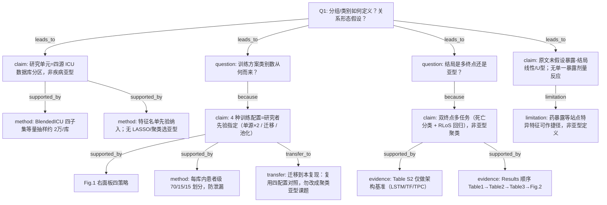

# User message for AI-B

## Question
研究问题 Q1：本研究预设了几个分组/亚型/类别？该数量是数据驱动的（如聚类定 K）还是研究者主观指定？是否假设了暴露-结局关系的方向（线性、单调、U 型）？

请严格依据原文攻击下方 AI-A 决策树。

## AI-A Round1 Decision Tree
# AI-A Decision Tree Round 1

paper_id: paper_025
question_id: Q1
task_type: literature_decision_tree_reasoning
question: 本研究预设了几个分组/亚型/类别？该数量是数据驱动还是研究者主观指定？是否假设了暴露-结局关系的方向（线性、单调、U型）？
source_file: adversarial_lit_reading/chunks/paper_025_allyn_2026_blended_los_pooling.md (+ MOESM1/MOESM2)

## 1. Evidence Map

| evidence_id | location | evidence_summary | used_by_node |
|---|---|---|---|
| E1 | Abstract / Methods | 四库（eICU / MIMIC-IV / AmsterdamUMC / HiRID）harmonized BlendedICU；TPC 联合预测 ICU 死亡 + RLoS | N1, N2 |
| E2 | Fig.1 / Methods | 四种训练配置为先验指定：①Amsterdam 单源；②MIMIC 单源；③迁移学习（MIMIC→Amsterdam）；④数据池化（MIMIC+Amsterdam 联合） | N3, N4 |
| E3 | Methods / Fig.1 Step3 | 患者级划分 train/val/test = 70%/15%/15%，非聚类定类 | N5 |
| E4 | Methods（two-stage RLoS） | RLoS 假定存活出院；死亡者评估时不计入 RLoS；损失为 BCE(mort)+α·MAPE(RLoS)，α=20 | N6, N7 |
| E5 | Additional File2 Table S2 | 架构对照 LSTM / Transformer / TPC，为方法基准而非亚型发现 | N8 |
| E6 | Results Table1–3 / Fig.2 | Results 按：队列描述→内外验落差→四训练方案 specialization/generalization→样本量效应 | N9 |
| E7 | Methods Feature Selection / MOESM1 | 特征为先验临床变量集（人口学+生命体征+实验室+17药+GCS/尿量），非数据驱动亚型 | N10 |
| E8 | Discussion / Methods | 无 LCA/聚类定 K；无暴露-结局线性/U型假设；预测任务为深度多任务，非回归剂量反应 | N11 |

## 2. Decision Tree - Mermaid

## 3. Node Table

| node_id | node_type | claim | evidence_location | evidence_summary | confidence | risk_tag |
|---|---|---|---|---|---|---|
| N0 | question | 分组来源与关系形态？ | Q1 | 根问题 | high | — |
| N1 | claim | 分区单位是数据库来源，不是临床亚型 | Abstract; Data source | 四库对照 | high | — |
| N2 | method | 每库约 20,000 例等量抽取 | Methods | BlendedICU 子集 | high | — |
| N3 | question | 训练方案类别是否数据驱动？ | Fig.1 | 设计问题 | high | — |
| N4 | claim | 四训练方案为先验实验设计，非聚类定 K | Fig.1; Table3 | ①–④ 明确列出 | high | — |
| N5 | method | 患者级 70/15/15 | Methods | 防泄漏 | high | — |
| N6 | question | 是否做亚型/多终点？ | Methods | 设计问题 | high | — |
| N7 | claim | 双终点多任务预测，非亚型发现 | Methods; loss α=20 | 死亡+RLoS | high | — |
| N8 | evidence | LSTM/Transformer/TPC 基准 | Additional File2 Table S2 | 架构比较 | high | — |
| N9 | evidence | Results 展开顺序 | Results | Table1–3, Fig.2 | high | — |
| N10 | method | 特征先验清单 | MOESM1 Input features | 无数据驱动亚型 | high | — |
| N11 | claim | 无线性/U型暴露-结局假设声明 | Methods/全文 | 深度学习预测任务 | high | — |
| N12 | limitation | 站点特异特征可导致捷径学习 | Results/Discussion | 药暴露等 | medium | 可迁移性不足 |
| N13 | transfer | 本复现应对齐四训练配置与双终点，勿改成聚类 | Q8 预告 | 复现口径 | medium | — |

## 4. Provisional Answer

本研究**没有**做数据驱动的亚型/聚类定 K。核心「类别」是研究者**先验指定**的：（1）四个数据源分区；（2）四种训练策略（两单源 + 迁移学习 + 数据池化）；（3）两个预测终点（ICU 死亡、条件存活下的 RLoS）。患者划分是固定比例 70/15/15。原文**未**声明暴露-结局的线性/单调/U 型剂量反应假设——任务是时序深度多任务预测，而非回归暴露效应曲线。

## 5. Uncertainty List

- 原文未给出「为何恰好选 Amsterdam + MIMIC 做池化/迁移、而以 eICU/HiRID 作未见外验」的形式化准则以外的细节是否还有其他候选配对。【原文未明确说明备选配对】
- RLoS cap=10 天与 α=20 的敏感性：主文有 Fig.2 样本量效应，但对 α 敏感性原文未系统报告。
- 本数据交付包注明 PI-3：原文精确 N（3574/10915/14489）构造式未完全公开，复现用同规则重抽而非逐例同一队列。

## 6. Follow-up Questions

- Q2：双终点如何联合报告、是否多重比较校正？
- Q3：为何选 TPC 而非 LSTM/Transformer（Table S2）？
- Q5：MNAR、前向填充+缺失指示、clip/归一化假设是否满足？
- Q8：如何把公开 BlendedLoS 代码接到四库真实提取包与本引擎 batch？

## Paper chunk (main)
# Page 1

RESEARCH
Open Access
Critical Care
Allyn et al. Critical Care          (2026) 30:364 
https://doi.org/10.1186/s13054-026-06034-5
Multi-source data integration through 
pooling and transfer learning improves 
generalizability and specialization of deep 
learning models for ICU mortality and length 
of stay prediction: a four-database external 
validation study
Jerome Allyn1,2*, Matthieu Oliver2, Raphaël Cerveau2, Nicolas Allou1, Tristan Barennes2 and Cyril Ferdynus2
​*​C​o​r​r​e​s​p​o​n​d​e​n​c​e​:​
Jerome Allyn
jerome.allyn@chu-reunion.fr
Full list of author information is available at the end of the article
© The Author(s) 2026. Open Access  This article is licensed under a Creative Commons Attribution-NonCommercial-NoDerivatives 4.0 
International License, which permits any non-commercial use, sharing, distribution and reproduction in any medium or format, as long as you 
give appropriate credit to the original author(s) and the source, provide a link to the Creative Commons licence, and indicate if you modified the 
licensed material. You do not have permission under this licence to share adapted material derived from this article or parts of it. The images or 
other third party material in this article are included in the article’s Creative Commons licence, unless indicated otherwise in a credit line to the 
material. If material is not included in the article’s Creative Commons licence and your intended use is not permitted by statutory regulation or 
exceeds the permitted use, you will need to obtain permission directly from the copyright holder. To view a copy of this licence, visit ​h​t​t​p​:​/​/​c​r​e​a​t​i​
v​e​c​o​m​m​o​n​s​.​o​r​g​/​l​i​c​e​n​s​e​s​/​b​y​-​n​c​-​n​d​/​4​.​0​/​.​
Abstract
Background  Most Artificial Intelligence prognostic models in intensive care are trained and validated on a single 
source, limiting their reliability in external settings. This study evaluated generalizability and specialization for ICU 
mortality and remaining length of stay (RLoS) prediction across international databases, and explored multi-source 
strategies to mitigate the performance cost of external deployment.
Methods  Using the Temporal Pointwise Convolution (TPC) architecture, we conducted external validation across 
four harmonized BlendedICU databases (eICU-CRD, MIMIC-IV, AmsterdamUMCdb, HiRID), extracting nearly 20,000 
unique patients from each. Four training configurations were compared: single-source training on AmsterdamUMC 
(N = 3,574) or MIMIC-IV (N = 10,915), data pooling, and transfer learning (both N = 14,489). Performance was assessed 
using AUROC and AUPRC for mortality, MAPE for RLoS, and a composite metric (Mcomposite).
Results  Internal validation consistently overestimated external performance, with MAPE increasing by up to 51.8% 
and AUROC dropping by up to 13.8% on external databases. Site-specific features such as drug exposure acted as 
“shortcuts” degrading portability. Data pooling emerged as the superior strategy, achieving the best generalization 
(Mcomposite improvement up to 8.0% over single-source models) while matching or outperforming transfer learning 
for specialization — particularly for RLoS (MAPE 84.49 vs. 89.24, non-overlapping confidence intervals).
Conclusion  Single-source training compromises clinical applicability. Data pooling across harmonized international 
cohorts is the most effective strategy for both generalization and specialization, supporting a “Data-Centric AI” 
approach. We advocate for the democratization of local ICU datasets and open-source customizable models to 
empower independent clinical validation.

# Page 2

Page 2 of 12
Allyn et al. Critical Care          (2026) 30:364 
​Introduction
Predictive models based on machine learning have shown 
considerable promise in intensive care unit (ICU) appli­
cations, ranging from mortality risk assessment to treat­
ment response classification [1–3]. However, a recurring 
weakness in the literature is the reliance on single-center 
datasets for both model derivation and validation [4–6]. 
This methodological choice is not merely a matter of con­
venience; it reflects a fundamental challenge in critical 
care data science: the lack of harmonization among major 
open-access databases. This fragmentation severely limits 
the feasibility of multi-center validation and hinders the 
assessment of cross-dataset generalization. While inter­
nal validation techniques are common, they often dem­
onstrate a model’s ability to fit retrospective data rather 
than its utility in clinical practice, where data distribu­
tions may significantly deviate from the training set [7, 8]. 
This lack of proven transferability remains a major bar­
rier to the clinical deployment of Artificial Intelligence.
The proliferation of electronic health records has led 
to several high-quality ICU research databases, such as 
eICU and MIMIC-IV from the United States, Amsterda­
mUMC from the Netherlands, and HiRID from Switzer­
land [9–12]. Despite the massive volume of available data, 
these sources remain largely siloed. The BlendedICU 
dataset addresses this gap by providing harmonized data 
across these four major repositories, enabling robust 
multi-source training and external validation strategies 
[13]. Despite these resources, external validation has his­
torically been scarce:, estimated at only 9% for mortality 
models as of 2021, and virtually non-existent for Remain­
ing Length of Stay (RLoS) [14]. While recent studies have 
begun to address this gap by conducting cross-database 
validation across the same four international ICU data­
bases for a range of clinical outcomes including sep­
sis, acute kidney injury, and length of stay, a systematic 
and quantified characterization of the performance cost 
incurred during external validation:, and of the strate­
gies best suited to mitigate it:, remains lacking [6, 15–
17]. Consequently, clinicians lack sufficient data on the 
model’s performance across different healthcare systems, 
where variations in equipment, clinical protocols, and 
patient demographics:, known as “domain shift”:, can sig­
nificantly reduce the accuracy of predictions [5, 18, 19]. 
Beyond a statistical concern, when a model is deployed 
at a new institution without external validation, its pre­
dictions may reflect spurious associations specific to the 
training site - such as local prescribing habits, measure­
ment frequencies, or case-mix characteristics - rather 
than generalizable physiological signals. When clinicians 
act on such predictions to adjust monitoring intensity, 
escalate or de-escalate treatment, or allocate scarce ICU 
beds, errors arising from undetected domain shift can 
lead to both over- and under-treatment, with potentially 
life-threatening consequences in a setting where deci­
sions must be made rapidly and under uncertainty.
To address these critical gaps, we present a compre­
hensive investigation of multi-source data integration to 
enhance both the generalization (performance on unseen 
institutions) and specialization (performance on a tar­
get institution) of deep learning models. Specifically, we 
focus on two clinically vital outcomes: ICU mortality and 
RLoS. Unlike static admission-time prediction scores, 
our model updates predictions continuously and hourly 
throughout the ICU stay, providing a dynamic trajectory 
of risk rather than a single estimate of a non-actionable 
outcome [20]. In this context, a rising mortality probabil­
ity can prompt escalation of monitoring or goals-of-care 
discussions; a decreasing remaining length of stay can 
trigger early discharge planning and bed management. 
From the patient and family perspective, anticipated 
duration of ICU stay is among the most frequently asked 
questions at admission. From an institutional standpoint, 
real-time length-of-stay forecasting is a key lever for 
bed management - a role that was made starkly evident 
during the COVID-19 pandemic, when predicted ICU 
occupancy directly informed capacity planning decisions 
across health systems.
Leveraging the harmonized BlendedICU framework 
and a deep learning model trained on hourly-sampled 
tabular time series data, this study aims to: (1) evaluate 
the generalizability of RLoS and mortality predictions 
by conducting the first systematic quantification of the 
performance cost; (2) compare multi-source training 
strategies, specifically analyzing the trade-offs between 
single-dataset training, data pooling, and transfer learn­
ing in terms of predictive performances; and (3) assess 
the impact of data volume by varying the size of training 
samples to determine the amount of data required (cost/
benefit balance).
By addressing these objectives, this work seeks to 
provide practical insights into the requirements for 
deploying AI models that remain reliable across diverse 
institutional contexts, moving beyond retrospective per­
formance toward clinical applicability.
Methods
This study is reported according to the TRIPOD + AI 
guidelines [21]. All code is available at ​h​t​t​p​s​:​/​/​g​i​t​h​u​b​.​c​o​m​
/​C​I​C​-​1​4​1​0​/​B​l​e​n​d​e​d​L​o​S​.​
Keywords  Intensive care unit, Length of stay, Artificial intelligence, Deep learning, Machine learning, Prediction, 
Validation, Bias

# Page 3

Page 3 of 12
Allyn et al. Critical Care          (2026) 30:364 
Ethics statement
Datasets were observational and had preexisting ethi­
cal approvals or exemptions that allowed for retrospec­
tive analysis [9–12]. Access was obtained following the 
respective requirements for each dataset.
Data source
We used the BlendedICU dataset, which harmonizes 
data from four major publicly available ICU databases: 
MIMIC-IV (USA), eICU-CRD (USA), HiRID (Switzer­
land), and AmsterdamUMCdb (Netherlands) [9–13]. 
Nearly 20,000 unique patients were extracted from each 
of the four subsets, yielding a total of approximately 
80,000 patients. Input variables included hourly-sam­
pled vital signs, laboratory values, drug exposures, and 
clinical scores derived from electronic health records 
(as detailed in Additional File 1). Diagnoses were not 
included, as they are not consistently available across all 
four databases.
Data preprocessing
Missing data were handled using forward-filling com­
bined with missingness indicator masks, a strategy 
appropriate for the Missing Not At Random (MNAR) 
structure of ICU data [22–24]. Prior to normalization, 
extreme values were clipped to physiologically plausible 
ranges, limiting the influence of outliers on model train­
ing. Full details of the preprocessing pipeline, including 
distribution statistics before and after clipping, are pro­
vided in Supplementary Table S1 (Additional File 1).
Outcome definition
Two outcomes were predicted jointly at hourly intervals 
throughout each ICU stay: in-ICU mortality (defined as 
death before ICU discharge) and remaining length of stay 
(RLoS), defined as time to discharge conditional on sur­
vival. Outcomes were predicted from 5 h after admission 
onward.
Model
We used the Temporal Pointwise Convolution (TPC) 
architecture, a deep learning model specifically designed 
for ICU time series data that has demonstrated superior 
performance over alternative architectures for joint mor­
tality and RLoS prediction [25]. Prior to adopting TPC, 
we benchmarked three state-of-the-art architectures - 
Transformer, Long Short-Term Memory (LSTM), and 
TPC - on our two-stage prediction task across all four 
BlendedICU databases. TPC outperformed both alter­
natives on most subsets and both prediction tasks; full 
results are provided in Additional File 2 (Table S2). Data 
were split at the patient level into training (70%), valida­
tion (15%), and test (15%) sets to prevent data leakage.
Performance evaluation
Model discrimination for mortality was assessed using 
the Area Under the Receiver Operating Characteristic 
curve (AUROC) and the Area Under the Precision-Recall 
Curve (AUPRC). RLoS accuracy was assessed using the 
Mean Absolute Percentage Error (MAPE). A composite 
metric (Mcomposite) was introduced to jointly summa­
rize performance across both tasks, normalized to the 
internal validation baseline of each model: a value below 
1 indicates improvement over the internal baseline, and 
a value above 1 indicates degradation. The composite 
metric was used for cross-configuration ranking only; 
AUROC and MAPE remain the primary performance 
metrics.
Specialization and generalization
Two properties were evaluated. Specialization refers to 
model performance on a site seen during training - the 
most relevant property for deploying a model in a known 
clinical environment. Generalization refers to perfor­
mance on entirely unseen sites - the key property for a 
model intended for broad deployment across institutions. 
Four training configurations were compared: single-
source training on AmsterdamUMC alone (N = 3,574), 
single-source training on MIMIC-IV alone (N = 10,915), 
transfer learning (pre-training on MIMIC-IV then fine-
tuning on AmsterdamUMC, N = 14,489), and data pool­
ing (joint training on both, N = 14,489). Generalization 
was strictly evaluated on the held-out eICU and HiRID 
databases, which were never used during training. The 
full study pipeline is illustrated in Fig.  1. A detailed 
description of all methodological steps, including prepro­
cessing, model architecture, loss function, and statistical 
methods, is provided in Additional File 1.
Results
Patient stay
Table  1 presents certain characteristics of the 19,573 
patients included in the present study and their ICU stays 
according to their inclusion in the four open databases. 
Some characteristics varied considerably between the 
original databases, sometimes by a factor of two such 
as ICU mortality (5.5% in eICU and 9.8% in Amster­
damUMC), or length of stay in ICU (49.5 [standard 
deviation = 64.2] hours in HiRID and 77.9 [standard devi­
ation = 99.0] hours in AmsterdamUMC). Similarly, we 
observed great variations in medication exposure, such 
as the use of dopamine, which ranged from 0% in HiRID 
to 31% at AmsterdamUMC, or norepinephrine, which 
ranged from 11.6% in eICU to 35.4% at AmsterdamUMC. 
Distribution summary statistics before and after clipping 
of extreme values to physiologically plausible ranges and 
normalization-space clipping are provided in Additional 
File 1, Table S1.

# Page 4

Page 4 of 12
Allyn et al. Critical Care          (2026) 30:364 
AmsterdamUMC showed a + 4.4% improvement in 
AUROC on external data, suggesting that this training 
source may generalize particularly well to other data­
bases. The MAPE of RLoS prediction varied from − 0.3% 
to + 51.8% depending on the training set used; AUROC 
dropped by up to 13.8% for mortality prediction, with 
Comparison of the internal and external validations
A comparison of the internal and external validations 
of the TPC model with training on each data source is 
shown in Table 2. Internal validation generally overesti­
mated the model’s capability on external data, although 
one exception was observed: the model trained on 
Fig. 1  Overview of the study pipeline and training strategies. The workflow proceeds in seven sequential steps (left panel). Step 1: data were extracted 
from the BlendedICU framework, which harmonizes four open-access international ICU databases (MIMIC-IV, eICU-CRD, HiRID, and AmsterdamUMCdb). 
Step 2: preprocessing included clipping of extreme values to physiologically plausible ranges, handling of Missing Not At Random (MNAR) data using 
forward-filling imputation with missingness indicator masks, and normalisation. Step 3: data were split at the patient level (training 70% / validation 15% 
/ test 15%) to prevent data leakage. Step 4: a Temporal Pointwise Convolution (TPC) deep learning model was trained to jointly predict in-ICU mortality 
and remaining length of stay (RLoS). Step 5: internal validation was performed on the held-out test set from the same database, using the Area Under the 
Receiver Operating Characteristic curve (AUROC) and the Area Under the Precision-Recall Curve (AUPRC) for mortality, and the Mean Absolute Percentage 
Error (MAPE) for RLoS. Step 6: external validation was performed across four training strategies (right panel): (①) single-source training on AmsterdamUMC 
alone (N = 3,574); (②) single-source training on MIMIC-IV alone (N = 10,915); (③) transfer learning, with pre-training on MIMIC-IV followed by fine-tuning on 
AmsterdamUMC (N = 14,489) - evaluated for specialization on AmsterdamUMC only; (④) data pooling, with joint training on both MIMIC-IV and Amsterda­
mUMC (N = 14,489) - evaluated on all three sets. Specialization refers to performance on a site seen during training; generalization refers to performance 
on the unseen eICU and HiRID databases. A composite metric (Mcomposite) was introduced to jointly summarize mortality and RLoS performance relative 
to the internal validation baseline. Step 7: the model produces two outputs, updated hourly for each patient - predicted in-ICU mortality risk (probability) 
and predicted remaining length of stay (days, conditional on survival). AUROC: Area Under the Receiver Operating Characteristic curve; AUPRC: Area 
Under the Precision-Recall Curve; MAPE: Mean Absolute Percentage Error; MNAR: Missing Not At Random; RLoS: Remaining Length of Stay; TPC: Temporal 
Pointwise Convolution

# Page 5

Page 5 of 12
Allyn et al. Critical Care          (2026) 30:364 
three out of four training sources showing a decline. 
Notably, the model trained on AmsterdamUMC shows 
the largest MAPE increase (+ 51.8%). AUPRC values for 
mortality prediction, reported alongside their no-skill 
baseline (equal to the in-ICU mortality prevalence in each 
dataset), confirm and amplify the pattern observed for 
AUROC. All models substantially outperformed random 
prediction in both internal and external settings, with 
AUPRC values ranging from 2.5 to 4.5 times above the 
no-skill baseline. However, the degradation from internal 
Table 1  Characteristics of ICU patient stays included in the study, according to the original database
Characteristics
eICU
AmsterdamUMC
HiRID
MIMIC-IV
Multi-centric database
Yes (N = 238)
No
No
No
Patients, n
19,573
19,573
19,573
19,573
ICU Stays, n1
27,515
20,751
19,573
28,227
Demographics*
Age (years), mean [SD]
63.2 [17.4]
56.5 [17.4]
63.6 [15.2]
63.4 [17.2]
Sex, n (%)
  • Female
8,887 (45.4%)
6,667 (34.1%)
6,955 (35.5%)
8,664 (44.3%)
  • Male
10,672 (54.5%)
12,456 (63.6%)
12,618 (64.5%)
10,909 (55.7%)
  • Unknown
14 (0.1%)
450 (2.3%)
-
-
Height (cm), mean [SD]
169.4 [13.5]
170.6 [8.7]
171.2 [8.6]
168.9 [15.6]
Weight (kg), mean [SD]
83.6 [26.0]
76.0 [13.5]
76.8 [15.2]
81.6 [49.0]
ICU LoS (hours), mean [SD]
61.6 [68.9]
77.9 [99.0]
49.5 [64.2]
75.6 [78.5]
ICU LoS > 10 days, n (%)
1,192 (4.3%)
2,387 (11.5%)
674 (3.4%)
1,851 (6.6%)
ICU mortality, n (%)
1,521 (5.5%)
2,033 (9.8%)
1,209 (6.2%)
2,061 (7.3%)
Continuous Variables
Vitals, mean [SD]
  • Heart rate (/min)
87.0 [19.3]
86.0 [19.8]
84.6 [17.2]
87.1 [19.5]
  • Invasive Systolic Arterial pressure (mmHg)
117.7 [20.1]
129.9 [28.5]
119.7 [24.9]
121.1 [24.4]
  • O² Saturation in Arterial blood (%)
96.3 [2.9]
91.9 [10.0]
96.5 [3.06]
82.3 [16.8]
  • Temperature (°C)
37.1 [0.9]
36.6 [0.9]
37.19 [0.9]
37.0 [0.7]
Laboratory, mean [SD]
  • pH
7.37 [0.1]
7.38 [0.09]
7.42 [0.07]
7.38 [0.09]
  • Platelets count (G/L)
198.2 [19.3]
198.1 [128.8]
190.2 [126.1]
195.6 [119.2]
Unit Type2 n (%)
  • Cardiac
3,847 (13.98%)
1,222 (5.89%)
-
7,619 (26,99%)
  • Gastrosurgery
-
1,200 (5.78%)
-
-
  • Medical
2,350 (8.54%)
1,013 (4.89%)
-
6,020 (21.33%)
  • Medical-Surgical
15,521 (56.41%)
-
-
4,954 (17.55%)
  • Neurological
1,996 (7.25%)
2,889 (13.92%)
-
1,885 (6.68%)
  • Other
-
3,937 (18.97%)
-
-
  • Surgical
3,801 (13.81%)
8,234 (39.68%)
-
4,348 (15.4%)
  • Trauma
-
1,095 (5.28%)
-
3,401 (12.05%)
  • Unknown
-
1,013 (5.59%)
19,573 (100%)
-
Drug Exposure3, n (%)
• Dobutamine
394 (1.4%)
1,283 (6.2%)
2,542 (13.0%)
394 (1.4%)
• Dopamine
601 (2.2%)
6,504 (31.3%)
-
711 (2.5%)
• Epinephrine
574 (2.01%)
-
1,933 (9.9%)
1,206 (4.3%)
• Fentanyl
5,296 (19.2%)
7,151 (34.5%)
15,340 (78.4%)
8,260 (29.3%)
• Furosemide
5,927 (21.5%)
5,320 (25.6%)
5,024 (25.7%)
8,839 (31.3%)
• Midazolam
2,851 (10.4%)
4,249 (20.5%)
4,537 (23.2%)
3,965 (14.0%)
• Norepinephrine
3,204 (11.6%)
7,336 (35.4%)
6,313 (32.3%)
4,839 (17.1%)
• Propofol
3,535 (12.8%)
13, 819 (66.6%)
10,707 (54.7%)
9,457 (33.5%)
Values represent mean ± standard deviation unless otherwise indicated. For time series variables with multiple hourly recordings per ICU stay, summary statistics 
were computed at the stay level: the mean value across all available time points within a stay was first calculated, and Table 1 presents the distribution of these 
per-stay means across the cohort. This approach avoids pseudo replication arising from repeated measurements and is standard for cohort characterisation of 
longitudinal clinical data. Categorical variables are presented as n (%). ¹No patient identifier nor Unit Type is provided in the HiRID database; each stay was therefore 
considered as a unique patient. ²Values are presented as a percentage of the source database ICU stays. ³Number of ICU stays where a drug was administered at 
least once. *Demographic variables (age, sex, height, weight) are aggregated at the unique patient level; all other variables are aggregated at the ICU stay level. ICU: 
Intensive Care Unit; LoS: Length of Stay; SD: Standard deviation. A dash (–) represents a value not available in the source database

# Page 6

Page 6 of 12
Allyn et al. Critical Care          (2026) 30:364 
to external validation was more pronounced for AUPRC 
than for AUROC, with drops ranging from − 3.3% 
(AmsterdamUMC) to − 40.8% (MIMIC-IV), reflecting 
the greater sensitivity of AUPRC to distributional shift 
in the presence of class imbalance. The model trained on 
MIMIC-IV showed the steepest AUPRC decline despite 
maintaining a relatively high absolute value, suggesting 
that strong internal discrimination does not guarantee 
robust external precision-recall performance.
The results of the internal validation were used as the 
baseline in the composite metric Mcomposite.
Comparison of the training schemes
Building on this understanding of data requirements, we 
compared four distinct training regimes to evaluate their 
impact on model specialization (MIMIC-IV and Amster­
damUMC) and generalization (unseen eICU and HiRID 
subsets). Specifically, we assessed: [1] single-source train­
ing on AmsterdamUMC (N = 3,574) [2], single-source 
training on MIMIC-IV (N = 10,915) [3], data pooling (N 
= 14,489), and [4] transfer learning (N = 14,489). Results 
are shown in Table 3.
For specialization on AmsterdamUMC, both data 
pooling and transfer learning substantially outperformed 
single-source training, with Mcomposite scores of 1.07 
and 1.08 respectively, compared to 1.41 for training on 
AmsterdamUMC alone - representing improvements of 
approximately 24%. The two strategies, data pooling and 
transfer learning, performed virtually identically on mor­
tality discrimination, with overlapping Mcomposite confi­
dence intervals (1.059–1.081 vs. 1.066–1.091) and nearly 
equivalent AUROC values (0.75 vs. 0.76). However, data 
pooling demonstrated a meaningful advantage over 
transfer learning for RLoS prediction specifically, with a 
MAPE of 84.49 compared to 89.24 for transfer learning 
- a 5.3% improvement with non-overlapping confidence 
intervals (83.49–85.51 vs. 87.99–90.44). This suggests 
that, while both strategies yield comparable mortality 
discrimination at the target site, data pooling may better 
preserve RLoS accuracy, arguably the more operationally 
sensitive of the two outputs.
For generalization to unseen databases (eICU and 
HiRID), data pooling achieved the best performance 
(Mcomposite = 1.15), improving by 4.2% and 8.0% com­
pared to the AmsterdamUMC and MIMIC-IV sin­
gle-source models respectively. Notably, data pooling 
therefore performed well on both specialization and gen­
eralization simultaneously - a key finding suggesting that 
the trade-off between the two properties can be substan­
tially mitigated by multi-source training.
However, data pooling incurred a performance cost for 
specialization on MIMIC-IV: its Mcomposite (0.97) was 
9.0% higher than that of the MIMIC-IV single-source 
model (0.89), reflecting the expected trade-off when 
incorporating a smaller external dataset alongside a well-
powered source.
Finally, regardless of the training scheme, internal vali­
dation consistently yielded overoptimistic estimates of 
model capability compared to external evaluation.
Table 2  Comparison of the TPC model’s internal and external 
validation when training on subsets of the BlendedICU dataset
Task and training 
dataset
Internal
validation
External
validation
Variation be­
tween internal 
and external 
validation
Remaining Length of Stay prediction, MAPE [CI 95%]
  • AmsterdamUMC
80.3 
[79.5–81.1]
121.9 
[120.9–122.8]
+ 51.8%
  • eICU
87.4 
[86.8–88.0]
100.1 
[99.5–100.8]
+ 14.6%
  • HiRID
83.2 
[82.3–84.1]
83.0 
[82.6–83.4]
− 0.3%
  • MIMIC-IV
87.2 
[86.3–88.1]
109.5 
[108.6–110.3]
+ 25.5%
Mortality prediction, AUROC [CI 95%]
  • AmsterdamUMC
0.774 
[0.770–0.778]
0.808 
[0.805–0.810]
+ 4.4%
  • eICU
0.788 
[0.783–0.793]
0.768 
[0.766–0.771]
− 2.5%
  • HiRID
0.851 
[0.847–0.856]
0.777 
[0.775–0.779]
− 8.7%
  • MIMIC-IV
0.897 
[0.895–0.900]
0.773 
[0.770–0.776]
− 13.8%
Mortality prediction, AUPRC [CI 95%]
  • AmsterdamUMC
0.304 
[0.296–0.312]
(Baseline: 
0.113)
0.294 
[0.289–0.299] 
(Baseline: 
0.091)
− 3.3%
  • eICU
0.355 
[0.344–0.365]
(Baseline: 
0.078)
0.269 
[0.265–0.273] 
(Baseline: 
0.107)
− 24.2%
  • HiRID
0.441 
[0.427–0.455]
(Baseline: 
0.101)
0.331 
[0.327–0.336] 
(Baseline: 
0.115)
− 24.9%
  • MIMIC-IV
0.456 
[0.448–0.464]
(Baseline: 
0.108)
0.270 
[0.265–0.274] 
(Baseline: 
0.104)
− 40.8%
Internal validation: Training and evaluation were done on separate samples 
from a single subset; External validation: Training was done on a sample from 
a single subset and evaluation was done on a sample from all other subsets
Higher AUROC and higher AUPRC indicate better mortality discrimination. 
Baseline AUPRC corresponds to a no-skill classifier and equals the positive class 
prevalence (in-ICU mortality rate) in each dataset. Lower MAPE indicates better 
Remaining Length of Stay prediction. 95% CI for AUROC were computed using 
the DeLong method; 95% CIs for MAPE and AUPRC were estimated by bootstrap 
resampling (10,000 iterations, percentile method)
AUROC : Area Under the Receiver Operating Characteristic curve; AUPRC : Area 
Under the Precision-Recall Curve; MAPE : Mean Absolute Percentage Error; CI : 
confidence interval

# Page 7

Page 7 of 12
Allyn et al. Critical Care          (2026) 30:364 
Impact of training sample size on model robustness
To determine the optimal data volume required for stable 
predictions, we evaluated the TPC architecture across 
training scales ranging from 1,000 to 55,000 patients. 
As shown in Fig. 2, models trained on fewer than 5,000 
patients exhibited significant performance degradation 
across both mortality and RLoS tasks. While predictive 
accuracy improved with larger cohorts, a performance 
plateau was observed beyond 15,000 patients, where 
additional data yielded only marginal gains in AUROC 
and MAPE. The Mcomposite metric closely mirrored 
these trends, confirming its utility as a robust single 
indicator for benchmarking model performance. These 
findings established that a minimum threshold of 15,000 
patients is necessary to achieve stable baseline perfor­
mance, providing a quantitative justification for the sam­
ple sizes used in our subsequent multi-site experiments.
Discussion
In a clinical setting, data collection will inevitably vary 
between retrospective databases; for this reason, models 
developed for clinical usage must have strong general­
ization capabilities while remaining able to specialize on 
local data [5]. Internal validation is therefore insufficient 
to evaluate the performance of a model in clinical prac­
tice [7, 8]. Our study quantifies the loss of performance 
during external validation and highlights the fragility of 
generalization when training a deep learning model using 
data from a single source.
Firstly, we demonstrate that internal validation is over­
optimistic for evaluating clinical prediction models. Fur­
thermore, the drop in performance varied considerably 
depending on the data source used for training. This 
“generalization gap” is driven by domain shift, includ­
ing variability in patient phenotype, clinical practices, 
and data collection. Our results indicate that evaluating 
models solely on internal validation scores provides little 
information about their performance in clinical practice 
[18, 26]. This caveat regarding the evaluation of models 
intended for clinical applications is consistent with find­
ings in other medical AI domains, where performance 
drops significantly when tested on out-of-distribution 
data [14, 27]. Recent work has further validated the 
importance of cross-institutional evaluation frameworks. 
Dong Jin Park et al.. recently demonstrated the practical 
challenges of cross-hospital model deployment in a surgi­
cal context, underscoring the need for local re-validation 
[28]. [17] proposed a systematic benchmarking approach 
for generalization across ICU databases that comple­
ments our empirical findings [17]. Together, these studies 
reinforce the emerging consensus that external validation 
Table 3  Model performance on specialization and generalization in four separate training methods
Evaluation set and metric [CI 
95%]
Training on 
AmsterdamUMC
N = 3,574
Training on MIMIC-IV
N = 10,915
Training by Transfer 
Learning1
N = 14,489
Training by Data 
Pooling2
N = 14,489
Specialization on AmsterdamUMC 
  • Mortality, AUROC
0.70 [0.699-0.70]
0.72 [0.718–0.727]
0.76 [0.759–0.768]
0.75 [0.750–0.758]
  • RLoS, MAPE
97.03 [95.781–98.305]
106.73 [105.321-108.139]
89.24 [87.991–90.444]
84.49 
[83.492–85.514]
  • Mcomposite
1.41 [1.398–1.423]
1.28 [1.265–1.291]
1.08 [1.066–1.091]
1.07 [1.059–1.081]
Specialization on MIMIC-IV 
  • Mortality, AUROC
0.80 [0.798–0.805]
0.89 [0.892–0.897]
-
0.87 [0.872–0.878]
  • RLoS, MAPE
95.92 [95.011–96.875]
86.35 [85.480–87.182]
-
87.33 
[86.537–88.260]
  • Mcomposite
1.28 [1.263–1.293]
0.89 [0.885–0.902]
-
0.97 [0.958–0.979]
Generalization 
  • Mortality, AUROC
0.78 [0.776–0.784]
0.80 [0.793, 0.800]
-
0.82 [0.817, 0.823]
  • RLoS, MAPE
117.08 [115.8362–118.339]
117.41 [116.275–118.576]
-
111.07 
[110.042–112.174]
  • Mcomposite
1.20 [1.189–1.212]
1.25 [1.239–1.265]
-
1.15 [1.139–1.159]
AUROC: Area Under the Receiver Operating Characteristic curve; MAPE: Mean Absolute Percentage Error; RLoS: Remaining Length of Stay; CI: confidence interval
Higher AUROC indicate better mortality discrimination. Lower MAPE indicates better RLoS prediction. 95% CIs for AUROC were computed using the DeLong method; 
95% CIs for MAPE were estimated by bootstrap resampling (10,000 iterations, percentile method)
Mcomposite: a composite performance metric normalized to internal validation baseline. A value of 1 indicates performance equal to the internal validation 
baseline; values below 1 indicate improvement over baseline; values above 1 indicate degradation. 95% CI computed by bootstrap resampling (1,000 iterations). 
The composite metric is used for cross-configuration ranking only; AUROC and MAPE remain the primary performance metrics
Generalization was evaluated on the eICU and HiRID subsets, which were always unseen during training. The best performance for each evaluation set and metric 
is indicated in bold
1The model was pre-trained on MIMIC-IV and fine-tuned on AmsterdamUMC. Because the aim of transfer learning is to specialize on the fine-tuned dataset, this 
model was not evaluated on other data sources
2Data Pooling utilized the same data as in Transfer Learning (MIMIC-IV and AmsterdamUMC), but in a single training phase

# Page 8

Page 8 of 12
Allyn et al. Critical Care          (2026) 30:364 
should be a prerequisite, not an optional step, before clin­
ical deployment of AI models.
It is important to note the unique context of open ICU 
databases, which are dominated by North American 
cohorts such as MIMIC-IV and eICU [29]. This creates 
a geographic bias that limits the applicability of models 
in different healthcare systems, such as those in Europe. 
No large open-access ICU databases currently exist from 
Asian or African healthcare systems, which substantially 
limits the generalizability of models trained on predomi­
nantly North American or Western European cohorts. 
Beyond geographic heterogeneity, missing data patterns 
also differ substantially across institutions: in ICU elec­
tronic health records, the probability that a measure­
ment is absent depends on both local data collection 
practices and the patient’s clinical status - a Missing Not 
At Random (MNAR) structure that complicates model 
generalization across sites [22–24]. Our study therefore 
reinforces the debate on the value of local data. Our work 
also focuses on much smaller populations than the data­
bases themselves, demonstrating that it is possible to 
deploy effective models based on smaller but local data 
sets. This suggests that high-quality, specialized local 
repositories may be more valuable for clinical reliability 
than massive, distant datasets [19, 30]. The model trained 
on AmsterdamUMC showed the largest degradation in 
RLoS prediction during external validation, with a MAPE 
increase of 51.8% - the highest observed across all four 
training sources. This disproportionate generalization 
gap is noteworthy given that AmsterdamUMC has a dis­
tinctive clinical profile, including unusually high rates of 
certain drug exposures and specific case-mix character­
istics compared to the other three databases (Table 1). It 
is plausible that the model learned to rely on site-specific 
patterns, such as local prescribing protocols or unit-type 
distributions, as proxies for RLoS trajectories, rather 
than on generalizable physiological signals. This form of 
shortcut learning, in which a model achieves good inter­
nal performance by exploiting features that are informa­
tive within a single institution but not transferable across 
sites, represents a known vulnerability of single-source 
training that our data cannot fully characterize but that 
warrants dedicated investigation before any clinical 
deployment of an AmsterdamUMC-trained model.
Secondly, our data pooling experiment highlighted the 
benefit of training on multi-site data: adding a smaller 
number of patients from a different data source improved 
generalization compared to training on a single data 
source. Improved generalization through data pooling 
was expected, as models trained on multi-site data are 
less prone to overfit “shortcuts” or uninformative features 
from a single data source [31]. This reinforces the value of 
harmonizing and consolidating multi-center data via the 
BlendedICU framework [13].
Fig. 2  Performance of the TPC model on the remaining length of stay (RLoS) and mortality prediction with increasing training size. ICU Mortality and ICU 
RLoS were evaluated, respectively, on the area under the receiver operating characteristic (AUROC) and on the mean absolute percentage error (MAPE); 
the Mcomposite criterion is in gray color. Data points represent discrete training sample sizes; no interpolation between points is implied or should be 
inferred

# Page 9

Page 9 of 12
Allyn et al. Critical Care          (2026) 30:364 
Thirdly, both data pooling and transfer learning sub­
stantially improved specialization on AmsterdamUMC 
compared to single-source training. While the two strate­
gies performed virtually identically on mortality discrim­
ination at the target site, data pooling demonstrated a 
meaningful advantage for RLoS prediction (MAPE 84.49 
vs. 89.24, non-overlapping confidence intervals), making 
it the overall preferred strategy for site-specific adapta­
tion when both outcomes are considered jointly.
While the general benefits of transfer learning are rec­
ognized, and prior studies have explored transfer learn­
ing across ICU databases for various tasks, our study is 
the first to systematically quantify the specialization 
gain from transfer learning specifically for both ICU 
mortality and RLoS prediction simultaneously across all 
four BlendedICU databases [15, 16, 32]. Transfer learn­
ing nonetheless remains a clinically valuable approach 
when data pooling is not feasible - for instance, when the 
source and target datasets cannot be shared simultane­
ously - as pre-training on a large retrospective database 
followed by fine-tuning on a small local cohort can still 
achieve near-equivalent specialization performance, par­
ticularly for mortality prediction.
Our findings emphasize that for AI to be safely inte­
grated into clinical workflows, every ICU should ide­
ally possess its own local dataset. If predictive models 
are shared as open-source and customizable frame­
works, such local repositories would allow institutions 
to systematically validate external models and, where 
necessary, adapt them through data pooling or transfer 
learning depending on data availability. This decentral­
ization of AI validation would ensure that models remain 
aligned with local clinical practices and patient demo­
graphics, rather than being blindly adopted from distant, 
potentially unrepresentative cohorts.
Regarding the model itself, this study presents the first 
external validation of the TPC model for ICU mortality 
and RLoS. In clinical practice, the two model outputs 
are intended to be interpreted jointly rather than inde­
pendently. The hourly mortality probability provides a 
measure of confidence in the RLoS estimate: when mor­
tality risk is low, the RLoS prediction carries direct oper­
ational value for discharge planning and bed allocation; 
when mortality risk is elevated, the RLoS estimate should 
be interpreted as the expected remaining stay condi­
tional on survival, and clinical judgment must weigh this 
accordingly. This joint interpretation mirrors the natural 
framing of a bedside prognosis discussion - “what is the 
probability of survival, and if the patient survives, how 
long are they likely to remain in the ICU?” - and is more 
informative than either output considered in isolation. 
Internal performance was slightly weaker than reported 
by Rocheteau et al. [25]. This can be explained by our 
choice to prioritize real-time clinical utility. By excluding 
diagnoses, which are often unavailable at the exact time 
of admission, and using a more realistic sample size of 
approximately 10,000 unique patients, our results are 
more representative of what is achievable in most clinical 
settings where massive, fully-labeled datasets are unavail­
able. It should also be noted that no universally accepted 
performance threshold exists for clinical AI tools; 
whether the absolute values reported here are sufficient 
for deployment will depend on the local clinical context, 
available alternatives, and cultural attitudes toward algo­
rithmic decision support - questions that require pro­
spective evaluation beyond the scope of this study.
Our findings are consistent with, and extend, a grow­
ing body of literature on cross-database generalization 
of clinical AI models. Table 4 provides a structured com­
parison of key studies addressing ICU clinical outcome 
prediction and cross-database generalization. Moor et 
al. examine generalization across the same four data­
bases for sepsis prediction and include transfer learning 
experiments. Rockenschaub et al. systematically evaluate 
generalization for mortality, AKI, and sepsis across the 
same databases, varying the number of training centers 
but without transfer learning. [17] address generaliza­
tion and specialization for mortality, length of stay, sep­
sis, and AKI, and include transfer learning experiments 
[15–17]. Zhao et al. demonstrate the value of a local, 
multi-hospital dataset in Hong Kong, achieving high pre­
dictive performance with temporal validation across 11 
years - precisely the kind of local institutional validation 
framework our study advocates [33]. A systematic review 
and meta-analysis by Rockenschaub et al. confirmed that 
overoptimistic internal validation is pervasive in ICU 
machine learning research: of 572 eligible studies, only 
14.7% underwent external validation, a proportion that 
reached only 23.9% by 2023 despite a sharp rise in pub­
lications. Among externally validated models, AUROC 
dropped by an average of − 0.037 when applied to new 
hospitals, with nearly half of studies showing a clinically 
meaningful performance loss. Strikingly, external valida­
tion was overwhelmingly concentrated on two US data­
bases - MIMIC and eICU were used together in 83.3% 
of validated studies - raising serious concerns about 
the geographic representativeness of current validation 
practices. Our study directly addresses this blind spot 
by conducting systematic external validation across all 
four of the major international ICU databases, including 
two European cohorts (HiRID and AmsterdamUMCdb), 
thereby providing evidence of generalizability that 
extends well beyond the North American-dominated lit­
erature [6]. Our work adds three specific contributions 
not addressed by these studies in combination: [1] we 
explicitly quantify the performance cost of external vali­
dation - the AUROC, AUPRC and MAPE gap between 
internal and external performance - as a primary metric

# Page 10

Page 10 of 12
Allyn et al. Critical Care          (2026) 30:364 
across all four BlendedICU databases simultaneously; [2] 
we provide the first systematic assessment of the impact 
of training sample size on model robustness in this con­
text, identifying a minimum threshold of approximately 
15,000 patients for stable performance - a practically 
actionable finding for institutions considering local 
model development; and [3] we introduce a composite 
metric that operationalizes the generalization–special­
ization trade-off in a unified framework. Local datas­
ets should ideally span several years to enable temporal 
validation - that is, evaluating model performance on 
data collected after the training period - which is a pre­
requisite for detecting performance drift before clini­
cal deployment and which our current design does not 
address.
This study has some limitations. Firstly, it included 
a limited data scope: for example, model performance 
may be improved by adding drug dosages instead of 
binary exposure. Secondly, while our harmonization 
effort through BlendedICU was extensive, differences 
in sampling frequencies and missing data management 
across the four databases could still introduce small 
approximations. However, this study did not focus on 
feature engineering, but rather on the impact of train­
ing population diversity on model robustness. Thirdly, 
our demonstration concerns one particular deep learn­
ing architecture (TPC); while the authors believe this 
specialization-generalization trade-off is not model-spe­
cific but rather data-specific; further research is neces­
sary to confirm this intuition.
Additionally, the two-stage prediction architecture 
introduces a residual conditional bias. The model is 
trained on all patients regardless of outcome - including 
those who ultimately die - preserving the full range of 
illness trajectories. However, the RLoS loss is computed 
only for surviving patients during training: for patients 
who die before ICU discharge, only the mortality clas­
sification loss contributes to parameter updates, and the 
RLoS prediction is not evaluated. As a result, the model 
has never been optimized to predict RLoS for patients 
who deteriorate and die, meaning that the RLoS estimate 
for high-mortality-risk patients should be interpreted 
with caution, as a conditional estimate assuming survival, 
rather than an unconditional prediction. Alpha-weight­
ing in the binary cross-entropy loss corrects class imbal­
ance in the mortality classification task but does not 
resolve this conditional bias on RLoS prediction. Further­
more, missing data in this study are best characterized 
as Missing Not At Random (MNAR), and no imputa­
tion method can fully eliminate the resulting bias; our 
approach mitigates but does not remove it [22–24]. The 
available open-access ICU databases are predominantly 
from North American and Western European healthcare 
systems; no large open-access ICU databases currently 
Table 4  Comparison of key studies on ICU clinical outcome prediction and cross-database generalization
Study (year)
Databases
Endpoints
External 
validation
Transfer 
learning
Temporal 
validation
Perfor­
mance cost 
quantified
Compos­
ite metric
Training 
sample 
size impact 
assessed
Rocheteau et al.
2021 [25]
MIMIC-IV, eICU
Mortality, 
RLoS
No
No
No
No
No
No
Moor et al.
2023 [15]
MIMIC-IV, eICU, HiRID, 
Amsterdam
Sepsis
Yes
Yes
No
Indirectly
No
No
Rockenschaub et al.
2024 [16]
MIMIC-IV, eICU, HiRID, 
Amsterdam
Mortality, 
AKI, sepsis
Yes
No
No
Indirectly
No
Partial 
(center)
van de Water et al.
2024 [17]
MIMIC-IV, eICU, HiRID, 
Amsterdam
Mortality, 
LOS, sepsis, 
AKI
Yes
Yes
No
Indirectly
No
No
Park et al.
2025 [28]
2 Korean hospitals 
(postoperative)
Mortality, 
prolonged 
LOS (binary 
> 30d)
Yes, same 
country 
only
No
No
Indirectly
No
No
Zhao et al.
2026 [33]
15 HK hospitals (local)
Mortality, 
LOS
Yes, same 
system 
only
No
Yes
No
No
No
Allyn et al.
This study, 2025
MIMIC-IV, eICU, 
HiRID, Amsterdam 
(BlendedICU-normalized)
Mortality, 
RLoS
Yes
All 4 DBs
Yes
+ data 
pooling
No
Yes, Primary 
metric
AUROC, 
AUPRC & 
MAPE gap 
quantified
Yes
Generaliza­
tion–Spe­
cialization 
trade-off
Yes,
Minimum 
threshold 
identified 
(N ≥ 15,000)
AKI = acute kidney injury; AUROC: Area Under the Receiver Operating Characteristic curve; AUPRC: Area Under the Precision-Recall Curve; LOS = length of stay; MAPE: 
mean absolute percentage error; RLoS = remaining length of stay. Yes = feature present; No = not addressed

# Page 11

Page 11 of 12
Allyn et al. Critical Care          (2026) 30:364 
exist from Asian or African institutions, which limits the 
geographic generalizability of our findings. In addition, 
the outcome studied was restricted to in-ICU mortality; 
in-hospital mortality, which is a broader and arguably 
more patient-important endpoint, could not be stud­
ied consistently across all four databases as HiRID and 
eICU-CRD do not provide reliable follow-up information 
after ICU discharge. Our experimental design relies on 
a random patient-level split, which does not account for 
temporal trends such as changes in patient demograph­
ics, disease prevalence, or prescribing practices over 
time - a phenomenon known as concept drift. Temporal 
validation, in which the model is evaluated on data col­
lected strictly after the training period, represents a more 
realistic proxy for real-world deployment performance 
and should be incorporated in future validation studies 
before any clinical implementation is considered. There 
is currently no universally accepted statistical framework 
for comparing regression-based performance metrics 
such as MAPE across models; bootstrapped confidence 
intervals were used to convey uncertainty, but formal 
significance testing between configurations was not pos­
sible. Finally, there is no universally accepted threshold 
for “good enough” predictive performance in clinical AI; 
the clinical utility of our models in specific deployment 
contexts, and their acceptability across different cultural 
and healthcare settings, requires prospective evaluation 
beyond the scope of this study.
Conclusion
Training and validating AI models on a single care site 
is insufficient. Our study provides large-scale empirical 
evidence that internal validation consistently overesti­
mates real-world performance, and that this gap can be 
substantially reduced through multi-source data integra­
tion. Data pooling emerged as the superior strategy over­
all, achieving the best generalization to unseen databases 
while also matching or outperforming transfer learn­
ing for site-specific specialization, particularly for RLoS 
prediction. Transfer learning remains a viable alternative 
when joint training is not operationally feasible. These 
findings support a “Data-Centric AI” approach: the great­
est performance gains arose not from model complex­
ity but from thoughtful harmonization of international 
cohorts. We advocate for the democratization of local 
ICU datasets and the release of open, customizable mod­
els, empowering clinicians to independently validate and 
calibrate AI tools to their specific environment, ensuring 
both the safety and the portability of machine learning in 
critical care.
Abbreviations
AI	
Artificial Intelligence
AUROC	
Area Under the Receiver Operating Characteristic curve
AUPRC	
Area Under the Precision-Recall Curve
APACHE	
Acute Physiology and Chronic Health Evaluation
ICU	
Intensive Care Unit
LSTM	
Long Short-Term Memory
MAPE	
Mean absolute percentage error
TPC	
Temporal Pointwise Convolution
RLoS	
Remaining Length of stay
SOFA	
Sequential Organ Failure Assessment
Supplementary Information
The online version contains supplementary material available at ​h​t​t​p​s​:​/​/​d​o​i​.​o​r​
g​/​1​0​.​1​1​8​6​/​s​1​3​0​5​4​-​0​2​6​-​0​6​0​3​4​-​5​.​
Additional file 1
Additional file 2
Acknowledgments
We would like to thank the owners of the MIMIC, eICU, Hirid and 
AmsterdamUMC databases for allowing the scientific community access to 
this data.
Author contributions
All authors contributed substantially to the conception and design of the 
study, the acquisition of data, or the analysis and interpretation of the data. 
They also drafted (MO and JA) or provided (CF, TB, RC and NA) critical revision 
of the article. All authors provided final approval of the version submitted for 
publication.
Funding
This project is co-financed by the European Union and the Réunion Region. 
Europe is committed to Réunion with FEDER funds. This research is part of the 
ReALARM project.
Data availability
The data used for this study are publicly available from their respective 
repositories: MIMIC-IV and eICU-CRD via PhysioNet, HiRID via PhysioNet, and 
AmsterdamUMCdb via the Amsterdam UMC Data Catalogue.
Availability of data and materials
The data used for this study are publicly available from their respective 
repositories: MIMIC-IV and eICU-CRD via PhysioNet, HiRID via PhysioNet, and 
AmsterdamUMCdb via the Amsterdam UMC Data Catalogue.
Declarations
Ethics approval and consent to participate
The institutional review boards of the Beth Israel Deaconess Medical Center 
granted a waiver of informed consent and approved the sharing of the 
research resource.
Consent for publication
Not applicable. The individual data presented in this article were anonymized 
and not identifiable.
Competing interests
The authors declare no competing interests.
Author details
1Intensive care unit, Saint-Denis University Hospital, Reunion Island, Saint-
Denis, France
2Clinical Research Department, INSERM CIC1410 F-97410, Saint-Pierre, 
France
Received: 11 February 2026 / Accepted: 12 April 2026

# Page 12

Page 12 of 12
Allyn et al. Critical Care          (2026) 30:364 
References
1.	
Shillan D, Sterne JAC, Champneys A, Gibbison B. Use of machine learning to 
analyse routinely collected intensive care unit data: a systematic review. Crit 
Care. 2019;23(1):284. https:/​/doi.or​g/10.11​86/s​13054-019-2564-9.
2.	
Komorowski M, Celi LA, Badawi O, Gordon AC, Faisal AA. The Artificial Intel­
ligence Clinician learns optimal treatment strategies for sepsis in intensive 
care. Nat Med. 2018;24(11):1716–20. ​h​t​t​p​s​:​/​/​d​o​i​.​o​r​g​/​1​0​.​1​0​3​8​/​s​4​1​5​9​1​-​0​1​8​-​0​2​1​
3​-​5​. PubMed PMID: 30349085.
3.	
Kalimouttou A, Kennedy JN, Feng J, Singh H, Saria S, Angus DC, et al. Optimal 
Vasopressin Initiation in Septic Shock: The OVISS Reinforcement Learning 
Study. JAMA. 2025;333(19):1688–98. https:/​/doi.or​g/10.10​01/j​ama.2025.3046. 
PubMed PMID: 40098600; PubMed Central PMCID: PMC11920879.
4.	
Zech JR, Badgeley MA, Liu M, Costa AB, Titano JJ, Oermann EK. Variable gen­
eralization performance of a deep learning model to detect pneumonia in 
chest radiographs: A cross-sectional study. PLoS Med. 2018;15(11):e1002683. 
https:/​/doi.or​g/10.13​71/j​ournal.pmed.1002683. PubMed PMID: 30399157; 
PubMed Central PMCID: PMC6219764.
5.	
de Hond AAH, Kant IMJ, Fornasa M, Cinà G, Elbers PWG, Thoral PJ, et al. 
Predicting Readmission or Death After Discharge From the ICU: External 
Validation and Retraining of a Machine Learning Model. Crit Care Med. 
2023;51(2):291. https:/​/doi.or​g/10.10​97/C​CM.0000000000005758.
6.	
Rockenschaub P, Akay EM, Carlisle BG, Hilbert A, Wendland J, Meyer-Eschen­
bach F, et al. External validation of AI-based scoring systems in the ICU: a 
systematic review and meta-analysis. BMC Med Inf Decis Mak. 2025;25(1):5. 
https:/​/doi.or​g/10.11​86/s​12911-024-02830-7.
7.	
Kelly CJ, Karthikesalingam A, Suleyman M, Corrado G, King D. Key chal­
lenges for delivering clinical impact with artificial intelligence. BMC Med. 
2019;17(1):195. https:/​/doi.or​g/10.11​86/s​12916-019-1426-2. PubMed PMID: 
31665002; PubMed Central PMCID: PMC6821018.
8.	
Futoma J, Simons M, Panch T, Doshi-Velez F, Celi LA. The myth of generalis­
ability in clinical research and machine learning in health care. Lancet Digit 
Health. 2020;2(9):e489–92. https:/​/doi.or​g/10.10​16/S​2589-7500(. 20)30186-2 
PubMed PMID: 32864600; PubMed Central PMCID: PMC7444947.
9.	
Johnson AEW, Bulgarelli L, Shen L, Gayles A, Shammout A, Horng S, et al. 
MIMIC-IV, a freely accessible electronic health record dataset. Sci Data. 
2023;10(1):1..PubMed PMID: 36596836; PubMed Central PMCID: PMC9810617. 
https:/​/doi.or​g/10.10​38/s​41597-022-01899-x.
10.	 Pollard TJ, Johnson AEW, Raffa JD, Celi LA, Mark RG, Badawi O. The eICU 
Collaborative Research Database, a freely available multi-center database for 
critical care research. Sci Data. 2018;5:180178. ​h​t​t​p​s​:​/​/​d​o​i​.​o​r​g​/​1​0​.​1​0​3​8​/​s​d​a​t​a​.​2​
0​1​8​.​1​7​8​. PubMed PMID: 30204154; PubMed Central PMCID: PMC6132188.
11.	 Faltys M, Zimmermann M, Lyu X, Hüser M, Hyland S, Rätsch G et al. HiRID, a 
high time-resolution ICU dataset [Internet]. PhysioNet; [cited 2023 Mar 22]. 
Available from: https:/​/physio​net.org​/con​tent/hirid/1.1.1/ ​h​t​t​p​s​:​/​/​d​o​i​.​o​r​g​/​1​0​.​1​
3​0​2​6​/​N​K​W​C​-​J​S​7​2​
12.	 Thoral PJ, Peppink JM, Driessen RH, Sijbrands EJG, Kompanje EJO, Kaplan 
L, Sharing, ICU Patient Data Responsibly Under the Society of Critical Care 
Medicine/European Society of Intensive Care Medicine Joint Data Science 
Collaboration, et al. The Amsterdam University Medical Centers Data­
base (AmsterdamUMCdb) Example. Crit Care Med. 2021;49(6):e563–77. 
.0000000000004916 PubMed PMID: 33625129; PubMed Central PMCID: 
PMC8132908.
13.	 Oliver M, Allyn J, Carencotte R, Allou N, Ferdynus C. Introducing the 
BlendedICU dataset, the first harmonized, international intensive care data­
set. J Biomed Inf. 2023;146:104502. https:/​/doi.or​g/10.10​16/j​.jbi.2023.104502. 
PubMed PMID: 37769828.
14.	 van de Sande D, van Genderen ME, Huiskens J, Gommers D, van Bommel J. 
Moving from bytes to bedside: a systematic review on the use of artificial 
intelligence in the intensive care unit. Intensive Care Med. 2021;47(7):750–60. 
https:/​/doi.or​g/10.10​07/s​00134-021-06446-7.
15.	 Moor M, Bennett N, Plečko D, Horn M, Rieck B, Meinshausen N, et al. Predict­
ing sepsis using deep learning across international sites: a retrospective 
development and validation study. eClinicalMedicine. 2023;62. ​h​t​t​p​s​:​/​/​d​o​i​.​o​r​
g​/​1​0​.​1​0​1​6​/​j​.​e​c​l​i​n​m​.​2​0​2​3​.​1​0​2​1​2​4​. PubMed PMID: 37588623.
16.	 Rockenschaub P, Hilbert A, Kossen T, Elbers P, von Dincklage F, Madai VI, et al. 
The Impact of Multi-Institution Datasets on the Generalizability of Machine 
Learning Prediction Models in the ICU. Crit Care Med. 2024;52(11):1710. 
https:/​/doi.or​g/10.10​97/C​CM.0000000000006359.
17.	 van de Water R, Schmidt H, Elbers P, Thoral P, Arnrich B, Rockenschaub P, Yet 
Another ICU. Benchmark: A Flexible Multi-Center Framework for Clinical ML 
[Internet]. arXiv; 2024 [cited 2026 Mar 19]. Available from: ​h​t​t​p​:​/​/​a​r​x​i​v​.​o​r​g​/​a​b​s​
/​2​3​0​6​.​0​5​1​0​9​ https:/​/doi.or​g/10.48​550/​arXiv.2306.05109
18.	 Wu E, Wu K, Daneshjou R, Ouyang D, Ho DE, Zou J. How medical AI devices 
are evaluated: limitations and recommendations from an analysis of FDA 
approvals. Nat Med. 2021;27(4):582–4. ​h​t​t​p​s​:​/​/​d​o​i​.​o​r​g​/​1​0​.​1​0​3​8​/​s​4​1​5​9​1​-​0​2​1​-​0​1​
3​1​2​-​x​.​
19.	 Subbaswamy A, Saria S. From development to deployment: dataset shift, cau­
sality, and shift-stable models in health AI. Biostat Oxf Engl. 2020;21(2):345–
52. https:/​/doi.or​g/10.10​93/b​iostatistics/kxz. 041 PubMed PMID: 31742354.
20.	 Ehrmann DE, Joshi S, Goodfellow SD, Mazwi ML, Eytan D. Making machine 
learning matter to clinicians: model actionability in medical decision-making. 
Npj Digit Med. 2023;6(1):7. https:/​/doi.or​g/10.10​38/s​41746-023-00753-7.
21.	 Collins GS, Reitsma JB, Altman DG, Moons KGM. Transparent Reporting of a 
multivariable prediction model for Individual Prognosis or Diagnosis (TRI­
POD): the TRIPOD statement. Ann Intern Med. 2015;162(1):55–63. 10.7326. /
M14-0697 PubMed PMID: 25560714.
22.	 Ren W, Liu Z, Wu Y, Zhang Z, Hong S, Liu H, et al. Health Data Sci. 2024;4:0176. 
https:/​/doi.or​g/10.34​133/​hds.0176.
23.	 Groenwold RHH. Informative missingness in electronic health record systems: 
the curse of knowing. Diagn Progn Res. 2020;4:8. ​h​t​t​p​s​:​/​/​d​o​i​.​o​r​g​/​1​0​.​1​1​8​6​
/​s​4​1​5​1​2​-​0​2​0​-​0​0​0​7​7​-​0​. PubMed PMID: 32699824; PubMed Central PMCID: 
PMC7371469.
24.	 Giesa N, Zhumagambetov R, Sekutowicz M, Sikora V, Piper S, Balzer F et al. 
Benchmarking imputation methods on real-world clinical time series with 
simulated spatio-temporal missingness [Internet]. Research Square; 2025 
[cited 2026 Mar 18]. Available from: ​h​t​t​p​s​:​/​/​w​w​w​.​r​e​s​e​a​r​c​h​s​q​u​a​r​e​.​c​o​m​/​a​r​t​i​c​l​e​/​
r​s​-​7​2​6​3​5​7​1​/​v​1​ https:/​/doi.or​g/10.21​203/​rs.3.rs-7263571/v1
25.	 Rocheteau E, Liò P, Hyland S. Temporal pointwise convolutional networks 
for length of stay prediction in the intensive care unit. In: Proceedings of the 
Conference on Health, Inference, and Learning [Internet]. New York, NY, USA: 
Association for Computing Machinery; 2021 [cited 2024 Jan 19]. pp. 58–68. 
(CHIL ’21). Available from: https:/​/doi.or​g/10.11​45/3​450439.3451860
26.	 Wong A, Otles E, Donnelly JP, Krumm A, McCullough J, DeTroyer-Cooley O, et 
al. External Validation of a Widely Implemented Proprietary Sepsis Prediction 
Model in Hospitalized Patients. JAMA Intern Med. 2021;181(8):1065–70. 
https:/​/doi.or​g/10.10​01/j​amainternmed.2021.2626.
27.	 Baylor E, Beede E, Hersch F, Iurchenko A, Ruamviboonsuk P, Vardoulakis L et 
al. A Human-Centered Evaluation of a Deep Learning System Deployed in 
Clinics for the Detection of Diabetic Retinopathy. 2020. ​h​t​t​p​s​:​/​/​d​o​i​.​o​r​g​/​1​0​.​1​1​4​
5​/​3​3​1​3​8​3​1​.​3​3​7​6​7​1​8​
28.	 Park DJ, Baik SM, Hong KS, Yi H, Lee JG, Lee JM. Development and external 
validation of an artificial intelligence model for predicting mortality and pro­
longed ICU stay in postoperative critically ill patients: a retrospective study. 
World J Emerg Surg WJES. 2025;20(1):79. ​h​t​t​p​s​:​/​/​d​o​i​.​o​r​g​/​1​0​.​1​1​8​6​/​s​1​3​0​1​7​-​0​2​
5​-​0​0​6​5​0​-​2​. PubMed PMID: 41094587; PubMed Central PMCID: PMC12523136.
29.	 Sauer CM, Dam TA, Celi LA, Faltys M, de la Hoz MAA, Adhikari L, et al. Crit Care 
Med. 2022;50(6):e581–8. 10. 1097/CCM.0000000000005517 PubMed PMID: 
35234175. Systematic Review and Comparison of Publicly Available ICU Data 
Sets-A Decision Guide for Clinicians and Data Scientists.
30.	 Finlayson SG, Subbaswamy A, Singh K, Bowers J, Kupke A, Zittrain J, et 
al. The Clinician and Dataset Shift in Artificial Intelligence. N Engl J Med. 
2021;385(3):283–6. 10.1056. /NEJMc2104626 PubMed PMID: 34260843; 
PubMed Central PMCID: PMC8665481.
31.	 Geirhos R, Jacobsen JH, Michaelis C, Zemel R, Brendel W, Bethge M, et al. 
Shortcut learning in deep neural networks. Nat Mach Intell. 2020;2(11):665–
73. https:/​/doi.or​g/10.10​38/s​42256-020-00257-z.
32.	 Ebbehoj A, Thunbo MØ, Andersen OE, Glindtvad MV, Hulman A. Transfer 
learning for non-image data in clinical research: A scoping review. PLOS Digit 
Health. 2022;1(2):e0000014. https:/​/doi.or​g/10.13​71/j​ournal.pdig.0000014.
33.	 Zhao Y, Shu X, Leung CS, Wong EWM, Xuan Q, Lee KL, et al. Machine 
Learning-Driven Prediction of Intensive Care Units Mortality and Length of 
Stay: A 11-Year Retrospective Study in Hong Kong Public Hospitals. J Med 
Syst. 2026;50(1):31. https:​//d​oi.​or​g/10​.10​07/​s10​916-0​26-02355-8.
Publisher’s note
Springer Nature remains neutral with regard to jurisdictional claims in 
published maps and institutional affiliations.

## Supplement MOESM1 (excerpt)
Methods

This study is reported according to the TRIPOD+AI guidelines (21). All our codes are available at https://github.com/CIC-1410/BlendedLoS.

Ethics Statement

Datasets were observational and had preexisting ethical approvals or exemptions that allowed for retrospective analysis (8–11). Access was obtained following the respective requirements for each dataset.

The BlendedICU dataset

The BlendedICU dataset comprises harmonized data from five major publicly available ICU databases: eICU, MIMIC-III, MIMIC-IV, HiRID and AmsterdamUMC (8–12). It contains 42 time series variables, and exposure to more than 100 drugs for nearly 380,000 ICU stays from four data sources in the USA, Switzerland and the Netherlands. Because it contains ICU data from international care sites, this database is more representative of worldwide ICU data than individual databases (12). Original patient data from each source database of the BlendedICU dataset was preserved, apart from converting numerical values to a single unit system.

Extraction and pre-processing

In this work, we extracted nearly 20,000 unique patients from each of four subsets of the BlendedICU dataset: AmsterdamUMC, eICU, HiRID, and MIMIC-IV. Time series variables were sampled hourly using forward filling.

Missing data in this study are best characterized as Missing Not At Random (MNAR), a pattern well-documented in ICU electronic health records (22–24). Two mechanisms account for this: first, the frequency of measurements varies across source databases (e.g., electrolyte sampling rates differ between institutions), so missingness is structurally linked to data origin; second, the likelihood that a measurement is performed depends on the patient's clinical condition — a stable patient is far less likely to undergo repeated laboratory sampling than a deteriorating one, meaning that the absence of a value is itself informative about the patient's status. Classical imputation methods (mean/median substitution, multiple imputation by chained equations) implicitly assume data are Missing At Random (MAR) and may therefore introduce systematic bias when applied to MNAR data. We adopted forward-filling combined with missingness indicator masks, a strategy widely used in ICU prediction models (25,26).  Forward-filling preserves the temporal structure of the data while missingness masks allow the model to leverage the informative nature of missing values as an additional predictive signal. Although this approach rests on the simplifying assumption that physiological values remain stable between measurements, it avoids the distributional assumptions required by model-based imputation and retains all observations, unlike complete-case analysis which would disproportionately exclude the most severely ill patients.

Prior to normalization, extreme values were clipped to physiologically plausible ranges rather than winsorised to boundary values. Clipping thresholds were defined a priori based on physiological plausibility — for instance, setting to zero negative values for variables that cannot be negative by definition, or capping percentage values at 100% — consistently with the BlendedICU preprocessing pipeline. This clipping approach was preferred over winsorisation to avoid introducing a systematic signal at the boundary values that could distort gradient updates during model training. A supplementary table comparing descriptive statistics before and after this step is provided (Table S1 in Additional File 1).

All numerical data were then normalized according to the following rules:

where q5 and q95 are the 5% and 95% quantiles, respectively. This normalization step transformed the data between q5 and q95 to [−1, 1] and clipped extreme values to [−4, 4], which limited the influence of residual outliers on model training.

Feature Selection

The model uses longitudinal tabular time series data derived from electronic health records, sampled hourly throughout each ICU stay. This data type reflects the continuous, high-frequency monitoring that characterizes modern ICU care and enables dynamic, time-updated predictions rather than static admission-time risk scores. Demographic and time series variables in the BlendedICU dataset (version v0.3.2) were included, along with a selection of 17 drugs. All input variables used in this study are listed in Additional File 1. Patient length of stay in the ICU and mortality were extracted for prediction. Because diagnoses are not available in all four source databases, they were not used in this study.

Experimental designs

Numerous studies have used patient data to predict length of stay in ICU including simple linear regression models based on physiology scores (Sequential Organ Failure Assessment (SOFA) score, Simplified Acute Physiology Score II (SAPS II), Acute Physiology and Chronic Health Evaluation (APACHE)) and multiple linear regression models (27,28). They assumed a linear relation between patient data and the length of stay and did not use temporal data acquired during a patient’s stay. Machine learning models, such as random forest and gradient boosting methods, have also been utilized for non-temporal data (29,30).

Machine learning models improved current performance by utilizing time series data on the HiRID dataset (31). In addition, Rocheteau et al. introduced the Temporal Pointwise Convolution (TPC) architecture, which outperformed Long Short-Term Memory (LSTM) and Transformer architectures for predicting the length of stay and mortality on MIMIC-IV and eICU datasets (25). The TPC architecture is the current reference for predicting ICU mortality and ICU remaining length of stay (RLoS). 

Prediction of the ICU remaining length of stay through a two-stage process

Patient mortality drastically influences their RLoS: a severe patient could either recover over a long period of time or deteriorate and die swiftly. For this reason, RLoS prediction assumed that the patient was discharged alive. Accordingly, a two-step process was chosen. First, the model predicts the probability of patient mortality before discharge from ICU, and then the model predicts a patient’s time-to-discharge assuming survival. RLoS was capped to 10 days; a prediction of 10 was equivalent to “RLoS is more than 10 days”. Mortality and RLoS were evaluated hourly during a patient’s stay, beginning 5 hours after admission. 

The model is trained on the entire patient cohort, including those with a known fatal outcome. However, when evaluating performance, length-of-stay predictions are not included for patients who have died. This design preserves the full range of illness trajectories during training while ensuring that RLoS performance metrics reflect only clinically interpretable predictions — that is, those for patients who survive to discharge. The loss function (L) is therefore a weighted sum of the binary cross-entropy of mortality prediction and the mean squared logarithmic error of the RLoS prediction, applied conditionally:

where yM and yL are the true ICU mortality and RLoS; ŷM and ŷL are the ICU mortality and RLoS predictions; and α = 20.

Comparison of Transformer, LSTM, and TPC models 

In this study, we used state-of-the-art prediction models to predict ICU mortality and RLoS. We benchmarked Transformer, LSTM, and TPC models on our two-stage prediction task using the BlendedICU dataset. The TPC architecture demonstrated superior performance compared to Transformer and LSTM architectures (see Additional File 2). This architecture was introduced to handle both static (tabular) and dynamic (temporal) data, which is essential when dealing with data from electronic medical records (25).

Model evaluation

The BlendedICU dataset was partitioned using the source database of each patient. Each partition was split into a train, validation and test set containing, respectively, 70%, 15%, and 15% of the patients in the partition. Critically, the unit of splitting was the patient, not the individual observation or time step. 

Model performance was evaluated for predictions of both mortality and RLoS. Mortality prediction was evaluated using the Area Under the Receiver Operating Characteristic curve (AUROC) and the Area Under the Precision-Recall Curve (AUPRC), the latter being particularly informative in the presence of class imbalance. RLoS prediction was evaluated using the Mean Absolute Percentage Error (MAPE). The outcome studied is in-ICU mortality, defined as death occurring prior to ICU discharge. In-hospital mortality was not studied, as it is not available in a consistent and harmonized form across all four constituent databases of BlendedICU. Ninety-five percent confidence intervals (95% CI) for AUROC were computed using the DeLong method, a non-parametric approach designed for ROC curve comparison that does not assume a normal distribution of the AUC statistic (32). For MAPE and AUPRC, 95% CIs were estimated via bootstrapping with 10,000 resampling iterations. For the composite metric, 1,000 bootstrap iterations were used. All bootstrap CIs were computed using the percentile method on the held-out test set. There is currently no universally accepted statistical framework for comparing regression-based performance metrics such as MAPE across models; we therefore report bootstrapped CIs to convey uncertainty around point estimates, consistent with recommendations for transparent model evaluation reporting.

We introduced a composite metric “Mcomposite” that evaluated both the mortality and RLoS performance by comparing them to a baseline:

where yrlos and ymort are the predicted RLoS and ICU mortality, respectively; and MAPErlos,baseline and AUCmort,baseline are the performance baseline metrics obtained through internal validation. Lower values of Mcomposite indicate better performance; scores lower than 1 indicate a performance higher than internal validation.

The composite metric is normalized to the internal validation performance of each model on its training database, such that Mcomposite = 1 corresponds to performance equal to the internal baseline, values below 1 indicate improvement relative to that baseline, and values above 1 indicate degradation. This formulation enables fair cross-model and cross-database comparison by accounting for the inherent differences in task difficulty across datasets. The composite metric is used solely for overall model ranking; the individual AUROC and MAPE values reported in Tables 2 and S1 remain the primary performance metrics.

Specialization and Generalization

Two model performances were considered in particular:

Specialization: Model performance on a selected care site from which some data may be seen in training. This property is most relevant when applying a trained model to a known clinical setting. As it applies to a single known environment, some of its data may be used for training. 

Generalization: Model performance on care settings unseen in training. Generalization evaluates the model’s portability to new clinical environments. When evaluating generalization, it is important for the evaluation data to have been acquired outside of the training data's clinical setting. Generalization is a crucial property for applying a generic model to care sites unseen during model development.

Experiment

Dataset benchmark

We evaluated the TPC architecture for each source database of the BlendedICU dataset:

Internally: Training and evaluation were done on separate samples from a single subset;

Externally: Training was done on a sample from a single subset and evaluation was done on a sample from all other subsets.

This experiment measured the shortcomings of using solely internal validation as an indicator of model performance. It was also used to define the baseline performance metrics that are used in the composite metric Mcomposite.

Training scheme comparison

The aim of this experiment was to compare the benefits of methodologies utilizing mul

## Supplement MOESM2 (excerpt)
Model Benchmark

The performance of the LSTM, Transformer and TPC architecture were evaluated on the BlendedICU dataset. Models were trained on an extract from the BlendedICU dataset which included nearly 3,000 patients from each subset. A single model was trained for predicting ICU RLoS and ICU mortality for all subsets; performance results are presented for each subset in Table S2. We observed that the TPC model outperformed other models on most subsets and both prediction tasks. One exception was noted: for mortality prediction on the eICU subset, TPC showed the lowest AUROC of the three architectures (AUROC: 0.760 [0.756–0.765]), below both LSTM (0.768) and Transformer (0.777).

Table S2: Performance comparison of the LSTM, Transformer, and TPC architectures when training on 12,654 patients from the BlendedICU dataset.

AUROC, Area Under the Receiver Operating Characteristic curve; MAPE, Mean Absolute Percentage Error; RLoS, Remaining Length of Stay; CI, confidence interval; TPC, Temporal Pointwise Convolution; LSTM, Long Short-Term Memory; MNAR, Missing Not At Random. Higher AUROC indicate better mortality discrimination. Lower MAPE indicates better RLoS prediction. 95% CIs for AUROC were computed using the DeLong method; 95% CIs for MAPE were estimated by bootstrap resampling (10,000 iterations, percentile method). 

For each architecture, a single model was trained, but the validation was presented separately for each subset. The training set contained the same number of patients from each subset.

## Table 0

Prediction | Validation dataset | LSTM | Transformer | TPC

Remaining  Length of  Stay, MAPE [95% CI] | AmsterdamUMC | 91.955 [91.032, 92.879] | 95.201 [94.139, 96.249] | 86.881 [85.789, 87.953]

Remaining  Length of  Stay, MAPE [95% CI] | eICU | 104.536 [103.432, 105.622] | 114.857 [113.543, 116.147] | 98.959 [97.819, 100.095]

Remaining  Length of  Stay, MAPE [95% CI] | HiRID | 98.564 [97.192, 99.926] | 104.951 [103.310, 106.531] | 93.205 [91.694, 94.691]

Remaining  Length of  Stay, MAPE [95% CI] | MIMIC-IV | 92.381 [91.573, 93.193] | 98.446 [97.504, 99.385] | 86.193 [85.385, 87.005]

Mortality,  AUROC [95% CI] | AmsterdamUMC | 0.786 [0.781 - 0.791] | 0.800 [0.795 - 0.804] | 0.825 [0.821 - 0.830]

Mortality,  AUROC [95% CI] | eICU | 0.768 [0.762 - 0.773] | 0.777 [0.772 - 0.782] | 0.760 [0.756 - 0.765]

Mortality,  AUROC [95% CI] | HiRID | 0.854 [0.849 - 0.858] | 0.862 [0.858 - 0.866] | 0.883 [0.879 - 0.886]

Mortality,  AUROC [95% CI] | MIMIC-IV | 0.838 [0.835 - 0.841] | 0.836 [0.833 - 0.839] | 0.839 [0.836 - 0.842]

