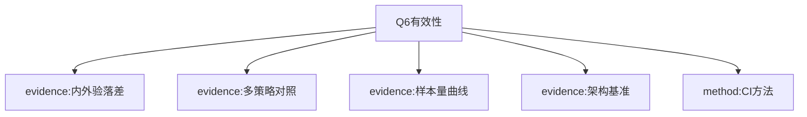

# Q Q6

## AI-A tree
# AI-A Decision Tree Round 1
paper_id: paper_025
question_id: Q6
question: 如何证明分析有效？内/外验、敏感性、基线对照？证据强度？
source_file: Results Table2-3 Fig.2 MOESM2

## 1. Evidence Map
| id | location | summary | nodes |
|---|---|---|---|
| E1 | Table2 | 内验高估外验：MAPE↑至+51.8%，AUROC↓至-13.8% | N1 |
| E2 | Table3 | 四策略 specialization/generalization + Mcomposite | N2 |
| E3 | Fig.2 | 训练样本量效应 | N3 |
| E4 | MOESM2 | 架构基准 | N4 |
| E5 | Methods | DeLong AUROC CI；bootstrap MAPE/AUPRC | N5 |

## 2. Mermaid

## 3. Node Table
| node_id | type | claim | evidence | conf |
|---|---|---|---|---|
| N1 | evidence | 内验不能代替外验 | E1 | high |
| N2 | evidence | 池化改善泛化/专化权衡 | E2 | high |
| N3 | evidence | 更大数据有帮助 | E3 | high |
| N4 | evidence | TPC基准 | E4 | high |
| N5 | method | DeLong/bootstrap | E5 | high |

## 4. Provisional Answer
有效性证据层级：**(1)**四库外验量化内验乐观偏差；**(2)**四训练策略对照；**(3)**架构基准；**(4)**样本量曲线；**(5)**CI方法披露。无E-value/阴性对照（预测任务语境）。证据对“单源不够、池化有益”方向较强。

## 5. Uncertainty
无独立第五库前瞻验证；无前瞻床旁部署试验。

## 6. Follow-up
Q7局限。

## Paper
# Page 1

RESEARCH
Open Access
Critical Care
Allyn et al. Critical Care          (2026) 30:364 
https://doi.org/10.1186/s13054-026-06034-5
Multi-source data integration through 
pooling and transfer learning improves 
generalizability and specialization of deep 
learning models for ICU mortality and length 
of stay prediction: a four-database external 
validation study
Jerome Allyn1,2*, Matthieu Oliver2, Raphaël Cerveau2, Nicolas Allou1, Tristan Barennes2 and Cyril Ferdynus2
​*​C​o​r​r​e​s​p​o​n​d​e​n​c​e​:​
Jerome Allyn
jerome.allyn@chu-reunion.fr
Full list of author information is available at the end of the article
© The Author(s) 2026. Open Access  This article is licensed under a Creative Commons Attribution-NonCommercial-NoDerivatives 4.0 
International License, which permits any non-commercial use, sharing, distribution and reproduction in any medium or format, as long as you 
give appropriate credit to the original author(s) and the source, provide a link to the Creative Commons licence, and indicate if you modified the 
licensed material. You do not have permission under this licence to share adapted material derived from this article or parts of it. The images or 
other third party material in this article are included in the article’s Creative Commons licence, unless indicated otherwise in a credit line to the 
material. If material is not included in the article’s Creative Commons licence and your intended use is not permitted by statutory regulation or 
exceeds the permitted use, you will need to obtain permission directly from the copyright holder. To view a copy of this licence, visit ​h​t​t​p​:​/​/​c​r​e​a​t​i​
v​e​c​o​m​m​o​n​s​.​o​r​g​/​l​i​c​e​n​s​e​s​/​b​y​-​n​c​-​n​d​/​4​.​0​/​.​
Abstract
Background  Most Artificial Intelligence prognostic models in intensive care are trained and validated on a single 
source, limiting their reliability in external settings. This study evaluated generalizability and specialization for ICU 
mortality and remaining length of stay (RLoS) prediction across international databases, and explored multi-source 
strategies to mitigate the performance cost of external deployment.
Methods  Using the Temporal Pointwise Convolution (TPC) architecture, we conducted external validation across 
four harmonized BlendedICU databases (eICU-CRD, MIMIC-IV, AmsterdamUMCdb, HiRID), extracting nearly 20,000 
unique patients from each. Four training configurations were compared: single-source training on AmsterdamUMC 
(N = 3,574) or MIMIC-IV (N = 10,915), data pooling, and transfer learning (both N = 14,489). Performance was assessed 
using AUROC and AUPRC for mortality, MAPE for RLoS, and a composite metric (Mcomposite).
Results  Internal validation consistently overestimated external performance, with MAPE increasing by up to 51.8% 
and AUROC dropping by up to 13.8% on external databases. Site-specific features such as drug exposure acted as 
“shortcuts” degrading portability. Data pooling emerged as the superior strategy, achieving the best generalization 
(Mcomposite improvement up to 8.0% over single-source models) while matching or outperforming transfer learning 
for specialization — particularly for RLoS (MAPE 84.49 vs. 89.24, non-overlapping confidence intervals).
Conclusion  Single-source training compromises clinical applicability. Data pooling across harmonized international 
cohorts is the most effective strategy for both generalization and specialization, supporting a “Data-Centric AI” 
approach. We advocate for the democratization of local ICU datasets and open-source customizable models to 
empower independent clinical validation.

# Page 2

Page 2 of 12
Allyn et al. Critical Care          (2026) 30:364 
​Introduction
Predictive models based on machine learning have shown 
considerable promise in intensive care unit (ICU) appli­
cations, ranging from mortality risk assessment to treat­
ment response classification [1–3]. However, a recurring 
weakness in the literature is the reliance on single-center 
datasets for both model derivation and validation [4–6]. 
This methodological choice is not merely a matter of con­
venience; it reflects a fundamental challenge in critical 
care data science: the lack of harmonization among major 
open-access databases. This fragmentation severely limits 
the feasibility of multi-center validation and hinders the 
assessment of cross-dataset generalization. While inter­
nal validation techniques are common, they often dem­
onstrate a model’s ability to fit retrospective data rather 
than its utility in clinical practice, where data distribu­
tions may significantly deviate from the training set [7, 8]. 
This lack of proven transferability remains a major bar­
rier to the clinical deployment of Artificial Intelligence.
The proliferation of electronic health records has led 
to several high-quality ICU research databases, such as 
eICU and MIMIC-IV from the United States, Amsterda­
mUMC from the Netherlands, and HiRID from Switzer­
land [9–12]. Despite the massive volume of available data, 
these sources remain largely siloed. The BlendedICU 
dataset addresses this gap by providing harmonized data 
across these four major repositories, enabling robust 
multi-source training and external validation strategies 
[13]. Despite these resources, external validation has his­
torically been scarce:, estimated at only 9% for mortality 
models as of 2021, and virtually non-existent for Remain­
ing Length of Stay (RLoS) [14]. While recent studies have 
begun to address this gap by conducting cross-database 
validation across the same four international ICU data­
bases for a range of clinical outcomes including sep­
sis, acute kidney injury, and length of stay, a systematic 
and quantified characterization of the performance cost 
incurred during external validation:, and of the strate­
gies best suited to mitigate it:, remains lacking [6, 15–
17]. Consequently, clinicians lack sufficient data on the 
model’s performance across different healthcare systems, 
where variations in equipment, clinical protocols, and 
patient demographics:, known as “domain shift”:, can sig­
nificantly reduce the accuracy of predictions [5, 18, 19]. 
Beyond a statistical concern, when a model is deployed 
at a new institution without external validation, its pre­
dictions may reflect spurious associations specific to the 
training site - such as local prescribing habits, measure­
ment frequencies, or case-mix characteristics - rather 
than generalizable physiological signals. When clinicians 
act on such predictions to adjust monitoring intensity, 
escalate or de-escalate treatment, or allocate scarce ICU 
beds, errors arising from undetected domain shift can 
lead to both over- and under-treatment, with potentially 
life-threatening consequences in a setting where deci­
sions must be made rapidly and under uncertainty.
To address these critical gaps, we present a compre­
hensive investigation of multi-source data integration to 
enhance both the generalization (performance on unseen 
institutions) and specialization (performance on a tar­
get institution) of deep learning models. Specifically, we 
focus on two clinically vital outcomes: ICU mortality and 
RLoS. Unlike static admission-time prediction scores, 
our model updates predictions continuously and hourly 
throughout the ICU stay, providing a dynamic trajectory 
of risk rather than a single estimate of a non-actionable 
outcome [20]. In this context, a rising mortality probabil­
ity can prompt escalation of monitoring or goals-of-care 
discussions; a decreasing remaining length of stay can 
trigger early discharge planning and bed management. 
From the patient and family perspective, anticipated 
duration of ICU stay is among the most frequently asked 
questions at admission. From an institutional standpoint, 
real-time length-of-stay forecasting is a key lever for 
bed management - a role that was made starkly evident 
during the COVID-19 pandemic, when predicted ICU 
occupancy directly informed capacity planning decisions 
across health systems.
Leveraging the harmonized BlendedICU framework 
and a deep learning model trained on hourly-sampled 
tabular time series data, this study aims to: (1) evaluate 
the generalizability of RLoS and mortality predictions 
by conducting the first systematic quantification of the 
performance cost; (2) compare multi-source training 
strategies, specifically analyzing the trade-offs between 
single-dataset training, data pooling, and transfer learn­
ing in terms of predictive performances; and (3) assess 
the impact of data volume by varying the size of training 
samples to determine the amount of data required (cost/
benefit balance).
By addressing these objectives, this work seeks to 
provide practical insights into the requirements for 
deploying AI models that remain reliable across diverse 
institutional contexts, moving beyond retrospective per­
formance toward clinical applicability.
Methods
This study is reported according to the TRIPOD + AI 
guidelines [21]. All code is available at ​h​t​t​p​s​:​/​/​g​i​t​h​u​b​.​c​o​m​
/​C​I​C​-​1​4​1​0​/​B​l​e​n​d​e​d​L​o​S​.​
Keywords  Intensive care unit, Length of stay, Artificial intelligence, Deep learning, Machine learning, Prediction, 
Validation, Bias

# Page 3

Page 3 of 12
Allyn et al. Critical Care          (2026) 30:364 
Ethics statement
Datasets were observational and had preexisting ethi­
cal approvals or exemptions that allowed for retrospec­
tive analysis [9–12]. Access was obtained following the 
respective requirements for each dataset.
Data source
We used the BlendedICU dataset, which harmonizes 
data from four major publicly available ICU databases: 
MIMIC-IV (USA), eICU-CRD (USA), HiRID (Switzer­
land), and AmsterdamUMCdb (Netherlands) [9–13]. 
Nearly 20,000 unique patients were extracted from each 
of the four subsets, yielding a total of approximately 
80,000 patients. Input variables included hourly-sam­
pled vital signs, laboratory values, drug exposures, and 
clinical scores derived from electronic health records 
(as detailed in Additional File 1). Diagnoses were not 
included, as they are not consistently available across all 
four databases.
Data preprocessing
Missing data were handled using forward-filling com­
bined with missingness indicator masks, a strategy 
appropriate for the Missing Not At Random (MNAR) 
structure of ICU data [22–24]. Prior to normalization, 
extreme values were clipped to physiologically plausible 
ranges, limiting the influence of outliers on model train­
ing. Full details of the preprocessing pipeline, including 
distribution statistics before and after clipping, are pro­
vided in Supplementary Table S1 (Additional File 1).
Outcome definition
Two outcomes were predicted jointly at hourly intervals 
throughout each ICU stay: in-ICU mortality (defined as 
death before ICU discharge) and remaining length of stay 
(RLoS), defined as time to discharge conditional on sur­
vival. Outcomes were predicted from 5 h after admission 
onward.
Model
We used the Temporal Pointwise Convolution (TPC) 
architecture, a deep learning model specifically designed 
for ICU time series data that has demonstrated superior 
performance over alternative architectures for joint mor­
tality and RLoS prediction [25]. Prior to adopting TPC, 
we benchmarked three state-of-the-art architectures - 
Transformer, Long Short-Term Memory (LSTM), and 
TPC - on our two-stage prediction task across all four 
BlendedICU databases. TPC outperformed both alter­
natives on most subsets and both prediction tasks; full 
results are provided in Additional File 2 (Table S2). Data 
were split at the patient level into training (70%), valida­
tion (15%), and test (15%) sets to prevent data leakage.
Performance evaluation
Model discrimination for mortality was assessed using 
the Area Under the Receiver Operating Characteristic 
curve (AUROC) and the Area Under the Precision-Recall 
Curve (AUPRC). RLoS accuracy was assessed using the 
Mean Absolute Percentage Error (MAPE). A composite 
metric (Mcomposite) was introduced to jointly summa­
rize performance across both tasks, normalized to the 
internal validation baseline of each model: a value below 
1 indicates improvement over the internal baseline, and 
a value above 1 indicates degradation. The composite 
metric was used for cross-configuration ranking only; 
AUROC and MAPE remain the primary performance 
metrics.
Specialization and generalization
Two properties were evaluated. Specialization refers to 
model performance on a site seen during training - the 
most relevant property for deploying a model in a known 
clinical environment. Generalization refers to perfor­
mance on entirely unseen sites - the key property for a 
model intended for broad deployment across institutions. 
Four training configurations were compared: single-
source training on AmsterdamUMC alone (N = 3,574), 
single-source training on MIMIC-IV alone (N = 10,915), 
transfer learning (pre-training on MIMIC-IV then fine-
tuning on AmsterdamUMC, N = 14,489), and data pool­
ing (joint training on both, N = 14,489). Generalization 
was strictly evaluated on the held-out eICU and HiRID 
databases, which were never used during training. The 
full study pipeline is illustrated in Fig.  1. A detailed 
description of all methodological steps, including prepro­
cessing, model architecture, loss function, and statistical 
methods, is provided in Additional File 1.
Results
Patient stay
Table  1 presents certain characteristics of the 19,573 
patients included in the present study and their ICU stays 
according to their inclusion in the four open databases. 
Some characteristics varied considerably between the 
original databases, sometimes by a factor of two such 
as ICU mortality (5.5% in eICU and 9.8% in Amster­
damUMC), or length of stay in ICU (49.5 [standard 
deviation = 64.2] hours in HiRID and 77.9 [standard devi­
ation = 99.0] hours in AmsterdamUMC). Similarly, we 
observed great variations in medication exposure, such 
as the use of dopamine, which ranged from 0% in HiRID 
to 31% at AmsterdamUMC, or norepinephrine, which 
ranged from 11.6% in eICU to 35.4% at AmsterdamUMC. 
Distribution summary statistics before and after clipping 
of extreme values to physiologically plausible ranges and 
normalization-space clipping are provided in Additional 
File 1, Table S1.

# Page 4

Page 4 of 12
Allyn et al. Critical Care          (2026) 30:364 
AmsterdamUMC showed a + 4.4% improvement in 
AUROC on external data, suggesting that this training 
source may generalize particularly well to other data­
bases. The MAPE of RLoS prediction varied from − 0.3% 
to + 51.8% depending on the training set used; AUROC 
dropped by up to 13.8% for mortality prediction, with 
Comparison of the internal and external validations
A comparison of the internal and external validations 
of the TPC model with training on each data source is 
shown in Table 2. Internal validation generally overesti­
mated the model’s capability on external data, although 
one exception was observed: the model trained on 
Fig. 1  Overview of the study pipeline and training strategies. The workflow proceeds in seven sequential steps (left panel). Step 1: data were extracted 
from the BlendedICU framework, which harmonizes four open-access international ICU databases (MIMIC-IV, eICU-CRD, HiRID, and AmsterdamUMCdb). 
Step 2: preprocessing included clipping of extreme values to physiologically plausible ranges, handling of Missing Not At Random (MNAR) data using 
forward-filling imputation with missingness indicator masks, and normalisation. Step 3: data were split at the patient level (training 70% / validation 15% 
/ test 15%) to prevent data leakage. Step 4: a Temporal Pointwise Convolution (TPC) deep learning model was trained to jointly predict in-ICU mortality 
and remaining length of stay (RLoS). Step 5: internal validation was performed on the held-out test set from the same database, using the Area Under the 
Receiver Operating Characteristic curve (AUROC) and the Area Under the Precision-Recall Curve (AUPRC) for mortality, and the Mean Absolute Percentage 
Error (MAPE) for RLoS. Step 6: external validation was performed across four training strategies (right panel): (①) single-source training on AmsterdamUMC 
alone (N = 3,574); (②) single-source training on MIMIC-IV alone (N = 10,915); (③) transfer learning, with pre-training on MIMIC-IV followed by fine-tuning on 
AmsterdamUMC (N = 14,489) - evaluated for specialization on AmsterdamUMC only; (④) data pooling, with joint training on both MIMIC-IV and Amsterda­
mUMC (N = 14,489) - evaluated on all three sets. Specialization refers to performance on a site seen during training; generalization refers to performance 
on the unseen eICU and HiRID databases. A composite metric (Mcomposite) was introduced to jointly summarize mortality and RLoS performance relative 
to the internal validation baseline. Step 7: the model produces two outputs, updated hourly for each patient - predicted in-ICU mortality risk (probability) 
and predicted remaining length of stay (days, conditional on survival). AUROC: Area Under the Receiver Operating Characteristic curve; AUPRC: Area 
Under the Precision-Recall Curve; MAPE: Mean Absolute Percentage Error; MNAR: Missing Not At Random; RLoS: Remaining Length of Stay; TPC: Temporal 
Pointwise Convolution

# Page 5

Page 5 of 12
Allyn et al. Critical Care          (2026) 30:364 
three out of four training sources showing a decline. 
Notably, the model trained on AmsterdamUMC shows 
the largest MAPE increase (+ 51.8%). AUPRC values for 
mortality prediction, reported alongside their no-skill 
baseline (equal to the in-ICU mortality prevalence in each 
dataset), confirm and amplify the pattern observed for 
AUROC. All models substantially outperformed random 
prediction in both internal and external settings, with 
AUPRC values ranging from 2.5 to 4.5 times above the 
no-skill baseline. However, the degradation from internal 
Table 1  Characteristics of ICU patient stays included in the study, according to the original database
Characteristics
eICU
AmsterdamUMC
HiRID
MIMIC-IV
Multi-centric database
Yes (N = 238)
No
No
No
Patients, n
19,573
19,573
19,573
19,573
ICU Stays, n1
27,515
20,751
19,573
28,227
Demographics*
Age (years), mean [SD]
63.2 [17.4]
56.5 [17.4]
63.6 [15.2]
63.4 [17.2]
Sex, n (%)
  • Female
8,887 (45.4%)
6,667 (34.1%)
6,955 (35.5%)
8,664 (44.3%)
  • Male
10,672 (54.5%)
12,456 (63.6%)
12,618 (64.5%)
10,909 (55.7%)
  • Unknown
14 (0.1%)
450 (2.3%)
-
-
Height (cm), mean [SD]
169.4 [13.5]
170.6 [8.7]
171.2 [8.6]
168.9 [15.6]
Weight (kg), mean [SD]
83.6 [26.0]
76.0 [13.5]
76.8 [15.2]
81.6 [49.0]
ICU LoS (hours), mean [SD]
61.6 [68.9]
77.9 [99.0]
49.5 [64.2]
75.6 [78.5]
ICU LoS > 10 days, n (%)
1,192 (4.3%)
2,387 (11.5%)
674 (3.4%)
1,851 (6.6%)
ICU mortality, n (%)
1,521 (5.5%)
2,033 (9.8%)
1,209 (6.2%)
2,061 (7.3%)
Continuous Variables
Vitals, mean [SD]
  • Heart rate (/min)
87.0 [19.3]
86.0 [19.8]
84.6 [17.2]
87.1 [19.5]
  • Invasive Systolic Arterial pressure (mmHg)
117.7 [20.1]
129.9 [28.5]
119.7 [24.9]
121.1 [24.4]
  • O² Saturation in Arterial blood (%)
96.3 [2.9]
91.9 [10.0]
96.5 [3.06]
82.3 [16.8]
  • Temperature (°C)
37.1 [0.9]
36.6 [0.9]
37.19 [0.9]
37.0 [0.7]
Laboratory, mean [SD]
  • pH
7.37 [0.1]
7.38 [0.09]
7.42 [0.07]
7.38 [0.09]
  • Platelets count (G/L)
198.2 [19.3]
198.1 [128.8]
190.2 [126.1]
195.6 [119.2]
Unit Type2 n (%)
  • Cardiac
3,847 (13.98%)
1,222 (5.89%)
-
7,619 (26,99%)
  • Gastrosurgery
-
1,200 (5.78%)
-
-
  • Medical
2,350 (8.54%)
1,013 (4.89%)
-
6,020 (21.33%)
  • Medical-Surgical
15,521 (56.41%)
-
-
4,954 (17.55%)
  • Neurological
1,996 (7.25%)
2,889 (13.92%)
-
1,885 (6.68%)
  • Other
-
3,937 (18.97%)
-
-
  • Surgical
3,801 (13.81%)
8,234 (39.68%)
-
4,348 (15.4%)
  • Trauma
-
1,095 (5.28%)
-
3,401 (12.05%)
  • Unknown
-
1,013 (5.59%)
19,573 (100%)
-
Drug Exposure3, n (%)
• Dobutamine
394 (1.4%)
1,283 (6.2%)
2,542 (13.0%)
394 (1.4%)
• Dopamine
601 (2.2%)
6,504 (31.3%)
-
711 (2.5%)
• Epinephrine
574 (2.01%)
-
1,933 (9.9%)
1,206 (4.3%)
• Fentanyl
5,296 (19.2%)
7,151 (34.5%)
15,340 (78.4%)
8,260 (29.3%)
• Furosemide
5,927 (21.5%)
5,320 (25.6%)
5,024 (25.7%)
8,839 (31.3%)
• Midazolam
2,851 (10.4%)
4,249 (20.5%)
4,537 (23.2%)
3,965 (14.0%)
• Norepinephrine
3,204 (11.6%)
7,336 (35.4%)
6,313 (32.3%)
4,839 (17.1%)
• Propofol
3,535 (12.8%)
13, 819 (66.6%)
10,707 (54.7%)
9,457 (33.5%)
Values represent mean ± standard deviation unless otherwise indicated. For time series variables with multiple hourly recordings per ICU stay, summary statistics 
were computed at the stay level: the mean value across all available time points within a stay was first calculated, and Table 1 presents the distribution of these 
per-stay means across the cohort. This approach avoids pseudo replication arising from repeated measurements and is standard for cohort characterisation of 
longitudinal clinical data. Categorical variables are presented as n (%). ¹No patient identifier nor Unit Type is provided in the HiRID database; each stay was therefore 
considered as a unique patient. ²Values are presented as a percentage of the source database ICU stays. ³Number of ICU stays where a drug was administered at 
least once. *Demographic variables (age, sex, height, weight) are aggregated at the unique patient level; all other variables are aggregated at the ICU stay level. ICU: 
Intensive Care Unit; LoS: Length of Stay; SD: Standard deviation. A dash (–) represents a value not available in the source database

# Page 6

Page 6 of 12
Allyn et al. Critical Care          (2026) 30:364 
to external validation was more pronounced for AUPRC 
than for AUROC, with drops ranging from − 3.3% 
(AmsterdamUMC) to − 40.8% (MIMIC-IV), reflecting 
the greater sensitivity of AUPRC to distributional shift 
in the presence of class imbalance. The model trained on 
MIMIC-IV showed the steepest AUPRC decline despite 
maintaining a relatively high absolute value, suggesting 
that strong internal discrimination does not guarantee 
robust external precision-recall performance.
The results of the internal validation were used as the 
baseline in the composite metric Mcomposite.
Comparison of the training schemes
Building on this understanding of data requirements, we 
compared four distinct training regimes to evaluate their 
impact on model specialization (MIMIC-IV and Amster­
damUMC) and generalization (unseen eICU and HiRID 
subsets). Specifically, we assessed: [1] single-source train­
ing on AmsterdamUMC (N = 3,574) [2], single-source 
training on MIMIC-IV (N = 10,915) [3], data pooling (N 
= 14,489), and [4] transfer learning (N = 14,489). Results 
are shown in Table 3.
For specialization on AmsterdamUMC, both data 
pooling and transfer learning substantially outperformed 
single-source training, with Mcomposite scores of 1.07 
and 1.08 respectively, compared to 1.41 for training on 
AmsterdamUMC alone - representing improvements of 
approximately 24%. The two strategies, data pooling and 
transfer learning, performed virtually identically on mor­
tality discrimination, with overlapping Mcomposite confi­
dence intervals (1.059–1.081 vs. 1.066–1.091) and nearly 
equivalent AUROC values (0.75 vs. 0.76). However, data 
pooling demonstrated a meaningful advantage over 
transfer learning for RLoS prediction specifically, with a 
MAPE of 84.49 compared to 89.24 for transfer learning 
- a 5.3% improvement with non-overlapping confidence 
intervals (83.49–85.51 vs. 87.99–90.44). This suggests 
that, while both strategies yield comparable mortality 
discrimination at the target site, data pooling may better 
preserve RLoS accuracy, arguably the more operationally 
sensitive of the two outputs.
For generalization to unseen databases (eICU and 
HiRID), data pooling achieved the best performance 
(Mcomposite = 1.15), improving by 4.2% and 8.0% com­
pared to the AmsterdamUMC and MIMIC-IV sin­
gle-source models respectively. Notably, data pooling 
therefore performed well on both specialization and gen­
eralization simultaneously - a key finding suggesting that 
the trade-off between the two properties can be substan­
tially mitigated by multi-source training.
However, data pooling incurred a performance cost for 
specialization on MIMIC-IV: its Mcomposite (0.97) was 
9.0% higher than that of the MIMIC-IV single-source 
model (0.89), reflecting the expected trade-off when 
incorporating a smaller external dataset alongside a well-
powered source.
Finally, regardless of the training scheme, internal vali­
dation consistently yielded overoptimistic estimates of 
model capability compared to external evaluation.
Table 2  Comparison of the TPC model’s internal and external 
validation when training on subsets of the BlendedICU dataset
Task and training 
dataset
Internal
validation
External
validation
Variation be­
tween internal 
and external 
validation
Remaining Length of Stay prediction, MAPE [CI 95%]
  • AmsterdamUMC
80.3 
[79.5–81.1]
121.9 
[120.9–122.8]
+ 51.8%
  • eICU
87.4 
[86.8–88.0]
100.1 
[99.5–100.8]
+ 14.6%
  • HiRID
83.2 
[82.3–84.1]
83.0 
[82.6–83.4]
− 0.3%
  • MIMIC-IV
87.2 
[86.3–88.1]
109.5 
[108.6–110.3]
+ 25.5%
Mortality prediction, AUROC [CI 95%]
  • AmsterdamUMC
0.774 
[0.770–0.778]
0.808 
[0.805–0.810]
+ 4.4%
  • eICU
0.788 
[0.783–0.793]
0.768 
[0.766–0.771]
− 2.5%
  • HiRID
0.851 
[0.847–0.856]
0.777 
[0.775–0.779]
− 8.7%
  • MIMIC-IV
0.897 
[0.895–0.900]
0.773 
[0.770–0.776]
− 13.8%
Mortality prediction, AUPRC [CI 95%]
  • AmsterdamUMC
0.304 
[0.296–0.312]
(Baseline: 
0.113)
0.294 
[0.289–0.299] 
(Baseline: 
0.091)
− 3.3%
  • eICU
0.355 
[0.344–0.365]
(Baseline: 
0.078)
0.269 
[0.265–0.273] 
(Baseline: 
0.107)
− 24.2%
  • HiRID
0.441 
[0.427–0.455]
(Baseline: 
0.101)
0.331 
[0.327–0.336] 
(Baseline: 
0.115)
− 24.9%
  • MIMIC-IV
0.456 
[0.448–0.464]
(Baseline: 
0.108)
0.270 
[0.265–0.274] 
(Baseline: 
0.104)
− 40.8%
Internal validation: Training and evaluation were done on separate samples 
from a single subset; External validation: Training was done on a sample from 
a single subset and evaluation was done on a sample from all other subsets
Higher AUROC and higher AUPRC indicate better mortality discrimination. 
Baseline AUPRC corresponds to a no-skill classifier and equals the positive class 
prevalence (in-ICU mortality rate) in each dataset. Lower MAPE indicates better 
Remaining Length of Stay prediction. 95% CI for AUROC were computed using 
the DeLong method; 95% CIs for MAPE and AUPRC were estimated by bootstrap 
resampling (10,000 iterations, percentile method)
AUROC : Area Under the Receiver Operating Characteristic curve; AUPRC : Area 
Under the Precision-Recall Curve; MAPE : Mean Absolute Percentage Error; CI : 
confidence interval

# Page 7

Page 7 of 12
Allyn et al. Critical Care          (2026) 30:364 
Impact of training sample size on model robustness
To determine the optimal data volume required for stable 
predictions, we evaluated the TPC architecture across 
training scales ranging from 1,000 to 55,000 patients. 
As shown in Fig. 2, models trained on fewer than 5,000 
patients exhibited significant performance degradation 
across both mortality and RLoS tasks. While predictive 
accuracy improved with larger cohorts, a performance 
plateau was observed beyond 15,000 patients, where 
additional data yielded only marginal gains in AUROC 
and MAPE. The Mcomposite metric closely mirrored 
these trends, confirming its utility as a robust single 
indicator for benchmarking model performance. These 
findings established that a minimum threshold of 15,000 
patients is necessary to achieve stable baseline perfor­
mance, providing a quantitative justification for the sam­
ple sizes used in our subsequent multi-site experiments.
Discussion
In a clinical setting, data collection will inevitably vary 
between retrospective databases; for this reason, models 
developed for clinical usage must have strong general­
ization capabilities while remaining able to specialize on 
local data [5]. Internal validation is therefore insufficient 
to evaluate the performance of a model in clinical prac­
tice [7, 8]. Our study quantifies the loss of performance 
during external validation and highlights the fragility of 
generalization when training a deep learning model using 
data from a single source.
Firstly, we demonstrate that internal validation is over­
optimistic for evaluating clinical prediction models. Fur­
thermore, the drop in performance varied considerably 
depending on the data source used for training. This 
“generalization gap” is driven by domain shift, includ­
ing variability in patient phenotype, clinical practices, 
and data collection. Our results indicate that evaluating 
models solely on internal validation scores provides little 
information about their performance in clinical practice 
[18, 26]. This caveat regarding the evaluation of models 
intended for clinical applications is consistent with find­
ings in other medical AI domains, where performance 
drops significantly when tested on out-of-distribution 
data [14, 27]. Recent work has further validated the 
importance of cross-institutional evaluation frameworks. 
Dong Jin Park et al.. recently demonstrated the practical 
challenges of cross-hospital model deployment in a surgi­
cal context, underscoring the need for local re-validation 
[28]. [17] proposed a systematic benchmarking approach 
for generalization across ICU databases that comple­
ments our empirical findings [17]. Together, these studies 
reinforce the emerging consensus that external validation 
Table 3  Model performance on specialization and generalization in four separate training methods
Evaluation set and metric [CI 
95%]
Training on 
AmsterdamUMC
N = 3,574
Training on MIMIC-IV
N = 10,915
Training by Transfer 
Learning1
N = 14,489
Training by Data 
Pooling2
N = 14,489
Specialization on AmsterdamUMC 
  • Mortality, AUROC
0.70 [0.699-0.70]
0.72 [0.718–0.727]
0.76 [0.759–0.768]
0.75 [0.750–0.758]
  • RLoS, MAPE
97.03 [95.781–98.305]
106.73 [105.321-108.139]
89.24 [87.991–90.444]
84.49 
[83.492–85.514]
  • Mcomposite
1.41 [1.398–1.423]
1.28 [1.265–1.291]
1.08 [1.066–1.091]
1.07 [1.059–1.081]
Specialization on MIMIC-IV 
  • Mortality, AUROC
0.80 [0.798–0.805]
0.89 [0.892–0.897]
-
0.87 [0.872–0.878]
  • RLoS, MAPE
95.92 [95.011–96.875]
86.35 [85.480–87.182]
-
87.33 
[86.537–88.260]
  • Mcomposite
1.28 [1.263–1.293]
0.89 [0.885–0.902]
-
0.97 [0.958–0.979]
Generalization 
  • Mortality, AUROC
0.78 [0.776–0.784]
0.80 [0.793, 0.800]
-
0.82 [0.817, 0.823]
  • RLoS, MAPE
117.08 [115.8362–118.339]
117.41 [116.275–118.576]
-
111.07 
[110.042–112.174]
  • Mcomposite
1.20 [1.189–1.212]
1.25 [1.239–1.265]
-
1.15 [1.139–1.159]
AUROC: Area Under the Receiver Operating Characteristic curve; MAPE: Mean Absolute Percentage Error; RLoS: Remaining Length of Stay; CI: confidence interval
Higher AUROC indicate better mortality discrimination. Lower MAPE indicates better RLoS prediction. 95% CIs for AUROC were computed using the DeLong method; 
95% CIs for MAPE were estimated by bootstrap resampling (10,000 iterations, percentile method)
Mcomposite: a composite performance metric normalized to internal validation baseline. A value of 1 indicates performance equal to the internal validation 
baseline; values below 1 indicate improvement over baseline; values above 1 indicate degradation. 95% CI computed by bootstrap resampling (1,000 iterations). 
The composite metric is used for cross-configuration ranking only; AUROC and MAPE remain the primary performance metrics
Generalization was evaluated on the eICU and HiRID subsets, which were always unseen during training. The best performance for each evaluation set and metric 
is indicated in bold
1The model was pre-trained on MIMIC-IV and fine-tuned on AmsterdamUMC. Because the aim of transfer learning is to specialize on the fine-tuned dataset, this 
model was not evaluated on other data sources
2Data Pooling utilized the same data as in Transfer Learning (MIMIC-IV and AmsterdamUMC), but in a single training phase

# Page 8

Page 8 of 12
Allyn et al. Critical Care          (2026) 30:364 
should be a prerequisite, not an optional step, before clin­
ical deployment of AI models.
It is important to note the unique context of open ICU 
databases, which are dominated by North American 
cohorts such as MIMIC-IV and eICU [29]. This creates 
a geographic bias that limits the applicability of models 
in different healthcare systems, such as those in Europe. 
No large open-access ICU databases currently exist from 
Asian or African healthcare systems, which substantially 
limits the generalizability of models trained on predomi­
nantly North American or Western European cohorts. 
Beyond geographic heterogeneity, missing data patterns 
also differ substantially across institutions: in ICU elec­
tronic health records, the probability that a measure­
ment is absent depends on both local data collection 
practices and the patient’s clinical status - a Missing Not 
At Random (MNAR) structure that complicates model 
generalization across sites [22–24]. Our study therefore 
reinforces the debate on the value of local data. Our work 
also focuses on much smaller populations than the data­
bases themselves, demonstrating that it is possible to 
deploy effective models based on smaller but local data 
sets. This suggests that high-quality, specialized local 
repositories may be more valuable for clinical reliability 
than massive, distant datasets [19, 30]. The model trained 
on AmsterdamUMC showed the largest degradation in 
RLoS prediction during external validation, with a MAPE 
increase of 51.8% - the highest observed across all four 
training sources. This disproportionate generalization 
gap is noteworthy given that AmsterdamUMC has a dis­
tinctive clinical profile, including unusually high rates of 
certain drug exposures and specific case-mix character­
istics compared to the other three databases (Table 1). It 
is plausible that the model learned to rely on site-specific 
patterns, such as local prescribing protocols or unit-type 
distributions, as proxies for RLoS trajectories, rather 
than on generalizable physiological signals. This form of 
shortcut learning, in which a model achieves good inter­
nal performance by exploiting features that are informa­
tive within a single institution but not transferable across 
sites, represents a known vulnerability of single-source 
training that our data cannot fully characterize but that 
warrants dedicated investigation before any clinical 
deployment of an AmsterdamUMC-trained model.
Secondly, our data pooling experiment highlighted the 
benefit of training on multi-site data: adding a smaller 
number of patients from a different data source improved 
generalization compared to training on a single data

## Supp excerpt
Methods

This study is reported according to the TRIPOD+AI guidelines (21). All our codes are available at https://github.com/CIC-1410/BlendedLoS.

Ethics Statement

Datasets were observational and had preexisting ethical approvals or exemptions that allowed for retrospective analysis (8–11). Access was obtained following the respective requirements for each dataset.

The BlendedICU dataset

The BlendedICU dataset comprises harmonized data from five major publicly available ICU databases: eICU, MIMIC-III, MIMIC-IV, HiRID and AmsterdamUMC (8–12). It contains 42 time series variables, and exposure to more than 100 drugs for nearly 380,000 ICU stays from four data sources in the USA, Switzerland and the Netherlands. Because it contains ICU data from international care sites, this database is more representative of worldwide ICU data than individual databases (12). Original patient data from each source database of the BlendedICU dataset was preserved, apart from converting numerical values to a single unit system.

Extraction and pre-processing

In this work, we extracted nearly 20,000 unique patients from each of four subsets of the BlendedICU dataset: AmsterdamUMC, eICU, HiRID, and MIMIC-IV. Time series variables were sampled hourly using forward filling.

Missing data in this study are best characterized as Missing Not At Random (MNAR), a pattern well-documented in ICU electronic health records (22–24). Two mechanisms account for this: first, the frequency of measurements varies across source databases (e.g., electrolyte sampling rates differ between institutions), so missingness is structurally linked to data origin; second, the likelihood that a measurement is performed depends on the patient's clinical condition — a stable patient is far less likely to undergo repeated laboratory sampling than a deteriorating one, meaning that the absence of a value is itself informative about the patient's status. Classical imputation methods (mean/median substitution, multiple imputation by chained equations) implicitly assume data are Missing At Random (MAR) and may therefore introduce systematic bias when applied to MNAR data. We adopted forward-filling combined with missingness indicator masks, a strategy widely used in ICU prediction models (25,26).  Forward-filling preserves the temporal structure of the data while missingness masks allow the model to leverage the informative nature of missing values as an additional predictive signal. Although this approach rests on the simplifying assumption that physiological values remain stable between measurements, it avoids the distributional assumptions required by model-based imputation and retains all observations, unlike complete-case analysis which would disproportionately exclude the most severely ill patients.

Prior to normalization, extreme values were clipped to physiologically plausible ranges rather than winsorised to boundary values. Clipping thresholds were defined a priori based on physiological plausibility — for instance, setting to zero negative values for variables that cannot be negative by definition, or capping percentage values at 100% — consistently with the BlendedICU preprocessing pipeline. This clipping approach was preferred over winsorisation to avoid introducing a systematic signal at the boundary values that could distort gradient updates during model training. A supplementary table comparing descriptive statistics before and after this step is provided (Table S1 in Additional File 1).

All numerical data were then normalized according to the following rules:

where q5 and q95 are the 5% and 95% quantiles, respectively. This normalization step transformed the data between q5 and q95 to [−1, 1] and clipped extreme values to [−4, 4], which limited the influence of residual outliers on model training.

Feature Selection

The model uses longitudinal tabular time series data derived from electronic health records, sampled hourly throughout each ICU stay. This data type reflects the continuous, high-frequency monitoring that characterizes modern ICU care and enables dynamic, time-updated predictions rather than static admission-time risk scores. Demographic and time series variables in the BlendedICU dataset (version v0.3.2) were included, along with a selection of 17 drugs. All input variables used in this study are listed in Additional File 1. Patient length of stay in the ICU and mortality were extracted for prediction. Because diagnoses are not available in all four source databases, they were not used in this study.

Experimental designs

Numerous studies have used patient data to predict length of stay in ICU including simple linear regression models based on physiology scores (Sequential Organ Failure Assessment (SOFA) score, Simplified Acute Physiology Score II (SAPS II), Acute Physiology and Chronic Health Evaluation (APACHE)) and multiple linear regression models (27,28). They assumed a linear relation between patient data and the length of stay and did not use temporal data acquired during a patient’s stay. Machine learning models, such as random forest and gradient boosting methods, have also been utilized for non-temporal data (29,30).

Machine learning models improved current performance by utilizing time series data on the HiRID dataset (31). In addition, Rocheteau et al. introduced the Temporal Pointwise Convolution (TPC) architecture, which outperformed Long Short-Term Memory (LSTM) and Transformer architectures for predicting the length of stay and mortality on MIMIC-IV and eICU datasets (25). The TPC architecture is the current reference for predicting ICU mortality and ICU remaining length of stay (RLoS). 

Prediction of the ICU remaining length of stay through a two-stage process

Patient mortality drastically influences their RLoS: a severe patient could either recover over a long period of time or deteriorate and die swiftly. For this reason, RLoS prediction assumed that the patient was discharged alive. Accordingly, a two-step process was chosen. First, the model predicts the probability of patient mortality before discharge from ICU, and then the model predicts a patient’s time-to-discharge assuming survival. RLoS was capped to 10 days; a prediction of 10 was equivalent to “RLoS is more than 10 days”. Mortality and RLoS were evaluated hourly during a patient’s stay, beginning 5 hours after admission. 

The model is trained on the entire patient cohort, including those with a known fatal outcome. However, when evaluating performance, length-of-stay predictions are not included for patients who have died. This design preserves the full range of illness trajectories during training while ensuring that RLoS performance metrics reflect only clinically interpretable predictions — that is, those for patients who survive to discharge. The loss function (L) is therefore a weighted sum of the binary cross-entropy of mortality prediction and the mean squared logarithmic error of the RLoS prediction, applied conditionally:

where yM and yL are the true ICU mortality and RLoS; ŷM and ŷL are the ICU mortality and RLoS predictions; and α = 20.

Comparison of Transformer, LSTM, and TPC models 

In this study, we used state-of-the-art prediction models to predict ICU mortality and RLoS. We benchmarked Transformer, LSTM, and TPC models on our two-stage prediction task using the BlendedICU dataset. The TPC architecture demonstrated superior performance compared to Transformer and LSTM architectures (see Additional File 2). This architecture was introduced to handle both static (tabular) and dynamic (temporal) data, which is essential when dealing with data from electronic medical records (25).

Model evaluation

The BlendedICU dataset was partitioned using the source database of each patient. Each partition was split into a train, validation and test set containing, respectively, 70%, 15%, and 15% of the patients in the partition. Critically, the unit of splitting was the patient, not
