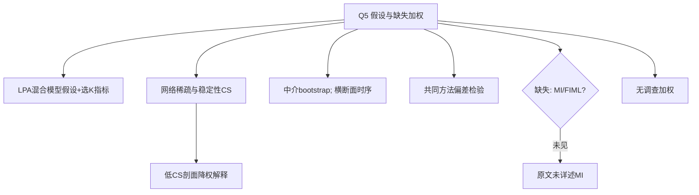

# Question
Q5: 分析依赖哪些参数假设？缺失如何处理？是否加权设计？

---

# AI-A Round1
# AI-A Round1 — paper_060 / Q5

**Q5**: 参数假设？缺失？加权？

## 1. Evidence Map

| eid | location | summary | node |
|---|---|---|---|
| E1 | Methods 2.3(2) | LPA 依赖局部独立/正态条目等混合模型假设；用 LMR/BLRT/entropy 助选 | N1 |
| E2 | Methods 2.3(3) | 网络：稀疏 GGM/EBICglasso；CS case-dropping 评稳定性 | N2 |
| E3 | Methods 2.3(4) | 中介 bootstrap 5000；横断面 | N3 |
| E4 | Methods 2.3 | Harman 单因子共同方法偏差 | N4 |
| E5 | Methods/Results | 有效问卷完整分析；未见 MICE/FIML 详述 | N5 |
| E6 | Design | 非复杂抽样；无 survey 权重 | N6 |
| E7 | Results 3.3 | 某剖面 CS 偏低 | N7 |

## 2. Mermaid

## 3. Provisional Answer

关键假设：LPA 混合模型、网络稀疏/稳定性、中介路径与 bootstrap。做了 Harman。**非加权设计**。缺失处理细节【原文未明确说明】多重插补/FIML。低 CS 剖面解释需谨慎。

## 4. Follow-up
本课题：FIML/MI、完整病例敏感性是否强制（反馈已要求）？

---

# Paper Chunk
# Page 1

Acta Psychologica 267 (2026) 107149

                                                                   Contents lists available at ScienceDirect

                                                                        Acta Psychologica
                                                         journal homepage: www.elsevier.com/locate/actpsy

Psychological phenotypes of sense of coherence: How illness perception
mediates distress differently across patient subgroups with
hematologic malignancies
Guiyuan Ma a,b,1, Nannan Long a,c,1 , Yuanyuan Li d , Ping Mao a , Chengyuan Li a,c,*
a
  Nursing Department, The Third Xiangya Hospital, Central South University, Changsha, Hunan, China
b
  Xiangya School of Nursing, Central South University, Changsha, Hunan, China
c
  Hematology Department, The Third Xiangya Hospital, Central South University, Hunan, China
d
  Lymphoma Hematology Department, Hunan Cancer Hospital, Changsha, Hunan, China

A R T I C L E I N F O                                     A B S T R A C T

Keywords:                                                 Background: Sense of coherence (SOC) plays a critical role in how patients with hematologic malignancies cope
Sense of coherence                                        with disease-related stress. However, the heterogeneity of SOC and its mechanisms influencing anxiety and
Hematologic malignancies                                  depression remain unclear. This study aimed to identify latent SOC profiles and to examine the mediating role of
Illness perception
                                                          illness perception in the SOC–anxiety and depression relationship.
Anxiety and depression
Latent profile analysis
                                                          Methods: A cross-sectional study was conducted among 486 inpatients with hematologic malignancies. SOC,
                                                          illness perception, and symptoms of anxiety and depression were assessed using the SOC-13, the BIPQ-8, and the
                                                          PHQ-4. Descriptive analyses, Logistic regression, latent profile analysis, network analysis, and mediation ana­
                                                          lyses were performed to examine SOC profile classification, illness perception with anxiety-depression associa­
                                                          tions, and their underlying mechanisms.
                                                          Results: Latent profile analysis identified three SOC subgroups: Low SOC–Psychologically Vulnerable (26.8%),
                                                          Moderate SOC–High Control Low Understanding (42.2%), and High SOC–Resilient Adaptive (31.1%), with age,
                                                          residence, diagnosis, chronic disease, and social support as significant predictors of profile membership. Network
                                                          analysis revealed that tension/anxiety (D1) and low mood (D3) were central symptoms across SOC profiles, while
                                                          emotional representation (P8) consistently emerged as a key bridge node linking illness perception with
                                                          emotional distress. Mediation analysis further showed that illness perception significantly mediated the
                                                          SOC–anxiety and depression link, with the strongest effect observed in Profile 2, weaker in Profile 1, and non-
                                                          significant in Profile 3.
                                                          Conclusions: SOC shows heterogeneous profiles with distinct structures. Illness perception partially mediates the
                                                          SOC–anxiety/depression link, moderated by SOC profiles, highlighting the need for tailored psychological
                                                          interventions.

1. Introduction                                                                                chronic uncertainty, prolonged immunosuppression, and a persistent
                                                                                               fear of relapse and infection, placing patients at heightened risk for se­
   Hematologic malignancies (Mitchell et al., 2011; Tseng & Ng, 2020)                          vere anxiety and depression (Kuczmarski et al., 2024; Ma et al., 2025; Xu
represent a major global public health issue, with recent estimates                            et al., 2026). A recent systematic review reported that 31.6% of patients
indicating over 1 million prevalent cases worldwide among children,                            with hematologic malignancies experience depression or adjustment
adolescents, and young adults in 2021 (Xu et al., 2026). Unlike patients                       disorders (Mitchell et al., 2011), while 38.2% present with broader
with many solid tumors, hematologic malignancies confront a unique                             emotional disturbances (Kuczmarski et al., 2024; Mitchell et al., 2011).
constellation of stressors, including exceptionally long treatment cycles,                     Elucidating the protective factors that facilitate psychological

 * Corresponding author at: Nursing Department, The Third Xiangya Hospital, Central South University, Changsha, 410013, Hunan, China.
    E-mail addresses: mmgy0906@163.com (G. Ma), longnannan@csu.edu.cn (N. Long), 702043473@qq.com (Y. Li), 2221581336@qq.com (P. Mao), lichengyuan_
xy3@163.com (C. Li).
  1
    These authors contributed equally to this work.

https://doi.org/10.1016/j.actpsy.2026.107149
Received 6 November 2025; Received in revised form 8 March 2026; Accepted 25 May 2026
Available online 30 May 2026
0001-6918/© 2026 The Authors. Published by Elsevier B.V. This is an open access article under the CC BY license (http://creativecommons.org/licenses/by/4.0/).

# Page 2

G. Ma et al.                                                                                                                    Acta Psychologica 267 (2026) 107149

adaptation in this population, and clarifying the mechanisms through                perception–anxiety–depression network varies across SOC subgroups;
which they exert their effects, is therefore of critical importance for             and (H3) illness perception mediates the relationship between SOC and
advancing patient care and improving mental health outcomes.                        psychological distress, with the strength of this mediation effect being
    Among the diverse psychological resources identified in health                  moderated by SOC profile membership.
research, Antonovsky's construct of the Sense of Coherence (SOC) (Li                    Although some of the relationships among these variables have been
et al., 2023; Moksnes, 2021) stands out as a central determinant of                 widely documented in general oncology populations, patients with he­
resilience. SOC represents a pervasive, enduring, and dynamic orienta­              matologic malignancies face prolonged treatment, chronic immuno­
tion of confidence that life's challenges are comprehensible, manage­               suppression, and persistent relapse uncertainty, which may reshape
able, and meaningful (Li et al., 2023; Liu, Wang, et al., 2025; Moksnes,            psychological adaptation processes. It therefore remains unclear
2021; Vähäaho et al., 2021). Extensive evidence demonstrates that SOC             whether existing models can be directly generalized to this group. This
serves as a critical protective factor against psychosocial stress, exerting        study aims to identify latent SOC profiles and their heterogeneity in
a strong inverse association with anxiety and depression (Li et al., 2023).         patients with hematologic malignancies, examine subgroup-specific
However, the role of SOC as a reliable predictor of physical health                 differences in the illness perception, anxiety, and depression network,
outcomes has been a subject of scholarly debate. Seminal reviews have               and quantify the mediating role of illness perception and its moderation
suggested that while the link between SOC and mental health is robust               by SOC profile. The findings will provide a theoretical basis and prac­
and consistent, its association with physical health indicators is often            tical guidance for developing tailored psychological interventions for
weaker and less conclusive (Flensborg-Madsen et al., 2005; Galletta                 distinct SOC subgroups.
et al., 2019). This distinction provides a strong theoretical justification
for focusing specifically on mental health indicators, as SOC's primary             2. Methods
influence likely operates through psychological adaptation pathways
(Galletta et al., 2019). Yet, existing studies in patients with hematologic         2.1. Participants
malignancies have largely conceptualized SOC as a homogeneous,
continuous variable, overlooking potential latent subgroups within this                This cross-sectional study was conducted between July and October
population (Vähäaho et al., 2021). Such an average effect obscures                2023 using a convenience sampling method. Participants were patients
clinically meaningful heterogeneity, limiting our understanding of pa­              from the hematology departments of four tertiary hospitals in Hunan
tients' diverse psychological trajectories (Vähäaho et al., 2021).                Province in China. Inclusion criteria were: (1) pathologically confirmed
    To establish a robust theoretical foundation for our mediation model,           hematologic malignancy; (2) currently receiving inpatient treatment;
we draw upon the transactional Stress and Coping Theory. This frame­                and (3) adequate communication skills. Exclusion criteria included: (1)
work posits that psychological distress is not a direct result of a                 cognitive impairment or diagnosis of a psychiatric disorder; and (2)
stressor—such as a cancer diagnosis—but is mediated by an individual's              comorbid severe diseases of vital organs, such as the heart, brain, or
cognitive appraisal of the event and their available coping resources.              kidneys.
Within this model, we conceptualize SOC as a critical personal coping
resource. According to Antonovsky's theory (Moksnes, 2021), in­                     2.2. Measures
dividuals with high SOC possess a view that enables them to mobilize
resources effectively for functional coping and emotional regulation                2.2.1. Sociodemographic and clinical characteristics
(Moksnes, 2021).                                                                       Based on a literature review (Hinz et al., 2023; Liu, Wang, et al.,
    Illness perception (Ma et al., 2024), which refers to patients' cogni­          2025; Liu, Zhang, et al., 2025; Schäfer et al., 2023; Vähäaho et al.,
tive and emotional representations of their disease, functions as the               2021; Zamanian et al., 2021) and team discussions, the research group
primary cognitive appraisal process in this context (Xiong et al., 2023).           developed a self-designed demographic and clinical questionnaire. The
The Stress and Coping Theory suggests that personal resources like SOC              questionnaire collected 15 variables, including age, sex, marriage status,
directly shape these appraisals. Specifically, individuals with a stronger          educational level, occupation, residence, family monthly income, diag­
SOC are more likely to appraise their illness as comprehensible and                 nosis, chronic disease, course of disease, treatment stage, relapse, in­
controllable, leading to more adaptive illness perceptions (Zamanian                surance, complication, and social support.
et al., 2021). Conversely, those with a weaker SOC may adopt cata­
strophic, uncontrollable appraisals, which in turn exacerbate anxiety               2.2.2. Sense of Coherence Scale (SOC-13)
and depression (Moksnes, 2021; Zamanian et al., 2021). Therefore, we                    The SOC-13 scale was originally developed by Antonovsky (Liu et al.,
propose that illness perception acts as a pivotal mediator, translating the         2024) and has been adapted into Chinese by Bao Leiping et al. (Liu et al.,
protective effects of the SOC resource into specific cognitive appraisals           2024). The SOC-13 consists of 13 items across three dimensions:
that ultimately determine emotional outcomes. Despite the strong                    comprehensibility (5 items: 2, 6, 7, 8, 12), manageability (4 items: 3, 4,
theoretical basis, rigorous empirical validation in the unique context of           5, 9, 10), and meaningfulness (4 items: 1, 9, 11, 13). Responses are rated
hematologic malignancies is lacking.                                                on a 7-point Likert scale, with 5 items reverse-scored (Mitchell et al.,
    To further dissect the complex interactions within this framework,              2011; Tseng & Ng, 2020; Vähäaho et al., 2021; Xiong et al., 2023; Xu
our study adopts an integrative strategy combining person- and variable-            et al., 2026). Total scores range from 13 to 91, with higher scores
centered approaches. While traditional regression is limited, network               indicating greater sense of coherence. Scores of 80–91, 64–79, and
analysis (Fried et al., 2016) offers a nuanced view of the links between            13–63 represent high, moderate, and low levels of SOC, respectively. In
illness perception and anxiety and depression, and can identify key                 the present study, the scale demonstrated good internal consistency with
bridge symptoms for targeted interventions (Zhu et al., 2023). Latent               a Cronbach's α of 0.865.
profile analysis (Ma et al., 2025) will first identify heterogeneous SOC
subgroups among hematologic cancer patients. We will then construct                 2.2.3. The Brief Illness Perception Questionnaire (BIPQ-8) (Galletta et al.,
weighted networks for each subgroup to compare their structural                     2019)
properties (Ma et al., 2025). Finally, moderated mediation models will                  The Chinese version of the BIPQ-8 (Broadbent et al., 2006), trans­
test the mediating role of illness perception and the moderating effect of          lated by Mei Yaqi et al. (Ma et al., 2024), was used to assess patients'
SOC subgroup membership (Tang et al., 2013). Based on this integrated               perceptions and emotional responses to their illness. The scale includes
theoretical and methodological framework, we formally hypothesize                   nine items: item 1 assesses the impact of the illness on daily life; item 2,
that: (H1) patients with hematologic malignancies exhibit distinct latent           the perceived duration of the illness; item 3, perceived personal control;
SOC       profiles;    (H2)      the      structure     of    the     illness       item 4, perceived treatment effectiveness; item 5, perception of

                                                                                2

# Page 3

G. Ma et al.                                                                                                                 Acta Psychologica 267 (2026) 107149

symptoms; item 6, concern about the illness; item 7, understanding of               (3) Network Analysis (Zhu et al., 2023): To investigate the associa­
the illness; and item 8, emotional response to the illness. All items are               tion structure between illness perception and anxiety–depression,
scored on a 0–10 scale. Item 9 is an open-ended question investigating                  a weighted undirected network was constructed using R 4.3.0.
patients' perceived causes of their illness. Total scores range from 0 to               Nodes included dimensions of illness perception and anx­
80, with higher scores indicating stronger overall illness perception. In               iety–depression symptoms (e.g., D1, D2, D3, P1, P2), while edges
the present study, only the first eight items were analyzed, as the ninth               represented partial correlations. A graphical LASSO (Least Ab­
item is open-ended and not suitable for quantitative scoring or statistical             solute Shrinkage and Selection Operator) was applied to estimate
analysis. The scale demonstrated excellent internal consistency, with a                 a sparse network. Network visualization was performed using the
Cronbach's α of 0.903.                                                                  Fruchterman–Reingold algorithm. Network metrics, including
                                                                                        node strength and bridge centrality, were used to identify key
2.2.4. Patient Health Questionnaire-4 (PHQ-4)                                           nodes linking illness perception and anxiety–depression. Ana­
    Anxiety and depression were measured using the PHQ-4 (Ma et al.,                    lyses were conducted for the overall sample and for different SOC
2025). Developed by Kroenke et al., the PHQ-4 combines the first two                    subgroups, allowing comparison of network structures to explore
items of the PHQ-9 (PHQ-2, assessing depressive symptoms) and the first                 patterns of illness perception–anxiety–depression associations
two items of the GAD-7 (GAD-2, assessing anxiety symptoms) to eval­                     across SOC profiles. The stability of centrality indices was eval­
uate patients' emotional states over the past two weeks. Each item is                   uated using a case-dropping bootstrap procedure, and correlation
rated on a 4-point scale: “not at all” (0), “several days” (1), “more than              stability (CS) coefficients were calculated to assess the robustness
half the days” (2), and “nearly every day” (3), yielding a total score                  of the network estimates.
range of 0–12. Scores of 0–2 indicate no anxiety or depression, 3–5 mild,           (4) Mediation Analysis (Tang et al., 2013): R 4.3.0 was used to
6–8 moderate, and 9–12 severe anxiety or depression. In the present                     further examine the mechanisms by which SOC influences anx­
study, the PHQ-4 demonstrated good internal consistency (Cronbach's α                   iety–depression and the mediating role of illness perception,
= 0.84).                                                                                employing a moderated mediation model. The independent var­
                                                                                        iable was SOC profile (either as a continuous measure for the
2.2.5. Perceived Social Support Scale (PSSS)                                            overall sample or as latent profile categories), the mediator was
    Originally developed by Zimet et al. (Zimet et al., 1990) and adapted               the illness perception score, and the dependent variable was
into Chinese by Jiang Qianjin (Ma et al., 2025), the scale assesses in­                 anxiety–depression level. Path coefficients were estimated using
dividuals' perceived support from multiple sources, including family,                   partial least squares, and indirect effects with 95% confidence
relatives, colleagues, and friends. The PSSS comprises 12 items rated on                intervals were computed via bootstrapping with 5000 resamples.
a 7-point Likert scale ranging from “strongly disagree” (0) to “strongly                Analyses were conducted for both the overall sample and SOC
agree” (7), yielding total scores from 12 to 84. Higher scores indicate                 subgroups to compare differences in mediation effects and clarify
better perceived social support. Scores ≤36 indicate low support, 37–60                 the moderating role of SOC profile on the mediation pathway.
moderate support, and 61–84 high support (Zimet et al., 1990). In the
present study, Cronbach's α was 0.901.                                            2.4. Sample size

                                                                                      To assess potential common method bias, Harman's single-factor test
2.3. Statistical analysis                                                         was conducted. All measurement items were entered into an exploratory
                                                                                  factor analysis without rotation to examine the variance explained by
    SPSS 24.0, Mplus 8.3, PROCESS Macro 4.2 and JASP 0.18.2 were                  the first unrotated factor. For logistic regression, the sample size was
used for data analysis. A two-tailed P value <0.05 was considered sta­            estimated based on the rule of events per variable (EPV ≥10) (van
tistically significant.                                                           Smeden et al., 2019), and accounting for approximately 20% invalid
                                                                                  questionnaires, at least 180 participants were required. For LPA, a
   (1) Descriptive analyses: Continuous variables presented as mean ±             minimum of 300 participants was recommended to ensure sufficient
       standard deviation and categorical variables as frequencies and            statistical power and reliable identification of small subgroups (Ma
       percentages. Chi-square tests or Fisher's Exact Test were used to          et al., 2025). For network analysis (Fried et al., 2016), considering the
       compare demographic characteristics and scale scores across SOC            number of nodes and potential edges, the sample size is typically
       subgroups, identifying variables with statistically significant            required to be 5–10 times the number of nodes to ensure accurate esti­
       differences. Logistic regression analysis was then performed to            mation of network structure and centrality metrics. For mediation
       determine predictors of SOC classification.                                analysis (Fritz et al., 2015), according to Fritz & MacKinnon's guidelines,
   (2) Latent profile analysis (LPA) (Liu, Zhang, et al., 2025; Ma et al.,        at least 80–100 participants are needed to achieve adequate statistical
       2025): The 13 items of the SOC-13 scale reported by patients               power. Taken together, each latent profile should include more than 80
       with hematologic malignancies were used as observed variables.             participants, and the overall sample size should exceed 300 participants
       Models with one to five classes were explored, and the optimal             to satisfy all analytic requirements.
       class solution was selected based on a combination of fit indices
       and practical interpretability. A latent profile plot was subse­           2.5. Ethical consideration
       quently generated. The specific model fit indices were as follows:
       (i) information criteria: Akaike Information Criterion (AIC),                  A portion of the data used in this study were derived from the same
       Bayesian Information Criterion (BIC), and sample-size adjusted             dataset as a previously published study (Ma et al., 2025). While the data
       BIC (aBIC), with lower values indicating better model fit; (ii)            source is shared, this study addresses distinct research questions and
       classification accuracy: entropy, ranging from 0 to 1, with values         employs new analyses not reported in the prior publication. This study
       closer to 1 indicating more precise classification; (iii) likelihood       was approved by the Medical Ethics Committee of the xx (Approval No.:
       ratio tests: the Lo-Mendell-Rubin likelihood ratio test (LMR) and          2024-S425). Prior to enrollment, all participants provided written
       the bootstrapped likelihood ratio test (BLRT), with P < 0.05               informed consent after receiving a detailed explanation of the study's
       indicating that the model with the additional class provides a             objectives, procedures, potential risks, and anticipated benefits. Partic­
       significantly better fit than the model with one fewer class. These        ipants were informed of their right to withdraw from the study at any
       indices serve as references, and interpretability of the classes was       time without any impact on their clinical care or treatment. All data
       also considered when determining the optimal model.                        collected were anonymized using unique numerical identifiers and

                                                                              3

# Page 4

G. Ma et al.                                                                                                                            Acta Psychologica 267 (2026) 107149

securely stored on a password-protected computer accessible only to the                     486 valid questionnaires were collected. The largest proportion of par­
research team. This cross-sectional study was conducted in accordance                       ticipants (41.36%) were aged 40 to 59 years. Most had completed junior
with the Declaration of Helsinki.                                                           high school education. Nearly half of the patients (42.59%) had previ­
                                                                                            ously worked as laborers, and the vast majority (79.01%) were married.
3. Results                                                                                  Monthly income data indicated that over one-third of participants
                                                                                            (38.48%) reported a household income between 5000 and 10,000 RMB
3.1. Sociodemographic and clinical characteristics of the participants                      (1 RMB = 0.14 USD). Other demographic characteristics are presented
                                                                                            in Table 1.
   The first unrotated factor accounted for 13.92% of the total variance,
which is below the commonly recommended threshold of 50%, sug­
gesting that common method bias did not affect the results. A total of

Table 1
Sociodemographic and clinical characteristics of the participants.
  Category                                                           All [Case              C1 [Case           C2 [Case           C3 [Case            χ2/H       P
                                                                     (Percentage, %)]       (Percentage, %)]   (Percentage, %)]   (Percentage, %)]

  Age (years)          0–19                                            21 (4.32)               3 (2.31)           9 (4.39)           9 (5.96)         23.706a        0.003
                       20–39                                          93 (19.14)             15 (11.54)         55 (26.83)         23 (15.23)
                       40–59                                         201 (41.36)             53 (40.77)         87 (42.44)         61 (40.40)
                       60–79                                         131 (26.95)             45 (34.62)         39 (19.02)         47 (31.13)
                       80+                                             40 (8.23)             14 (10.77)          15 (7.32)          11 (7.28)
  Sex                  Male                                          262 (53.91)             73 (56.15)        109 (53.17)         80 (52.98)          0.361         0.835
                       Female                                        224 (46.09)             57 (43.85)         96 (46.83)         71 (47.02)
  Marriage status      Unmarried                                      62 (12.76)               8 (6.15)         34 (16.59)         20 (13.25)          9.706         0.138
                       Married                                       384 (79.01)            110 (84.62)        157 (76.59)        117 (77.48)
                       Divorced                                        21 (4.32)               5 (3.85)           9 (4.39)           7 (4.64)
                       Widowed                                         19 (3.91)               7 (5.38)           5 (2.44)           7 (4.64)
  Educational level    Primary school and below                       99 (20.37)             20 (15.38)         43 (20.98)         36 (23.84)          4.468         0.614
                       Junior high school                            167 (34.36)             49 (37.69)         65 (31.71)         53 (35.100)
                       Senior high school                             94 (19.34)             26 (20.00)         40 (19.51)         28 (18.54)
                       College degree or above                       126 (25.93)             35 (26.92)         57 (27.80)         34 (22.52)
  Occupation           Laborers                                      207 (42.59)             50 (38.46)         84 (40.98)         73 (48.34)          7.248         0.299
                       Enterprise                                     69 (14.20)             17 (13.08)         32 (15.61)         20 (13.25)
                       Civil servant/public institution                43 (8.85)             15 (11.54)          13 (6.34)          15 (9.93)
                       Individual/Retired/Unemployed                 167 (34.36)             48 (36.92)         76 (37.07)         43 (28.48)
  Residence            Rural                                         208 (42.80)             75 (57.69)         80 (39.02)         53 (35.10)         17.208a        0.002
                       Township                                       74 (15.23)             13 (10.00)         36 (17.56)         25 (16.56)
                       City                                          204 (41.98)             42 (32.31)         89 (43.41)         73 (48.34)
  Family monthly       >10,000                                       140 (28.81)             52 (40.00)         49 (23.90)         39 (25.83)         11.349a        0.023
    income (Yuan)      5000–10,000                                   187 (38.48)             43 (33.08)         86 (41.95)         58 (38.41)
                       <5000                                         159 (32.72)             35 (26.92)         70 (34.15)         54 (35.76)
  Diagnosis            Multiple myeloma                              167 (34.36)             55 (42.31)         69 (33.66)         43 (28.48)         17.304a        0.008
                       Lymphoma                                      139 (28.60)             34 (26.15)         49 (23.90)         56 (37.09)
                       Leukemia                                      164 (33.74)             34 (26.15)         83 (40.49)         47 (31.13)
                       Others                                          16 (3.29)               7 (5.38)           4 (1.95)           5 (3.31)
  Chronic disease      None                                          358 (73.67)             82 (63.08)        151 (73.66)        125 (82.78)         13.981a    <0.001
                       Yes (Hypertension, diabetes, coronary heart   128 (26.33)             48 (36.92)         54 (26.34)         26 (17.22)
                       disease, chronic obstructive pulmonary
                       disease)
  Course of disease    1–6 months                                    249 (51.23)             65 (50.00)        102 (49.76)         82 (54.30)          8.985         0.176
                       6–12 months                                    99 (20.37)             25 (19.23)         44 (21.46)         30 (19.87)
                       1–3 years                                     104 (21.40)             24 (18.46)         47 (22.93)         33 (21.85)
                       3+ years                                        34 (7.00)             16 (12.31)          12 (5.85)           6 (3.97)
  Treatment stage      CAR-T cell therapy                              15 (3.09)               4 (3.08)           5 (2.44)           6 (3.97)          9.661         0.467
                       Maintenance                                    73 (15.02)             28 (21.54)         28 (13.66)         17 (11.26)
                       Post-transplantation                            23 (4.73)               5 (3.85)          11 (5.37)           7 (4.64)
                       Before-transplantation                         64 (13.17)             18 (13.85)         26 (12.68)         20 (13.25)
                       Post-chemotherapy                             258 (53.09)             64 (49.23)        115 (56.10)         79 (52.32)
                       Before-chemotherapy                            53 (10.91)              11 (8.46)          20 (9.76)         22 (14.57)
  Relapse              Yes                                            83 (17.08)             23 (17.69)         38 (18.54)         22 (14.57)          1.014         0.602
                       None                                          403 (82.92)            107 (82.31)        167 (81.46)        129 (85.43)
  Insurance            Social medical insurance (Provincial,         146 (30.04)             36 (27.69)         65 (31.71)         45 (29.80)          4.479         0.612
                       municipal and urban medical insurance)
                       New Rural Co-operative Medical System         133 (27.37)             42 (32.31)         56 (27.32)         35 (23.18)
                       Commercial insurance/public medical           147 (30.25)             37 (28.46)         57 (27.80)         53 (35.10)
                       insurance
                       Self-paying                                    60 (12.35)             15 (11.54)         27 (13.17)         18 (11.92)
  Complication         None                                          353 (72.63)             95 (73.08)        154 (75.12)        104 (68.87)          1.725         0.422
                       Yes                                           133 (27.37)             35 (26.92)         51 (24.88)         47 (31.13)
  Social support       Low                                            97 (19.96)             18 (13.85)         46 (22.44)         33 (21.85)         18.937     <0.001
                       Medium                                        175 (36.01)             34 (26.15)         84 (40.98)         57 (37.75)
                       High                                          214 (44.03)             78 (60.00)         75 (36.59)         61 (40.40)

Note: a, Fisher's Exact Test.
C1: Low SOC–Psychologically Vulnerable Group (n = 130, 26.75%), C2: Moderate SOC–High Control Low Understanding Group (n = 205, 42.18%), and C3: High
SOC–Resilient Adaptive Group (n = 151, 31.07%).

                                                                                        4

# Page 5

G. Ma et al.                                                                                                                  Acta Psychologica 267 (2026) 107149

3.2. LPA for SOC in hematologic malignancies                                       (Strength = 1.013, EI = 1.017). P8 (Strength = 0.607, EI = 0.665) was
                                                                                   also connected to D1, indicating a potential link between emotional
    Latent profile analysis showed that AIC, BIC, and aBIC decreased               perception and anxiety-related symptoms. In the high SOC profile (34
with additional classes, and entropy remained high. LMR and BLRT                   edges, sparsity = 0.485), D1 (Strength = 2.551, EI = 2.481, Closeness =
supported models up to four classes, but the five-class model added                1.686, Betweenness = 2.553) appeared to be one of the most central
minimal statistical improvement and included very small classes with               nodes in the network. P5 (timeline perception; Strength = 0.588,
proportions of 0.14 and 0.16, which limited interpretability. Consid­              Closeness = 0.733) showed connections with several nodes in the
ering model fit, classification accuracy, and clinical relevance, the three-       network, while P8 remained linked with depressive symptoms. Overall,
class solution with balanced proportions of 0.27, 0.42, and 0.31 and               emotional representation (P8) consistently appeared as an important
high entropy was optimal and selected as the latent structure of sense of          connector in the illness perception–anxiety–depression network across
coherence in hematologic malignancy patients (Fig. 1, Table 2).                    SOC profiles (Fig. 3; Table 4).
    Based on the proportions of each item, they were labeled as Profile 1:
Low SOC–Psychologically Vulnerable Group (n = 130, 26.75%), Profile
2: Moderate SOC–High Control Low Understanding Group (n = 205,                     3.4. Moderated mediation analysis
42.18%), and Profile 3: High SOC–Resilient Adaptive Group (n = 151,
31.07%). Chi-square tests and Fisher's exact tests indicated significant           3.4.1. Correlation analysis
differences among SOC profiles in age, diagnosis, family monthly in­                  Results showed that SOC was negatively correlated with illness
come, residence, chronic disease, and social support (P < 0.05), as                perception and anxiety–depression (r < 0, P < 0.01), while illness
shown in Table 1.                                                                  perception was positively correlated with anxiety–depression (r > 0, P
    Variables with significant differences in univariate analyses (VIF <           < 0.01) (Table 5).
5) were included as independent variables, and the three SOC profiles
identified by LPA served as the dependent variable. Using the Low SOC              3.4.2. Mediation analysis
profile as the reference, residence, chronic disease, and social support               After controlling for covariates, mediation models were tested with
significantly predicted membership in the Moderate SOC profile and                 anxiety–depression as the dependent variable, SOC as the independent
High SOC profile. Using the moderate SOC profile as the reference, age,            variable, and illness perception as the mediator across All, Profile 1,
residence, diagnosis, and social support significantly predicted mem­              Profile 2, and Profile 3. In the All participants and Profile 2, illness
bership in the high SOC profile. Results are presented in Table 3.                 perception exerted a significant mediating effect on the SOC–distress
                                                                                   relationship, while the direct effect of SOC on anxiety–depression also
                                                                                   remained significant. This indicates that SOC influenced distress both
3.3. Network analysis results                                                      directly and indirectly through illness perception. However, subgroup
                                                                                   heterogeneity was observed: the mediation effect was most pronounced
    The case-dropping bootstrap analysis showed that the CS-coefficients           in Class 2, marginal in Class 1, and non-significant in Class 3 (Table 6,
for strength centrality were 0.362 (Profile 1), 0.751 (Profile 2), and             Fig. 4).
0.675 (Profile 3), indicating acceptable to excellent stability of the
networks. Network models of illness perception (P1–P8) and anx­                    4. Discussion
iety–depression symptoms (D1–D4) were constructed for each SOC
profile and the total sample (Fig. 2). In the low SOC profile, the network             This study is the first to integrate latent profile analysis (LPA),
(12 nodes, 25 edges, sparsity = 0.621) showed D3 (low mood; Strength               network analysis, and mediation analysis to reveal the heterogeneous
= 1.945, EI = 1.979, Closeness = 0.750) as a relatively central node,              structure of SOC and its differential mechanisms in influencing anxiety
while P8 (emotional representation; Betweenness = 2.148, Closeness =               and depression through illness perception.
1.090) appeared to act as a bridge node linked with D1 and D3, sug­                    LPA revealed three SOC profiles among patients with hematologic
gesting that emotional illness perception may be associated with                   malignancies: “low coherence–psychologically vulnerable,” “moderate
heightened distress. In the moderate SOC profile (29 edges, sparsity =             SOC–high manageability/low comprehensibility,” and “high coher­
0.561), D1 (tension and anxiety; Strength = 2.316, EI = 2.147, Close­              ence–resilient adaptive.” This typology shows partial concordance with
ness = 1.128) appeared to play a dominant role, with D3 secondary                  prior studies while also highlighting population-specific characteristics.

                                      Fig. 1. Latent profile analysis of SOC in patients with hematological malignancies.

                                                                               5

# Page 6

G. Ma et al.                                                                                                                           Acta Psychologica 267 (2026) 107149

Table 2
Latent profile analysis of SOC in patients with hematological malignancies (n = 486).
  Class             AIC                 BIC                    aBIC                 Entropy               LMR (P)           BLRT (P)           Proportion

    1               25,706.86           25,815.7               25,733.18            –                     –                 –                  –
    2               23,857.38           24,024.83              23,897.87            0.976                 0.000             0.000              0.43/0.57
    3               23,239.61           23,465.67              23,294.27            0.952                 0.000             0.000              0.27/0.42/0.31
    4               22,869.64           23,154.30              22,938.47            0.937                 0.009             0.000              0.18/0.26/0.29/0.27
    5               22,603.83           22,947.10              22,686.84            0.957                 0.042             0.000              0.18/0.25/0.14/0.27/0.16

Note: AIC, Akaike Information Criterion; BIC, Bayesian Information Criterion; aBIC, adjusted Bayesian Information Criterion; LMRT, Lo-Mendell-Rubin Test; BLRT,
Bootstrap Likelihood Ratio Test.

Table 3
Results of multivariate analysis.
  Reference group                                        C3                                                                            C2

  Comparison group                                       C1b                                      C2                                   C1

                                                         OR           95% CI            P         OR         95% CI           P        OR        95% CI           P

  Age (years)                       0–19                  0.202       0.040–1.034       0.055     0.705      0.202–2.465      0.584    0.287     0.059–1.400      0.122
                                    20–39                 0.639       0.212–1.923       0.426     2.086      0.812–5.360      0.127    0.306     0.113–0.829      0.020
                                    40–59                 0.782       0.306–1.996       0.606     1.172      0.495–2.778      0.718    0.667     0.282–1.574      0.355
                                    60–79                 0.776       0.291–2.065       0.611     0.615      0.244–1.550      0.303    1.260     0.503–3.156      0.621
                                    80+                  0b
  Residence                         Rural                 2.985       1.653–5.391       0.000     1.243      0.742–2.082      0.409    2.402     1.371–4.208      0.002
                                    Township              1.318       0.575–3.023       0.514     1.038      0.548–1.966      0.909    1.270     0.573–2.814      0.556
                                    City                 0b
  Family monthly income (Yuan)      >10,000               1.642       0.844–3.195       0.144     0.972      0.534–1.770      0.927    1.689     0.894–3.191      0.106
                                    5000–10,000           1.089       0.571–2.075       0.796     1.065      0.633–1.794      0.812    1.022     0.554–1.885      0.944
                                    <5000                0b
  Diagnosis                         Multiple myeloma      0.614       0.161–2.346       0.476     2.520      0.613–10.362     0.200    0.244     0.059–1.006      0.051
                                    Lymphoma              0.297       0.077–1.149       0.079     1.205      0.295–4.924      0.795    0.247     0.058–1.043      0.057
                                    Leukemia              0.389       0.099–1.524       0.175     2.339      0.571–9.577      0.238    0.166     0.039–0.702      0.015
                                    Others               0b
  Chronic disease                   None                  0.321       0.176–0.585       0.000     0.469      0.269–0.817      0.008    0.685     0.404–1.160      0.159
                                    Yes                  0b
  Social support                    Low                   0.418       0.205–0.853       0.017     1.275      0.705–2.306      0.421    0.328     0.167–0.645      0.001
                                    Medium                0.415       0.232–0.743       0.003     1.241      0.750–2.053      0.402    0.335     0.193–0.580      0.000
                                    High                 0b

C1: Low SOC–Psychologically Vulnerable Group (n = 130, 26.75%), C2: Moderate SOC–High Control Low Understanding Group (n = 205, 42.18%), and C3: High
SOC–Resilient Adaptive Group (n = 151, 31.07%). b Reference.

Fig. 2. Network figures of “illness perception” and “anxiety-depression” in patients with hematological malignancies (D1–D4: D1, feeling tense, anxious, or restless;
D2, inability to stop or control worrying; D3, feeling down, depressed, or hopeless; D4, feeling little interest or motivation when doing things. P1-P8: P1, assesses the
impact of the illness on daily life; P2, the perceived duration of the illness; P3, perceived personal control; P4, perceived treatment effectiveness; P5, perception of
symptoms; P6, concern about the illness; P7, understanding of the illness; P8, emotional response to the illness).

For example, Liu et al. (Liu et al., 2024) similarly identified three SOC                   profiles among patients undergoing chemotherapy and radiotherapy:

                                                                                    6

# Page 7

G. Ma et al.                                                                                                                       Acta Psychologica 267 (2026) 107149

                                                                                     Table 6
                                                                                     Mediating effect analysis of SOC, disease perception, anxiety and depression.
                                                                                                             Effect    SE        LLCI        ULCI         Effect size

                                                                                      All-Total effect       − 0.063   0.010     − 0.083     − 0.042      /
                                                                                      All-Direct effect      − 0.028   0.008     − 0.055     − 0.022      44.44%
                                                                                      All- Indirect effect   − 0.024   0.007     − 0.037     − 0.010      38.10%
                                                                                      C1- Total effect       − 0.243   0.024     − 0.291     − 0.195      /
                                                                                      C1- Direct effect      − 0.157   0.023     − 0.203     − 0.110      64.61%
                                                                                      C1- Indirect effect    − 0.086   0.016     − 0.119     − 0.057      35.39%
                                                                                      C2- Total effect       − 0.030   0.034     − 0.098       0.038      /
                                                                                      C2- Direct effect      − 0.015   0.026     − 0.067       0.037      50.00%
                                                                                      C2- Indirect effect    − 0.015   0.023     − 0.062       0.030      50.00%
                                                                                      C3- Total effect       − 0.071   0.047     − 0.163       0.021      /
                                                                                      C3- Direct effect      − 0.034   0.044     − 0.120       0.052      47.89%
                                                                                      C3- Indirect effect    − 0.037   0.023     − 0.091     − 0.002      52.11%

                                                                                     LLCI = Lower Level Confidence Interval; ULCI = Upper Level Confidence In­
                                                                                     terval.
                                                                                     C1, Low SOC–Psychologically Vulnerable Group; C2, Moderate SOC–High
                                                                                     Control Low Understanding Group; C3, High SOC–Resilient Adaptive Group.

                                                                                     (31.07%), suggesting that caregivers, given their supportive role, may
                                                                                     rely more heavily on perceived resources, meaning, and optimism to
                                                                                     sustain psychological adjustment under stress. In contrast, a study of
Fig. 3. Centrality indices (betweenness, closeness, strength, and expected in­
                                                                                     undergraduate nursing students identified four SOC categories (Liu,
fluence) of illness perception and anxiety-depression nodes in overall and
SOC subgroups.                                                                       Zhang, et al., 2025), including “Low sensitivity–Low coping” and
                                                                                     “High sensitivity–High coping”. These findings further underscore that
                                                                                     factors such as age, psychological maturity, coping experience, and so­
Table 4                                                                              cial support may shape the manifestation and structure of SOC across
Comparison of Node Centrality Index (Strength) in Networks in overall and            populations.
subgroups.                                                                               Further analyses revealed significant differences across SOC profiles
  Variable     Low                    Moderate SOC–High      High                    in terms of age, residence, household income, diagnosis, residence,
               SOC–Psychologically    Control Low            SOC–Resilient           chronic disease status, and perceived social support. These findings are
               Vulnerable Group       Understanding Group    Adaptive Group          broadly consistent with prior evidence while also underscoring
  D1             1.497                  2.316                  2.551                 population-specific features. Patients aged 20–39 years were more likely
  D2             0.136                  0.489                − 0.014                 to belong to the moderate SOC profile. This age range often coincides
  D3             1.945                  1.013                  0.652
                                                                                     with critical family and career responsibilities (Buro et al., 2023; Hinz
  D4             0.382                − 0.173                − 0.741
  P1           − 0.691                − 0.194                − 0.293                 et al., 2023); individuals typically possess certain coping resources but
  P2           − 1.202                − 1.454                − 1.385                 also face heightened social and economic pressures (Buro et al., 2023),
  P3           − 0.852                − 0.272                − 0.313                 which may explain the “high manageability but low comprehensibility”
  P4           − 1.033                − 0.927                − 0.177                 profile. Schäfer et al. (Schäfer et al., 2023) similarly reported a steady
  P5           − 0.279                − 0.081                  0.588
                                                                                     increase in SOC from childhood through young adulthood. Rural pa­
  P6           − 0.282                − 0.713                − 0.287
  P7           − 0.469                − 0.612                − 0.918                 tients were disproportionately represented in the low SOC profile, which
  P8             0.848                  0.607                  0.337                 may reflect limited access to medical resources, weaker health educa­
                                                                                     tion, and less robust social support systems (Wang et al., 2024). A study
                                                                                     of Chinese cancer caregivers (Wang et al., 2024) similarly reported
Table 5                                                                              lower SOC among rural populations, highlighting the psychological
Correlation analysis of SOC, disease perception, anxiety and depression.             impact of urban–rural disparities.
                                                                                         Clinical diagnosis further shaped SOC profiles: patients with leuke­
  Variables                SOC        Illness perception    Depression-anxiety
                                                                                     mia tended to cluster in the moderate SOC profile, a pattern that may be
  SOC                        1.000
                                                                                     related to the protracted and cyclical treatment course and complex
  Illness perception       − 0.263    1.000
  Depression-anxiety       − 0.170    0.623                 1.000                    disease management requirements (Liu, Wang, et al., 2025), which may
                                                                                     foster reliance on manageability while limiting comprehensibility and
                                                                                     meaningfulness. In contrast, patients without chronic comorbidities
“Low level–High meaningfulness,” “Moderate level–High manage­                        were more likely to fall into the high SOC profile, suggesting that mul­
ability,” and “High level–Balanced”, with distribution patterns largely              timorbidity exacerbates uncertainty and burden, thereby reducing
consistent with our findings. However, in our cohort, the moderate                   adaptive capacity. Jasiński et al. similarly reported that presence of
profile was characterized by relatively higher manageability but lower               chronic disease was negatively correlated with SOC (Jasiński et al.,
comprehensibility, a pattern that may reflect the prolonged treatment                2025). Notably, social support varied significantly across profiles.
cycles and complexity of hematologic malignancies. Under such cir­                   Paradoxically, patients reporting low-to-moderate support were not
cumstances, patients may gradually develop a sense of control through                restricted to the low SOC profile but also appeared in the moderate and
daily disease management, while still experiencing difficulties in fully             even high SOC profiles. This indicates that SOC is shaped not solely by
understanding the disease trajectory and its underlying mechanisms.                  external resources but also by psychological traits, coping strategies, and
Comparable heterogeneity has also been observed among caregivers of                  experiential mastery of disease management (Song et al., 2022).
breast cancer patients (Wang et al., 2024), where SOC was categorized                Accordingly, even with limited external support, some individuals may
into “Low coherence–Meaning,” “Moderate coherence–Manageability,”                    attain high coherence through internal regulation and adaptive resil­
and “High coherence–Optimism”. Notably, the proportion of high-level                 ience (Li et al., 2023). Together, these findings substantiate the socio­
SOC in caregivers (54.7%) exceeded that of our patient population                    demographic and clinical heterogeneity underpinning SOC, and they

                                                                                 7

# Page 8

G. Ma et al.                                                                                                                 Acta Psychologica 267 (2026) 107149

                                    Fig. 4. Mediating effects of illness perception on anxiety-depression (***P < 0.001).

underscore the need for differentiated intervention strategies to enhance         patients, targeting illness perception is critical; for low SOC patients,
psychological adaptation among patients with hematologic                          enhancing resources and coping skills is paramount; and for high SOC
malignancies.                                                                     patients, maintaining and reinforcing existing psychological resilience is
    Network analysis showed that, across all SOC profiles (C1–C3) and             key.
the overall sample, D1 (feeling tense or anxious), D2 (uncontrollable
worry), D3 (feeling depressed or hopeless), P5 (perception of symp­
                                                                                  4.1. Study limitations
toms), and P8 (emotional response to the illness) consistently emerged
as central nodes. This indicates that anxiety, depressive symptoms, and
                                                                                      This study has several limita

[CHUNK TRUNCATED]
