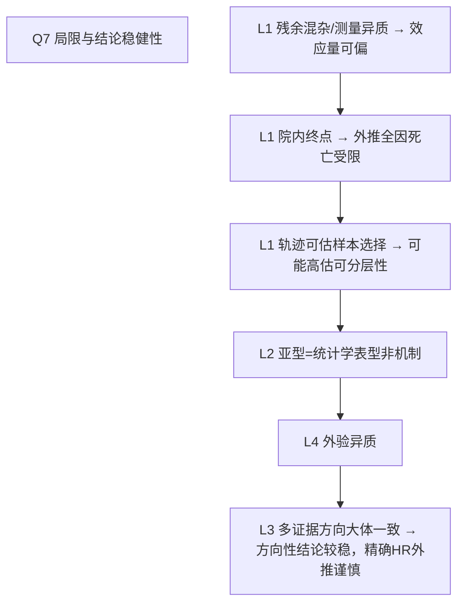

# Question Q7

## AI-A Round1 tree

# AI-A Decision Tree Round 1

paper_id: paper_1871653
question_id: Q7
task_type: literature_decision_tree_reasoning
question: Q7 局限有哪些？是否动摇主结论方向？
source_file: adversarial_lit_reading/chunks/paper_1871653_fcimb_temperature_jlcm.md

## 1. Evidence Map

| evidence_id | location | evidence_summary | used_by_node |
|---|---|---|---|
| E1 | Discussion/局限（及设计段） | 观察性残余混杂；体温测量设备/部位/频率异质 | N1 |
| E2 | Methods 2.4 | 仅院内死亡，出院后死亡不可靠（尤其 eICU） | N2 |
| E3 | Methods 选入 | 需足够纵向测量才能估轨迹 → 选择偏倚（排除者死亡更高、LOS 更短，Supp） | N3 |
| E4 | Methods | MAP 硬分类；潜类别解释非机制证明 | N4 |
| E5 | 外验设计 | 验证集合并异质来源；单中心占比小 | N5 |

## 2. Decision Tree - Mermaid

## 3. Node Table

| node_id | node_type | claim | evidence_location | evidence_summary | confidence | risk_tag |
|---|---|---|---|---|---|---|
| N1 | limitation | 混杂与测量 | Discussion | 观察性 | high | 因果过度 |
| N2 | limitation | 院内终点 | Methods 2.4 | 失访控制代价 | high | |
| N3 | limitation | 入选偏倚 | Supp 排除比较 | 死亡更高 | high | |
| N4 | limitation | 亚型非机制 | Discussion | 解释边界 | high | |
| N5 | limitation | 外验异质 | Methods | 合并队列 | medium | |
| N6 | claim | 方向结论相对稳健 | Results 多证据 | 外验大致同向 | medium | |

## 4. Provisional Answer

主要局限：观察性混杂、测量异质、院内终点外推受限、轨迹样本选择偏倚、亚型非机制、外验队列异质。多重分析与外验使**方向性**结论较稳，但精确效应量与临床阈值迁移需谨慎。复合指标复现另增：日级分辨率、指标阈值不可照抄体温切点、多指标多重比较。

## 5. Uncertainty List

- U1: Discussion 全文在 chunk 后部，个别局限措辞可能截断。

## 6. Follow-up Questions

1. COPD Limitations 是否强制写「无南京单中心外验」？

## PAPER CHUNK

# Page 1

Body temperature as a dynamic
host-response biomarker in
sepsis: trajectories and time-
varying mortality risk
Baoyan Wang 1†, Peijuan Xu 2†, Jialin Qi 3, Qian Ni 3, Dan Han 1*
and Tong Qiao 1*
1Nanjing Drum Tower Hospital, Affiliated Hospital of Medical School, Nanjing University, Nanjing,
Jiangsu, China, 2Nanjing Tongren Hospital, School of Medicine, Southeast University, Nanjing,
Jiangsu, China, 3Nanjing Drum Tower Hospital, Nanjing Drum Tower Hospital Clinical College, Nanjing
University of Chinese Medicine, Nanjing, Jiangsu, China
Background: Body temperature is a readily available physiological signal that may
reflect dynamic host responses in sepsis, yet most studies rely on single or early
measurements and do not capture the dynamic nature of thermoregulation
during critical illness. Whether the association between body temperature and
mortality varies over the course of sepsis remains unclear.
Methods: In this multicenter retrospective cohort study, patients with sepsis were
identified from the MIMIC-IV database as the derivation cohort and externally
validated using the eICU Collaborative Research Database and a single-center
intensive care unit (ICU) cohort from Nanjing Drum Tower Hospital. Body
temperature was summarized into 6-hour intervals during the ICU stay. The
primary outcome was 28-day in-hospital mortality. Joint latent class mixed
models were used to identify temperature trajectory classes and generate
landmark-based dynamic survival predictions. Piece-wise exponential additive
mixed models were applied to estimate the nonlinear and time-varying
association between infection-related temperature responses and in-
hospital mortality.
Results: A total of 8681 patients were included in the derivation cohort and 13717
in the validation cohort. Five distinct temperature trajectory classes were
identified, demonstrating heterogeneous thermoregulatory patterns during the
ICU stay. Mortality risk differed significantly across trajectory classes. The low-
increase-moderate hyperthermia trajectory was associated with the highest
mortality risk in both early and later periods of hospitalization. Dynamic
prediction models incorporating longitudinal temperature trajectories showed
better overall discrimination than models based on single temperature
measurements. Time-varying analysis revealed a nonlinear U-shaped
relationship between temperature and mortality, with the lowest risk near the
upper range of normothermia. Both hypothermia and hyperthermia were
associated with increased mortality, and the prognostic impact of infection-
related temperature responses varied over the ICU course, peaking at
approximately 4 days after ICU admission.
Frontiers in Cellular and Infection Microbiology
frontiersin.org
01
OPEN ACCESS
EDITED BY
Georgia Damoraki,
National and Kapodistrian University of
Athens, Greece
REVIEWED BY
Ioanna Styliara,
University of Patrass, Greece
Panagiotis Thanasoulias,
Hellenic Institute for the Study of Sepsis,
Greece
*CORRESPONDENCE
Dan Han
handanjelly@126.com
Tong Qiao
qiaotongmail@nju.edu.cn
†These authors have contributed
equally to this work and share
first authorship
RECEIVED 03 May 2026
REVISED 22 June 2026
ACCEPTED 01 July 2026
PUBLISHED 22 July 2026
CITATION
Wang B, Xu P, Qi J, Ni Q, Han D and
Qiao T (2026) Body temperature
as a dynamic host-response biomarker
in sepsis: trajectories and
time-varying mortality risk.
Front. Cell. Infect. Microbiol. 16:1871653.
doi: 10.3389/fcimb.2026.1871653
COPYRIGHT
© 2026 Wang, Xu, Qi, Ni, Han and Qiao.
This is an open-access article distributed
under the terms of the Creative
Commons Attribution License (CC BY).
The use, distribution or reproduction in
other forums is permitted, provided the
original author(s) and the copyright
owner(s) are credited and that the
original publication in this journal is
cited, in accordance with accepted
academic practice. No use, distribution
or reproduction is permitted which does
not comply with these terms.
TYPE Original Research
PUBLISHED 22 July 2026
DOI 10.3389/fcimb.2026.1871653

# Page 2

Conclusion: Body temperature may serve as a dynamic host-response marker in
sepsis, with prognostic significance determined by both temporal trajectory
patterns and disease stage. Longitudinal temperature monitoring could provide
a clinically accessible strategy for dynamic risk stratification and future
temperature-guided precision management in sepsis.
KEYWORDS
biomarker, body temperature, dynamic prediction, precision medicine, sepsis
1 Introduction
Sepsis remains a major cause of mortality worldwide and is
characterized by marked heterogeneity in host response, disease
progression, and treatment responsiveness. One challenge in risk
stratification and individualized management is the lack of readily
available markers that capture dynamic clinical states during critical
illness (Scherger and Kalil, 2024; Antcliffe et al., 2025). Although
molecular biomarkers have been extensively investigated, many
remain costly, delayed, or impractical for real-time bedside use.
Body temperature is one of the most frequently measured physio-
logical variables in critically ill patients and reflects the complex
interplay between host immune response, metabolic regulation, and
disease severity (Drewry and Mohr, 2022). As such, temperature
may represent a clinically accessible host-response biomarker (Zhao
and Zhang, 2024; Inghammar and Sunden-Cullberg, 2020).
However, most previous studies have relied on static or early
measurements, potentially overlooking clinically important tempo-
ral patterns.
To overcome the limitations of static temperature measures,
Bhavani and colleagues applied longitudinal temperature trajectory
modeling to identify reproducible sepsis subphenotypes with dis-
tinct mortality risks (Bhavani et al., 2019, Bhavani et al., 2020,
Bhavani et al., 2024). These trajectories were subsequently shown to
be associated with divergent immune and coagulation profiles,
supporting their biological relevance. Together, these findings
highlight temperature dynamics as an important marker of hetero-
geneity in host response during sepsis. While temperature trajectory
modeling has substantially advanced phenotyping efforts in sepsis
(Kijpaisalratana et al., 2025; Bhavani et al., 2022), important gaps
remain. First, trajectory-based approaches primarily classify
patients according to early patterns but do not directly quantify
how the prognostic impact of temperature evolves over time.
Second, they provide limited insight into whether the mortality
risk associated with abnormal temperature is constant throughout
the intensive care unit (ICU) course or amplified during specific
high-risk periods. As a result, the temporal interaction between
thermoregulatory dynamics and evolving baseline mortality risk
remains incompletely understood.
In the present study, we combined joint latent class mixed
models to characterize temperature trajectories during the ICU stay
with piece-wise exponential additive mixed models to evaluate the
time-varying association between body temperature and in-hospital
mortality in adult ICU patients with sepsis. This integrative
approach allowed us to evaluate temperature trajectories within a
dynamic risk framework and to examine whether deviations from
normothermia were associated with periods of heightened mortality
risk during the ICU course.
2 Materials and methods
2.1 Study design and populations
This study was a multicenter retrospective cohort analysis based
on data from the Medical Information Mart for Intensive Care IV
(MIMIC-IV) v3.1 database available at PhysioNet (certification
number: 62316327), the eICU Collaborative Research Database
(eICU-CRD) v2.0 and a single-center ICU cohort from Nanjing
Drum Tower Hospital. Use of the MIMIC-IV and eICU-CRD
databases was approved by the institutional review boards of the
Massachusetts Institute of Technology and participating institu-
tions, with a waiver of informed consent due to de-identified data.
The Nanjing Drum Tower Hospital cohort was approved by the
hospital ethics committee, and the requirement for informed
consent was waived owing to the retrospective study design.
Patients with sepsis were identified separately in each data
source according to data availability and clinical documentation
practices. Patients were excluded if they met any of the following
criteria: (1) age <18 years at ICU admission; (2) repeated ICU
admissions during the same hospitalization (only the first ICU stay
was retained); (3) fewer than five valid temperature measurements
during the ICU stay, to ensure sufficient longitudinal information
for reliable trajectory estimation. A detailed flowchart of patient
selection and cohort construction is provided in Supplementary
Figure 1. In the MIMIC-IV and eICU-CRD, sepsis was identified
using International Classification of Diseases, Ninth and Tenth
Abbreviations: APS III, Acute Physiology Score III; AUC, Area under the
receiver operating characteristic curve; BIC, Bayesian information criterion;
CCI, Charlson comorbidity index; CHF, Congestive heart failure; CKD,
Chronic kidney disease; CRRT, Continuous renal replacement therapy; eICU-
CRD, eICU Collaborative Research Database; Hb, Hemoglobin concentration;
HRs, Hazard ratios; ICD-9, International Classification of Diseases, Ninth
Revision; ICD-10, International Classification of Diseases, Tenth Revision;
ICU, Intensive care unit; IQR, Interquartile range; JLCMMs, Joint latent class
mixed models; MAP, Mean arterial pressure; MICE, Multiple imputation by
chained equations; MIMIC-IV, Medical Information Mart for Intensive Care IV;
PAMMs, Piece-wise exponential additive mixed models; PLT, Platelet count;
SOFA, Sequential organ failure assessment; SpO2, Peripheral oxygen saturation;
WBC, White blood cell count.
Wang et al.
10.3389/fcimb.2026.1871653
Frontiers in Cellular and Infection Microbiology
frontiersin.org
02

# Page 3

Revision (ICD-9 and ICD-10) diagnosis codes, consistent with
previously published large database studies. These code-based
algorithms have been widely used and validated for epidemiological
research in administrative critical care databases. In contrast, in the
Nanjing Drum Tower Hospital cohort, detailed clinical and labo-
ratory data enabled the direct application of contemporary inter-
national diagnostic criteria. Sepsis was therefore defined according
to the Sepsis-3 definition as suspected or confirmed infection
accompanied by acute organ dysfunction, operationalized as an
increase in Sequential Organ Failure Assessment (SOFA) score of
≥2 points (Singer et al., 2016). Diagnoses were adjudicated based on
comprehensive review of electronic medical records, including
clinical documentation, microbiological findings, and labora-
tory data.
2.2 Temperature measurement and
preprocessing
Because the exact onset time of sepsis could not be reliably
determined across databases, ICU admission was used as the
common temporal anchor for all longitudinal analyses. Body
temperature monitoring began at the time of ICU admission in
all cohorts. Temperature measurements were extracted from rou-
tinely recorded bedside vital signs. To harmonize temporal resolu-
tion across databases, the ICU stay was divided into consecutive 6-
hour intervals, and the maximum temperature value within each
interval was retained to represent peak thermoregulatory response
during that period. Using the maximum temperature within each
interval allowed us to capture clinically relevant temperature
elevations that may reflect the host inflammatory response.
Temperature values were standardized to degrees Celsius.
2.3 Variable extraction
Baseline demographic characteristics, comorbidities, disease
severity scores, laboratory tests, and physiological parameters
were extracted from each database using standardized definitions.
Demographic variables included age, sex, and race/ethnicity
recorded at ICU admission. Pre-existing comorbidities were iden-
tified using International Classification of Diseases codes (ICD-9 or
ICD-10) and included congestive heart failure (CHF), diabetes
mellitus, hypertension, chronic pulmonary disease, malignancy,
and chronic kidney disease (CKD). Overall comorbidity burden
was summarized using the Charlson Comorbidity Index (CCI).
Severity of illness at ICU admission was assessed using the Acute
Physiology Score III (APS III), calculated according to established
definitions using the worst physiological and laboratory values
recorded within the first 24 hours after ICU admission.
Laboratory variables included white blood cell count (WBC),
hemoglobin concentration (Hb), lactate and platelet (PLT) ex-
tracted from routine blood tests performed within the first 24
hours after ICU admission. When multiple measurements were
available, the first recorded value was used to represent baseline
laboratory status. Physiological variables included respiratory rate,
heart rate, peripheral oxygen saturation (SpO2), and mean arterial
pressure (MAP). For baseline adjustment, the first recorded values
within the first 24 hours after ICU admission were used. Organ
support therapies included the use of mechanical ventilation and
continuous renal replacement therapy (CRRT) during the ICU stay.
All covariates were prespecified based on clinical relevance and
prior literature and were included in multivariable models to adjust
for potential confounding.
2.4 Outcomes
The primary outcome was 28-day in-hospital mortality, defined
as death occurring during hospitalization within 28 days after ICU
admission. Patients who were discharged alive before day 28 were
treated as experiencing a competing event, as they were no longer at
risk of in-hospital death. Patients remaining hospitalized beyond 28
days were administratively censored at day 28. This outcome was
selected to ensure consistency and comparability across data
sources, as post-discharge mortality information is not reliably
available in the eICU-CRD database.
Hospital discharge vital status was obtained from discharge dispo-
sition variables in the MIMIC-IV and eICU-CRD cohorts and from
electronic medical records in the Nanjing Drum Tower Hospital
cohort. By focusing on in-hospital mortality, we ensured consistent
outcome ascertainment across all cohorts while minimizing potential
misclassification due to incomplete post-discharge follow-up.
2.5 Statistical analysis
Model development was performed in the MIMIC-IV cohort,
and external validation was conducted using the combined eICU-
CRD and Nanjing Drum Tower Hospital cohorts.
2.5.1 Trajectory modeling, dynamic prediction,
and model evaluation
In the derivation cohort (MIMIC-IV), longitudinal body tem-
perature data were modeled using joint latent class mixed models
(JLCMMs) to identify distinct temperature trajectory subphenotypes.
The longitudinal submodel was specified using natural cubic splines
of time since ICU admission, with both intercept and time effects
allowed to vary across latent classes. The survival submodel included
pre-specified baseline covariates, and a Weibull baseline hazard
function was assumed. To ensure model stability and avoid conver-
gence to local optima, an initial single-class model (ng = 1) was first
fitted to obtain starting values. Subsequently, models with increasing
numbers of latent classes were estimated using a grid search proce-
dure with multiple random initializations.
Temperature trajectories were modeled using class-specific
mixed-effects models, with time since ICU admission treated as a
continuous variable. All available temperature measurements
during the ICU stay were used to capture the full longitudinal
evolution of thermoregulatory responses throughout critical illness.
The optimal number of latent classes was determined based on
Bayesian information criterion (BIC), posterior class-membership
probabilities, entropy, and clinical interpretability. Each class was
required to contain at least 5% of the study population, and patients
were assigned to the class with the highest posterior probability.
Wang et al.
10.3389/fcimb.2026.1871653
Frontiers in Cellular and Infection Microbiology
frontiersin.org
03

# Page 4

Trajectory patterns were visualized to illustrate the temporal
evolution of body temperature across classes. Kaplan-Meier curves
were constructed within a landmark framework to compare survival
across trajectory groups. Survival differences were assessed using
the log-rank test. Time-dependent hazard ratios (HRs) were further
estimated using a piecewise Cox proportional hazards model, with
the optimal cut point determined by the highest log-likelihood.
2.5.2 Dynamic prediction and model
discrimination
The fitted JLCMMs were used to generate dynamic predictions of
survival probability from a given landmark time to subsequent time
points during follow-up. Each day from ICU admission through day
14 was defined as a landmark time point. At each landmark time,
predicted survival probabilities from the landmark time to day 28
were derived for patients who remained alive at the landmark time.
Patients who experienced the outcome prior to a given landmark time
were excluded from the analysis at that landmark, consistent with
standard landmark analysis methodology.
Model discrimination was evaluated using time-dependent area
under the receiver operating characteristic curve (AUC) within the
landmark framework. At each landmark time, survival time was
redefined from the landmark to day 28 or censoring. For the static
model, only the temperature value measured at the landmark time
was used for prediction, whereas for the dynamic model, survival
probabilities were obtained from the joint latent class model
incorporating longitudinal temperature trajectories. Confidence
intervals were estimated using bootstrap resampling with 2000
iterations, and model comparisons were performed using permu-
tation testing with 2000 repetitions.
2.5.3 Time-varying survival analysis
To further characterize the continuous and time-dependent
association between body temperature and mortality beyond discrete
trajectory groups, piece-wise exponential additive mixed models
(PAMMs) were applied in the MIMIC-IV cohort. Follow-up time
was discretized into short intervals, and body temperature was treated
as a time-varying exposure. All available temperature measurements
during the ICU stay were incorporated into the time-varying expo-
sure structure. Penalized splines were used to flexibly model the
nonlinear relationship between temperature and mortality risk as well
as its interaction with time since ICU admission. Baseline covariates
were included as time-fixed confounders.
To further evaluate the impact of temperature abnormalities,
four complementary exposure metrics were analyzed: continuous
temperature, threshold-defined abnormalities, proportion of expo-
sure time, and cumulative exposure burden. Hypothermia was
defined as temperature ≤36 °C and hyperthermia as temperature
≥39 °C. The proportion of time spent in hypothermia or hyper-
thermia was modeled as the hazard ratio per 5% increase in
exposure time. Cumulative exposure burden was calculated as the
total accumulated exposure below 36 °C or at or above 39 °C.
Adjusted hazard ratios and 95% confidence intervals were estimated
using multivariable Cox proportional hazards models.
2.5.4 External validation
External validation was performed using the combined eICU-
CRD and Nanjing Drum Tower Hospital cohorts. Temperature
data were processed using the same preprocessing strategy as in the
derivation cohort. Posterior class-membership probabilities were
estimated using model parameters derived from the MIMIC-IV
cohort, and trajectory distributions and associated mortality risks
were compared across cohorts. Time-varying temperature-mortal-
ity associations were also re-estimated using the same modeling
framework to assess reproducibility.
2.5.5 Sensitivity analyses
In the primary analysis, cause-specific hazard models were
applied, with discharge alive before day 28 treated as censoring.
To account for competing events, Fine-Gray subdistribution hazard
models were used in sensitivity analyses, treating discharge as a
competing risk. Consistency between the two approaches was used
to assess robustness. Furthermore, we repeated the trajectory and
time-varying analyses using 28-day mortality as the outcome in the
MIMIC-IV cohort, where complete follow-up was available.
Temperature trajectories were re-identified using JLCMMs, and
time-varying associations were evaluated using PAMMs, following
the same analytical framework as in the primary analysis.
Continuous variables were summarized as mean (standard
deviation) or median (interquartile range), as appropriate, and
categorical variables as counts and percentages. Missing values in
covariates were handled using multiple imputation by chained
equations (MICE). All models were prespecified based on clinical
relevance and prior literature. All analyses were performed using
RStudio software (version 2026.01.1 + 403).
3 Results
3.1 Baseline characteristics of study
populations
The derivation cohort comprised 8681 patients with sepsis from
the MIMIC-IV database, of whom 1469 (16.92%) died before
hospital discharge. The validation cohort included 13029 patients
from the eICU-CRD and 688 patients from Nanjing Drum Tower
Hospital who met the eligibility criteria; overall, 2263 patients
(16.50%) died during hospitalization. Baseline characteristics of
patients in the derivation and validation cohorts were summarized
in Table 1. Patient characteristics were broadly comparable between
the derivation and validation cohorts, although several differences
were observed. Patients in the derivation cohort had a higher
comorbidity burden, as reflected by a higher CCI. Laboratory
values and vital signs were generally similar across cohorts. The
use of mechanical ventilation was more frequent in the derivation
cohort, while the proportion of patients receiving CRRT was
comparable between groups. Compared with included patients,
excluded patients had a higher mortality rate and shorter ICU
length of stay (Supplementary Tables 1 and 2).
Wang et al.
10.3389/fcimb.2026.1871653
Frontiers in Cellular and Infection Microbiology
frontiersin.org
04

# Page 5

3.2 Identification of subpopulations using
the JLCMMs
The number of latent classes was selected based on model fit
and classification quality. Model fit improved with increasing
numbers of classes, as indicated by higher log-likelihood values
and decreasing BIC, with the lowest BIC observed for the five-class
model (Supplementary Table 3). Although entropy peaked in the
four-class model and declined slightly in the five-class model,
classification quality remained acceptable in the five-class model,
with adequate class sizes (all >5%) and high mean posterior
probabilities across classes (>0.70, Supplementary Table 4),
supporting reliable class assignment. Moreover, the five-class solu-
tion provided clearer separation in mortality risk. Therefore, the
five-class model was selected as the primary trajectory solution.
Similarly, Supplementary Tables 5 and 6 presented the model fit
metrics and mean posterior probabilities for the validation cohort.
Using joint latent class mixed models, five distinct temperature
trajectories were identified during the ICU stay in the derivation
cohort (Figure 1a), reflecting heterogeneous thermoregulatory pat-
terns among patients. Class 1 (high-decrease-low plateau, n = 635)
showed initially elevated temperatures with a progressive decrease
during the early ICU course, stabilizing at lower levels thereafter.
Class 2 (early peak-gradual decline, n = 673) displayed an early rise
TABLE 1 Baseline characteristics of the derivation and validation cohorts.
Items
Derivation cohort (n=8681)
Validation cohort
(n=13717)
Age (years), median [IQR]
68.98 [57.74, 79.62]
67.00 [55.00, 78.00]
Gender, n (%)
Male
4836 (55.71%)
7217 (52.61%)
Female
3845 (44.29%)
6500 (47.39%)
Race, n (%)
White
5767 (66.43%)
10211 (74.44%)
Black/African American
915 (10.54%)
1211 (8.83%)
Asian/Hispanic/Other
915 (10.54%)
876 (6.39%)
Unknown
1084 (12.49%)
1419 (10.34%)
Comorbidity, n (%)
CHF
2951 (33.99%)
1607 (11.72%)
Diabetes
3065 (35.31%)
2252 (16.42%)
Chronic pulmonary disease
1055 (12.15%)
1609 (11.73%)
Hypertension
3753 (43.23%)
1892 (13.79%)
Cancer
2709 (31.21%)
709 (5.17%)
CKD
2485 (28.63%)
1705 (12.43%)
CCI (median [IQR])
6.00 [4.00, 8.00]
4.00 [3.00, 6.00]
Illness severity (median [IQR])
APS III
57.00 [44.00, 74.00]
54.00 [41.00, 72.00]
Laboratory Index (median [IQR])
WBC
13.20 [8.40, 19.40]
13.10 [8.70, 18.80]
Lactate
2.00 [1.30, 3.10]
1.70 [1.10, 2.80]
PLT
185.00 [121.00, 266.00]
180.00 [121.00, 251.00]
Hb
10.20 [8.70, 11.70]
10.40 [8.90, 12.10]
Vital signs (median [IQR])
Respiratory rate
21.00 [17.00, 25.00]
22.00 [18.00, 27.00]
MAP
76.00 [66.00, 88.00]
74.00 [63.00, 89.00]
Heart rate
96.00 [82.00, 112.00]
98.00 [83.00, 113.00]
SpO2
97.00 [94.00, 99.00]
97.00 [94.00, 99.00]
Mechanical Ventilation
4141 (47.70%)
4467 (32.57%)
CRRT
353 (4.07%)
464 (3.38%)
28-day in-hospital mortality, n (%)
1469 (16.92%)
2263 (16.50%)
Length of ICU stay (days), median [IQR]
4.58 [2.81, 9.25]
3.74 [2.17, 7.57]
Wang et al.
10.3389/fcimb.2026.1871653
Frontiers in Cellular and Infection Microbiology
frontiersin.org
05

# Page 6

in temperature, peaking within the first week, followed by a gradual
downward trend. Class 3 (low-increase-moderate hyperthermia, n =
604) demonstrated mildly reduced baseline temperatures followed
by a gradual increase before slowly declining. Class 4 (high-
decrease-rebound, n = 1032) was characterized by marked hyper-
thermia at ICU admission, followed by a rapid early decline and a
gradual rebound over time. Class 5 (stable normothermia, n =
5737), the largest group, exhibited relatively stable normothermic
temperatures with minimal fluctuation throughout follow-up.
Overall, separation between trajectory classes became increasingly
evident with longer ICU duration, indicating that longitudinal
temperature patterns provided additional phenotypic information
beyond early measurements alone. Comparable temperature trajec-
tory patterns were observed in the validation cohort, demonstrating
consistency of the identified trajectories across cohorts (Figure 1b).
Landmark Kaplan-Meier survival curves demonstrated signifi-
cant differences in in-hospital mortality among the five temperature
trajectory classes in the derivation cohort (log-rank test, P < 0.001;
Figure 2a). Crossing survival curves indicated potential violation of
the proportional hazards. A piecewise Cox regression was utilized to
account for time-varying coefficients and the model with the highest
log-likelihood was selected, determining day 5 as the optimal cut
point. The results from the piecewise Cox model indicated marked
time-dependent differences in mortality risk across temperature
trajectory classes (Supplementary Table 7). During the early period
(0–5 days), Class 3 exhibited the highest mortality risk compared with
Class 1 (HR = 2.85, 95%CI: 2.03-3.99), followed by Class 2
(HR = 1.94, 95%CI: 1.37-2.75). In the later period (5–28 days),
Class 3 remained associated with the highest mortality risk
(HR = 2.21, 95%CI: 1.69-2.90). Similar class-specific survival separa-
tion was observed in the validation cohort (Figure 2b;
Supplementary Table 8).
3.3 Trajectory-specific dynamic prediction
of in-hospital mortality
In the derivation cohort, clear separation in predicted mortality
risk across trajectory classes was observed across landmark times
(Figure 3). At the early landmark (day 2), Class 3 exhibited the
highest predicted mortality, whereas Class 4 showed the lowest risk.
FIGURE 1
Temperature trajectory classes identified by joint latent class mixed models in the derivation and validation cohorts. (a) Model-estimated body
temperature trajectories in the MIMIC-IV derivation cohort. (b) Corresponding temperature trajectory patterns in the external validation cohort. The
x-axis represents time after ICU admission, and the y-axis represents body temperature in degrees Celsius.
Wang et al.
10.3389/fcimb.2026.1871653
Frontiers in Cellular and Infection Microbiology
frontiersin.org
06

# Page 7

The relative ranking of trajectory classes remained largely stable
over time, while separation between high- and low-risk groups
became more pronounced at later landmarks, particularly day 12,
indicating that the prognostic value of temperature trajectories
strengthened with accumulating longitudinal information. A sim-
ilar pattern was observed in the external validation cohort
(Figure 4). Notably, the stable normothermia trajectory (Class 5)
remained at an intermediate risk level across most landmark times.
These findings supported the robustness and generalizability of
trajectory-based dynamic risk stratification.
Time-dependent AUCs were estimated within the landmark
framework from day 1 to day 14 among patients alive at each
landmark (Supplementary Figure 2). Both models showed moderate
discrimination, with the dynamic model consistently outperform-
ing the static model. Although statistical significance was not
observed at every landmark, the dynamic model demonstrated
superior discrimination across most early and intermediate time
points and maintained an overall advantage throughout the 14-day
period. These findings indicate that incorporating longitudinal
temperature trajectories provides additional prognostic value
beyond single time-point measurements.
3.4 Time-varying association between
body temperature and in-hospital mortality
Using PAMMs, a non-linear U-shaped association was
observed between time-varying temperature and mortality risk,
with the lowest hazard observed at temperatures around 37.6 °C,
near the upper range of normothermia. Both lower and higher
temperatures were associated with increased risk (Figure 5a). When
FIGURE 2
Kaplan-Meier curves for time to in-hospital mortality within 28 days after ICU admission, stratified by temperature trajectory class. (a) Survival curves
in the MIMIC-IV derivation cohort. (b) Survival curves in the external validation cohort. Patients were grouped by temperature trajectory class, and
survival differences were compared using the log-rank test; crossing curves supported subsequent piecewise Cox regression.
Wang et al.
10.3389/fcimb.2026.1871653
Frontiers in Cellular and Infection Microbiology
frontiersin.org
07

# Page 8

stratified by landmark time points (Figure 5b), the temperature-
mortality association remained non-linear across all time windows.
Temporal differences were most evident near the nadir of the curve,
whereas the associations at lower and higher temperature ranges
were more consistent across time. Mortality risk increased rapidly
during the early phase after ICU admission, peaked at around day 4,
and gradually attenuated thereafter (Figure 5c), indicating a time-
dependent effect of temperature. When stratified by temperature
levels, patients with hypothermia or hyperthermia exhibited greater
temporal variation in mortality risk, whereas those with tempera-
tures around the nadir of the U-shaped curve demonstrated the
least fluctuation in risk over time (Figure 5d). Collectively, these
findings demonstrated a dynamic and time-dependent relationship
between body temperature and in-hospital mortality, supporting
temperature as a clinically meaningful time-varying prognostic
marker. Similar temporal patterns were observed in the external
validation cohort, indicating good reproducibility of the tempera-
ture-mortality association across independent datasets (Figure 6).
Four complementary analyses consistently demonstrated sig-
nificant associations between temperature abnormalities and mor-
tality (Supplementary Table 9). When temperature was analyzed as
a continuous variable, each 1 °C increase was associated with a
modest reduction in mortality risk. Using prespecified, clinically
defined thresholds, hypothermia (≤36 °C) and hyperthermia (≥39 °
C) were defined in accordance with commonly used definitions in
critical care literature (Laupland et al., 2008; O'Grady et al., 2008),
and both were associated with increased mortality, consistent with
the nonlinear temperature-mortality relationship observed in the
primary analysis. Similarly, greater proportions of time spent in
hypothermia or hyperthermia were associated with progressively
higher mortality risk. Finally, cumulative exposure to temperature
abnormalities showed a dose-response association with mortality,
with both cumulative hypothermia and hyperthermia burdens
significantly increasing the hazard of death. Similar associations
were observed in the validation cohort (Supplementary Table 10).
3.5 Sensitivity analyses
To account for the competing event of alive hospital discharge,
we performed Fine-Gray competing-risk analyses (Supplementary
Table 11). In these analyses, Classes 2 and 3 remained significantly
associated with increased mortality, and Class 3 consistently exhib-
ited the highest risk. For Classes 4 and 5, the estimates differed from
those of the cause-specific Cox models, likely reflecting differences
in discharge patterns and the impact of competing events. In the
sensitivity analysis using 28-day mortality as the outcome, similar
temperature trajectory patterns were identified, with five distinct
subphenotypes demonstrating consistent longitudinal trends com-
pared with the primary analysis (Supplementary Figure 4).
Dynamic prediction analyses within the landmark framework
showed that differences in predicted mortality risk across trajectory
classes were already evident at early time points and became
progressively more pronounced with increasing landmark time
(Supplementary Figure 5). Notably, Class 3 consistently demon-
strated the highest predicted mortality risk across all landmark time
points. In addition, PAMM analyses using 28-day mortality as the
outcome yielded results consistent with the primary analysis
(Supplementary Figure 6).
FIGURE 3
Dynamic body temperature trajectories and landmark-based prediction of 28-day in-hospital mortality across five trajectory classes in the derivation
cohort. (a) Temperature measurements in the first 2 days and predicted mortality probability in the next 26 days; (b) Temperature measurements in
the first 5 days and predicted mortality probability in the next 23 days; (c) Temperature measurements in the first 7 days and predicted mortality
probability in the next 21 days; (d) Temperature measurements in the first 12 days and predicted mortality probability in the next 16 days.
Wang et al.
10.3389/fcimb.2026.1871653
Frontiers in Cellular and Infection Microbiology
frontiersin.org
08

# Page 9

FIGURE 4
Dynamic body temperature trajectories and landmark-based prediction of 28-day in-hospital mortality across five trajectory classes in the validation
cohort. (a) Temperature measurements in the first 2 days and predicted mortality probability in the next 26 days; (b) Temperature measurements in
the first 5 days and predicted mortality probability in the next 23 days; (c) Temperature measurements in the first 7 days and predicted mortality
probability in the next 21 days; (d) Temperature measurements in the first 12 days and predicted mortality probability in the next 16 days.
FIGURE 5
Time-varying association between body temperature and in-hospital mortality estimated using PAMMs in the derivation cohort. (a) Adjusted
relationship between time-varying body temperature and in-hospital mortality; (b) Adjusted relationship between time-varying body temperature
and in-hospital mortality stratified by landmark time points; (c) Time-varying effect of body temperature on in-hospital mortality; (d) Time-varying
effect of body temperature on in-hospital mortality stratified by temperature levels.
Wang et al.
10.3389/fcimb.2026.1871653
Frontiers in Cellular and Infection Microbiology
frontiersin.org
09

# Page 10

4 Discussion
In this multicenter study, we demonstrated that body temperature
may act as a dynamic host-response biomarker in sepsis, with prog-
nostic value determined by both longitudinal thermoregulatory patterns
and disease stage. Five reproducible temperature trajectory classes were
identified across cohorts. The low-increase-moderate hyperthermia
trajectory consistently showed the highest mortality risk, whereas the
stable normothermic trajectory was not consistently associated with the
lowest risk. Incorporating trajectory information into a landmark-based
framework improved dynamic risk discrimination compared with
models based on single measurements. In parallel, time-varying analyses
revealed a nonlinear U-shaped association between temperature and
mortality, with the lowest risk near the upper range of normothermia
and the strongest prognostic effect occurring during the early-to-middle
phase after ICU admission. These findings suggested that temperature
in sepsis could be interpreted as an evolving biological signal whose
clinical meaning changes over time.
Trajectory-based and time-varying approaches provided comple-
mentary insights into thermoregulatory heterogeneity and dynamic
risk evolution. JLCMM-derived trajectories captured between-patient
heterogeneity by identifying distinct thermoregulatory phenotypes,
whereas PAMMs quantified how the association between temperature
and mortality changed during the course of illness. This distinction is
clinically important because the same temperature value may carry
different prognostic implications depending on when it occurs and how
temperature has evolved previously. Conventional threshold-based
approaches, which treat temperature as a static measurement, cannot
capture this complexity. Our results suggested that risk assessment may
benefit from considering both current temperature and preceding
temperature trajectory.
Our findings should be interpreted in the context of previous
studies on temperature abnormalities and outcomes in sepsis. Prior
observational studies and meta-analyses have consistently reported that
hypothermia was associated with increased mortality, whereas the
prognostic meaning of fever has been more heterogeneous (Rumbus
et al., 2017; Tan et al., 2024; Sundén-Cullberg et al., 2017). Moderate
fever may reflect a preserved host response in selected patients, while
excessive or persistent hyperthermia may indicate uncontrolled
inflammation or metabolic stress. These apparently divergent findings
may partly reflect differences in study populations, timing of temper-
ature assessment, definitions of fever and hypothermia, and whether
temperature was analyzed as a single measurement, a threshold-based
exposure, or a longitudinal process. Our results helped refine this
interpretation by showing that the prognostic meaning of temperature
depends not only on its absolute level, but also on its trajectory and
timing during the ICU course. In the PAMM analysis, the temperature-
mortality association was nonlinear, with the lowest risk near the upper
range of normothermia, whereas both hypothermia and hyperthermia
were associated with increased risk. Importantly, this association was
not constant over time, with the strongest prognostic impact observed
during the early-to-middle phase after ICU admission. These findings
suggested that fever, hypothermia, and normothermia should not be
interpreted as fixed prognostic states; rather, their clinical implications
FIGURE 6
Time-varying association between body temperature and in-hospital mortality estimated using PAMMs in the validation cohort. (a) Adjusted
relationship between time-varying body temperature and in-hospital mortality; (b) Adjusted relationship between time-varying body temperature
and in-hospital mortality stratified by landmark time points; (c) Time-varying effect of body temperature on in-hospital mortality; (d) Time-varying
effect of body temperature on in-hospital mortality stratified by temperature levels.
Wang et al.
10.3389/fcimb.2026.1871653
Frontiers in Cellular and Infection Microbiology
frontiersin.org
10

# Page 11

may vary according to disease stage and longitudinal temperature
evolution. Recent trajectory-based studies have shown that longitudinal
temperature patterns identify reproducible sepsis subphenotypes asso-
ciated with distinct clinical outcomes and immune or coagulation
profiles (Zhang et al., 2025; Thomas-Rüddel et al., 2021). Our study was
consistent with this concept but extended it by integrating trajectory
phenotyping, landmark-based dynamic prediction, and time-varying
hazard modeling. This framework showed that temperature dynamics
provided prognostic information across multiple dimensions, including
absolute temperature level, cumulative exposure, trajectory direction,
and temporal context. It may also help explain why stable normother-
mia was not consistently associated with the lowest mortality risk, as
normothermia may represent different underlying states, including true
physiological stability, treated fever, impaired febrile response, or
recovery from prior temperature abnormalities.
The observed temporal variability in the prognostic impact of
temperature likely reflects evolving interactions among immune regula-
tion, inflammation, and metabolic stress. Fever is a hallmark of host
defense against infection, and moderate temperature elevation may
inhibit pathogen replication, enhance immune activation, and promote
effective host responses (Evans et al., 2015; Launey et al., 2011).
Accordingly, early fever may indicate a relatively preserved adaptive
immune response. In contrast, hypothermia may reflect impaired
immune activation or exhaustion of host-defense mechanisms, including
suppressed cytokine responses, reduced leukocyte function, and features
of immune paralysis, which may compromise pathogen clearance and
contribute to early mortality (Bhavani et al., 2019). Excessive or
prolonged hyperthermia may instead indicate uncontrolled systemic
inflammation and metabolic dysregulation; sustained high temperatures
can increase cardiac workload, oxygen consumption, fluid loss, and
organ injury risk (Doman et al., 2023). Thus, the nonlinear temperature-
mortality relationship may arise from the balance between immune
insufficiency at low temperatures and inflammatory-metabolic injury at
high temperatures. The relative contribution of these mechanisms may
shift over time, which could partly explain why the prognostic implica-
tions of temperature differ across disease stages.
Our findings also underscore the limitations of relying solely on
single time-point measurements in critical illness. Sepsis is a dynamic
syndrome characterized by changes in immune status, hemodynam-
ics, metabolism, and organ function over time. A measurement
obtained at one time point may not fully capture this evolving clinical
state. Body temperature has practical advantages because it is routinely
measured, noninvasive, inexpensive, and repeatedly available in most
clinical settings. Rather than replacing established biomarkers or
clinical assessment, longitudinal temperature patterns may provide
complementary information on the evolving host response (Drewry
et al., 2017; Young et al., 2019). This approach may be clinically useful
because it relies on routinely collected bedside data and does not
require additional assays or specialized equipment.
This study has several limitations. First, as a retrospective obser-
vational analysis, residual confounding and reverse causation cannot be
excluded. In particular, important time-varying interventions such as
antipyretic use, temperature management, and sedation were not fully
captured, potentially introducing indication bias. Second, temperature
measurements may be subject to heterogeneity in measurement sites,
devices, and recording frequency across databases. Although time-
window aggregation was applied, this approach may obscure transient
extremes or misclassify short-term temperature abnormalities. Third,
differences in sepsis definitions, clinical documentation, and data
granularity across cohorts may affect comparability. Reliable classifica-
tion of sepsis etiology could not be consistently achieved across all
datasets, particularly in eICU-CRD. Nevertheless, external validation
supports the robustness of the main findings. In addition, the exact
onset time of sepsis could not be reliably determined across the
included databases. Variability in the interval between true sepsis
onset and ICU admission may have introduced heterogeneity in
baseline inflammatory status and thermoregulatory responses.
Fourth, patients with insufficient temperature measurements were
excluded, which may have preferentially removed individuals with
very short ICU stays, including those who died early after admission.
As a result, excluded patients exhibited higher mortality and shorter
lengths of stay, potentially introducing survivorship bias and limiting
the generalizability of the findings to patients with early critical illness
trajectories. This pattern suggests that patients with very early death or
brief ICU stays were underrepresented in the trajectory analyses.
However, this selection is inherent to trajectory-based analyses,
which require repeated longitudinal measurements. Finally, thresh-
old-based and cumulative exposure analyses were designed to enhance
clinical interpretability rather than identify optimal cutoffs, and should
be interpreted as supportive of the primary nonlinear associations.
5 Conclusion
In conclusion, the prognostic significance of body temperature
in adult ICU patients with sepsis was not defined by a single value,
but reflected its nonlinear level, temporal dynamics, and longitudi-
nal trajectory. Longitudinal temperature monitoring may offer a
scalable and clinically implementable tool for risk stratification in
sepsis. Further prospective studies are needed to determine whether
trajectory-informed temperature monitoring can improve clinical
decision-making or patient outcomes.
Data availability statement
The data used in this study were derived from the MIMIC-IV
database, the eICU Collaborative Research Database, and a single-
Wang et al.
10.3389/fcimb.2026.1871653
Frontiers in Cellular and Infection Microbiology
frontiersin.org
11

# Page 12

center cohort from Nanjing Drum Tower Hospital. Access to MIMIC-
IV and eICU-CRD requires an approved application. The single-center
data are not publicly available because of institutional and privacy
restrictions but may be available from the corresponding author upon
reasonable request and with appropriate ethical approval.
Ethics statement
This study was conducted in accordance with the Declaration of
Helsinki. Use of the MIMIC-IV and eICU Collaborative Research
Database was approved by the institutional review boards of the
Massachusetts Institute of Technology and participating institutions,
with a waiver of informed consent because the data were de-identified.
The single-center cohort from Nanjing Drum Tower Hospital was
approved by the Ethics Committee of Nanjing Drum Tower Hospital,
and the requirement for informed consent was waived owing to the
retrospective nature of the study.
Author contributions
BW: Visualization, Data curation, Methodology, Formal analysis,
Writing – original draft, Investigation. PX: Data curation,
Visualization, Formal analysis, Methodology, Investigation,
Writing – original draft. JQ: Data curation, Validation, Formal
analysis, Writing – review & editing. QN: Writing – review & editing,
Validation, Formal analysis, Data curation. DH: Methodology,
Conceptualization, Writing – review & editing, Supervision, Project
administration. TQ: Project administration, Writing – review &
editing, Methodology, Supervision, Conceptualization.
Funding
The author(s) declared that financial support was not received
for this work and/or its publication.
Conflict of interest
The author(s) declared that this work was conducted in the
absence of any commercial or financial relationships that could be
construed as a potential conflict of interest.
Generative AI statement
The author(s) declared that generative AI was not used in the
creation of this manuscript.
Any alternative text (alt text) provided alongside figures in this
article has been generated by Frontiers with the support of artificial
intelligence and reasonable efforts have been made to ensure
accuracy, including review by the authors wherever possible. If
you identify any issues, please contact us.
Publisher’s note
All claims expressed in this article are solely those of the authors
and do not necessarily represent those of their affiliated organiza-
tions, or those of the publisher, the editors and the reviewers. Any
product that may be evaluated in this article, or claim that may be
made by its manufacturer, is not guaranteed or endorsed by
the publisher.
Supplementary material
The Supplementary Material for this article can be found online
at: https://www.frontiersin.org/articles/10.3389/fcimb.2026.
1871653/full#supplementary-material
References
Antcliffe, D. B., Burrell, A., Boyle, A. J., Gordon, A. C., McAuley, D. F., and Silversides,
J. (2025). Sepsis subphenotypes, theragnostics and personalized sepsis care. Intensive
Care Med. 51, 756–768. doi: 10.1007/s00134-025-07873-6
Bhavani, S. V., Carey, K. A., Gilbert, E. R., Afshar, M., Verhoef, P. A., and Churpek, M.
M. (2019). Identifying novel sepsis subphenotypes using temperature trajectories. Am.
J. Respir. Crit. Care Med. 200, 327–335. doi: 10.1164/rccm.201806-1197OC
Bhavani, S. V., Semler, M., Qian, E. T., Verhoef, P. A., Robichaux, C., Churpek, M. M.,
et al. (2022). Development and validation of novel sepsis subphenotypes using trajectories
of vital signs. Intensive Care Med. 48, 1582–1592. doi: 10.1007/s00134-022-06890-z
Bhavani, S. V., Spicer, A., Sinha, P., Malik, A., Lopez-Espina, C., Schmalz, L., et al. (2024).
Distinct immune profiles and clinical outcomes in sepsis subphenotypes based on temper-
ature trajectories. Intensive Care Med. 50, 2094–2104. doi: 10.1007/s00134-024-07669-0
Bhavani, S. V., Wolfe, K. S., Hrusch, C. L., Greenberg, J. A., Krishack, P. A., Lin, J., et al.
(2020). Temperature trajectory subphenotypes correlate with immune responses in patients
with sepsis. Crit. Care Med. 48, 1645–1653. doi: 10.1097/CCM.0000000000004610
Doman, M., Thy, M., Dessajan, J., Dlela, M., Do Rego, H., Cariou, E., et al. (2023).
Temperature control in sepsis. Front. Med. (Lausanne) 10, 1292468. doi: 10.3389/
fmed.2023.1292468
Drewry, A. M., Ablordeppey, E. A., Murray, E. T., Stoll, C. R. T., Izadi, S. R., Dalton, C.
M., et al. (2017). Antipyretic therapy in critically ill septic patients: a systematic review
and meta-analysis. Crit. Care Med. 45, 806–813. doi: 10.1097/CCM.0000000000002285
Drewry, A., and Mohr, N. M. (2022). Temperature management in the ICU. Crit. Care
Med. 50, 1138–1147. doi: 10.1097/CCM.0000000000005556
Evans, S. S., Repasky, E. A., and Fisher, D. T. (2015). Fever and the thermal regulation
of immunity: the immune system feels the heat. Nat. Rev. Immunol. 15, 335–349.
doi: 10.1038/nri3843
Inghammar, M., and Sunden-Cullberg, J. (2020). Prognostic significance of body
temperature in the emergency department vs the ICU in patients with severe sepsis
or septic shock: a nationwide cohort study. PloS One 15, e0243990. doi: 10.1371/
journal.pone.0243990
Wang et al.
10.3389/fcimb.2026.1871653
Frontiers in Cellular and Infection Microbiology
frontiersin.org
12

# Page 13

Kijpaisalratana, N., Hassan, A., Peng, B., El Ariss, A. B., Samadian, K., Mitragotri, S.,
et al. (2025). Exploring temperature trajectories in emergency department sepsis
patients. Am. J. Emerg. Med. 95, 235–242. doi: 10.1016/j.ajem.2025.07.001
Launey, Y., Nesseler, N., Mallédant, Y., and Seguin, P. (2011). Clinical review: fever in
septic ICU patients–friend or foe? Crit. Care 15, 222. doi: 10.1186/cc10097
Laupland, K. B., Shahpori, R., Kirkpatrick, A. W., Ross, T., Gregson, D. B., and Stelfox,
H. T. (2008). Occurrence and outcome offever in critically ill adults. Crit. Care Med. 36,
1531–1535. doi: 10.1097/CCM.0b013e318170efd3
O'Grady, N. P., Barie, P. S., Bartlett, J. G., Bleck, T., Carroll, K., Kalil, A. C., et al. (2008).
Guidelines for evaluation of new fever in critically ill adult patients: 2008 update from
the American College of Critical Care Medicine and the Infectious Diseases Society of
America. Crit. Care Med. 36, 1330–1349. doi: 10.1097/CCM.0b013e318169eda9
Rumbus, Z., Matics, R., Hegyi, P., Zsiboras, C., Szabo, I., Illes, A., et al. (2017). Fever is
associated with reduced, hypothermia with increased mortality in septic patients: a
meta-analysis of clinical trials. PloS One 12, e0170152. doi: 10.1371/
journal.pone.0170152
Scherger, S. J., and Kalil, A. C. (2024). Sepsis phenotypes, subphenotypes, and
endotypes: are they ready for bedside care? Curr. Opin. Crit. Care 30, 406–413.
doi: 10.1097/MCC.0000000000001178
Singer, M., Deutschman, C. S., Seymour, C. W., Shankar-Hari, M., Annane, D., Bauer,
M., et al. (2016). The third international consensus definitions for sepsis and septic
shock (Sepsis-3). JAMA 315, 801–810. doi: 10.1001/jama.2016.0287
Sundén-Cullberg, J., Rylance, R., Svefors, J., Norrby-Teglund, A., Björk, J., and
Inghammar, M. (2017). Fever in the emergency department predicts survival of
patients with severe sepsis and septic shock admitted to the ICU. Crit. Care Med. 45,
591–599. doi: 10.1097/CCM.0000000000002249
Tan, D. J., Chen, J., Zhou, Y., Ong, J. S. Q., Sin, R. J. X., Bui, T. V., et al. (2024).
Association of body temperature and mortality in critically ill patients: an observational
study using two large databases. Eur. J. Med. Res. 29, 33. doi: 10.1186/s40001-023-
01616-3
Thomas-Rüddel, D. O., Hoffmann, P., Schwarzkopf, D., Scheer, C., Bach, F., Komann,
M., et al. (2021). Fever and hypothermia represent two populations of sepsis patients
and are associated with outside temperature. Crit. Care 25, 368. doi: 10.1186/s13054-
021-03776-2
Young, P. J., Bellomo, R., Bernard, G. R., Niven, D. J., Schortgen, F., Saxena, M., et al.
(2019). Fever control in critically ill adults. An individual patient data meta-analysis of
randomised controlled trials. Intensive Care Med. 45, 468–476. doi: 10.1007/s00134-
019-05553-w
Zhang, X., Zhang, W., Zhang, H., and Liao, X. L. (2025). Sepsis subphenotypes:
bridging the gaps in sepsis treatment strategies. Front. Immunol. 16, 1546474.
doi: 10.3389/fimmu.2025.1546474
Zhao, Y. N., and Zhang, B. (2024). Association between body temperature and all-cause
mortality in patients with sepsis: analysis of the MIMIC-IV database. Eur. J. Med. Res.
29, 630. doi: 10.1186/s40001-024-02219-2
Wang et al.
10.3389/fcimb.2026.1871653
Frontiers in Cellular and Infection Microbiology
frontiersin.org
13
