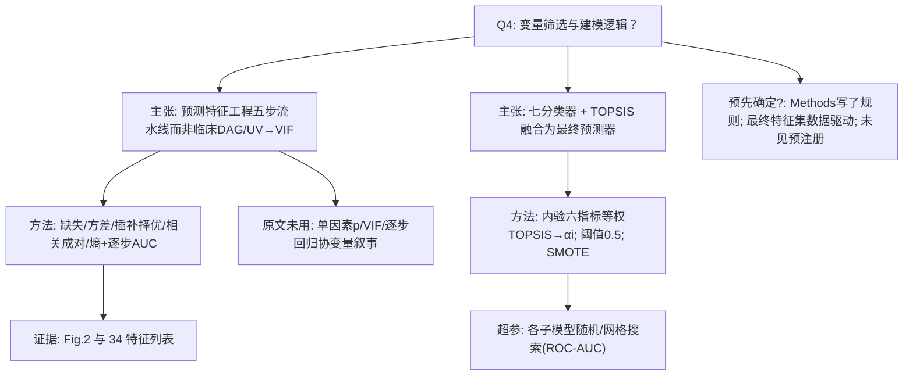

研究问题 Q4：变量/协变量筛选与建模逻辑是什么？该逻辑是否在分析前预先确定？
请严格依据原文攻击下方 AI-A 决策树初稿。

===A===
# AI-A Decision Tree Round 1

paper_id: paper_40295871
question_id: Q4
task_type: literature_decision_tree_reasoning
question: 变量/协变量筛选与建模逻辑是什么？该逻辑是否在分析前预先确定？
source_file: adversarial_lit_reading/chunks/paper_40295871_tcf_septic_shock.md (+ supp chunk)

## 1. Evidence Map

| evidence_id | location | evidence_summary | used_by_node |
|---|---|---|---|
| E1 | Methods Data preprocessing (1)–(5) | 五步：缺失>30%删；布尔方差删(>90%一致)；四种插补比较后选优；Pearson≥0.7 成对留 AUC 更大者；熵排序逐步加特征至 AUC 最优→34 | N1,N2 |
| E2 | Results + Fig.2 + Supp T5 | 特征数增加时 AUC 变化；34 为最优点；列出 34 指标名 | N2,N3 |
| E3 | Methods Prediction modeling | 七基模型（DT/RF/XGB/LGBM/NB/SVM/GBDT）；训练后内验六指标；TOPSIS 等权融合；阈值 0.5；训练集 SMOTE 1:1 | N4,N5 |
| E4 | Supp T4 / T6 | 插补方法比较；超参 RandomizedSearch/网格 | N2,N6 |
| E5 | 全文 | 未见预注册分析计划；特征筛选规则写在 Methods，但 34 的最终集合由数据驱动 AUC 选定 | N7 |
| E6 | Methods | 入模前 min-max 归一化；未做传统 UV p 值/VIF/DAG 协变量筛选叙事 | N8 |

## 2. Decision Tree - Mermaid

## 3. Node Table

| node_id | node_type | claim | evidence_location | evidence_summary | confidence | risk_tag |
|---|---|---|---|---|---|---|
| N0 | question | Q4 | — | 根 | high | |
| N1 | claim | 特征筛选=五步预处理 | Methods | 非 UV/VIF | high | |
| N2 | method | 五步细则 | Methods (1)-(5) | 见 E1 | high | |
| N3 | evidence | 34 特征与 Fig.2 | Results | AUC 最优 | high | |
| N4 | claim | 建模=七模型+TCF | Methods | 融合 | high | |
| N5 | method | TOPSIS+SMOTE+0.5 | Methods | 等权六指标 | high | |
| N6 | method | 超参搜索 | Supp T6 | ROC-AUC | high | |
| N7 | uncertainty | 规则预写但子集数据驱动；无预注册 | 全文 | 原文未明确预注册 | medium | 证据不足 |
| N8 | claim | 未走经典协变量 p/VIF | 全文 | 原文未说明 UV/VIF | high | |

## 4. Provisional Answer

变量进入逻辑是 **预测导向的五步特征处理**（缺失→方差→插补方法择优→高相关成对按 AUC 保留→熵排序逐步加至 AUC 最大得 34 特征），**不是**临床 DAG / 单因素 p / VIF 多因素那套路。建模为七个基分类器，在内验集上用六项性能等权 TOPSIS 得融合权重，阈值 0.5；训练集 SMOTE 1:1；子模型超参以 ROC-AUC 搜索。Methods 预先写了筛选**规则**，但最终 34 个特征集合由样本 AUC 路径决定；原文**未明确说明**预注册分析计划，也未报告传统 UV→VIF 协变量筛选。

## 5. Uncertainty List

- U1: 插补在全队列还是仅训练集拟合——公开 notebook 与正文对泄漏防护的表述需对照（迁移时必须 train-only fit）。
- U2: 相关成对「留 AUC 更大」的 AUC 在哪一折/是否泄漏——原文未完全写清。
- U3: Fig.1 70/30 vs Table1 80/20 划分不一致，影响「内验上算 TOPSIS 权重」的可复现性。

## 6. Follow-up Questions

1. 复现时是否强制「插补/归一化/特征逐步仅在 MIMIC train 拟合再应用到内验与 eICU」？
2. 双库特征池是「34 文献名单∩双库可算」还是「在 MIMIC 上重跑五步再锁名单」？

===CHUNK===
# Page 1

npj | digital medicine
Article
Published in partnership with Seoul National University Bundang Hospital
https://doi.org/10.1038/s41746-025-01643-w
Artificial intelligence based multispecialty
mortality prediction models for septic
shock in a multicenter retrospective study
Check for updates
Shurui Wang1,7, Xinyi Liu2,7, Shaohua Yuan3, Yi Bian4,5, Hong Wu6
& Qing Ye1
Septic shock is one of the most lethal conditions in ICU, and early risk prediction may help reduce
mortality. We developed a TOPSIS-based Classification Fusion (TCF) model to predict mortality risk in
septic shock patients using data from 4872 ICU patients from February 2003 to November 2023
across three hospitals. The model integrates seven machine learning models via the Technique for
Order Preference by Similarity to an Ideal Solution (TOPSIS), achieving AUCs of 0.733 in internal
validation, 0.808 in the pediatric ICU, 0.662 in the respiratory ICU, with external validation AUCs of
0.784 and 0.786, respectively. It demonstrated high stability and accuracy in cross-specialty and
multi-center validation. This interpretable model provides clinicians with a reliable early-warning tool
for septic shock mortality risk, facilitating early intervention to reduce mortality.
Septic shock is a severe syndrome of circulatory and cellular metabolic
disorders caused by sepsis, also known as infectious shock, a type of dis-
tributed shock1. The clinical diagnostic criteria for septic shock in the third
edition of the International Consensus on the Definition of Sepsis and
Infectious Shock, published in 2016, are persistent hypotension despite
adequate volume resuscitation in patients with sepsis, the need for vaso-
constrictor medication to maintain a mean arterial pressure of not less than
65 mmHg and a serum lactate level greater than 2 mmol/L2.
Septic shock, which is characterized by high mortality and difficulty in
early warning, has always received considerable attention from researchers.
A retrospective cohort study using health record data reported an in-
hospital mortality rate of 15% in patients with septic shock3; another ret-
rospective study using the National Intensive Care Database reported a
mortality rate of 55.5% in septic shock patients4. In Michael Bauer’s review
of studies, the 30-day observed mortality rate in patients with septic shock
was 34.73% (32.61–36.85%)5. Early warning of patient outcomes in septic
shock can give physicians more time to intervene and carry out more
aggressive therapeutic measures, thereby reducing mortality6,7. However,
due to the complexity of the disease in septic shock patients, there is cur-
rently no effective model to predict the prognosis of septic shock patients. If
the disease progression of septic shock patients can be predicted in advance,
then clinicians can closely monitor patients at higher risk of death earlier
and take more aggressive treatment measures.
Septic shock, a subtype of sepsis with severe circulatory and cellular
metabolic abnormalities and an unstable hemodynamic state, has become
theleadingcauseofdeathinICUpatients.Earlywarningandinterventionin
sepsis progression have the potential to reduce mortality, so sepsis-related
early warning efforts have gained widespread attention from researchers.
Several scholars have already used clinical data to construct artificial intel-
ligence models to predict sepsis8–10. These studies typically use patient vital
sign data, laboratory test data, and various types of therapeutic data from
electronic medical records to build machine learning models8,11. Some of
these studies achieved early warning of sepsis by mining publicly available
databases or retrospective cohorts to develop machine learning models11,12.
These studies achieved prediction of disease progression in patients with
sepsis by constructing advanced machine learning models, which brought
timeforphysicianstointerveneclinicallyandreducedmortality13.However,
most of these studies have only been conducted on septic patients and are
not applicable to septic shock patients. In addition, many of these studies
havenotbeenappliedinclinicalpracticeduetothesmallsamplesize,theuse
of a single machine learning model and the lack of extensive multicenter
validation.
In order to overcome the problem of poor performanceof small cohort
and single classification models in clinical scenarios, we aim to construct a
robust fusion model with high generalization ability based on several base
classification models through an efficient fusion strategy. This model is used
1Tongji Hospital, Tongji Medical College, Huazhong University of Science and Technology, Wuhan, China. 2School of Public Health, Tongji Medical College,
Huazhong University of Science and Technology, Wuhan, China. 3School of Cyber Science and Engineering, Zhengzhou University, Zhengzhou, China.
4Department of Critical Care Medicine, Tongji Hospital, Tongji Medical College, Huazhong University of Science and Technology, Wuhan, Hubei, China.
5Department of Emergency Medicine, Tongji Hospital, Tongji Medical College, Huazhong University of Science and Technology, Wuhan, Hubei, China. 6School of
Medicine and Health Management, Tongji Medical College, Huazhong University of Science and Technology, Wuhan, China. 7These authors contributed equally:
Shurui Wang, Xinyi Liu.
e-mail: hongwu@hust.edu.cn; qye@tjh.tjmu.edu.cn
npj Digital Medicine |  (2025) 8:228 
1
1234567890():,;
1234567890():,;

# Page 2

toaccuratelypredict the28-dayriskofdeathinICUsepticshockpatients.In
addition, we will transparently visualize the inference process of our model
through feature importance visualization to enhance the credibility of our
model and provide ICU physicians with an efficient, stable, and trustworthy
clinical decision-making tool.
Results
Study population characteristics and cohort composition
The ICU cohort consisted of 3451 participants, including 721 outcome-
positive participants and 2730 outcome-negative participants. The pediatric
intensive care unit cohort (cohort 1-1) comprised 357 individuals with 52
positive results (14.57%). The respiratory intensive care unit cohort (cohort
1-2) comprised 381 individuals with 60 positive results (15.75%). The first
external validation cohort, cohort 2, included 422 participants, with 100
outcome-positive participants and 322 outcome-negative participants. The
second external validation cohort, cohort 3, included 261 participants,
consisting of 75 outcome-positive participants and 186 outcome-negative
participants (Fig. 1). The advantage of our data is that the data related to
model construction (Cohort 1) comes from general ICU, featuring a com-
plex and diverse participant background, which can theoretically contribute
to constructing a widely applicable septic shock prediction model. In
addition to multicenter validation, we also conducted cross-specialty vali-
dation, further demonstrating the wide applicability of the model. The basic
profile of the study population is shown in Table 1, and the results of the
hypothesis tests for each group of features are shown in (Supplementary
Table 1).
Feature selection and optimization process
Sequence characterization was performed on the training data (Sup-
plementary Fig. 1), removing 23 features with a missing rate higher than
30%, leaving 70 features. The variance was calculated for 23 of the
Boolean features, leaving 61 features after screening. The correlation
coefficients were calculated (Supplementary Fig. 2), and there were 12
groups of features that needed to be filtered in pairs according to the
principle of higher AUC (Supplementary Tables 2 and 3), at which
point there were 50 features left. The results of the four algorithms for
imputing missing values are shown in Supplementary Table 4, and the
prediction effect of the Multiple Imputation method based on Logistic
Regression (AUC = 0.844) is significantly higher than that of the other
methods. Finally, the entropy values of the remaining features were
calculated and modeled in order from largest to smallest. Figure 2
shows how the model effect varies with the increase of features. When
the number of features is 34, the AUC reaches the optimal, and these
features are the final input features of seven sub-models and TCF. The
34 indicators are: Age, Surgical history (SH), Temperature (Temp),
Diastolic blood pressure (DBP), Length of stay in the ICU until dis-
charge (LOC-ICU), Oxygen uptake (litres/minute) (OU), Duration of
mechanical ventilation (DOMV), High-sensitivity C-reactive protein
(hs-CRP), Fibrinogen (FBG), Prothrombin time (PT), Activated partial
thromboplastin time (APTT), Alanine aminotransferase (ALT), Direct
bilirubin (DBIL), Creatinine (Cr), Uric acid (UA), Total calcium (Tca),
Potassium ion (K), Sodium ion (Na), Lactate (Lac), Albumin (ALB),
Glucose (Glu), Lymphocyte count (LYM#), White blood cell count
(WBC#), Haemoglobin (Hb), Total cholesterol (TC), High-density
lipoprotein cholesterol (HDL-C), Monocyte count (MONO), Pro-
calcitonin (PCT), Number of resuscitations (NOR), Number of blood
purifications (NOBP), NLR, PLR, LMR, PAR (Supplementary Table 5).
TCF model performance and sub-model comparisons
Parameter optimization and sub-model training were performed using the
training set (Supplementary Tables 6 and 7). Subsequently, model fusion
and weight assignment were conducted based on the internal validation set
(Supplementary Table 8). The fusion algorithm for the TCF model is as
follows:
pj ¼ pDT × 0:141 þ pRF × 0:153 þ pXGB × 0:155 þ pLGMB × 0:151
þpSVM × 0:089 þ pNB × 0:153 þ pGBDT × 0:158
ð1Þ
Fig. 1 | Study cohort selection and dataset partitioning flowchart. Data from three
central cohorts (Cohort 1, Cohort 2, and Cohort 3) were included in the study.
Cohorts 2 and 3 were used to assess the model’s generalizability across different
centers. Subsets from Cohort 1 (Cohort 1-1 and Cohort 1-2) were extracted to
further evaluate its applicability in different specialized intensive care units (ICUs).
Model development data also came from Cohort 1, which included patients from
general ICUs. This dataset was split into 70% training data and 30% internal vali-
dation data. The training data were used to build the base model, while the internal
validation data tested the model’s effectiveness and demonstrated its performance in
real-world scenarios.
https://doi.org/10.1038/s41746-025-01643-w
Article
npj Digital Medicine |  (2025) 8:228 
2

# Page 3

Table 1 | Baseline characteristics of included population
Cohort 1
External validation set
Training set (n = 2760)
Internal validation set (n = 691)
Cohort 1-1 (n = 357)
Cohort 1-2 (n = 381)
Cohort 2 (n = 422)
cohort 3 (n = 261)
Age, years
59.5 (48.0–69.0)
59.0 (47.5–68.0)
3.0 (0.0–7.0)
65.0 (51.0–73.0)
64.5 (52.3–75.0)
65.0 (55.0–73.0)
Gender
Female
1084 (39.28%)
293 (42.40%)
128 (35.85%)
124 (32.55%)
172 (40.76%)
102 (39.08%)
Male
1676 (60.72%)
398 (57.60%)
229 (64.15%)
257 (67.45%)
250 (59.24%)
159 (60.92%)
LOS, h
256.33 (91.58–497.88)
230.69 (68.43–456.38)
357.50 (209.05–635.47)
325.70 (139.97–576.00)
190.46 (79.37–349.22)
135.03 (47.47–278.70)
hs-CRP, mg/L
130.48 (66.70–199.08)
123.60 (59.10–198.15)
66.74 (22.30–127.50)
108.10 (55.30–154.90)
115.02 (52.78–192.38)
130.60 (57.50–195.60)
ALT, IU/L
30 (15.00–88.09)
29 (15–72)
29 (15–81)
27 (14–57)
25 (15–55)
29 (15–78)
Na, mmol/L
134.45 (1.39–141.10)
134.20 (1.37–140.70)
132.20 (103.68–136.30)
134.50 (1.41–139.40)
132.25 (1.37–138.50)
137.80 (133.90–141.60)
Lac, mmol/L
3.38 (1.97–5.62)
3.07 (1.80–5.41)
3.81 (2.48–5.05)
2.79 (1.32–5.01)
2.66 (1.53–4.41)
2.89 (1.70–4.91)
PLR
192.41 (85.34–362.04)
178.87 (75.08–336.56)
116.67 (62.50–205.68)
213.75 (125.64–339.87)
207.86 (102.21–368.33)
194.66 (111.11–352.78)
LMR
1.57 (0.86–3.06)
1.58 (0.83–3.20)
4.20 (1.98–1.97)
1.52 (0.94–2.58)
1.31 (0.75–2.60)
1.32 (0.74–2.64)
Ventilation time, h
Ventilator Recipients
1512 (54.78%)
399 (57.74%)
116 (32.49%)
158 (41.47%)
162 (38.39%)
123 (47.13%)
62 (18–154)
62 (15–146)
82 (18–197.13)
157.50 (58.75–372.00)
71 (24.5–211.5)
58 (17–135)
Non-Ventilator Recipients
1248 (45.22%)
292 (42.56%)
241 (67.51%)
223 (58.53%)
260 (61.61%)
138 (52.87%)
Oxygen flow rate via nasal cannula, L/min
Nasal Cannula Recipients
602, 21.81%
132, 19.10%
67, 18.77%
37, 9.71%
93, 22.04%
61, 23.37%
3 (3–5)
3 (3–5)
1 (0.5–1)
3 (2–5)
2 (2–3)
3 (2–5)
Non-Nasal Cannula Recipients
2158, 78.19%
559, 80.90%
290, 81.23%
344, 90.29%
329, 77.96%
200, 76.63%
Frequency of hemodialysis
Hemodialysis Recipients
1217, 44.09%
317, 45.88%
18, 5.04%
64, 16.79%
154, 36.49%
138, 52.87%
2 (1–3)
2 (1–3)
3.5 (2–7.5)
3.50 (2–8)
2 (1–3)
2 (1–3)
Non-Hemodialysis Recipients
1543, 55.91%
374, 54.12%
339, 94.96%
317, 83.20%
268, 63.51%
123, 47.13%
Clinical Outcomes
Death Within 28 Days
577 (20.91%)
144 (20.84%)
52 (14.57%)
60 (15.75%)
100 (23.70%)
75 (28.74%)
Others
2183 (79.09%)
547 (79.16%)
305 (85.43%)
321 (84.25%)
322 (76.30%)
186 (71.26%)
Data presented as median (IQR) or n (%). LOS = length of stay. hs-CRP = high-sensitivity C-reactive protein. ALT = alanine aminotransferase. Na = sodium ion. Lac = lactate. PLR = platelet-to-lymphocyte ratio. LMR = lymphocyte-to-monocyte ratio.
https://doi.org/10.1038/s41746-025-01643-w
Article
npj Digital Medicine |  (2025) 8:228 
3

# Page 4

wherej representsthej-thpredictedsample,andprepresentstheprobability
of predicting a positive result.
The model’s performance was validated as shown in Table 2. TCF
outperforms the sub-models in terms of two comprehensive evaluation
indices: AUC 0.733 (95% CI: 0.694–0.774) and F1-score 0.458
(0.398–0.520). Additionally, ACC 0.686 (0.654–0.721) and PRE 0.358
(0.302–0.419) are also higher than most sub-models, showcasing excel-
lent classification capabilities. LGBM demonstrates the best positive
identification ability (SEN 0.735 (0.664-0.808)), while SVM shows the
best negative identification ability (SPE 0.907 (0.882–0.931)). However,
models that excel in certain indices may lack in others. For instance, SVM
has a weak positive identification ability (SEN 0.236 (0.171–0.306)), and
LGBM performs worse than TCF in terms of the comprehensive indices
AUC, F1-score, and ACC. The comparison of ROC curves between the
TCF model and sub-models is shown in Fig. 3. The calibration curve and
Decision Curve Analysis (DCA) can be found on Supplementary Figs.
3 and 4, respectively. Although the TCF model does not achieve optimal
performance in identifying positives (SEN 0.640 (0.557–0.712)) and
negatives (SPE 0.700 (0.663–0.736)), it can integrate the biased identi-
fication effects of sub-models, resulting in the best overall performance.
The calibration curve and DCA also demonstrate that the predictions of
the TCF model are consistent with the actual outcomes, indicating its
potential clinical utility within a certain range. It can assist decision-
makers in making more beneficial decisions.
Feature importance and model interpretation
Since the TCF models are fusion models, their feature importance consists
of all sub-model features and their weights. In order to understand the
inference process of our models more deeply, we chose the GBDT model,
which has the best performance in terms of AUC, and visualized its feature
importance by drawing a SHAP feature importance heatmap, as shown in
Fig. 4 (Supplementary Fig. 5). The results showed that in the GBDT model,
Number of resuscitations (NOR), Duration of mechanical ventilation
(DOMV), Length of stay in the ICU until discharge (LOC-ICU), Diastolic
bloodpressure(DBP)andotherclinicalcharacteristicshaveagreaterimpact
on outcome. The weighted feature importance of the TCF model is on
Supplementary Table 9, which is essentially consistent with GBDT, and the
feature importance ranking of the ensemble model also has reference value.
Multicenter validation and generalizability
The results of multicenter validation can more accurately demonstrate the
predictive performance of TCF model, and there is heterogeneity among
differentdatasets.Inmoststudies,thepredictiveeffectonmulticenterdatais
slightly inferior to that on the training set and internal validation set. In this
study, compared to the internal validation set, the AUC slightly decreased
on cohort 1-2 (AUC 0.662 (95% CI: 0.598–0.730)) (Fig. 5a), while the AUC
showed significant improvement on cohort 1-1 (AUC 0.808 (0.740–0.864)),
cohort 2 (AUC 0.784 (0.733–0.825)), and cohort 3 (AUC 0.786
(0.725–0.840)) (Fig. 5). Figure 6 and Supplementary Table 10 further
demonstrate the comparison of results on six indices across different
datasets. Due to the limited sample size of multicenter data and fewer
positive samples, SEN decreases, but SPE significantly improves, with
recognition capability reaching over 80%. Therefore, we specifically com-
bined the four external validation datasets for prediction. The sample size at
Fig. 2 | Stepwise feature selection performance. Features were ranked based on
information entropy, with more valuable features prioritized and sequentially
incorporated into the model. When the number of variables exceeded 34, the AUC
gain no longer increased.
Table 2 | Performance of sub-models and TCF on the internal validation set
Models
AUC
F1-score
ACC
PRE
SEN
SPE
DT
0.698 (0.651, 0.743)
0.426 (0.367, 0.484)
0.674 (0.638, 0.708)
0.336 (0.278, 0.390)
0.585 (0.503, 0.660)
0.698 (0.657, 0.734)
RF
0.697 (0.653, 0.742)
0.447 (0.391, 0.504)
0.667 (0.634, 0.703)
0.344 (0.291, 0.399)
0.646 (0.569, 0.725)
0.675 (0.637, 0.712)
XGB
0.718 (0.674, 0.756)
0.456 (0.396, 0.511)
0.654 (0.619, 0.689)
0.339 (0.284, 0.392)
0.701 (0.624, 0.770)
0.642 (0.600, 0.682)
LGBM
0.710 (0.667, 0.752)
0.455 (0.394, 0.511)
0.632 (0.596, 0.669)
0.330 (0.276, 0.380)
0.735 (0.664, 0.808)
0.605 (0.562, 0.646)
SVM
0.698 (0.653, 0.744)
0.296 (0.224, 0.374)
0.767 (0.737, 0.796)
0.402 (0.303, 0.507)
0.236 (0.171, 0.306)
0.907 (0.882, 0.931)
NB
0.705 (0.662, 0.747)
0.456 (0.397, 0.514)
0.645 (0.609, 0.680)
0.336 (0.282, 0.388)
0.714 (0.640, 0.795)
0.627 (0.589, 0.668)
GBDT
0.725 (0.682, 0.762)
0.453 (0.391, 0.512)
0.687 (0.651, 0.722)
0.355 (0.297, 0.415)
0.623 (0.544, 0.704)
0.703 (0.667, 0.743)
TCF
0.733 (0.694, 0.774)
0.458 (0.398, 0.520)
0.686 (0.654, 0.721)
0.358 (0.302, 0.419)
0.640 (0.557, 0.712)
0.700 (0.663, 0.736)
Performance metrics (Area under ROC curve (AUC), F1-score, Precision (PRE), Accuracy (ACC), Sensitivity (SEN), and Specificity (SPE)) with 95% CIs were computedvia 1000 bootstrap resamplingsfor the
internal validation set across seven models, including TCF model. The TCF model achieved superior performance.
Fig. 3 | Comparison of ROC curves between TCF and its sub-models. A com-
parison of ROC curves between the TCF model and sub-models in the internal
validation set demonstrated superior performance of the TCF model, as evidenced
by both the curve trajectories and AUC values.
https://doi.org/10.1038/s41746-025-01643-w
Article
npj Digital Medicine |  (2025) 8:228 
4

# Page 5

this point was 1421 (including 287 positive events), with an AUC of 0.7705
(0.7417–0.7983). We also plotted the calibration curve (Supplementary Fig.
6).ThisindicatesthattheTCFmodelcaneffectivelydistinguishsepticshock
patients with low-risk factors and possesses excellent calibration capability.
We also performed DCA on the combined dataset (Supplementary Fig. 7).
The net benefit of the model intervention was higher than the “treat-all” and
“treat-none” strategies across most threshold probability ranges. Moreover,
within the threshold probability range (~0.1–0.5), the model demonstrated
evengreaternetbenefit.ThisindicatesthatthepredictionsoftheTCFmodel
have significant clinical value for decision-making within this range. Most
multicenter data perform better than the internal validation set in terms of
AUC, F1-score, ACC, PRE, and SPE. Although cohort 1-2 shows a slight
decrease in AUC and F1-score, it still achieves good classification capability.
Overall, TCF has an unexpectedlystrong generalization ability,which is also
attributed to the complex patient background in the ICU cohort.
Discussion
In this study, we developed the TCF model for accurately predicting the 28-
day risk of death for septic shock patients based on 34 features. Adopting
TOPSIS to fuse the seven base models, TCF models achieved consistent and
good performance on both the internal set and the two external validation
sets, outperforming all individual models before fusion in predicting 28-day
risk of death for septic shock patients.
Theriskofdeathinpatientswithsepticshockisdifficulttodifferentiate
due to the severity, complexity, and overall high mortality of sepsis14,15. Early
recognition is also challenging because sepsis shares similar clinical signs
(e.g., changes in vital signs), symptoms (e.g., fever), and molecular mani-
festations (e.g., host response dysregulation16. The strength of the TCF
model lies in the fact that it provides clinicians in ICU with a tool to assist
them in real-time prediction of a patient’s risk of death over a period of 28
days, especially in the deteriorating early stages of disease progression or in
primary care settings with limited clinical experience. Interpretable work on
our model features has made an outstanding contribution to predicting the
risk of death in septic shock and has helped clinicians better understand the
mechanisms of sepsis and septic shock progression.
Our TCF model showed strong stability and generalization ability. We
have not only validated our TCF model across specialties but also across
multiple centers. On the internal validation set, the AUC of the TCF model
was 0.733 (95% CI 0.694–0.774). On the pediatric and respiratory ICU
datasets, the AUC was 0.808 (0.740–0.864) and 0.662 (0.598–0.730),
respectively. In both external validation sets, the AUC similarly achieved
0.784 (0.733–0.825) and 0.786 (0.725–0.840). The results show that the
model exhibits excellent performance on different ICU patient populations.
Although the multicenter data can validate the stability of the model, it can
likewise present us with severalproblemsthat are not friendly to buildingAI
models.Ourdataissuesincludedanimbalanceintheproportionofpositives
among septic shock patients, a large variation in sample size, and many
missing values (Supplementary Table 11). In order to address these data
issues and ensure model robustness, extensive and varied data cleaning was
performed. The most appropriate data preprocessing method was selected
by comparing the results of different cleaning methods on the study data.
Our TCF model exhibits high prediction accuracy, which is inex-
tricably linked to the model fusion strategy we adopted. In this study, we
used the TOPSIS method to fuse seven base models to construct the TCF
model. The model brings together the strengths of each base model and
obtains the best prediction by weighting the contributions of each model.
The TCF model provides a more reliable and consistent prediction of the
risk of septic shock death for multicenter data than known base prediction
models (Supplementary Table 7).
Artificial intelligence predictive models based on electronic medical
record data have been employed in many diseases, including several studies
on the prediction of the risk of death from septic shock17,18. Zheng et al.
developed six machine-learning models that predicted 28-day mortality in
patients with septic shock across 46 features, including markers of inflam-
mation, organ dysfunction, or injury19. The effect of a certain drug inter-
vention on septic shock has also been studied using Artificial Neural
Network20. However, these existing studies have not been clinically applied
due to problems such as small cohort size and lack of extensive multicenter
validation. In contrast, the TCF model constructed in this study was
externally validated not only by two cohorts but also by two different spe-
cialties. Therefore, our model has higher credibility and generalizability.
Feature importance ranking not only enhances the transparency and
credibility of clinical predictive models but also provides valuable insight
Fig. 5 | Comparison of ROC curves for
multicenter data. a The difference in the ability of
cross-specialty data and the internal validation set to
distinguish between positive and negative patients.
b The difference in the ability of multicenter data
and the internal validation set to distinguish
between positive and negative patients. ROC curves
were used for visualization, with the shaded areas
representing the 95% confidence intervals.
Fig. 4 | Optimal sub-model (GBDT) SHAP feature importance heatmap. The
GBDT model demonstrated the best performance among all sub-models. Feature
importance was visualized using SHapley Additive exPlanation (SHAP) summary
plots, revealing that the number of resuscitations (NOR), duration of mechanical
ventilation (DOMV), length of stay in the ICU until discharge (LOC-ICU), diastolic
blood pressure (DBP), along with other clinical features, had the most significant
impact on outcomes in the GBDT model.
https://doi.org/10.1038/s41746-025-01643-w
Article
npj Digital Medicine |  (2025) 8:228 
5

# Page 6

and support for medical practice. In this study, we performed feature
importance ranking on the TCF model to enhance the transparency of our
model inference process. Since the TCF models incorporated sub-models
without feature importance, we weighted feature importance only for the
incorporatedmodelsthatsupportedfeatureimportance,anddetailedresults
are presented in the Supplementary Table 9. In our study, factors such as
duration of mechanical ventilation, number of resuscitations, and other
factors included in the “International Guidelines for the Management of
Sepsis and Septic Shock: 2016” have been identified by the TCF models as
important features for predicting the risk of death from septic shock, which
is in line with previous clinical and basic research on sepsis21,22. Our pre-
dictive variables are all routine clinical variables. In the course of clinical use,
if the quality of the variables is poor or unavailable, we strongly recommend
that clinicians supplement with additional test results.
This study has several limitations. Firstly, although methods such as
correlationanalysisandexternalvalidationhaveconfirmedthatthemodelis
minimally affected by covariate shift, a smaller number of predictive vari-
ables would be more user-friendly. Secondly, the model validation cohort,
while providing initial insights, is limited by its sample size and the
imbalancein sample proportions, particularly the scarcity of positive events,
which may affect the robustness of the model’s performance. To address
this, we integrated four validation datasets, resulting in a combined sample
size of 1421, including 287 positive cases. The analysis yielded an AUC of
0.7705 (95% CI 0.7417-0.7983), suggesting promising discriminatory abil-
ity. We also augmented cohorts with insufficient positive samples through
oversampling, further demonstrating the reliability of the validation results
(Supplementary Table 12). Nevertheless, future could collect enough data
for cross-specialty and multi-center validation, ensuring its generalizability
and reliability across diverse clinical settings. Thirdly, this study validated
the model across three centers, providing preliminary evidence of its per-
formance, further research is needed to explore its generalizability across
broaderandmorediverseregions.Fourthly,thisstudyfocusedonleveraging
structured clinical feature data derived from electronic medical records to
develop the predictive model. While this approach provides valuable
insights, future research could explore the integration of additional data
modalities.Fifthly,thisstudy,designedasaretrospectiveanalysis,providesa
foundational understanding of the model’s potential based on historical
data. Future research can conduct prospective studies under ethical
approval to evaluate the clinical efficacy of the model23.
In conclusion, the TCF model demonstrated stable and robust gen-
eralizationinpredictingtheriskofdeathwithin28daysinpatientswithseptic
shock based on 34 patient characteristics from the electronic medical record.
The predictive performance of the model was significantly better than the
seven base models, providing a reliable tool for early intervention in septic
shockpatients.OurTCFmodelprovidesalow-cost,easy-to-use,andaccurate
tool for predicting the risk of death in septic shock patients. Future studies
Fig. 6 | Performance of six indices (95% CI) across
all datasets. The performance (95% CI) of the six
indices across all datasets. a shows the boxplot of the
Area Under the Curve (AUC), (b) shows the boxplot
of Accuracy (ACC), (c) shows the boxplot of Spe-
cificity (SPE), (d) shows the boxplot of the F1-score,
(e) shows the boxplot of Precision (PRE), and (f)
shows the boxplot of Sensitivity (SEN). The gray
dashed line represents the results of the internal
validation set. Evaluation scores for the other data-
sets fall within the dark gray area, indicating a
decline in performance compared to the internal
validation set.
https://doi.org/10.1038/s41746-025-01643-w
Article
npj Digital Medicine |  (2025) 8:228 
6

# Page 7

could collect data from more regions for validation and conduct prospective
studies to further confirm the feasibility of the TCF model we developed.
Methods
Study design and participants
This study was approved by the Institutional Review Board of Tongji Hos-
pital, Tongji Medical College, Huazhong University of Science and Tech-
nology(ApprovalNo.TJ-IRB202412029,thethreecentersweregoverned by
the same ethics review committee), and complied with the Declaration of
Helsinki. The ethics committee waived the requirement for informed con-
sent as this retrospective study analyzed only existing, fully anonymized
clinical data with no additional patient interventions. All data were de-
identified prior to analysis to protect participant privacy. In this multicenter
retrospective study, we collected clinical information on 4872 ICU patients
from February 2003 to November 2023 from the electronic medical records
of three hospitals in China. This retrospective study included patients with
septic shock from the intensive care units (ICUs) (Cohort 1, Cohort 2, and
Cohort3).Cohort1containedpatientsfromthreeclinicalspecialties:general
ICU, pediatric ICU, and respiratory ICU. We used 3451 ICU patients from
the general ICU (ICU cohort) as the primary study population for model
training and internal validation. A total of 357 patients from pediatric ICU
(Cohort 1-1) and 381 patients from respiratory ICU (Cohort 1-2) were used
as cross-specialty validation data to assess the stability of the model across
specialties. In addition, 422 participants from Cohort 2 and 261 participants
from Cohort 3 provided multicenter data for this study, representing
patients with septic shock from different ICUs, to assess the external gen-
eralization performance of the model. Septic shock diagnoses and outcomes
(discharge or death) for all participants were confirmed by the attending
physician and recorded in the electronic medical record.
Our clinically intelligent prediction research is primarily divided into
three steps. The first step involved using in-hospital data of patients with
infectious shock to establish seven sub-models, each yielding results for six
evaluation metrics. The second step was based on a fusion strategy, inte-
grating the sub-models into a comprehensive model (TCF) and demon-
strating that the predictive performance of TCF was superior to other
models. The third step involved testing the model’s performance across
various datasets and conducting an interpretability analysis of the model.
The research design adheres to the TRIPOD + AI guidelines24 (Supple-
mentary Table 13), as illustrated in Fig. 7. As this was a retrospective study,
there was no public involvement, no research protocol was prepared, and
the study was not registered.
Data preprocessing
Based on their universality in routine clinical use by ICU working doctors,
93 intramural indices were screened, including demographics information
(e.g., age and gender), disease and treatment history (e.g., chemotherapy
history), admission information (e.g., length of stay in the ICU until dis-
charge),laboratorytests(e.g.,whitebloodcellcountandlymphocytecount),
vital sign information (e.g., height and blood pressure), and medication
information (e.g., epinephrine). Participants were measured multiple times
for the same item upon admission to the ICU, and laboratory test data from
the first measurement were selected for the study. Additionally, records of
drug injections or oral intake within 24 h were included in the analysis. Four
metrics were obtained through calculation:
NLR ¼ Neutrophil Count 109=L


Lymphocyte count 109=L


ð2Þ
PLR ¼
Platelet count 109=L


Lymphocyte count 109=L


ð3Þ
LMR ¼ Lymphocyte count 109=L


Monocyte count 109=L


ð4Þ
PAR ¼ Platelet count 109=L


Albumin g=L


ð5Þ
SI ¼ Heart rate beats per minute


Systolic blood pressure mmHg


ð6Þ
Raw data are difficult to utilize directly; appropriate feature processing
can help us better capture participants’ information and build models with
Fig. 7 | Study design. An illustration of how the predictive model is established based on the electronic health record system.
https://doi.org/10.1038/s41746-025-01643-w
Article
npj Digital Medicine |  (2025) 8:228 
7

# Page 8

better performance. Our feature processing includes five parts: (1) delete
features with a missing rate greater than 30%, as features with too high a
missing rate lose the value of interpolation; (2) calculate the variance of
Boolean features according to Bernoulli’s variance formula and delete fea-
tures with more than 90% agreement; (3) consider four common missing
value interpolation methods (k-Nearest Neighbors Imputer, Multiple
Imputation using Logistic Regression, Multiple Imputation using the
k-Nearest Neighbors, and Ridge Regression) interpolate the missing values,
and then build the same classification model separately to compare the
effects and choose the best method as our missing value interpolation
strategy; (4) calculate the Pearson correlation coefficients between pairs of
features,andforcombinationsoffeatures withcorrelationsnotlessthan0.7,
retain the features that make the AUC larger; (5) calculate the information
entropy of each feature, understanding that the smaller the entropy value,
the higher the information content and the higher the value of the feature,
andthensortthefeaturesaccordingtotheinformationentropyfromhighto
low, gradually increasing the number of features to build the model and
selecting the subset of features that maximize AUC. In addition, the data
needs to be min-max normalized before modeling or validation.
Outcomes
A diagnosis of septic shock, either primary or secondary, was determined by
theattendingphysicianandrecordedonthefirstpageofthecase.Thelength
of time between the participants’ admission to the ICU and the occurrence
of the outcome (death orsurvivalto discharge) was calculated. The outcome
of the study was whether the participant died of all-cause death within 28
days of admission to the ICU. Participants who experienced all-cause death
within 28 days from the start of ICU admission were considered to have a
positive outcome, while those who did not were considered to have a
negative outcome.
Prediction modeling
It is unrealistic to exhaust all binary classification models; therefore, fusion
models that combine results more effectively than a single model represent
an efficient and high-quality strategy25. The unprocessed ICU cohort was
divided into a training set (80%, n = 2760) and an internal validation set
(20%, n = 691). Seven sub-models were trained on the training set after
feature processing, the actual effects of the models were tested on the
internal validation set, and the parameters of the fusion model were
obtained based on these results. Synthetic Minority Over-sampling Tech-
nique (SMOTE) was applied to the training set according to the 1:1 rule to
mitigate the negative effects of class imbalance26. After min-max normal-
ization, the optimal parameter combination was determined by five-fold
cross-validation and random search, and seven models (Decision Tree
(DT), Random Forest (RF), XGBoost (XGB), LightGBM (LGBM), Naive
Bayes (NB), Support Vector Machine (SVM), Gradient Boosted Decision
Tree (GBDT)) were trained on the training set. Finally, the predictions were
validated using the internal validation data, and the performance of the
models was evaluated by area under ROC curve (AUC), F1-score, precision
(PRE), accuracy (ACC), sensitivity (SEN), and specificity (SPE).
Each of the seven models has its own strengths and weaknesses across
six indices, and we designed a TOPSIS-based Classification Fusion (TCF)
model that combines the estimation results from the seven models in order
to develop a comprehensive predictive tool for the diagnosis of septic shock.
The model was fused using TOPSIS, where each evaluation index was given
equalimportance27.Thesub-modelweightsarecalculatedbyTOPSIS-score,
and the weighted predictive probability is the predictive probability of TCF,
with 0.5 as the critical value to derive the classification result of TCF.
Use AUCi, F1  socrei, ACCi, PREi, SENi, SPEi ði ¼ 1; 2; .. . ; 7Þ to
represent the effects of seven models. The larger the evaluation index, the
better the model performance, so all indices are uniformly transformed into
extreme-type indices, for example, AUC
0
i ¼ max AUCi


 AUCi. Simi-
larly, get all F1  score
0
i, PRE
0
i, ACC
0
i, SEN
0
i, SPE
0
i ði ¼ 1; 2; .. . ; 7Þ. After the
matrix is positively transformed, it undergoes a standardization process to
eliminate the impact of varying attribute dimensions, thereby ensuring that
the values of each index are comparable on the same scale. Take AUC as an
example,
AUCi
00 ¼
AUC
0
i
ffiffiffiffiffiffiffiffiffiffiffiffiffiffiffiffiffiffiffiffiffiffiffiffi
P7
i¼1 AUC
0
i
2
q
; i ¼ 1; 2; . .. ; 7
ð7Þ
similarly, get all F1  scorei
00, PREi
00, ACCi
00, SENi
00, SPEi
00.
Assign the same weights to the indices, the weight vector
is 1=6; 1=6; 1=6; 1=6; 1=6; 1=6


. Multiply each value of the normalized
decision matrix by its corresponding weight to obtain a weighted normal-
ized matrix, ensuring that the contribution of each scoring index is pro-
portional to its weight. The maximum and minimum values of each index
across the seven models are identified to form the sets of positive ideal
solution (PIS) and negative ideal solution (NIS), respectively 28.
PIS ¼ AUCmax; F1max; PREmax; ACCmax; SENmax; SPEmax


ð8Þ
NIS ¼ AUCmin; F1min; PREmin; ACCmin; SENmin; SPEmin


ð9Þ
Calculate the comprehensive evaluation index of each model, the
comprehensive evaluation index of the i-th model is scorei,
topsisscorei ¼
scorei;min
scorei;min þ scorei;max
; i ¼ 1; 2; .. . ; 7
ð10Þ
where scorei;max and scorei;min are defined as
scorei;max ¼
ffiffiffiffiffiffiffiffiffiffiffiffiffiffiffiffiffiffiffiffiffiffiffiffiffiffiffiffiffiffiffiffiffiffiffiffiffiffiffiffiffiffiffiffiffiffiffiffiffiffiffiffiffiffiffiffiffiffiffiffiffiffiffiffiffiffiffiffiffiffiffiffiffiffiffiffiffiffiffiffiffiffiffiffiffiffiffiffiffiffiffiffiffiffiffiffiffiffiffiffiffiffiffiffiffiffiffiffiffiffiffiffiffiffiffiffiffiffiffiffiffiffiffiffiffiffiffiffiffiffiffiffi
AUCmax  AUCi00

2 þ F1max  F1i00

2 þ    þ SPEmax  SPEi00

2
q
ð11Þ
scorei;min ¼
ffiffiffiffiffiffiffiffiffiffiffiffiffiffiffiffiffiffiffiffiffiffiffiffiffiffiffiffiffiffiffiffiffiffiffiffiffiffiffiffiffiffiffiffiffiffiffiffiffiffiffiffiffiffiffiffiffiffiffiffiffiffiffiffiffiffiffiffiffiffiffiffiffiffiffiffiffiffiffiffiffiffiffiffiffiffiffiffiffiffiffiffiffiffiffiffiffiffiffiffiffiffiffiffiffiffiffiffiffiffiffiffiffiffiffiffiffiffiffiffiffiffiffiffiffiffiffiffiffiffi
AUCmin  AUCi00

2 þ F1min  F1i00

2 þ    þ SPEmin  SPEi00

2
q
ð12Þ
Use topsisscoreiði ¼ 1; 2; . .. ; 7Þ to represent the comprehensive scoring
index of DT, RF, XGB, LGBM, SVM, NB, GBDT, define αi i ¼ 1; 2; . .. ; 7
ð
Þ
as
αi ¼
topsisscorei
P topsisscorei
; i ¼ 1; 2; .. . ; 7
ð13Þ
Assuming that we obtain the negative predictive results for N parti-
cipants through seven models as matrix M3,
M3 ¼
pij


; i ¼ 1; 2; :::; 7; j ¼ 1; 2; .. . ; N
ð14Þ
the positive probability of the j-th participant after model fusion is
pj ¼
X
7
i¼1
αipij; j ¼ 1; 2; . .. ; N


ð15Þ
Statistical analysis
Statistics on certain key features of the participants are provided to facilitate
a quicker understanding of the background of the research subjects. For
continuous features, statistics on the median, upper quartile, and lower
quartile are presented, and for discrete features, the proportion of each
category is reported. In our study, the smallest dataset is cohort3 (n = 261).
According to the central limit theorem, the distribution of the mean of
continuous features can be considered normal. Levene’s test was applied to
determine the homogeneity of features between the two sets of data. Chi-
square test was employed to compare the differences in discrete features
between other data and the internal validation set, while Independent-
https://doi.org/10.1038/s41746-025-01643-w
Article
npj Digital Medicine |  (2025) 8:228 
8

# Page 9

Sample t-test or Welch’s t-test was utilized to assess the differences in
continuous features. The 95% confidence intervals for the assessment
indices were calculated using 1000 bootstrap samples.
Feature assessment
TCF obtains a recognized feature priority ranking by calculating the feature
importanceweightsbuiltintothesub-models.SVMfocusesonthecriticality
of decisions, seeking the optimal hyperplane rather than the contribution of
all features, and NB assumes that features are independent of each other,
considering each feature equally important29,30. Therefore, neither of these
two types of models can provide feature importance weights. DT, RF, XGB,
LGBM, and GBDT output weights for 34 features, respectively, and the TCF
feature ranking is obtained by sorting the sum of these weights. Meanwhile,
SHapley Additive exPlanation (SHAP) also helps to interpret the sub-
models of TCF31.
Data availability
Thedata thatsupportthefindingsofthisstudyareavailableon requestfrom
the corresponding author Q.Y. The data are not publicly available due to
them containing information that could compromise research participant
privacy.
Code availability
Data analysis was conducted using SPSS Statistics (version 26) and Python
(version 3.10.9). The core code for the research can be found on the cor-
responding
author’s
GitHub
page
(https://github.com/472404420/
NPJ-codes).
Received: 24 January 2025; Accepted: 16 April 2025;
References
1.
Cecconi, M., Evans, L., Levy, M. & Rhodes, A. Sepsis and septic
shock. Lancet 392, 75–87 (2018).
2.
Singer, M. et al. The third international consensus definitions for
sepsis and septic shock (Sepsis-3). JAMA 315, 801–810 (2016).
3.
Rhee, C. et al. Incidence and trends of sepsis in US hospitals using
clinical vs claims data, 2009-2014. JAMA 318, 1241–1249 (2017).
4.
Shankar-Hari, M., Harrison, D. A., Rubenfeld, G. D. & Rowan, K.
Epidemiology of sepsis and septic shock in critical care units:
comparison between sepsis-2 and sepsis-3 populations using a
national critical care database. BJABr. J. Anaesth.119, 626–636 (2017).
5.
Bauer, M. et al. Mortality in sepsis and septic shock in Europe, North
America and Australia between 2009 and 2019- results from a
systematic review and meta-analysis. Crit. Care Lond. Engl. 24, 239
(2020).
6.
Rudd, K. E. et al. The global burden of sepsis: barriers and potential
solutions. Crit. Care Lond. Engl. 22, 232 (2018).
7.
Liu, V. et al. Hospitaldeathsin patients with sepsisfrom2 independent
cohorts. JAMA 312, 90–92 (2014).
8.
Moor, M. et al. Predicting sepsis using deep learning across
international sites: a retrospective development and validation study.
eClinicalMedicine 62, 102124 (2023).
9.
Kam,H. J. &Kim, H. Y. Learningrepresentationsfor theearlydetection
of sepsis with deep neural networks. Comput. Biol. Med. 89, 248–255
(2017).
10. Dreiseitl, S. & Ohno-Machado, L. Logistic regression and artificial
neural network classification models: a methodology review. J.
Biomed. Inform. 35, 352–359 (2002).
11. Calvert, J. S. et al. A computational approach to early sepsis
detection. Comput. Biol. Med. 74, 69–73 (2016).
12. Bedoya, A. D. et al. Machine learning for early detection of sepsis: an
internal and temporal validation study. JAMIA Open 3, 252–260 (2020).
13. Kamran, F. et al. Evaluation of sepsis prediction models before onset
of treatment. NEJM AI 1, AIoa2300032 (2024).
14. Evans, L. et al. Surviving sepsis campaign: international guidelines for
management of sepsis and septic shock 2021. Intensive Care Med.
47, 1181–1247 (2021).
15. Hotchkiss, R. S. et al. Sepsis and septic shock. Nat. Rev. Dis. Prim. 2,
1–21 (2016).
16. Ramar,K. & Gajic, O. Early recognition and treatmentof severe sepsis.
Am. J. Respir. Crit. Care Med. 188, 7–8 (2013).
17. Yee, C. R., Narain, N. R., Akmaev, V. R. & Vemulapalli, V. A data-driven
approach to predicting septic shock in the intensive care unit.
Biomed. Inform. Insights 11, 1178222619885147 (2019).
18. Fleuren, L. M. et al. Machine learning for the prediction of sepsis: a
systematic review and meta-analysis of diagnostic test accuracy.
Intensive Care Med. 46, 383–400 (2020).
19. Zheng, F. et al. ShockSurv: a machine learning model to accurately
predict 28-day mortality for septic shock patients in the intensive care
unit. Biomed. Signal Process. Control 86, 105146 (2023).
20. Ali, D. ala et al. Determinants of inadequate empiric antimicrobial
therapy in ICU sepsis patients in Al-Madinah Al-Munawwarah, Saudi
Arabia: a comparison of artificial neural network and regression
analysis. Antibiotics12, 1305 (2023).
21. Rhodes, A. et al. Surviving sepsis campaign: international guidelines
for management of sepsisand septicshock:2016.Intensiv.Care Med.
43, 304–377 (2017).
22. Ebihara, S. et al. Mechanical ventilation protects against diaphragm
injury in sepsis: Interaction of oxidative and mechanical stresses. Am.
J. Respir. Crit. Care Med. 165, 221–228 (2002).
23. Morrow, E. et al. Artificial intelligence technologies and compassion in
healthcare: a systematic scoping review. Front. Psychol. 13, 971044
(2022).
24. Collins, G. S. et al. TRIPOD+AI statement: updated guidance for
reporting clinical prediction models that use regression or machine
learning methods. BMJ 385, e078378 (2024).
25. Cai, G. et al. Artificial intelligence-based models enabling accurate
diagnosisofovariancancerusinglaboratorytestsinChina:amulticentre,
retrospective cohort study. Lancet Digit. Health 6, e176–e186 (2024).
26. Blagus, R. & Lusa, L. SMOTE for high-dimensional class-imbalanced
data. BMC Bioinforma. 14, 106 (2013).
27. Chakraborty, S. TOPSIS and modified TOPSIS: a comparative
analysis. Decis. Anal. J. 2, 100021 (2022).
28. Qi, J., Hu, J. & Peng, Y. New design concept evaluation method
involving customer preferences based on rough distance to redefined
ideal solution. Comput. Ind. Eng. 147, 106677 (2020).
29. En-Naaoui, A., Kaicer, M. & Aguezzoul, A. A novel decision support
system for proactive risk management in healthcare based on fuzzy
inference, neural network and support vector machine. Int. J. Med. Inf.
186, 105442 (2024).
30. Yang, F.-J. An Implementation of Naive Bayes Classifier. in 2018
International Conference on Computational Science and
Computational Intelligence (CSCI) 301–306 https://doi.org/10.1109/
CSCI46756.2018.00065 (2018).
31. Nohara, Y., Matsumoto, K., Soejima, H. & Nakashima, N. Explanation
of machine learning models using Shapley additive explanation and
application for real data in hospital. Comput. Methods Prog. Biomed.
214, 106584 (2022).
Acknowledgements
This research was supported by the following funding sources: the CCF-
BaiChuan-EbtechFoundation Model Fund (Grant No. 2023012), the CIPSC-
SMP-Zhipu Large Model Cross-Disciplinary Fund (Grant No.
ZPCG20241107362), and the National Natural Science Foundation of China
(Grants No. 72001087 and 72371111).
Author contributions
S.W. prepared all data and analysis results. X.L. wrote the manuscript text.
S.Y.wasresponsiblefor organizingthesupplementarymaterials.Y.B.wasin
https://doi.org/10.1038/s41746-025-01643-w
Article
npj Digital Medicine |  (2025) 8:228 
9

# Page 10

charge of reviewing the medical information in the article. Q.Y. and H.W.
checked all results and analysis texts within the manuscript. All authors read
and approved the final manuscript.
Competing interests
The authors declare no competing interests.
Additional information
Supplementary information The online version contains
supplementary material available at
https://doi.org/10.1038/s41746-025-01643-w.
Correspondence and requests for materials should be addressed to
Hong Wu or Qing Ye.
Reprints and permissions information is available at
http://www.nature.com/reprints
Publisher’s note Springer Nature remains neutral with regard to
jurisdictional claims in published maps and institutional affiliations.
Open Access This article is licensed under a Creative Commons
Attribution 4.0 International License, which permits use, sharing,
adaptation, distribution and reproduction in any medium or format, as long
as you give appropriate credit to the original author(s) and the source,
provide a link to the Creative Commons licence, and indicate if changes
were made. The images or other third party material in this article are
included in the article’s Creative Commons licence, unless indicated
otherwise in a credit line to the material. If material is not included in the
article’s Creative Commons licence and your intended use is not permitted
by statutory regulation or exceeds the permitted use, you will need to
obtain permission directly from the copyright holder. To view a copy of this
licence, visit http://creativecommons.org/licenses/by/4.0/.
© The Author(s) 2025
https://doi.org/10.1038/s41746-025-01643-w
Article
npj Digital Medicine |  (2025) 8:228 
10

===SUPP===
# Page 1

1 
 
Supplementary Information 
 
Artificial Intelligence Based Multispecialty Mortality Prediction Models for Septic 
Shock in a Multicenter Retrospective Study 
 
Contents: 
Supplementary item 
Page 
Supplementary figures 
2 
Supplementary Fig. 1 | Feature processing flow 
2 
Supplementary Fig. 2 | Correlation coefficient heatmap 
3 
Supplementary Fig. 3 | The calibration curves of all models on the internal validation set 
4 
Supplementary Fig. 4 | The DCA result of TCF model on the internal validation set 
5 
Supplementary Fig. 5 | SHAP feature summary plot of the optimal sub-model 
6 
Supplementary Fig. 6 | The calibration curves on the validation set 
7 
Supplementary Fig. 7 | The DCA result of TCF model on the validation set 
8 
Supplementary tables 
9 
Supplementary Table 1 | The hypothesis testing results for cohort 1-1, cohort 1-2, cohort 2, and cohort 3 
9 
Supplementary Table 2 | Comparison of three highly correlated variable combinations 
11 
Supplementary Table 3 | Results of pairwise comparisons of highly correlated variables 
12 
Supplementary Table 4 | Comparison of results from different methods of imputing missing values 
13 
Supplementary Table 5 | Stepwise inclusion of variables based on entropy ranking for modeling 
14 
Supplementary Table 6 | Hyperparameter tuning information for various models on the training set 
15 
Supplementary Table 7 | Evaluation of classification performance for seven sub-models 
16 
Supplementary Table 8 | Evaluation of the classification performance of the TCF model 
17 
Supplementary Table 9 | TCF feature importance ranking 
18 
Supplementary Table 10 | Performance of the TCF across different datasets 
19 
Supplementary Table 11 | The missing rate of the training dataset 
20 
Supplementary Table 12 | Validation results after oversampling the validation data 
21 
Supplementary Table 13 | TRIPOD+AI guidelines 
22

# Page 2

2 
 
Supplementary Fig. 1 | Feature processing flowchart. The detailed process of feature handling in 
this study can be represented by a flowchart, which includes a series of feature engineering steps 
such as missing rate filtering, variance filtering, missing value imputation, correlation filtering, and 
stepwise feature selection.

# Page 3

3 
 
Supplementary Fig. 2 | Correlation coefficient heatmap. A heatmap was generated based on the 
Pearson correlation coefficients of the 34 variables included in the model, with darker colors 
indicating higher correlations. The heatmap revealed that all correlations among these variables 
were below 0.7, indicating no strong correlations.

# Page 4

4 
 
Supplementary Fig. 3 | The calibration curves of all models on the internal validation set. The 
calibration curve on the internal validation set showed that the TCF model was closest to the 
diagonal line, indicating it had the best calibration performance among all models.

# Page 5

5 
 
Supplementary Fig. 4 | The DCA result of TCF model on the internal validation set. The TCF 
model’s curve consistently outperforms both the “All” and “None” strategies across most threshold 
probabilities, demonstrating superior net benefit particularly within the 0.1 to 0.5 probability range.

# Page 6

6 
 
Supplementary Fig. 5 | SHAP feature summary plot of the optimal sub-model. The SHAP 
feature importance analysis of the optimal sub-model (GBDT model) visualized the impact of 
different features on model outputs. Features were sorted by importance, with the most influential 
ones positioned at the top. Key predictive features included the number of resuscitations, duration 
of mechanical ventilation, ICU length of stay, among others, all demonstrating significant 
contributions to the model’s performance.

# Page 7

7 
 
Supplementary Fig. 6 | The calibration curves on the validation set. The curves plotted after 
merging the prediction results of cohort 1-1, cohort 1-2, cohort 2, and cohort 3 using the TCF model.

# Page 8

8 
 
Supplementary Fig. 7 | The DCA result of TCF model on the validation set. The curves plotted 
after merging the prediction results of cohort 1-1, cohort 1-2, cohort 2, and cohort 3 using the TCF 
model.

# Page 9

9 
 
Supplementary Table 1 | The hypothesis testing results for cohort 1-1, cohort 1-2, cohort 2, and cohort 3. In our study, the smallest dataset is cohort3 (n=261), 
according to the central limit theorem, the distribution of the mean of continuous features can be considered normal. Levene’s test was applied to determine the 
homogeneity of features between the two sets of data. Independent-Sample t-test or Welch’s t-test was utilized to assess the differences in continuous features. 
 
Cohort 1-1 
 
Cohort 1-2 
 
Cohort 2 
 
Cohort 3 
 
Levene’s Test 
 
t-test 
chi-square test 
 
Levene’s Test 
 
t-test 
chi-square test 
 
Levene’s Test 
 
t-test 
chi-square test 
 
Levene’s Test 
 
t-test 
chi-square test 
 
F-value 
p-value 
 
t-value 
p-value 
 
F-value 
p-value 
 
t-value 
p-value 
 
F-value 
p-value 
 
t-value 
p-value 
 
F-value 
p-value 
 
t-value 
p-value 
SH 
/ 
/ 
 
48.420 
<0.05 
 
/ 
/ 
 
3.342 
0.068 
 
/ 
/ 
 
0.479 
0.489 
 
/ 
/ 
 
2.566 
0.109 
LOS-ICU 
1.319 
0.251 
 
-5.834 
0.000 
 
12.207 
0.000 
 
-5.012 
0.000 
 
0.475 
0.491 
 
-2.340 
0.019 
 
12.089 
0.001 
 
2.195 
0.029 
NLR 
124.576 
0.000 
 
16.266 
0.000 
 
0.130 
0.718 
 
0.959 
0.338 
 
2.425 
0.120 
 
-1.112 
0.266 
 
4.371 
0.037 
 
-0.918 
0.359 
PAR 
4.106 
0.043 
 
-4.557 
0.000 
 
0.817 
0.366 
 
-3.351 
0.001 
 
0.931 
0.335 
 
-1.025 
0.305 
 
1.614 
0.204 
 
0.053 
0.957 
PLR 
4.363 
0.037 
 
2.685 
0.007 
 
0.712 
0.399 
 
-2.150 
0.032 
 
11.507 
0.001 
 
-2.782 
0.006 
 
0.405 
0.524 
 
-1.313 
0.189 
hs-CRP 
12.712 
0.000 
 
8.380 
0.000 
 
15.740 
0.000 
 
3.171 
0.002 
 
0.203 
0.653 
 
1.655 
0.098 
 
0.509 
0.476 
 
0.321 
0.748 
PCT 
81.154 
0.000 
 
5.879 
0.000 
 
175.742 
0.000 
 
10.053 
0.000 
 
1.040 
0.308 
 
0.739 
0.460 
 
0.312 
0.577 
 
-0.478 
0.633 
LMR 
54.167 
0.000 
 
-6.444 
0.000 
 
27.439 
0.000 
 
3.402 
0.001 
 
7.538 
0.006 
 
2.303 
0.021 
 
11.225 
0.001 
 
2.977 
0.003 
WBC# 
0.977 
0.323 
 
0.596 
0.552 
 
26.271 
0.000 
 
2.252 
0.025 
 
0.018 
0.892 
 
-0.797 
0.426 
 
1.342 
0.247 
 
0.328 
0.743 
UA 
1.218 
0.270 
 
4.034 
0.000 
 
2.555 
0.110 
 
3.856 
0.000 
 
0.083 
0.773 
 
-1.208 
0.227 
 
1.862 
0.173 
 
-3.517 
0.000 
Glu 
34.675 
0.000 
 
-0.166 
0.868 
 
0.770 
0.380 
 
-0.589 
0.556 
 
6.862 
0.009 
 
-2.119 
0.034 
 
1.240 
0.266 
 
-0.484 
0.629 
Lac 
19.152 
0.000 
 
0.713 
0.476 
 
2.772 
0.096 
 
1.738 
0.083 
 
9.818 
0.002 
 
3.124 
0.002 
 
3.754 
0.053 
 
1.415 
0.158 
FBG 
1.740 
0.187 
 
1.882 
0.060 
 
11.922 
0.001 
 
-5.909 
0.000 
 
8.240 
0.004 
 
-1.970 
0.049 
 
2.324 
0.128 
 
-2.866 
0.004 
APTT 
14.925 
0.000 
 
2.972 
0.003 
 
45.869 
0.000 
 
8.696 
0.000 
 
2.064 
0.151 
 
4.901 
0.000 
 
7.185 
0.007 
 
3.391 
0.001

# Page 10

10 
 
Cr 
175.191 
0.000 
 
18.193 
0.000 
 
40.431 
0.000 
 
6.587 
0.000 
 
1.617 
0.204 
 
0.607 
0.544 
 
0.649 
0.421 
 
-1.986 
0.047 
TC 
2.593 
0.108 
 
-4.592 
0.000 
 
0.043 
0.836 
 
-8.869 
0.000 
 
0.383 
0.536 
 
-6.409 
0.000 
 
0.515 
0.473 
 
-4.738 
0.000 
DBIL 
38.453 
0.000 
 
5.970 
0.000 
 
77.905 
0.000 
 
7.498 
0.000 
 
8.654 
0.003 
 
2.647 
0.008 
 
14.306 
0.000 
 
3.091 
0.002 
K 
4.722 
0.030 
 
2.324 
0.020 
 
11.385 
0.001 
 
3.729 
0.000 
 
1.512 
0.219 
 
2.909 
0.004 
 
0.274 
0.601 
 
1.661 
0.097 
HDL-C 
3.935 
0.048 
 
-7.887 
0.000 
 
1.808 
0.179 
 
-4.446 
0.000 
 
1.016 
0.314 
 
-7.365 
0.000 
 
2.210 
0.138 
 
-4.963 
0.000 
ALB 
2.316 
0.128 
 
-16.084 
0.000 
 
2.919 
0.088 
 
-10.700 
0.000 
 
1.677 
0.196 
 
-8.092 
0.000 
 
2.275 
0.132 
 
-6.257 
0.000 
Na 
189.551 
0.000 
 
-4.178 
0.000 
 
14.634 
0.000 
 
-1.049 
0.294 
 
5.660 
0.018 
 
-0.293 
0.769 
 
852.278 
0.000 
 
-12.550 
0.000 
LYM# 
12.340 
0.000 
 
-2.636 
0.009 
 
0.737 
0.391 
 
-0.727 
0.468 
 
6.727 
0.010 
 
-1.234 
0.218 
 
1.974 
0.160 
 
0.877 
0.381 
PT 
11.542 
0.001 
 
4.582 
0.000 
 
36.142 
0.000 
 
8.012 
0.000 
 
5.648 
0.018 
 
4.315 
0.000 
 
10.509 
0.001 
 
4.205 
0.000 
MONO 
4.415 
0.036 
 
-1.674 
0.095 
 
1.731 
0.189 
 
-0.345 
0.730 
 
13.459 
0.000 
 
-1.452 
0.147 
 
0.026 
0.871 
 
-0.930 
0.353 
ALT 
4.373 
0.037 
 
1.214 
0.225 
 
19.876 
0.000 
 
3.181 
0.002 
 
2.145 
0.143 
 
1.019 
0.308 
 
0.159 
0.690 
 
-0.205 
0.837 
Hb 
29.602 
0.000 
 
1.777 
0.076 
 
19.079 
0.000 
 
0.019 
0.985 
 
2.417 
0.120 
 
-2.702 
0.007 
 
0.081 
0.776 
 
-0.541 
0.589 
Tca 
0.967 
0.326 
 
-13.042 
0.000 
 
3.805 
0.051 
 
-9.379 
0.000 
 
0.463 
0.496 
 
-4.757 
0.000 
 
0.193 
0.661 
 
-4.880 
0.000 
DBP 
2.083 
0.149 
 
7.581 
0.000 
 
14.612 
0.000 
 
-5.357 
0.000 
 
0.487 
0.486 
 
-1.678 
0.094 
 
1.795 
0.181 
 
-0.761 
0.447 
Age 
317.677 
0.000 
 
78.159 
0.000 
 
0.188 
0.664 
 
-3.863 
0.000 
 
3.171 
0.075 
 
-4.355 
0.000 
 
5.445 
0.020 
 
-5.383 
0.000 
Temp 
7.181 
0.007 
 
-7.016 
0.000 
 
9.430 
0.002 
 
-1.877 
0.061 
 
3.960 
0.047 
 
-0.324 
0.746 
 
2.065 
0.151 
 
1.153 
0.249 
DOMV 
9.791 
0.002 
 
3.294 
0.001 
 
38.964 
0.000 
 
-2.889 
0.004 
 
4.767 
0.029 
 
2.265 
0.024 
 
10.880 
0.001 
 
2.758 
0.006 
NOBP 
45.263 
0.000 
 
6.587 
0.000 
 
1.035 
0.309 
 
1.920 
0.055 
 
1.375 
0.241 
 
0.146 
0.884 
 
7.132 
0.008 
 
-1.955 
0.051 
NOR 
340.161 
0.000 
 
-14.943 
0.000 
 
1.979 
0.160 
 
10.855 
0.000 
 
0.193 
0.660 
 
1.263 
0.207 
 
0.899 
0.343 
 
1.033 
0.302 
OU 
128.776 
0.000 
 
6.374 
0.000 
 
37.357 
0.000 
 
3.515 
0.000 
 
6.506 
0.011 
 
0.939 
0.348 
 
3.492 
0.062 
 
-1.191 
0.234

# Page 11

11 
 
Supplementary Table 2 | Comparison of three highly correlated variable combinations. The 
pairwise correlation coefficients among SBP, DBP, and MAP exceeded 0.7, forming a strongly 
correlated variable group. Consequently, only one variable from this group could be retained in the 
final model. We systematically evaluated all three possible retention scenarios (keeping either SBP, 
DBP, or MAP) and selected the option that maximized the AUC. 
Delete variables 
AUC 
Final scheme 
SBP 
DBP 
0.845 
 
SBP 
MAP 
0.877 
√ 
DBP 
MAP 
0.844

# Page 12

12 
 
Supplementary Table 3 | Results of pairwise comparisons of highly correlated variables. For 
variable groups with correlation coefficients above 0.7, two potential elimination approaches were 
tested, retaining the variable that yielded a higher AUC. 
Variable_1 
Variable_2 
AUC 
Final retained 
variables 
Retention of variable _1 
Retention of variable _2 
PT-INR 
PT 
0.823 
0.845 
PT 
ALT 
AST 
0.847 
0.843 
ALT 
TBIL 
DBIL 
0.828 
0.850 
DBIL 
ALB 
TP 
0.849 
0.840 
ALB 
WBC# 
NEU# 
0.856 
0.835 
WBC# 
D-Dimer 
PCT 
0.830 
0.833 
PCT 
PLT# 
PAR 
0.825 
0.852 
PAR 
TC 
LDL-C 
0.859 
0.834 
TC 
Gender 
Pregnancy history 
0.830 
0.849 
Pregnancy history

# Page 13

13 
 
Supplementary Table 4 | Comparison of results from different methods of imputing missing 
values. Combining cross-validation, we evaluated four missing value imputation methods on the 
training set, with Multiple Imputation using Logistic Regression proving to be the optimal choice. 
Method 
AUC 
k-Nearest Neighbors Imputer 
0·829 
Multiple Imputation using Logistic Regression 
0·844 
Multiple Imputation using the k-Nearest Neighbors Algorithm 
0·826 
Ridge Regression 
0·805

# Page 14

14 
 
Supplementary Table 5 | Stepwise inclusion of variables based on entropy ranking for 
modeling. The features were prioritized for model inclusion based on their information entropy 
ranking, with progressively more variables added while tracking the corresponding AUC values. 
Top n variables 
AUC 
Top n variables 
AUC 
2 
0.6398 
28 
0.7365 
4 
0.6577 
30 
0.7718 
6 
0.6759 
32 
0.8123 
8 
0.66996 
34 
0.8410 
10 
0.6829 
36 
0.8310 
12 
0.6856 
38 
0.8132 
14 
0.6864 
40 
0.8225 
16 
0.6880 
42 
0.8271 
18 
0.7012 
44 
0.8211 
20 
0.7165 
46 
0.8137 
22 
0.6762 
48 
0.8270 
24 
0.7048 
50 
0.8254 
26 
0.6757

# Page 15

15 
 
Supplementary Table 6 | Hyperparameter tuning information for various models on the 
training set. All model parameters in the study were obtained through random search. Below are 
the specified parameter ranges and the optimal parameter results. 
Model 
Parameters 
Range 
Optimum value 
DT 
criterion 
['entropy', 'gini'] 
gini 
max_depth 
[10, 20, 30, …, 300] 
200 
max_features 
['sqrt', 'log2'] 
sqrt 
max_leaf_nodes 
[10, 20, 30, …, 100] 
40 
min_samples_split 
[10, 20, 30, …, 100] 
10 
splitter 
['best', 'random'] 
best 
min_samples_leaf 
[10, 20,30, …, 100] 
70 
RF 
n_estimators 
[20, 25, 30, …, 100] 
75 
criterion 
['gini', 'entropy'] 
gini 
max_depth  
[10, 20, 30, …, 100] 
20 
min_samples_leaf 
[10, 20, 30, …, 100] 
10 
min_samples_split 
[10, 20, 30, …, 100] 
10 
max_features 
['sqrt', 'log2']  
sqrt 
XGB 
max_depth 
[20, 25, 30, …, 50] 
20 
min_child_weight 
[5, 6, 7,…, 20] 
16 
lambda 
[10, 15, 20, …,50] 
20 
subsample 
[0.5, 0.6, 0.7, 0.8, 0.9, 1] 
0.9 
colsample_bytree 
[0.5, 0.6, 0.7, 0.8, 0.9, 1] 
0.6 
eta 
[0.01, 0.02, 0.03, …, 0.1] 
0.06 
gamma 
[0.001, 0.005, 0.01, 0.05, 0.1] 
0.01 
n_estimators 
[20, 25, 30, …, 50] 
30 
LGBM 
boosting_type 
['gbdt', 'goss', 'dart', 'rf'] 
gbdt 
num_leaves 
[5, 10, 15, …, 50] 
45 
max_depth 
[10, 15, 20, …, 50] 
25 
learning_rate 
[0.001, 0.002, 0.003, …, 0.050] 
0.031 
n_estimators 
[10, 15, 20, …, 50] 
35 
subsample 
[0.1, 0.2, 0.3, …, 1] 
0.2 
colsample_bytree 
[0.1, 0.2, 0.3, …, 1] 
0.4 
reg_alpha 
[0.01, 0.05, 0.1, 0.5 ,1] 
0.01 
SVM 
C 
[0.01, 0.02, 0.03, …, 0.5] 
0.25 
gamma 
[0.01, 0.02, 0.03, …, 0.5] 
0.4 
kernel 
['linear', 'rbf', 'poly'] 
rbf 
degree 
[1, 2, 3, …,10] 
5 
NB 
alpha 
[0.1, 0.2, 0.3, …, 0.9] 
0.3 
binarize 
[0.0, 0.1, 0.2, …, 1.0] 
0 
GBDT 
n_estimators 
[10, 20, 30, …, 100] 
90 
learning_rate 
[0.01, 0.02, 0.03, …, 0.1] 
0.01 
max_depth 
[2, 3, 4, …, 20] 
8 
subsample 
[0.4,0.5,0.6,0.7,0.8] 
0.6 
min_samples_split  
[2, 4, 6, …, 20] 
4 
min_samples_leaf  
[20, 25, 30, …, 50] 
20 
max_features 
['sqrt', 'log2'] 
sqrt

# Page 16

16 
 
Supplementary Table 7 | Evaluation of classification performance for seven sub-models. The 
performance of seven submodels on the training set was evaluated using six metrics, with 95% 
confidence intervals derived from 1000 bootstrap samples. 
 
AUC 
F1-score 
ACC 
PRE 
SEN 
SPE 
DT 
0.869 
(0.859-0.880) 
0.796 
(0.783-0.810) 
0.790 
(0.778-0.802) 
0.771 
(0·754-0·789) 
0.823 
(0.807-0.838) 
0.756 
(0.739-0.775) 
RF 
0.985 
(0.982-0.987) 
0.928 
(0.920-0.935) 
0.928 
(0.920-0.935) 
0.923 
(0.912-0.934) 
0.933 
(0.922-0.944) 
0.922 
(0.911-0.933) 
XGB 
0.948 
(0.942-0.954) 
0.877 
(0.866-0.887) 
0.877 
(0.866-0.887) 
0.874 
(0.861-0.888) 
0.880 
(0.866-0.894) 
0.874 
(0.859-0.887) 
LGB 
0.982 
(0.979-0.985) 
0.933 
(0.924-0.940) 
0.934 
(0.926-0.941) 
0.951 
(0.942-0.961) 
0.915 
(0.903-0.927) 
0.953 
(0.944-0.962) 
SVM 
0·845 
(0·833-0·856) 
0.778 
(0.765-0.790) 
0.762 
(0.750-0.773) 
0.728 
(0.711-0.745) 
0.835 
(0.821-0.849) 
0·688 
(0·670-0·707) 
NB 
0.825 
(0.813-0.837) 
0.786 
(0.774-0.798) 
0.766 
(0.754-0.778) 
0.723 
(0.707-0.740) 
0·861 
(0·846-0·875) 
0.671 
(0.652-0.689) 
GBDT 
0.964 
(0.959-0.968) 
0.892 
(0.883-0.901) 
0.890 
(0.882-0.899) 
0.877 
(0.863-0.889) 
0.909 
(0.897-0.921) 
0.872 
(0.858-0.885)

# Page 17

17 
 
Supplementary Table 8 | Evaluation of the classification performance of the TCF model. The 
TOPSIS method was employed to integrate the computational results from seven sub-models, 
incorporating the following key components: Positive Ideal Solution (PIS), Negative Ideal Solution 
(NIS), Comprehensive scoring index (𝛼𝑖), Final ranking, and model coefficients. 
 
PIS 
NIS 
𝜶𝒊 
Ranking 
Ranking_min_max 
DT 
0.070 
0.100 
0.588 
6 
0.141 
RF 
0.066 
0.116 
0.638 
4 
0.153 
XGB 
0.070 
0.129 
0.647 
2 
0.155 
LGBM 
0.080 
0.136 
0.629 
5 
0.151 
SVM 
0.136 
0.080 
0.370 
7 
0.089 
NB 
0.074 
0.131 
0.640 
3 
0.153 
GBDT 
0.060 
0.114 
0.658 
1 
0.158

# Page 18

18 
 
Supplementary Table 9 | TCF feature importance ranking. The built-in feature importance 
scores from tree-based models were ranked and aggregated to derive composite feature importance 
metrics. 
Variable 
DT 
RF 
XGB 
LGBM 
GBDT 
SUM 
Rank 
DOMV 
0.627  
0.210  
0.302  
0.049  
0.210  
1.398  
1 
NOR 
0.048  
0.152  
0.119  
0.082  
0.194  
0.595  
2 
LOS-ICU 
0.044  
0.083  
0.055  
0.051  
0.099  
0.332  
3 
OU 
0.045  
0.039  
0.160  
0.014  
0.052  
0.310  
4 
NOBP 
0.000  
0.065  
0.059  
0.106  
0.076  
0.307  
5 
Lac 
0.100  
0.040  
0.029  
0.032  
0.034  
0.235  
6 
ALT 
0.017  
0.040  
0.023  
0.023  
0.032  
0.136  
7 
Na 
0.026  
0.021  
0.020  
0.035  
0.022  
0.124  
8 
LMR 
0.021  
0.021  
0.010  
0.028  
0.023  
0.102  
9 
PLR 
0.012  
0.013  
0.010  
0.031  
0.011  
0.078  
10 
PT 
0.004  
0.018  
0.010  
0.027  
0.014  
0.073  
11 
Age 
0.002  
0.017  
0.009  
0.027  
0.014  
0.069  
12 
hs-CRP 
0.005  
0.014  
0.011  
0.027  
0.011  
0.067  
13 
PCT 
0.000  
0.015  
0.008  
0.033  
0.010  
0.067  
14 
TC 
0.002  
0.012  
0.008  
0.035  
0.009  
0.066  
15 
Cr 
0.006  
0.016  
0.010  
0.021  
0.013  
0.065  
16 
DBP 
0.000  
0.015  
0.017  
0.018  
0.014  
0.064  
17 
Hb 
0.003  
0.012  
0.010  
0.030  
0.010  
0.064  
18 
Temp 
0.011  
0.011  
0.007  
0.028  
0.007  
0.064  
19 
Glu 
0.000  
0.017  
0.007  
0.026  
0.012  
0.062  
20 
PAR 
0.001  
0.013  
0.008  
0.026  
0.013  
0.061  
21 
UA 
0.006  
0.012  
0.011  
0.019  
0.011  
0.060  
22 
DBIL 
0.004  
0.018  
0.008  
0.012  
0.017  
0.060  
23 
K 
0.001  
0.015  
0.008  
0.023  
0.011  
0.059  
24 
HDL-C 
0.004  
0.013  
0.014  
0.016  
0.011  
0.058  
25 
NLR 
0.001  
0.011  
0.006  
0.027  
0.009  
0.055  
26 
ALB 
0.001  
0.012  
0.008  
0.025  
0.008  
0.055  
27 
Tca 
0.004  
0.012  
0.011  
0.018  
0.010  
0.054  
28 
APTT 
0.000  
0.014  
0.005  
0.021  
0.008  
0.047  
29 
LYM# 
0.000  
0.009  
0.008  
0.022  
0.006  
0.046  
30 
MONO 
0.003  
0.010  
0.009  
0.016  
0.008  
0.045  
31 
WBC# 
0.001  
0.011  
0.005  
0.021  
0.008  
0.045  
32 
FBG 
0.001  
0.014  
0.004  
0.013  
0.009  
0.041  
33 
SH 
0.000  
0.004  
0.012  
0.018  
0.005  
0.038  
34

# Page 19

19 
 
Supplementary Table 10 | Performance of the TCF across different datasets. The TCF model’s 
performance was comprehensively compared across six distinct datasets (training set, internal 
validation set, cohort 1-1, cohort 1-2, cohort 2, cohort 3), with 95% confidence intervals derived 
from 1000 bootstrap samples. 
 
AUC 
F1-score 
ACC 
PRE 
SEN 
SPE 
Training set 
0.955 
(0.949, 0.960) 
0.874 
(0.865, 0.884) 
0.869 
(0.860, 0.879) 
0.845 
(0.831, 0.860) 
0.905 
(0.893, 0.917) 
0.834 
(0.820, 0.849) 
Internal  
validation 
set 
0.733 
(0.694, 0.774) 
0.458 
(0.398, 0.520) 
0.686 
(0.654, 0.721) 
0.358 
(0.302, 0.419) 
0.640 
(0.557, 0.712) 
0.700 
(0.663, 0.736) 
Cohort 1-1 
0.808 
(0.740, 0.864) 
0.510 
(0.391, 0.620) 
0.863 
(0.824, 0.896) 
0.521 
(0.385, 0.653) 
0.500 
(0.372, 0.638) 
0.922 
(0.893, 0.950) 
Cohort 1-2 
0.662 
(0.598, 0.730) 
0.214 
(0.111, 0.317) 
0.790 
(0.748, 0.835) 
0.262 
(0.133, 0.400) 
0.182 
(0.091, 0.286) 
0.904 
(0.872, 0.937) 
Cohort 2 
0.784 
(0.733, 0.825) 
0.482 
(0.387, 0.557) 
0.758 
(0.716, 0.799) 
0.490 
(0.381, 0.583) 
0.471 
(0.373, 0.567) 
0.847 
(0.806, 0.885) 
Cohort 3 
0.786 
(0.725, 0.840) 
0.497 
(0.388, 0.596) 
0.716 
(0.659, 0.770) 
0.500 
(0.386, 0.619) 
0.494 
(0.375, 0.614) 
0.802 
(0.747, 0.862)

# Page 20

20 
 
Supplementary Table 11 | The missing rate of the training dataset. Missing rate of the 34 features 
included in the model. 
Number 
Feature 
Missing rate (%) 
Number 
Feature 
Missing rate (%) 
1 
Age 
0 
18 
LMR 
4·60 
2 
SH 
0 
19 
Na 
4·64 
3 
OU 
0 
20 
Tca 
4·67 
4 
DOMV 
0 
21 
NLR 
4·67 
5 
NOR 
0 
22 
PAR 
4·67 
6 
NOBP 
0 
23 
APTT 
5·04 
7 
LOS-ICU 
1·20 
24 
DBIL 
5·04 
8 
Hb 
3·55 
25 
ALT 
5·18 
9 
WBC# 
3·59 
26 
TC 
5·29 
10 
PT 
3·99 
27 
UA 
5·80 
11 
FBG 
4·13 
28 
Temp 
8·01 
12 
MONO 
4·42 
29 
DBP 
11·49 
13 
Cr 
4·49 
30 
PCT 
21·59 
14 
ALB 
4·49 
31 
hs-CRP 
21·92 
15 
LYM# 
4·49 
32 
Lac 
22·36 
16 
PLR 
4·53 
33 
Glu 
23·73 
17 
K 
4·60 
34 
HDL-C 
26·34

# Page 21

21 
 
Supplementary Table 12 | Validation results after oversampling the validation data. For 
datasets with fewer than 100 positive samples, resampling was performed. The validation results of 
the TCF model before and after resampling were then systematically compared. 
Cohort 
Sample Size 
(No. of Positives) 
AUC 
Before Sampling 
After Sampling 
Cohort 1-1 
357 (52) 
0.808 (0.740-0.864) 
0.843 (0.799-0.884) 
Cohort 1-2 
381 (60) 
0.662 (0.598-0.730) 
0.716 (0.660-0.765) 
Cohort 3 
261 (75) 
0.786 (0.725-0.840) 
0.806 (0.758-0.855)

# Page 22

22 
 
Supplementary Table 13 | TRIPOD+AI guidelines. This study underwent evaluation using the 
TRIPOD+AI checklist, with unchecked items deemed inapplicable to the current research.

# Page 23

23
