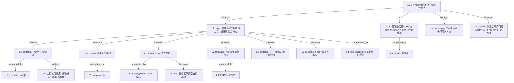

# Question Q7

## AI-A draft
# AI-A Decision Tree Round 1

paper_id: paper_40295872
question_id: Q7
task_type: literature_decision_tree_reasoning
question: 局限有哪些？是否被合理讨论？是否动摇主要结论方向？（残余混杂、选择偏倚、因果倒置、外推、中介时序、AF 表型缺失、单中心等）
source_file: adversarial_lit_reading/chunks/paper_40295872_jin2025_shr_sofa_af_mortality_cardiovasc_diabetol.md

## 1. Evidence Map

| evidence_id | location | evidence_summary | used_by_node |
|---|---|---|---|
| E1 | Strengths and limitations | 回顾性 → **不能因果推断**；长时期实践变迁影响当代外推 | N1, N2 |
| E2 | Strengths and limitations | **单中心** MIMIC 数据 → 人群/协议/资源不同时外推受限 | N3 |
| E3 | Strengths and limitations | 缺炎症标志、超声、线粒体/凝血直接指标 → 机制解释受限 | N4 |
| E4 | Strengths and limitations | **无法细分 AF**：病因（主因 vs 并发症）、类型（阵发/持续）、慢性度（新发/既往）；率控 vs 节律策略不可分析 | N5 |
| E5 | Strengths and limitations | 作者称模型变量易得、对异质危重 AF「仍 broadly applicable」；呼吁前瞻表型亚组验证 | N6 |
| E6 | Introduction | ICU AF 可为入院主因或继发并发症；预后研究少区分——本文 Limitations 承认仍未区分 | N5, N7 |
| E7 | Methods 人群 | 排除缺 HbA1c/入院 24h 空腹血糖或随访不可得者：22,419→15,358 → **选择偏倚**风险（代谢数据完整者） | N8 |
| E8 | Methods 中介 | 反事实 + bootstrap 中介；碳酸氢盐；未详述暴露–中介–结局时序窗是否严格先验 | N9 |
| E9 | Discussion 机制段 | 大量病理生理叙述（线粒体、酸碱等）超出本数据直接测量 → 解释性强于证据 | N10 |
| E10 | Results 多时点一致 | 院内/30 天/1 年 HR 同向 → 主要关联方向在内部多终点上稳定 | N11 |
| E11 | 全文 | 未系统讨论残余混杂定量（E-value）、失访机制、竞争风险 | N12 |

## 2. Decision Tree - Mermaid

**边关系摘要**

| 边 | 关系 |
|---|---|
| N0→N13 | leads_to |
| N13→N1 | because |
| N1→E1n | supported_by |
| N13→N3/N5/N8/N9/N4 | limitation |
| N5→N7 | because |
| N13→N10 | contradicted_by（叙述强度 vs 数据） |
| N0→N11 | if |
| N11→E10n | supported_by |
| N0→N12 | leads_to |
| N0→N14 | transfer_to |
| N1→N15 | leads_to |

## 3. Node Table

| node_id | node_type | claim | evidence_location | evidence_summary | confidence | risk_tag |
|---|---|---|---|---|---|---|
| N0 | question | 局限是否动摇主结论？ | — | Q7 | high | |
| N13 | claim | 主结论应读作关联+分层预测，非因果 | Limitations; Conclusion | 作者亦写 precludes causal inference | high | |
| N1 | limitation | 回顾性设计限制因果 | Strengths and limitations | 明文 | high | 因果过度 |
| N2 | limitation | 长纳入窗实践变迁 → 当代外推不确定 | Limitations | temporal changes | medium | |
| N3 | limitation | 单中心 → 外推他院弱 | Limitations | single center | high | 可迁移性不足 |
| N4 | limitation | 缺关键生物标志 → 机制解释受限 | Limitations | inflammatory/echo/ATP 等 | high | |
| N5 | limitation | AF 病因/类型/慢性度不可分 | Limitations | critically | high | |
| N6 | claim | 作者认为变量易得仍 broadly applicable | Limitations | 自我辩护 | medium | 逻辑跳跃 |
| N7 | evidence | Intro 已承认 ICU AF 异质且少区分；本文仍未区分 | Introduction; Limitations | 空白延续 | high | |
| N8 | limitation | 剔除缺 HbA1c/FBG 者 → 选择偏倚可能高估/低估不明 | Methods 人群 | 22419→15358 | medium | 证据不足 |
| N9 | limitation | 中介：时序可忽略性与未测混淆原文论证不足 | Methods Mediation | bootstrap 有、假设检验少 | medium | 因果过度 |
| N10 | limitation | Discussion 机制叙事超出直接测量 | Discussion | 病理生理长段 | medium | 因果过度 |
| N11 | claim | 就「死亡风险升高方向」：内部多时点一致，局限更伤外推/因果强度而非翻转点估计方向的文内证据 | Table 2 | 同向 HR | medium | |
| N12 | uncertainty | 残余混杂定量、竞争风险未作为局限深挖 | 全文 | 原文未明确说明 | medium | 证据不足 |
| N14 | transfer | 用户：eICU 外验缓解单库；脓毒症≠AF → AF 特异机制段不可照搬 | 用户确认 | 病种切换 | high | |
| N15 | claim | 可信度分层：关联方向中高；因果/机制低；工具外推低 | 综合 | 见 Provisional | high | |

## 4. Provisional Answer

作者在 **Strengths and limitations** 对核心局限讨论基本到位：回顾性非因果、单中心外推、机制标志缺失、**AF 表型无法细分**（与 Introduction 提出的研究空白形成呼应——提出了问题但数据仍解决不了）。

**对主结论的影响（需拆开读）**

| 结论类型 | 局限冲击 | 判断 |
|---|---|---|
| 「高 SHR+高 SOFA 死亡风险更高」（关联） | 残余混杂/选择偏倚可改效应量；文内多时点同向 | **方向在文内较稳**；因果不可延申 |
| 「碳酸氢盐介导 X%」 | 时序与未测混淆、回顾性 | **比例宜作探索**；不宜当机制定论 |
| 「nomogram/SHAP 可临床分层」 | 无外验、单中心、AF 异质 | **外推弱**；作者已部分承认 |
| Discussion 代谢–器官「治疗分层」建议 | 超出观察关联 | **易因果过度**；属解释非证明 |

综合：**局限动摇的是因果声称、机制精确比例与跨中心工具性能，不自动推翻文内「组合暴露与死亡正相关」的描述性结论。** 迁移到脓毒症时，AF 特异病理讨论段 **不适用**；单中心局限可用双库部分缓解，但病种切换引入新的外推不确定性。

## 5. Uncertainty List

- U1: 代谢数据缺失导致的选择偏倚方向（高估 vs 低估）原文未做 bound。
- U2: 出院后死亡依赖 Death Master File，失访/匹配误差未量化。
- U3: 竞争风险（如非死亡出院后删失定义）对 1 年终点的影响原文未明确说明。
- U4: 「broadly applicable」与「需更好表型验证」并列表述，外推边界仍模糊。

## 6. Follow-up Questions

1. Figure S1 纳排每步 n 是否完整可复现选择偏倚评估？
2. 中介模型协变量集是否与 Table 2 Model II 一致？
3. 作者是否在他处声明 SHR 测量时点相对 SOFA/碳酸氢盐的先后？

## CHUNK
# Page 1

RESEARCH
Open Access
© The Author(s) 2025. Open Access  This article is licensed under a Creative Commons Attribution-NonCommercial-NoDerivatives 4.0 
International License, which permits any non-commercial use, sharing, distribution and reproduction in any medium or format, as long as you 
give appropriate credit to the original author(s) and the source, provide a link to the Creative Commons licence, and indicate if you modified the 
licensed material. You do not have permission under this licence to share adapted material derived from this article or parts of it. The images or 
other third party material in this article are included in the article’s Creative Commons licence, unless indicated otherwise in a credit line to the 
material. If material is not included in the article’s Creative Commons licence and your intended use is not permitted by statutory regulation or 
exceeds the permitted use, you will need to obtain permission directly from the copyright holder. To view a copy of this licence, visit ​h​t​t​p​:​/​/​c​r​e​a​t​i​
v​e​c​o​m​m​o​n​s​.​o​r​g​/​l​i​c​e​n​s​e​s​/​b​y​-​n​c​-​n​d​/​4​.​0​/.
Jin et al. Cardiovascular Diabetology          (2025) 24:422 
https://doi.org/10.1186/s12933-025-02969-1
Cardiovascular Diabetology
*Correspondence:
Jinglan Zhang
jinglanzhang2006@163.com
Full list of author information is available at the end of the article
Abstract
Background  Atrial fibrillation (AF) is a major cardiovascular issue in critically ill patients, linked to elevated mortality 
rates. The Stress Hyperglycemia Ratio (SHR), a novel metric of glucose control, has shown promise in predicting 
adverse outcomes in cardiovascular diseases. However, its impact on the relationship between organ dysfunction 
and mortality in AF remains unclear. This study aims to explore SHR’s role in modifying this association to improve risk 
prediction in critically ill AF patients.
Methods  A retrospective cohort study was performed on MIMIC-IV 3.1 patients with critical illness and AF. 
The primary endpoints were in-hospital, 30-day, and 1-year mortality. Patients were stratified by SHR quartiles 
and categorized into four groups based on combined SHR and SOFA scores. Kaplan-Meier survival analysis and 
multivariate Cox regression assessed the association with mortality, and restriction cubic splines (RCS) were used 
to examine non-linear relationships. Mediation analysis using the Bootstrap method quantified the role of serum 
bicarbonate. A nomogram was developed with multivariable logistic regression, incorporating SHR, SOFA, and 
significant covariates from backward selection. The SHapley Additive exPlanations(SHAP) analysis provided insights 
into predictor contributions.
Results  Of the 15,358 patients included in the cohort, the median age was 66 years (IQR: 55–76), with 56.8% being 
male. The SHR-SOFA combination significantly stratified patients into four distinct risk groups (Q1-Q4), with the high 
SHR and high SOFA group (Q4) showing the poorest prognosis at all time points (log-rank P < 0.001). Multivariate 
Cox regression confirmed that Q4 had the highest mortality risk across all time points (in-hospital HR: 5.32, 95% CI: 
4.31–6.57; 30-day HR: 4.27, 95% CI: 3.62–5.04; 1-year HR: 3.18, 95% CI: 2.82–3.59). RCS analysis indicated a nonlinear 
correlation between SHR and mortality, with a threshold effect at SHR = 1.0 in low SOFA patients. In contrast, high 
SOFA patients showed a J-shaped curve, with an ideal SHR of 1.2. The predictive nomogram, validated through 
backward stepwise regression, included SHR, SOFA score, age, mean arterial pressure (MBP), white blood cell count 
(WBC), bicarbonate, hemoglobin, sodium, and total calcium as key predictors. SHAP analysis highlighted SHR and 
Stress hyperglycemia ratio modulates the 
impact of organ dysfunction on mortality risk 
in critically ill patients with atrial fibrillation: 
insights from the MIMIC-IV database
Huijun Jin1, Xuefeng Xu1, Bo Zhu1 and Jinglan Zhang1*

# Page 2

Page 2 of 13
Jin et al. Cardiovascular Diabetology          (2025) 24:422 
Research insights
What is currently known about this topic?
 	•
SHR predicts cardiovascular events in critical illness.
 	•
SOFA scores predict mortality but ignore metabolic 
dysregulation.
 	•
AF mortality links to organ failure yet metabolic 
modulation unquantified.
What is the key research question?
 	•
How does SHR modulate organ dysfunction’s impact 
on mortality in critical AF?
What is new?
 	•
This study delineates a nonlinear correlation between 
SHR and mortality across various SOFA levels.
 	•
We provide a predictive nomogram integrating SHR 
and SOFA for mortality risk assessment.
 	•
Insights into the mediating role of bicarbonate in the 
SHR-mortality link.
How might this study influence clinical practice?
 	•
The nomogram can help clinicians stratify mortality 
risk in critically ill AF patients;
 	•
Understanding the SHR-SOFA interaction may guide 
targeted interventions.
Introduction
Atrial fibrillation (AF) ranks as one of the most preva­
lent persistent arrhythmias associated with cardiovascu­
lar disease [1]. The prevalence of AF is estimated to be 
around 330  million people worldwide, with nearly one 
third of these individuals developing this disorder during 
their lifetime [2]. AF is associated with a 1.5 to 3.5-fold 
SOFA as the most influential predictors, with age also playing a crucial role. Mediation analysis indicated that serum 
bicarbonate mediated 22.7% of SHR’s effect on in-hospital mortality, diminishing over time.
Conclusions  This study reveals a notable relationship among SHR and SOFA scores in forecasting mortality among 
critically sick patients with atrial fibrillation. The developed nomogram integrating SHR, SOFA, and other covariates 
offers a novel tool for risk stratification. SHAP analysis confirms SHR and SOFA as key predictors, highlighting their 
clinical utility in mortality assessment.
Keywords  Atrial fibrillation, Stress hyperglycemia ratio, Sequential organ failure assessment, Mortality prediction, 
Machine learning interpretation
Graphical abstract

# Page 3

Page 3 of 13
Jin et al. Cardiovascular Diabetology          (2025) 24:422 
increase in all-cause mortality, representing a substantial 
medical and economic burden worldwide. Within inten­
sive care units (ICUs), the incidence of AF among criti­
cally ill patients has been reported to range from 4.5% to 
29.5% [3–5]. It is important to note that AF in the ICU 
may represent either a primary reason for admission 
(e.g., arrhythmia-induced hemodynamic instability) or a 
secondary complication arising from acute illness, sepsis, 
metabolic disturbance, or postoperative stress. Neverthe­
less, prognostic studies seldom distinguish between these 
contexts, and there remains a notable gap in research 
dedicated to identifying specific risk factors—particu­
larly metabolic markers—associated with outcomes in 
critically ill AF patients. Therefore, the identification and 
management of risk factors are crucial for mitigating 
mortality rates in this vulnerable population.
Current research demonstrates that hyperglycemia 
is common among critically ill patients and correlates 
with a higher incidence of complications and mortal­
ity, regardless of diabetes status [6–8]. A new metric of 
glucose control, the Stress Hyperglycemia Ratio (SHR), 
serves as a comprehensive assessment technique that bal­
ances acute and chronic blood glucose levels, therefore 
providing a more realistic reflection of stress-induced 
hyperglycemia, has been proposed to play a significant 
role in hyperglycemia-related processes [9]. In the full 
range of glycemic conditions, SHR has been proposed 
as a promising indicator of stress and hyperglycemia. 
Hyperglycemia induced by acute stress occurs when glu­
cagon, cortisol, catecholamines, and growth hormone 
levels are elevated. In addition to increasing gluconeo­
genesis and glycogenolysis, these processes also inhibit 
peripheral glucose uptake. SHR serves as a standalone 
prognostic factor for negative cardiovascular events, 
including heart failure and AF, following acute myocar­
dial infarction (AMI) or after cardiac surgical procedures 
[10–12]. Effective glycemic management is crucial in the 
treatment of AF [13], and recent research suggests that 
SHR correlates with both short-term and long-term 
mortality rates in patients experiencing severe AF [14]. 
However, while SHR’s U-shaped mortality association is 
established, a cardinal extension is quantifying its modi­
fication of organ dysfunction impact. Concomitantly, the 
biochemical mediation through acid-based imbalance 
remains unexplored terrain, culminating in deficient 
time-sensitive prediction tools.
The purpose of this study was to examine how SHR 
modifies the association between organ dysfunction 
severity that is assessed by SOFA scores and mortality 
risk in critical atrial fibrillation. Additionally, this study 
quantified bicarbonate-mediated pathways, constructed 
time-stratified prediction models and utilized explainable 
machine learning to characterize interaction patterns.
Method
Data source
This retrospective cohort analysis used data from 
MIMIC-IV (version 3.1), a publicly accessible deiden­
tified clinical database managed by the Massachusetts 
Institute of Technology Computational Physiology 
Laboratory [15]. From 2008 to 2022, over 90,000 ICU 
admissions were documented in the MIMIC-IV data­
base at Beth Israel Deaconess Medical Center in Boston, 
Massachusetts. Data captured by MIMIC-IV includes 
demographic information, continuous bedside vital mea­
surements, laboratory test results, medication records, 
surgical and procedural interventions, clinician notes, 
and ICD-9 and ICD-10 disease diagnoses, as well as lon­
gitudinal survival outcome data. As a result of structural 
improvements and expanded data components, the anal­
ysis employed MIMIC-IV version 3.1. BIDMC and MIT 
waived informed consent for this retrospective, anony­
mized database study since it involved retrospective data. 
Prior to accessing the data, the author HJJ received train­
ing in human subject protection and successfully met the 
Collaborative Institutional Training Initiative’s require­
ments (approval No. 61632129).
Study population
Initially, this retrospective cohort investigation identified 
22,419 adult patients (≥ 18 years) who met the following 
criteria from the MIMIC-IV database and who had docu­
mented atrial fibrillation: (1) Admission to an intensive 
care unit for the first time (2) ICU stay exceeding 24 h. 
After exclusion criteria for incomplete metabolic data 
(HbA1c or fasting blood glucose within 24 h of admis­
sion) and unavailability of follow-up records, the analysis 
cohort consisted of 15,358 patients. Using the SHR, these 
patients were categorized into three groups ( Figure S1).
Data extraction
The data is extracted using Navicat Premium (v16.1.15). 
The correlations between demographic variables (age, 
gender, weight), vital signs monitoring parameters (heart 
rate, mean blood pressure, respiratory rate, and oxy­
gen saturation) and validated severity assessment scores 
(Simplified Acute Physiology Score II and Sequential 
Organ Failure Assessment) were systematically iden­
tified. Comorbidities include hypertension, diabetes, 
renal disease, coronary heart disease, acute myocardial 
infarction, and cardiac failure. Lab tests after admission 
included glucose, HbA1c, lactate, lipid profiles, renal/
hepatic function indicators, hematologic parameters, and 
electrolyte panels. Antibiotics, glucocorticoids, vasopres­
sors, and mechanical ventilation were evaluated. Out­
come tracking assessed intensive care unit and hospital 
stay length and death endpoints from in-hospital to 365 
days after discharge. Variables with 20% missing were

# Page 4

Page 4 of 13
Jin et al. Cardiovascular Diabetology          (2025) 24:422 
eliminated for data completeness. Multiple imputation 
was performed for variables with < 20% missing values 
using the Miss Forest method, a non-parametric ran­
dom forest technique based on the missing-at-random 
assumption [16, 17]. A directed cyclic graph model was 
used to identify various causal pathways prior to statisti­
cal analysis. The SHR was determined using the formula: 
fasting blood glucose (FBG) (mg/dl) divided by [28.7 x 
HbA1c (%) – 46.7].
Study endpoint
The objectives of this study encompassed mortality rates 
at several intervals after hospitalization: in-hospital, 30 
days post-admission and 365 days post-admission. Data 
regarding patient mortality post-hospital discharge was 
sourced from the United States Social Security Adminis­
tration’s Death Master File.
Statistical analysis
The SHR was stratified into tertiles for analysis: Tertile 1 
(Low SHR: <0.93), Tertile 2 (Medium SHR: 0.93–1.22), 
and Tertile 3 (High SHR: ≥1.22). The SOFA score was 
dichotomized using a cutoff of 5, where scores < 5 defined 
Low SOFA and scores ≥ 5 defined High SOFA, a thresh­
old validated to signify significant organ dysfunction [18]. 
For the combined analysis, patients were categorized 
into four groups: Q1 (Low SHR + Low SOFA), Q2 (High 
SHR + Low SOFA), Q3 (Low SHR + High SOFA), and Q4 
(High SHR + High SOFA).
The analytical approach utilized a multi-tiered frame­
work, commencing with thorough data preprocessing. 
Continuous variables were expressed as mean ± stan­
dard deviation for data with normal distribution, while 
non-normally distributed variables were represented 
as median with an interquartile range (IQR). Distribu­
tion patterns were assessed using the Shapiro-Wilk test. 
Between-group comparisons were performed using Stu­
dent’s T-tests or Kruskal-Wallis tests as suitable. Cate­
gorical variables were summarized using frequencies (%) 
and analyzed through χ² or Fisher’s exact tests. Data with 
missing values exceeding a 20% threshold were excluded, 
while the remaining missing values were addressed 
through multiple imputation utilizing the miss Forest 
algorithm, based on the missing-at-random assumption.
The primary inferential analyses employed Cox pro­
portional hazards regression, advancing all candidate 
predictors with univariate associations (P < 0.05) to mul­
tivariate modeling, and the results were presented as an 
hazard ratio (HR) with 95% confidence intervals (CIs). 
Hierarchically adjusted models were constructed. Model 
1 was based solely on SHR; Model 2 applied extensive 
adjustments incorporating laboratory markers, thera­
peutic interventions, and further severity metrics. The 
assumptions of proportional hazards were validated 
using Schoenfeld residual analysis. Nonlinear exposure-
outcome relationships were assessed using restricted 
cubic splines (RCS) with four knots. Significant thresh­
old effects (P < 0.05 by likelihood ratio test) were quanti­
fied through piecewise Cox regression. Survival curves 
were constructed using the Kaplan-Meier method, with 
stratification applied according to SHR tertiles and SOFA 
scores categorized at the median. Survival distribution 
differences were assessed using log-rank tests across 
three mortality endpoints: in-hospital, 30-day, and 1-year 
mortality.
With the aid of the counterfactual framework, a boot­
strap-based mediation analysis (1,000 random samples) 
was conducted to quantify the mediating role played by 
bicarbonate in the SHR-mortality pathway. The effects 
were decomposed as direct (c), indirect (a + b), and 
proportion-mediated effects. In the process of devel­
oping and validating the prognostic tool, we created a 
nomogram that integrates key predictors identified in 
the final multivariate models. This enables tailored risk 
assessment. Bootstrapping-corrected calibration curves 
were used to verify calibration (Brier scores with boot­
strap validation and 200 resamples) to ensure alignment 
between predictions and observations [19]. Additionally, 
to enhance the clinical utility of the nomogram devel­
oped for predicting mortality risk in critically ill atrial 
fibrillation patients, we conducted a comprehensive eval­
uation integrating SHAP (Shapley Additive Explanations) 
analysis [20]. The use of this method permitted a detailed 
understanding of how various features affected predic­
tions, increasing clarity and comprehensibility. All analy­
ses were conducted using R v4.3.2 (survival, rms, glmnet 
packages) with statistical significance established at two-
sided P < 0.05.
Results
Baseline characteristics
The study assessed 15,358 critically ill patients with 
atrial fibrillation according to the established inclu­
sion and exclusion criteria (Figure S1), with a median 
(IQR) age of 66 [55,76] years, and 56.8% being males. 
The study patients were categorized into three groups 
based on the SHR index at ICU admission: T1 (< 0.93), 
T2 (0.93 ≤ SHR < 1.22), and T3 (SHR ≥ 1.22). Table 1 delin­
eates the baseline features of these groups. The elevated 
SHR group exhibited increased respiratory rates, severity 
ratings (e.g., SOFA and SIRS), more acid-base imbalances 
(e.g., reduced bicarbonate), and a higher prevalence of 
comorbidities (e.g., myocardial infarction, congestive 
heart failure, and chronic kidney disease). Furthermore, 
all-cause mortality following ICU admission in-hospital, 
at 90 days, and at 360 days displayed a gradual rise across 
SHR tertiles (T1 to T3, P < 0.001).

# Page 5

Page 5 of 13
Jin et al. Cardiovascular Diabetology          (2025) 24:422 
Variable
Overall
Tertile 1
Tertile 2
Tertile 3
P value
(n = 15358)
(SHR < 0.93,
n = 5122)
(0.93 ≤ SHR < 1.22, n = 5119)
(SHR ≥ 1.22,
n = 5117)
Demographics
Age, years
66.0 [55.0, 76.0]
66.0 [55.0, 77.0]
66.0 [56.0, 76.0]
66.0 [55.0, 76.0]
0.040
Men, n (%)
8720.0 (56.8)
2908.0 (56.8)
2979.0 (58.2)
2833.0 (55.4)
0.015
Race/ethnicity, n (%)
< 0.001
Asian
545.0 (3.5)
186.0 (3.6)
188.0 (3.7)
171.0 (3.3)
White
9323.0 (60.7)
3076.0 (60.1)
3206.0 (62.6)
3041.0 (59.4)
Black
2138.0 (13.9)
804.0 (15.7)
641.0 (12.5)
693.0 (13.5)
Others
3352.0 (21.8)
1056.0 (20.6)
1084.0 (21.2)
1212.0 (23.7)
Vital signs
Weight, kg
81.0 [68.2, 97.0]
80.2 [67.3, 95.6]
81.00 [69.0, 96.8]
81.8 [68.8, 98.4]
< 0.001
Temperature, ℃
36.7 [36.4, 37.1]
36.7 [36.4, 37.0]
36.7 [36.4, 37.1]
36.7 [36.4, 37.1]
0.032
Mean heart rate, beats/min
86.0 [75.0, 99.0]
86.0 [75.0, 98.0]
87.0 [75.0, 99.0]
86.0 [74.0, 99.0]
0.074
Systolic blood pressure, mmHg
127.0 [111.0, 145.0]
127.0 [111.0, 144.0]
128.0 [112.0, 145.0]
127.0 [110.0, 145.0]
0.066
Diastolic blood pressure, mmHg
70.0 [59.0, 82.0]
70.0 [59.0, 82.0]
70.0 [59.0, 83.0]
69.0 [58.0, 82.0]
0.117
Respiratory rate, times/min
18.0 [15.0, 22.0]
18.0 [15.0, 22.0]
18.0 [15.0, 22.0]
19.0 [16.0, 23.0]
< 0.001
Saturation of pulse oxygen, %
98.0 (95.0, 100.0)
98.0 [96.0, 100.0]
98.0 [95.0, 100.0]
98.0 [95.0, 100.0]
< 0.001
Comorbidities
Hypertension, n (%)
6987.0 (45.5)
2379.0 (46.4)
2468.0 (48.2)
2140.0 (41.8)
< 0.001
Diabetes mellitus, n (%)
6401.0 (41.7)
2201.0 (43.0)
1725.0 (33.7)
2475.0 (48.4)
< 0.001
Acute myocardial infarction, n (%)
3255.0 (21.2)
984.0 (19.2)
1047.0 (20.5)
1224.0 (23.9)
< 0.001
Heart failure, n (%)
4501.0 (29.3)
1462.0 (28.5)
1382.0 (27.0)
1657.0 (32.4)
< 0.001
Chronic obstructive pulmonary disease, n (%)
3509.0 (22.8)
1146.0 (22.4)
1140.0 (22.3)
1223.0 (23.9)
0.089
Liver disease, n (%)
1679.0 (10.9)
470.0 (9.2)
500.0 (9.8)
709.0 (13.9)
0.076
Chronic kidney disease, n (%)
3472.0 (22.6)
1160.0 (22.6)
1017.0 (19.9)
1295.0 (25.3)
< 0.001
Stroke, n (%)
4324.0 (28.2)
1504.0 (29.4)
1600.0 (31.3)
1220.0 (23.8)
< 0.001
Cardiogenic shock, n (%)
1151.0 (7.5)
309.0 (6.0)
327.0 (6.4)
515.0 (10.1)
< 0.001
Severity scores
SOFA
4.0 [2.0, 7.0]
4.0 [2.0, 6.0]
4.0 [2.0, 6.0]
5.0 [3.0, 8.0]
< 0.001
SAPS-II
33.0 [26.0, 41.0]
32.0 [25.0, 40.0]
32.0 [25.0, 40.0]
35.0 [27.0, 44.0]
< 0.001
SIRS
2.0 [2.0, 3.0]
2.0 [2.0, 3.0]
2.0 [2.0, 3.0]
3.0 [2.0, 3.0]
< 0.001
OASIS
30.0 [24.0, 36.0]
29.0 [24.0, 35.0]
30.0 [24.0, 35.0]
31.0 [26.0, 37.0]
< 0.001
Laboratory parameters
Hemoglobin, g/L
11.6 [9.8, 13.1]
11.6 [10.0, 13.1]
11.7 [10.0, 13.2]
11.3 [9.5, 13.0]
< 0.001
Platelet, 109/L
201.0 [150.0, 262.0]
199.0 [150.0, 259.0]
201.0 [153.0, 259.0]
202.0 [149.0, 268.0]
0.880
White blood cell, 109/L
10.2 [7.5, 13.9]
9.1 [6.8, 12.3]
10.2 [7.6, 13.5]
11.7 [8.4, 15.8]
< 0.001
Bicarbonate, mmol/L
23.0 [20.0, 25.0]
23.0 [21.0, 26.0]
23.0 [21.0, 25.0]
22.0 [19.0, 25.0]
< 0.001
Creatinine, mg/dL
1.0 [0.8, 1.4]
0.9 [0.7, 1.3]
0.9 [0.7, 1.3]
1.1 [0.8, 1.6]
< 0.001
Blood urea nitrogen, mg/dL
18.0 [13.0, 29.0]
17.0 [12.3, 27.0]
18.0 [13.0, 26.0]
21.0 [14.0, 34.0]
< 0.001
Sodium, mmol/L
138.0 [136.0, 141.0]
139.0 [136.0, 141.0]
138.0 [136.0, 141.0]
137.0 [134.0, 140.0]
0.579
Potassium, mmol/L
4.1 [3.7, 4.5]
4.0 [3.7, 4.4]
4.0 [3.7, 4.4]
4.2 [3.8, 4.6]
< 0.001
Total calcium, mg/dL
8.5 [8.0, 9.0]
8.6 [8.1, 9.0]
8.6 [8.1, 9.0]
8.5 [8.0, 9.0]
< 0.001
Prothrombin time, s
13.5 [12.1, 15.7]
13.5 [12.1, 15.7]
13.4 [12.0, 15.5]
13.5 [12.1, 15.8]
0.013
Activated partial thromboplastin time, s
29.6 [26.1, 36.4]
30.0 [26.4, 36.4]
29.4 [26.2, 35.9]
29.4 [25.7, 36.9]
0.004
Treatment
Aspirin
6206 (40.4)
2217 (43.3)
2107 (41.2)
1882 (36.8)
< 0.001
Insulin
3723 (24.2)
1345 (26.3)
1005 (19.6)
1373 (26.8)
0.435
Statin
2262 (14.7)
778 (15.2)
753 (14.7)
731 (14.3)
< 0.001
Length Of Stay (LOS)
LOS in hospital
7.8 [4.7, 13.9]
7.0 [4.3, 12.2]
7.7 [4.7, 13.3]
8.9 [5.2, 16.1]
< 0.001
LOS in ICU
2.6 [1.6, 4.8]
2.2 [1.5, 4.1]
2.5 [1.6, 4.7]
3.0 [1.8, 5.7]
< 0.001
Outcome
Table 1  Patients’ characteristics

# Page 6

Page 6 of 13
Jin et al. Cardiovascular Diabetology          (2025) 24:422 
Data: N (%) or Mean (T1–T2) or mean ± standard 
deviation. Abbreviations: SOFA: Sequential Organ Fail­
ure Assessment; SAPS II, Simplified Acute Physiology II; 
SIRS, Systemic Inflammatory Response Syndrome Score; 
OASIS, Outcome and Severity Index Score.
The SHR-SOFA combination and all-cause mortality 
in critical ill patients with AF
After combining the SOFA and the SHR, the patients 
were divided into four groups: Q1: low SOFA and low 
SHR; Q2: low SOFA and high SHR; Q3: high SOFA and 
low SHR; Q4: high SOFA and high SHR. The Kaplan-
Meier curves demonstrated statistically significant dif­
ferences in survival probabilities among the four strata 
(log-rank P < 0.001) (Figure S2) The high SHR and high 
SOFA group consistently displayed the poorest prognosis 
at all time points, with intermediate groups maintaining 
the hierarchy of low SHR and high SOFA > high SHR and 
low SOFA at all intervals (P < 0.001).
Cox 
regression 
analysis 
indicated 
significantly 
increased crude mortality hazards at all time points, 
with the high SHR and high SOFA group displaying the 
highest risk (in-hospital: HR 5.32, 95% CI 4.31–6.57; 
30-day: HR 4.27, 3.62–5.04; 1-year: HR 3.18, 2.82–3.59) 
compared to the low SHR and low SOFA reference. An 
association with risk differentials was still observed after 
adjusting for other variables, compared to the low SHR 
and low SOFA reference, the low SHR and high SOFA 
group exhibited HR of 2.59 (95% CI 2.07–3.23) for in-
hospital mortality, 2.14 (95% CI 1.77–2.58) for 30-day 
mortality, and 1.78 (95% CI 1.58-2.00) for 1-year mortal­
ity; the high SHR + low SOFA group demonstrated HRs 
of 1.79 (95% CI 1.41–2.28), 1.44 (95% CI 1.18–1.75), and 
1.21 (95% CI 1.08–1.39) for the respective timepoints; 
while the high SHR and high SOFA group showed sub­
stantially elevated hazards (in-hospital: HR 4.06, 95% CI 
3.24–5.09; 30-day: HR 3.23, 95% CI 2.75–4.03; 1-year: 
HR 2.45, 95% CI 2.17–2.78). Analysis of individual com­
ponents revealed the highest SHR level independently 
increased in-hospital mortality (HR 1.82, 95% CI 1.51–
2.18), 30-day mortality (HR 1.81, 95% CI 1.54–2.13), and 
1-year mortality (HR 1.38, 95% CI 1.25–1.53), while high 
SOFA similarly elevated risks (in-hospital: HR 2.16, 95% 
CI 2.07–2.93; 30-day: HR 2.22, 95% CI 1.91–2.59; 1-year: 
HR 1.88, 95% CI 1.71–2.08) (Table 2). Subgroup analysis 
validated the consistent ranking of mortality risk across 
cohorts of myocardial infarction, heart failure, and renal 
failure, reflecting overall population trends with non-
significant interaction terms (Table S1-3). For in-hos­
pital mortality, patients aged < 65 years with high SHR 
and high SOFA had substantially elevated risk (HR 6.93, 
95% CI 4.50-10.66) compared to the reference group. 
Table 2  Cox proportional hazard models for in-hospital, 30-day, and 365-day all-cause mortality
Variable
In-hospital mortality
30-day mortality
365-day mortality
Model I
HR (95%CI)
Model II
HR (95%CI)
P value
Model I
HR (95%CI)
Model II
HR (95%CI)
P value
Model I
HR (95%CI)
Model II
HR (95%CI)
P value
SHR
Tertiles 1
Ref
Ref
Ref
Ref
Ref
Ref
Tertiles 2
1.42 (1.17–1.73)
1.38 
(1.13–1.68)
0.0004
1.59 (1.34–1.89)
1.54 
(1.30–1.82)
< 0.0001
1.20 
(1.09–1.33)
1.20 
(1.08–1.33)
0.0004
Tertiles 3
2.84 (2.38–3.38)
1.82 
(1.51–2.18)
< 0.0001
2.65 (2.27–3.10)
1.81 
(1.54–2.13)
< 0.0001
1.73 
(1.57–1.90)
1.38 
(1.25–1.53)
< 0.0001
SOFA
Low
Ref
Ref
Ref
Ref
Ref
Ref
High
4.17 (3.61–4.81)
2.16 
(2.07–2.93)
< 0.0001
3.09 (2.73–3.49)
2.22 
(1.91–2.59)
< 0.0001
2.10 
(1.94–2.27)
1.88 
(1.71–2.08)
< 0.0001
Combined
Low SHR and Low SOFA
Ref
Ref
Ref
Ref
Ref
Ref
Low SHR and High SOFA
7.76 (6.40–9.40)
2.59 
(2.07–3.23)
< 0.0001
5.12 (4.37-6.00)
2.14 
(1.77–2.58)
< 0.0001
2.94 
(2.66–3.26)
1.78 
(1.58-2.00)
< 0.0001
High SHR and Low SOFA
2.07 (1.63–2.62)
1.79 
(1.41–2.28)
< 0.0001
1.66 (1.33–1.97)
1.44 
(1.18–1.75)
< 0.0001
1.32 
(1.18–1.49)
1.21 
(1.08–1.39)
< 0.0001
High SHR and High SOFA
3.92 (3.21–4.79)
4.06 
(3.24–5.09)
< 0.0001
2.67 (2.27–3.16)
3.23 
(2.75–4.03)
< 0.0001
1.89 
(1.70–2.01)
2.45 
(2.17–2.78)
< 0.0001
Variable
Overall
Tertile 1
Tertile 2
Tertile 3
P value
In-hospital mortality, n (%)
865 (5.6)
175 (3.4)
239 (4.7)
451 (8.8)
< 0.001
30-day mortality, n (%)
1069 (7.0)
376 (7.3)
489 (9.6)
711 (13.9)
< 0.001
365-day mortality, n (%)
2598 (16.9)
701 (13.7)
805 (15.7)
1092 (21.3)
< 0.001
Table 1  (continued)

# Page 7

Page 7 of 13
Jin et al. Cardiovascular Diabetology          (2025) 24:422 
Similarly, non-diabetic patients in this high-risk group 
showed markedly increased mortality (HR 5.07, 95% CI 
3.78–6.80). The risk patterns remained consistent across 
sex, acute myocardial infarction, heart failure, and acute 
kidney injury subgroups, with all confidence intervals 
excluding the null value except for a few underpowered 
subgroups.
HR, hazard ratio.
Model I: Unadjusted model.
Model II: Adjusted For Age; Gender; Heart Rate; Respi­
ratory Rate; SAPSII; SIRS; PT; Sodium; Total Calcium; 
Potassium; Creatinine; PLT; WBC; Bicarbonate; Mean 
Blood Pressure; Congestive Heart Failure; Diabetes; AKI; 
Invasive Ventilation, Insulin; Aspirin; Statin.
SHR: Tertiles 1 (< 0.93), Tertiles 2 (0.93 ≤ SHR < 1.22), 
Tertiles 3 (SHR ≥ 1.22). SOFA: Low (SOFA score < 5), 
High (SOFA score ≥ 5).
The adjusted RCS analysis revealed a varying dose 
response pattern of SHR on mortality among SOFA 
groups and at different time intervals (Figure1). In 
the low SOFA group, SHR had a nonlinear correla­
tion with in-hospital (P nonlinear=0.001) and 30-day (P 
nonlinear=0.003) mortality, marked by threshold effects 
at SHR = 1.0. Nonetheless, this nonlinear association 
was not statistically significant for 1-year mortality (P 
nonlinear=0.168). In contrast, within the high SOFA group, 
SHR had a substantial correlation with mortality at all 
intervals (in-hospital, 30 days, and 1 year), characterized 
by a persistent J-shaped curve (P nonlinear<0.001) and an 
ideal SHR of 1.2 (P < 0.001).
Mortality risk prediction based on nomogram model
Feature selection was conducted by backward stepwise 
regression analysis (retention significance level: α = 0.05), 
which determined the optimum covariate combina­
tion for each mortality outcome. Comprehensive mor­
tality risk prediction nomograms were then developed 
utilizing multivariable logistic regression for three piv­
otal timepoints: in-hospital, 30-day, and 1-year mortal­
ity (Figure 2). The stepwise-derived models consistently 
maintained essential predictors at all time points, includ­
ing SHR, SOFA score, age, with time-specific inclusions. 
The stepwise elimination approach removed non-signifi­
cant variables (P ≥ 0.05) at each stage, resulting in concise 
Fig. 2  Nomograms for Predicting Mortality Risks in Critically Ill AF Patients. These three nomograms predict a In-hospital, b 30-day, c 365-day all-cause 
mortality risks in critically ill patients with atrial fibrillation. Each nomogram incorporates the SHR, SOFA score, and other clinical indicators to provide a 
risk assessment tool
 
Fig. 1  Restriction Cubic Splines Analysis of Stress Hyperglycemia Ratio on Mortality Risk Across Different SOFA Levels in Critically Ill Patients with AF. 
Stratified restricted cubic spline analysis of stress hyperglycemia ratio and mortality by SOFA severity: a In-hospital, b 30-day, c 365-day all-cause mortality

# Page 8

Page 8 of 13
Jin et al. Cardiovascular Diabetology          (2025) 24:422 
yet clinically useful models. Each retained predictor was 
allocated a points scale (0-100) in accordance with its 
regression coefficient, with SOFA consistently exhibit­
ing the greatest contribution (maximum of 22 points). 
The total points system ranged from 0 to 400 points, 
nonlinearly correlating with mortality probability from 
0.1 to 0.9 via logistic transformation. Internal valida­
tion through 1,000 bootstrap resamples demonstrated 
exceptional calibration across all timepoints: for in-hos­
pital mortality, the optimism-corrected calibration curve 
exhibited 94–98% overlap between observed and pre­
dicted probabilities (mean absolute error [MAE] = 0.020, 
90% quantile error = 0.033); for 30-day mortality, the 
curve sustained 90–94% concordance (MAE = 0.009, 
90% quantile error = 0.012); and for 1-year mortality, 
calibration remained robust with 90–94% agreement 
(MAE = 0.021, 90% quantile error = 0.032). In all calibra­
tion plots (Figure S3), the optimism-corrected curves 
closely aligned with both the ideal reference line and 
observed outcomes, indicating low overfitting and strong 
predicted accuracy across the risk spectrum. The mod­
els also demonstrated robust discriminatory ability, with 
C-indexes of 0.807 (95% CI: 0.786–0.828) for in-hospital 
mortality, 0.792 (95% CI: 0.773–0.812) for 30-day mortal­
ity, and 0.722 (95% CI: 0.709–0.735) for 1-year mortality.
Model interpretation
SHAP values were employed to assess the influence of 
clinical variables on the predictive mortality model for 
critically ill atrial fibrillation patients. The SHAP sum­
mary plots (Figure  3A-C) demonstrated distinctly dif­
ferent patterns of influence for each feature over several 
time intervals: in-hospital, 30-day, and 365-day mortality. 
At all-time intervals, the SHR was consistently a signifi­
cant predictor of mortality, with a positive SHAP indi­
cating a higher mortality risk. In-hospital mortality was 
associated with protective effects from statin and aspirin 
use, while bicarbonate and MBP levels were identified 
as risk variables. The SHAP analysis of 30-day mortality 
indicated a similar trend. It was revealed that statin and 
insulin treatment conferred protection, whereas bicar­
bonate and sodium levels constituted risk factors. In 
the context of 365-day Death Prediction, statin use was 
correlated with reduced SHAP values, suggesting a pro­
tective influence on long-term mortality. Conversely, ele­
vated SHAP values were noted for MBP, respiratory rate, 
and total calcium, which were correlated with increased 
risk. SHAP dependence plots elucidated nonlinear mor­
tality associations, identifying the clinically significant 
SHR risk categories using a zero SHAP value as the 
risk-neutral benchmark: a high-risk range (SHAP > 0) 
emerged beyond SHR > 1.2, demonstrating exponential 
risk escalation when accompanied by organ dysfunction 
(SOFA > 5, yellow points) (Figure 3D-F).
Mediation analysis
Mediation research assessed the role of bicarbonate 
depletion in elucidating the mortality risk linked to the 
Fig. 3  SHAP Analysis of Clinical Features Influencing Mortality Risk at Different Time Intervals. SHAP summary plots (a–c) and SHAP dependence plots 
(d–f) are displayed, illustrating the impact of various clinical features on the prediction of in-hospital, 30-day, and 365-day mortality in critically ill patients 
with AF. The summary plots rank features by their SHAP values, highlighting their relative importance in mortality prediction. The dependence plots 
further explore the nonlinear relationship between the SHR and mortality risk across different SOFA score levels

# Page 9

Page 9 of 13
Jin et al. Cardiovascular Diabetology          (2025) 24:422 
SHR. Bicarbonate accounted for 22.7% of SHR’s influence 
on in-hospital mortality (indirect effect a × b = 0.110, 95% 
CI: 0.086–0.137; direct effect c’ = 0.375, 95% CI: 0.299–
0.450). At the 30-day follow-up, the mediation fraction 
diminished to 21.7% (axb = 0.099, 0.079–0.121; c’ = 0.357, 
0.292–0.435), but at the 1-year endpoint, merely 17.2% 
of the mortality impact of SHR was mediated through 
acid-base pathways (a × b = 0.057, 0.042–0.078; c’ = 0.274, 
0.217–0.334). The gradual reduction of bicarbonate 
mediating function corresponded with the diminishing 
clinical importance of metabolic acidosis in long-term 
critical care results (Figure 4).
Discussion
This study demonstrates that SHR significantly modu­
lates the relationship between SOFA-defined organ fail­
ure and mortality risk in critically ill AF patients. We 
further identified bicarbonate-mediated pathways and 
developed predictive models using explainable machine 
learning. The interplay between SHR and SOFA scores 
profoundly influences mortality risk, emphasizing the 
necessity of their combined assessment in clinical prac­
tice. Our findings highlight the crucial interplay between 
metabolic stress and organ dysfunction in AF patients, 
but why is SHR particularly relevant in this specific 
population?
The implementation of SHR holds particular signifi­
cance in critically ill patients with AF for several com­
pelling reasons. First, the heightened metabolic demand 
and catecholamine surge inherent in AF—especially with 
rapid ventricular response—can exacerbate stress hyper­
glycemia, creating a vicious cycle that further promotes 
arrhythmogenesis [21, 22]. Second, the pro-inflam­
matory and pro-fibrotic pathways activated by stress 
hyperglycemia directly contribute to the atrial structural 
remodeling that sustains AF [23, 24]. Third, there exists 
a well-established pathophysiological interplay between 
glucose metabolism and AF, where insulin resistance 
and glycemic fluctuations have been shown to alter atrial 
electrophysiology and promote atrial ectopy [13, 25]. In 
this context, SHR serves as an integrated marker of this 
maladaptive metabolic-stress response. Unlike isolated 
glucose measurements, SHR accounts for underlying gly­
cemic status, thereby more accurately reflecting the true 
magnitude of acute metabolic disturbance and its impact 
on the vulnerable atrial substrate [9, 26]. Consequently, 
SHR provides a superior tool for risk stratification in 
this specific population, identifying those AF patients 
in whom metabolic dysregulation may be driving both 
arrhythmia persistence and organ dysfunction.
SHR is associated with cardiovascular risk factors, 
including IR, and may serve as an important clinical 
prognostic indicator in cardiovascular diseases [26]. SHR 
is commonly observed in patients with critical illnesses 
and is closely linked to inflammatory reactions and sig­
nificant disturbances in glucose metabolism [23, 27, 28]. 
Clinical studies indicate that SHR is independently linked 
to numerous poor clinical outcomes, including throm­
bosis load and coronary artery disease severity [29, 30]. 
In individuals suffering from AMI, a heightened SHR 
demonstrated a significant association with long-term 
all-cause mortality within cohorts from both the United 
States and China [31]. Conversely, among patients expe­
riencing acute and decompensated heart failure, SHR 
revealed a U-shaped relationship with both mortality and 
rehospitalization rates [7].
Furthermore, Cheng et al. proposed a U-shaped corre­
lation between the levels of the SHR index and mortality 
rates observed at 30, 90, 180, and 365 days [14]. Nonethe­
less, the impact of SHR on mortality risk or the severity 
Fig. 4  Mediation analysis of the impact of SHR on mortality risk via bicarbonate. Panel A illustrates the mediation model, with panels B, C, and D showing 
the bootstrap distributions of the indirect (a×b) and direct effects (c’) for in-hospital, 30-day, and 365-day mortality predictions, respectively

# Page 10

Page 10 of 13
Jin et al. Cardiovascular Diabetology          (2025) 24:422 
of organ failure has yet to be investigated. This study 
elucidates that SHR dynamically interacts with SOFA-
defined organ failure, accordingly, altering death trajec­
tories. Upon controlling for potential confounders, there 
discerned a threshold-dependent J-shaped correlation 
between SHR and in-hospital or 30-day mortality in criti­
cally sick AF patients with SOFA > 5, with an inflection 
point at SHR = 1.2. In contrast, this connection exhibited 
a J-shaped pattern during the acute period in low-SOFA 
patients (SOFA ≤ 5), but it became statistically insig­
nificant for 365-day mortality. The findings of this study 
demonstrate that the prognostic value of SHR is depen­
dent upon concurrent organ dysfunction, presenting a 
stratified risk assessment framework that was previously 
unavailable.
The precise mechanisms that contribute to the non-
linear relationship are not yet fully understood. Hyper­
glycemia triggered by stress manifests during stress or 
significant illness [32]. An elevated SHR suggests that 
the body’s stress response remains unresolved, indicat­
ing sustained autonomic nervous system dysfunction. 
This condition, characterized by overactivity of the sym­
pathetic nervous system and reduced parasympathetic 
nervous system activity, may facilitate AF development 
[21, 22]. Moreover, acute hyperglycemia excursions 
induce oxidative stress by promoting the overproduction 
of reactive oxygen species [25]. Thirdly, a high SHR may 
interfere with fibrinolysis, which breaks down thrombi, 
characterized by elevated levels of plasminogen activa­
tor inhibitor, indicating a direct correlation between 
hyperglycemia and hypofibrinolytic conditions [33, 34]. 
Simultaneously, when the SHR is elevated, endothelial 
dysfunction occurs because of a mismatch between vaso­
dilatory and vasoconstrictive factors (such as endothelin 
and angiotensin II) [35]. The fibrinolytic and endothe­
lial abnormalities jointly enhance platelet adhesion and 
aggregation [36]. In addition, sustained hyperglycemia 
significantly adds to non-cardiovascular mortality by 
hindering tissue healing, elevating infection risk, and 
extending hospitalization duration.
It is still unclear what precisely explains the additive 
effect. The J-shaped mortality curve associated with 
SHR (inflection point: 1.0 or 1.2) reflects a fundamen­
tal metabolic transition: below this threshold, moderate 
hyperglycemia preserves hemodynamic stability through 
catecholamine-mediated vasoconstriction [37], while 
exceeding it leads to mitochondrial oxidative stress and 
endothelial damage, culminating in metabolic acido­
sis—the primary pathophysiological mechanism driv­
ing SHR-related mortality [38, 39]. In critically ill AF 
patients, an elevated SHR intensifies multi-organ failure 
via specific cardiometabolic mechanisms. SHR-induced 
metabolic stress diminishes myocardial bioenergetics 
via decreasing cardiomyocyte adenosine triphosphate 
(ATP) production, undermining heart function within 
the SOFA framework. Advanced glycol end-products 
(e.g. AGEs) facilitate pro-fibrotic atrial remodeling [24], 
whereas adrenergic induced left atrial dilation enhances 
mechanical stiffness [25]. These mechanisms cumula­
tively exacerbate the effects of pre-existing organ failure, 
especially via heightened systemic inflammation and aci­
dosis—by impairing inter-organ communication. This 
interaction between metabolic dysregulation and SOFA-
defined organ dysfunction increases mortality risk, estab­
lishing SHR as a significant regulator of organ failure 
pathogenesis in critical care environments.
Importantly, this study newly evaluated the media­
tion analysis quantifying this axis: bicarbonate levels 
accounted for 22.7% of in-hospital deaths and 17.2% of 
long-time mortality, establishing acidosis as the mecha­
nistic linchpin between hyperglycemic stress and organ 
failure. The hierarchical mediation effect may be medi­
ated by three different pathways: firstly, there is a bio­
energetic collapse caused by acidosis, which inhibits 
cytochrome C oxidase, resulting in a reduction in cardiac 
ATP synthesis, resulting in a worsening of SOFA-car­
diovascular scores; secondly, renal compensation occurs 
when sustained acidosis triggers SLC26A4-mediated 
bicarbonate reabsorption [40], resulting in a decline over 
time in mediation proportions; additionally, a combina­
tion of acidotic environments and coagulopathy exacer­
bation leads to an increase in platelet hyper aggregation 
and PAI-1 elevation, which synergizes with the SOFA-
coagulation sub scores to drive the mortality interaction 
[41]. In summary, the effects of acidotic environments 
are amplified by glycocalyx shedding and platelet hyper 
aggregation, amplifying the synergistic effects of SHR and 
SOFA on mortality. While bicarbonate demonstrated sig­
nificant mediation, other mechanisms likely contribute to 
the SHR-mortality relationship. Inflammatory markers 
and indicators of endothelial dysfunction—not consis­
tently captured in our dataset—may represent important 
additional pathways [22, 35, 38]. This suggests that bicar­
bonate represents one component of a more complex 
pathway. Future studies with comprehensive biomarker 
profiling are warranted to fully elucidate the underlying 
mechanisms.
Conventional ICU scoring systems such as SAPS II and 
SOFA, although useful for general risk evaluation [33, 
42], demonstrate significant shortcomings in populations 
with atrial fibrillation. This is attributable to their formu­
lation in non-cardiac groups and their failure to account 
for AF-specific pathophysiology, especially the intricate 
relationship between metabolic stress and organ dysfunc­
tion [43]. To overcome these limitations, this study cre­
ated a metabolically graded intervention paradigm based 
on the relationship between SHR thresholds and SOFA 
scores, where SHR consistently ranked among the top

# Page 11

Page 11 of 13
Jin et al. Cardiovascular Diabetology          (2025) 24:422 
5 contributors to mortality prediction across all time­
frames, outperforming conventional markers like blood 
pressure and electrolytes. Crucially, this synergy explains 
why existing ICU scoring systems (e.g., SOFA, SAPS II) 
fail in AF cohorts: they overlook the bidirectional patho­
physiology where hyperglycemia-induced mitochondrial 
bioenergetic failure and coagulopathy accelerate organ 
damage, while progressive organ dysfunction further 
exacerbates metabolic acidosis. For patients in the Pro­
tected tier (SHR < 1.2 + SOFA < 5; SHAP < 0), sustaining 
the existing glycemic control is enough due to the neg­
ligible risk of mortality associated with acidosis. Indi­
viduals classified in the Alert tier (SHR 1.2–2.5; SHAP 
0-0.2) necessitate enhanced bicarbonate surveillance 
and insulin adjustment to mitigate emerging acidotic 
damage—thereby averting the 20% mediational mor­
tality identified ins our study. Patients advancing to the 
critical tier (SHR > 2.5 + SOFA > 8; SHAP > 0.2) necessitate 
immediate metabolic correction, disrupting the self-rein­
forcing cycle of mitochondrial bioenergetic failure and 
coagulopathy that exacerbates mortality risk.
Strengths and limitations
The present study introduces an innovative framework 
for managing AF in critical care settings, revealing that 
the SHR has an active effect on mortality associated 
with organ failure caused by acidotic injury, a mecha­
nism that had not been considered by traditional ICU 
scoring systems. By integrating interpretable machine 
learning, mediation analysis, and time-stratified survival 
modeling, this research addresses a critical weakness of 
current prognostic methods such as SOFA and SAPS 
II: their failure to account for atrial fibrillation-specific 
metabolic-organ interactions. A clinically actionable, 
metabolically graded intervention framework has been 
established which surpasses correlation-based risk pre­
diction. Based on SHAP-derived thresholds and validated 
through multi-modal analysis, this framework catego­
rizes patients into three distinct physiological groups—
Protected, Alert, and Critical—that require a variety of 
therapeutic approaches from watchful waiting to con­
tinuous renal replacement therapy. This study redefines 
atrial fibrillation care in the ICU by emphasizing acid-
base homeostasis in tandem with anticoagulation-trans­
forming clinical practice from reactive organ support to 
proactive metabolic intervention.
There are, however, some limitations to this study. 
First, the retrospective design using the MIMIC-IV data­
base precludes causal inference, and temporal changes 
in clinical practice over the long study period may affect 
the generalizability of our findings to contemporary set­
tings. Furthermore, the single center data may affect gen­
eralizability to other healthcare settings with different 
patient populations, management protocols, or resource 
availability. Second, the absence of specific biomark­
ers—such as inflammatory markers, echocardiographic 
parameters, and direct measures of mitochondrial dys­
function (e.g., ATP) or coagulopathy (e.g., PAI-1)—lim­
its mechanistic interpretation. Third, and critically, the 
database does not allow for detailed classification of 
atrial fibrillation, including its etiology (primary cause of 
admission versus secondary complication), type (parox­
ysmal or persistent), or chronicity (new-onset versus pre-
existing). Analysis of treatment strategies such as rate 
versus rhythm control was also not feasible. Despite these 
constraints, our model relies on readily available clinical 
variables and remains broadly applicable to the hetero­
geneous population of critically ill AF patients. Further 
validation in prospectively defined subgroups with better 
phenotyping is warranted.
Future research could leverage advanced computa­
tional methods to enhance dynamic risk prediction. For 
instance, later temporal attention mechanisms could 
capture the evolving relationship between SHR trajecto­
ries and organ dysfunction over the ICU stay, potentially 
identifying critical windows for intervention. Similarly, 
singular pooling techniques could optimize feature rep­
resentation from high-frequency physiological data, 
improving model efficiency and interpretability for real-
time clinical decision support in critical care settings.
Conclusion
This study illustrates that the SHR alters the relation­
ship between the severity of organ failure and mortal­
ity in critically sick patients with atrial fibrillation, with 
acidosis-related mechanisms being partially mediated 
by serum bicarbonate concentrations. The use of SHR 
with SOFA scores enhances mortality risk categoriza­
tion beyond traditional ICU prognostic models. Regular 
monitoring of SHR and bicarbonate is advised for this 
demographic, with SHR thresholds integrated into SOFA 
assessments to inform metabolic-targeted treatments. 
These findings advocate for the inclusion of acute hyper­
glycemia treatment in organ protection strategies for 
critical care atrial fibrillation.
Abbreviations
SOFA	
Sequential Organ Failure Assessment
SAPS II	 Simplified Acute Physiology Score II
SIRS	
Systemic Inflammatory Response Syndrome Score
OASIS	 Outcome and Severity Index Score
Supplementary Information
The online version contains supplementary material available at ​h​t​t​p​s​:​/​/​d​o​i​.​o​r​
g​/​1​0​.​1​1​8​6​/​s​1​2​9​3​3​-​0​2​5​-​0​2​9​6​9​-​1.
Supplementary Material 1

# Page 12

Page 12 of 13
Jin et al. Cardiovascular Diabetology          (2025) 24:422 
Acknowledgements
The authors express their heartfelt gratitude to those who have developed 
and continue to oversee the MIMIV database for their invaluable contributions.
Author contributions
HJ, XF, BZ, and JL played pivotal roles in the design and conceptual framework 
of the research study. The initial draft of the manuscript was authored by HJ, 
who received subsequent input from XF, BZ, and JL. HJ also conducted the 
statistical analyses for the study. All authors were involved in the interpretation 
of the data, meticulously reviewed the manuscript, and consented to the 
publication of the final version.
Funding
This work was supported by Beijing Anzhen Hospital High Level Research 
Funding [2024AZC4006].
Data availability
Any inquiries pertaining to the sharing of datasets or methodologies should 
be directed to the corresponding author. The publicly accessible MIMIC 
datasets can be found at https://mimic.mit.edu/.
Declarations
Ethics approval and consent to participate
Not applicable.
Competing interests
The authors declare no competing interests.
Author details
1Department of Surgical intensive Care Unit, Beijing Anzhen Hospital, 
Capital Medical University, 100029 Beijing, China
Received: 5 August 2025 / Accepted: 6 October 2025
References
1.	
Al-Khatib SM. Atrial fibrillation. Ann Intern Med. 2023;176(7):Itc97–112.
2.	
Staerk L, Wang B, Preis SR, Larson MG, Lubitz SA, Ellinor PT, McManus DD, Ko 
D, Weng LC, Lunetta KL, et al. Lifetime risk of atrial fibrillation according to 
optimal, borderline, or elevated levels of risk factors: cohort study based on 
longitudinal data from the Framingham heart study. BMJ. 2018;361:k1453.
3.	
Wetterslev M, Haase N, Hassager C, Belley-Cote EP, McIntyre WF, An Y, Shen 
J, Cavalcanti AB, Zampieri FG, Guimaraes HP, et al. New-onset atrial fibril­
lation in adult critically ill patients: a scoping review. Intensive Care Med. 
2019;45(7):928–38.
4.	
Wetterslev M, Hylander Møller M, Granholm A, Hassager C, Haase N, Lange T, 
Myatra SN, Hästbacka J, Arabi YM, Shen J, et al. Atrial fibrillation (AFIB) in the 
ICU: Incidence, risk Factors, and outcomes: the international AFIB-ICU cohort 
study. Crit Care Med. 2023;51(9):1124–37.
5.	
Moss TJ, Calland JF, Enfield KB, Gomez-Manjarres DC, Ruminski C, DiMarco JP, 
Lake DE, Moorman JR. New-Onset atrial fibrillation in the critically ill. Crit Care 
Med. 2017;45(5):790–7.
6.	
Raghavan S, Vassy JL, Ho YL, Song RJ, Gagnon DR, Cho K, Wilson PWF, Phillips 
LS. Diabetes Mellitus-Related All-Cause and cardiovascular mortality in a 
National cohort of adults. J Am Heart Assoc. 2019;8(4):e011295.
7.	
Zhou Q, Yang J, Wang W, Shao C, Hua X, Tang YD. The impact of the stress 
hyperglycemia ratio on mortality and rehospitalization rate in patients with 
acute decompensated heart failure and diabetes. Cardiovasc Diabetol. 
2023;22(1):189.
8.	
Yang J, Zheng Y, Li C, Gao J, Meng X, Zhang K, Wang W, Shao C, Tang YD. The 
impact of the stress hyperglycemia ratio on Short-term and Long-term poor 
prognosis in patients with acute coronary syndrome: insight from a large 
cohort study in Asia. Diabetes Care. 2022;45(4):947–56.
9.	
Roberts GW, Quinn SJ, Valentine N, Alhawassi T, O’Dea H, Stranks SN, Burt MG, 
Doogue MP. Relative hyperglycemia, a marker of critical illness: introducing 
the stress hyperglycemia ratio. J Clin Endocrinol Metab. 2015;100(12):4490–7.
10.	 Song Y, Cui K, Yang M, Song C, Yin D, Dong Q, Gao Y, Dou K. High triglyceride-
glucose index and stress hyperglycemia ratio as predictors of adverse 
cardiac events in patients with coronary chronic total occlusion: a large-scale 
prospective cohort study. Cardiovasc Diabetol. 2023;22(1):180.
11.	 Cui K, Fu R, Yang J, Xu H, Yin D, Song W, Wang H, Zhu C, Feng L, Wang Z, et al. 
The impact of fasting stress hyperglycemia ratio, fasting plasma glucose and 
hemoglobin A1c on in-hospital mortality in patients with and without diabe­
tes: findings from the China acute myocardial infarction registry. Cardiovasc 
Diabetol. 2023;22(1):165.
12.	 Luo J, Li Z, Qin X, Zhang X, Liu X, Zhang W, Xu W, Liu B, Wei Y. Association of 
stress hyperglycemia ratio with in-hospital new-onset atrial fibrillation and 
long-term outcomes in patients with acute myocardial infarction. Diabetes 
Metab Res Rev. 2024;40(2):e3726.
13.	 Papazoglou AS, Kartas A, Moysidis DV, Tsagkaris C, Papadakos SP, Bekiaridou 
A, Samaras A, Karagiannidis E, Papadakis M, Giannakoulas G. Glycemic control 
and atrial fibrillation: an intricate relationship, yet under investigation. Cardio­
vasc Diabetol. 2022;21(1):39.
14.	 Cheng S, Shen H, Han Y, Han S, Lu Y. Association between stress hypergly­
cemia ratio index and all-cause mortality in critically ill patients with atrial 
fibrillation: a retrospective study using the MIMIC-IV database. Cardiovasc 
Diabetol. 2024;23(1):363.
15.	 Johnson AEW, Bulgarelli L, Shen L, Gayles A, Shammout A, Horng S, Pollard TJ, 
Hao S, Moody B, Gow B, et al. MIMIC-IV, a freely accessible electronic health 
record dataset. Sci Data. 2023;10(1):1.
16.	 Montez-Rath ME, Winkelmayer WC, Desai M. Addressing missing data in clini­
cal studies of kidney diseases. Clin J Am Soc Nephrol. 2014;9(7):1328–35.
17.	 Stekhoven DJ, Bühlmann P. MissForest–non-parametric missing value impu­
tation for mixed-type data. Bioinformatics. 2012;28(1):112–8.
18.	 Kohnke J, Pattberg K, Nensa F, Kuhlmann H, Brenner T, Schmidt K, Hosch R, 
Espeter F. A proof of concept for microcirculation monitoring using machine 
learning based hyperspectral imaging in critically ill patients: a monocentric 
observational study. Crit Care. 2024;28(1):230.
19.	 Cook NR. Statistical evaluation of prognostic versus diagnostic models: 
beyond the ROC curve. Clin Chem. 2008;54(1):17–23.
20.	 Lundberg S, Lee SI. A Unified Approach to Interpreting Model Predictions. 
2017.
21.	 Chen PS, Chen LS, Fishbein MC, Lin SF, Nattel S. Role of the autonomic 
nervous system in atrial fibrillation: pathophysiology and therapy. Circ Res. 
2014;114(9):1500–15.
22.	 Jernås M, Olsson B, Sjöholm K, Sjögren A, Rudemo M, Nellgård B, Carlsson 
LM, Sjöström CD. Changes in adipose tissue gene expression and plasma 
levels of adipokines and acute-phase proteins in patients with critical illness. 
Metabolism. 2009;58(1):102–8.
23.	 Qin X, Zhang Y, Zheng Q. Metabolic inflexibility as a pathogenic basis for atrial 
fibrillation. Int J Mol Sci 2022, 23(15).
24.	 Zelniker TA, Jarolim P, Scirica BM, Braunwald E, Park JG, Das S, Sabatine MS, 
Morrow DA. Biomarker of collagen turnover (C-Terminal Telopeptide) and 
prognosis in patients with Non- ST -Elevation acute coronary syndromes. J 
Am Heart Assoc. 2019;8(9):e011444.
25.	 Wang A, Green JB, Halperin JL, Piccini JP. Atrial fibrillation and diabetes mel­
litus: JACC review topic of the week. J Am Coll Cardiol. 2019;74(8):1107–15.
26.	 Sia CH, Chan MH, Zheng H, Ko J, Ho AF, Chong J, Foo D, Foo LL, Lim PZ, 
Liew BW, et al. Optimal glucose, HbA1c, glucose-HbA1c ratio and stress-
hyperglycaemia ratio cut-off values for predicting 1-year mortality in diabetic 
and non-diabetic acute myocardial infarction patients. Cardiovasc Diabetol. 
2021;20(1):211.
27.	 Cui K, Fu R, Yang J, Xu H, Yin D, Song W, Wang H, Zhu C, Feng L, Wang Z, et al. 
Stress hyperglycemia ratio and long-term mortality after acute myocardial 
infarction in patients with and without diabetes: A prospective, nationwide, 
and multicentre registry. Diabetes Metab Res Rev. 2022;38(7):e3562.
28.	 Hill MA, Yang Y, Zhang L, Sun Z, Jia G, Parrish AR, Sowers JR. Insulin resis­
tance, cardiovascular stiffening and cardiovascular disease. Metabolism. 
2021;119:154766.
29.	 Zhang Y, Song H, Bai J, Xiu J, Wu G, Zhang L, Wu Y, Qu Y. Association between 
the stress hyperglycemia ratio and severity of coronary artery disease under 
different glucose metabolic States. Cardiovasc Diabetol. 2023;22(1):29.
30.	 Algül E, Özbeyaz NB, Şahan HF, Aydınyılmaz F, Sunman H, Tulmaç M. Stress 
hyperglycemia ratio is associated with high thrombus burden in patients 
with acute coronary syndrome. Angiology. 2024;75(7):645–50.
31.	 Liu J, Zhou Y, Huang H, Liu R, Kang Y, Zhu T, Wu J, Gao Y, Li Y, Wang C, et al. 
Impact of stress hyperglycemia ratio on mortality in patients with critical 
acute myocardial infarction: insight from American MIMIC-IV and the Chinese 
CIN-II study. Cardiovasc Diabetol. 2023;22(1):281.

# Page 13

Page 13 of 13
Jin et al. Cardiovascular Diabetology          (2025) 24:422 
32.	 Shamoon H, Hendler R, Sherwin RS. Synergistic interactions among antiinsu­
lin hormones in the pathogenesis of stress hyperglycemia in humans. J Clin 
Endocrinol Metab. 1981;52(6):1235–41.
33.	 Lemkes BA, Hermanides J, Devries JH, Holleman F, Meijers JC, Hoek­
stra JB. Hyperglycemia: a prothrombotic factor? J Thromb Haemost. 
2010;8(8):1663–9.
34.	 Cefalu WT, Schneider DJ, Carlson HE, Migdal P, Gan Lim L, Izon MP, Kapoor A, 
Bell-Farrow A, Terry JG, Sobel BE. Effect of combination glipizide GITS/met­
formin on fibrinolytic and metabolic parameters in poorly controlled type 2 
diabetic subjects. Diabetes Care. 2002;25(12):2123–8.
35.	 Ferroni P, Basili S, Falco A, Davì G. Platelet activation in type 2 diabetes mel­
litus. J Thromb Haemost. 2004;2(8):1282–91.
36.	 Vinik AI, Erbas T, Park TS, Nolan R, Pittenger GL. Platelet dysfunction in type 2 
diabetes. Diabetes Care. 2001;24(8):1476–85.
37.	 Song G, Liu X, Lu Z, Guan J, Chen X, Li Y, Liu G, Wang G, Ma F. Relationship 
between stress hyperglycaemic ratio (SHR) and critical illness: a systematic 
review. Cardiovasc Diabetol. 2025;24(1):188.
38.	 Diaz-Juarez J, Suarez JA, Dillmann WH, Suarez J. Mitochondrial calcium han­
dling and heart disease in diabetes mellitus. Biochim Biophys Acta Mol Basis 
Dis. 2021;1867(1):165984.
39.	 El Hadi H, Vettor R, Rossato M. Cardiomyocyte mitochondrial dysfunction in 
diabetes and its contribution in cardiac arrhythmogenesis. Mitochondrion. 
2019;46:6–14.
40.	 Alsufayan TA, Myers EJ, Quade BN, Brady CT, Marshall A, Haque N, Duffey ME, 
Parker MD. Revisiting the role of Ser982 phosphorylation in stoichiometry 
shift of the electrogenic Na(+)/qHCO(3)(-) cotransporter NBCe1. Int J Mol Sci 
2021, 22(23).
41.	 Monnier L, Mas E, Ginet C, Michel F, Villon L, Cristol JP, Colette C. Activa­
tion of oxidative stress by acute glucose fluctuations compared with 
sustained chronic hyperglycemia in patients with type 2 diabetes. JAMA. 
2006;295(14):1681–7.
42.	 Lambden S, Laterre PF, Levy MM, Francois B. The SOFA score-development, 
utility and challenges of accurate assessment in clinical trials. Crit Care. 
2019;23(1):374.
43.	 Chen Y, Huang B, Calvert P, Liu Y, Gue Y, Gupta D, McDowell G, Azariah JL, 
Namboodiri N, Unni G, et al. Phenotypes of South Asian patients with atrial 
fibrillation and holistic integrated care management: cluster analysis of data 
from KERALA-AF registry. Lancet Reg Health Southeast Asia. 2024;31:100507.
Publisher’s note
Springer Nature remains neutral with regard to jurisdictional claims in 
published maps and institutional affiliations.
