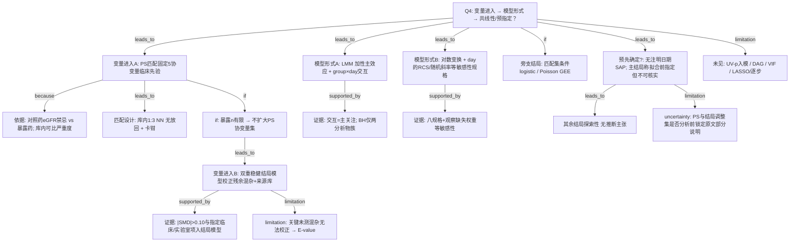

# AI-B 攻击输入

## 研究问题 (Q4)
变量/协变量筛选与建模逻辑是什么？（入模依据：临床重要性/单因素 p/文献/DAG/VIF；模型形式：加性/交互/含非线性项 RCS；是否 LASSO/逐步）该逻辑是否在分析前预先确定？

## AI-A 初稿决策树

# AI-A Decision Tree Round 1

paper_id: paper_42898695
question_id: Q4
task_type: literature_decision_tree_reasoning
question: 变量/协变量筛选与建模逻辑是什么？（入模依据：临床重要性/单因素 p/文献/DAG/VIF；模型形式：加性/交互/含非线性项 RCS；是否 LASSO/逐步）该逻辑是否在分析前预先确定？
source_file: adversarial_lit_reading/chunks/paper_42898695_t2dm_mimic_eicu.md

## 1. Evidence Map

| evidence_id | location | evidence_summary | used_by_node |
|---|---|---|---|
| E1 | Section 2.4 Propensity-score matching | 暴露组 1:3 最近邻匹配（无放回），PS 的 logit，卡钳 0.25 SD；匹配变量固定为年龄、BMI、男性、24-h SOFA、day-1 eGFR；eGFR 入模理由=对照药禁忌与暴露药不同 | N1,N2,N3 |
| E2 | Section 2.4 | 暴露例数有限（约 116）→ PS 模型可支持协变量数受限；残余混杂用双重稳健估计，而非扩大 PS 协变量集 | N4,N5 |
| E3 | Section 2.4 + Results 3.1 | 结局模型额外校正：来源库、慢性肝病、心衰、磺脲/胰岛素并用、day-1 白蛋白/钠及结局分析物自身；\|SMD\|>0.10 的变量亦带入双重稳健结局模型 | N5,N6 |
| E4 | Section 2.4 | 未记录病程时长、糖化血红蛋白、他汀/RAS 抑制剂、脓毒症前血糖控制等，无法校正；用 E-value 量化未测混杂 | N7 |
| E5 | Section 2.5 Statistical analysis | 轨迹：线性混合效应 `analyte ~ group × day`，患者随机截距；关注 group×day 交互（斜率差异）；胆红素+ALP 两分析物族做 BH-FDR | N8,N9 |
| E6 | Section 2.5 | 右偏分析物再拟合 log(x+1)；另八种规格含随机斜率、日为分类因子、**对 day 的 RCS**、双重稳健调整、校正 day-1 分析物值、加来源库等 | N10,N11 |
| E7 | Section 2.5 | 死亡：Fisher 精确检验；按匹配集分层的条件 logistic；按匹配集聚类的 Poisson GEE；试图校正全部 20 个残余不平衡协变量因完全分离未解释 | N12 |
| E8 | Section 2.3 Outcomes + 2.5 | 无注明日期的统计分析计划；主结局与两分析物族称拟合前已指定但无法独立核实；其余轨迹/复合指数/死亡为探索性 | N13,N14 |
| E9 | 全文 Methods | 未见单因素 p 阈值筛选入 PS/结局模型；未见 DAG；未见 VIF/LASSO/逐步回归叙述 | N15,N16 |
| E10 | Results 3.1–3.2 / Table 1 / Fig.2 / Love plot Fig.S1 | 匹配后 5 个 PS 变量平衡优秀；残余不平衡变量入结局模型；主文报告轨迹斜率差与多规格敏感性 | N6,N9,N11 |

## 2. Decision Tree - Mermaid

## 3. Node Table

| node_id | node_type | claim | evidence_location | evidence_summary | confidence | risk_tag |
|---|---|---|---|---|---|---|
| N0 | question | Q4：协变量进入、模型形式、是否预指定 | — | 根问题 | high | |
| N1 | method | PS 匹配协变量为固定临床名单（非 UV-p 筛选） | Section 2.4 | age/BMI/sex/SOFA/eGFR | high | |
| N2 | claim | eGFR 入模因对照药肾功能禁忌差异；SOFA 作严重度 | Section 2.4 | 临床理由写明 | high | |
| N3 | method | 库内 1:3 最近邻、无放回、logit-PS、卡钳 0.25 SD | Section 2.4 | 匹配规格 | high | |
| N4 | method | 暴露例数限制 → 用双重稳健而非扩 PS | Section 2.4 | 「limited…doubly robust」 | high | |
| N5 | method | 结局模型额外校正来源库、共病、并用降糖药、day-1 实验室等 | Section 2.4 | DR 调整集 | high | |
| N6 | evidence | 匹配后 \|SMD\|>0.10 变量带入结局模型；Love plot/Table1 | Results 3.1 + Fig.S1 | 残余不平衡处理 | high | |
| N7 | limitation | 病程/HbA1c/他汀等未测 → E-value 量化 | Section 2.4–2.5 | 无法校正清单 | high | |
| N8 | method | LMM：group×day 交互为轨迹主关注项 | Section 2.5 | 随机截距 | high | |
| N9 | evidence | BH-FDR 仅限胆红素+ALP 族；其余探索 | Section 2.3/2.5 + Results | 多重比较范围 | high | |
| N10 | method | 敏感性规格含对 **day** 的 RCS、随机斜率、log 变换、DR 调整等 | Section 2.5 | 八规格列表 | high | |
| N11 | evidence | 多规格与 IPOW/完整测量子集等敏感性报告 | Results 3.2 + Suppl | 规格依赖讨论 | high | |
| N12 | method | 死亡用匹配设计下的条件 logistic / GEE Poisson | Section 2.5 + 3.3 | 非轨迹主模型 | high | |
| N13 | uncertainty | 无注明日期的 SAP；主结局「拟合前指定」不可独立核实 | Section 2.3, 2.5 | 预指定证据弱 | medium | 证据不足 |
| N14 | claim | 非主族轨迹、复合指数、死亡标为探索性 | Section 2.3 | 无推断主张 | high | |
| N15 | uncertainty | 原文未明确说明 UV-p、DAG、VIF、LASSO/逐步 | 全文 Methods | 原文未明确说明 | high | 证据不足 |
| N16 | uncertainty | 最终 DR 调整项是否全部预锁定 vs 按 SMD 数据驱动——原文写了规则但部分依赖匹配后 SMD | Section 2.4 + 3.1 | 半规则半数据驱动 | medium | 逻辑跳跃 |

## 4. Provisional Answer

本文**不是**「单因素 p→多因素回归」或 LASSO/逐步选模叙事，而是**药物流行病学：倾向评分匹配 + 双重稳健结局模型**。

**（1）变量进入**  
- **PS 阶段**：预列 **5 个固定协变量**（年龄、BMI、男性、24-h SOFA、day-1 eGFR），依据为**临床/药理**（对照药 eGFR 禁忌）与**跨库严重度可比性**；匹配在库内进行。原文**未**写单因素 p 阈值、DAG 或自动选择。  
- **因暴露人数有限**，作者明确选择**不扩大 PS 协变量**，改用**双重稳健结局调整**：来源数据库、慢性肝病、心衰、磺脲/胰岛素并用、day-1 白蛋白/钠及结局分析物自身；Results 进一步写明 **\|SMD\|>0.10** 的残余不平衡变量亦进入结局模型。  
- 关键未记录混杂（病程、HbA1c 等）**无法入模**，用 **E-value** 量化。  
- **VIF / LASSO / 逐步：原文未明确说明**。

**（2）模型形式**  
- 主轨迹：**线性混合模型**，含 **group×day 交互**（关注斜率差），非默认「全协变量交互」。  
- 非线性：**对时间 day 的 RCS**（及随机斜率、分类 day、log 变换等）出现在**敏感性规格**列表，不是把暴露做成 RCS 主模型。  
- 死亡：Fisher、**匹配集条件 logistic**、匹配集聚类 Poisson GEE；试图纳入全部残余不平衡协变量时出现完全分离而未解释。

**（3）是否分析前预先确定**  
- **无注明日期的统计分析计划**；正式样本量计算无法事后构造。  
- 主结局与两分析物 FDR 族称**拟合前已指定**，但作者写明**无法独立核实**。  
- 其余轨迹/复合指数/死亡为**探索性**。  
- PS 五变量与 DR 核心项属 Methods 预写规则；**按匹配后 SMD 带入**的项带数据驱动成分。

## 5. Uncertainty List

- U1: 「每个 \|SMD\|>0.10 的变量」与 Section 2.4 预先列出的 DR 调整集是否完全重合——原文两处叙述需对照，是否另有扩充原文未列表穷尽。
- U2: day-1 eGFR 与 24-h SOFA 部分为暴露后测量，作者承认过调整/对撞风险；入模是「可比性」选择还是因果最优——属设计张力，非单纯筛选问题。
- U3: 对 day 的 RCS 是否用于主文推断还是仅敏感性——Methods 列为八规格之一，主规格仍是线性 day。
- U4: 完全分离导致「20 个残余不平衡协变量全调」模型未解释——是否意味着死亡模型实际只用了较少调整集，原文对最终死亡模型协变量清单写得不如轨迹清晰。

## 6. Follow-up Questions

1. 若复现「临床先验固定 PS 集 + 匹配后 SMD 闸门进结局模型」，Medical Blocks 应落在哪一层 config（勿误写成 UV→VIF→Model2）？
2. 对时间轴 RCS 与对暴露 RCS 在发表叙事上如何区分，以免被误读为暴露–结局非线性主分析？
3. 无 SAP 时，Q4「预先确定」结论应标到何种置信度才适合喂给决策树下游？

## 论文 CHUNK 全文

# Page 1

Hepatic biomarker trajectories and mortality in septic adults with type 2 
diabetes and recorded dipeptidyl peptidase-4 inhibitor exposure versus 
metformin-based therapy: A propensity-score-matched cohort study
Aristomenis G. Alevizopoulos a,b,*
, Georgios G. Anastasiou c
, Paraskevas Nomikos d
,  
Iakovos Kritikos e
a Endocrine Unit and Diabetes Centre, Department of Clinical Therapeutics, Alexandra Hospital, School of Medicine, National and Kapodistrian University of Athens, 
Athens, Greece
b Third Department of Psychiatry, Agioi Anargyroi General Oncological Hospital of Kifisia, National and Kapodistrian University of Athens, Athens, Greece
c BIOSIM Laboratory, School of Electrical and Computer Engineering, National Technical University of Athens, Athens, Greece
d Department of Electrical and Electronic Engineering, University of West Attica, Thivon Avenue 250, Athens, 122 44, Greece
e Global Business School for Health, University College London, London, WC1E 6BT, UK
A R T I C L E I N F O
Keywords:
Type 2 diabetes mellitus
DPP-4 inhibitors
Metformin
Sepsis
Liver injury
Pharmacoepidemiology
A B S T R A C T
Aims: To determine whether recorded dipeptidyl peptidase-4 (DPP-4) inhibitor exposure, compared with met­
formin, is associated with worse hepatic biomarker trajectories or mortality in adults with type 2 diabetes and 
sepsis.
Methods: In three critical care databases (MIMIC-IV, eICU-CRD, NWICU), adults with type 2 diabetes and sepsis 
with a DPP-4 inhibitor record were matched 1:3 within each database to metformin comparators on age, sex, 
body mass index, 24-h SOFA and day-1 estimated glomerular filtration rate. The day 1–7 total bilirubin trajectory 
was analysed by linear mixed-effects regression under nine specifications including log transformation, flexible 
day terms, doubly robust adjustment and inverse-probability-of-observation weighting.
Results: Matching yielded 105 DPP-4 inhibitor and 297 metformin patients; a pre-admission exposure record was 
present in 60.0%. The between-group difference in bilirubin slope was +0.048 mg/dL/day (95% CI −0.029 to 
0.126; p = 0.221), with p between 0.109 and 0.436 across specifications. No other hepatic outcome survived 
multiplicity correction. Alkaline phosphatase rose more steeply on the primary specification (+6.97 U/L/day; q 
= 0.005) but was fragile: 12 of 28 sensitivity analyses retained p < 0.05. In-hospital mortality was 21.0% versus 
13.5% (risk ratio 1.56, 95% CI 0.97–2.49), attenuating to 1.23 (0.67–2.29) with documented pre-admission 
exposure.
Conclusions: There was no statistically detectable difference in bilirubin trajectory between recorded DPP-4 in­
hibitor and metformin exposure, although differences below the cohort's detectable-effect threshold cannot be 
excluded. An ALP signal was fragile and hypothesis-generating. Mortality findings are exploratory and non- 
causal. These associations with recorded exposure cannot inform inpatient management.
1. Introduction
Sepsis accounts for an estimated 11 million deaths annually, and the 
liver acts both as an effector of host defence and as a frequent target of 
injury [1–3]. Sepsis-associated liver dysfunction encompasses hypoxic 
hepatitis and intrahepatic cholestasis driven by inflammatory cytokines 
and downregulation of canalicular transporters; the resulting hyper­
bilirubinaemia is the hepatic component of the Sequential Organ Failure 
Assessment (SOFA) score and independently predicts worse outcome [3, 
4].
Type 2 diabetes mellitus (T2DM) is highly prevalent among patients 
admitted with sepsis and modifies both susceptibility to infection and 
* Corresponding author. Endocrine Unit and Diabetes Centre, Department of Clinical Therapeutics, Alexandra Hospital, School of Medicine, National and Kapo­
distrian University of Athens, Athens, Greece.
E-mail addresses: aralev@uoa.gr (A.G. Alevizopoulos), giorgos.anastasiou172@gmail.com (G.G. Anastasiou), parisnomikos2@gmail.com (P. Nomikos), iakovos. 
kritikos.24@ucl.ac.uk (I. Kritikos). 
Contents lists available at ScienceDirect
Metabolism Open
journal homepage: www.sciencedirect.com/journal/metabolism-open
https://doi.org/10.1016/j.metop.2026.100508
Received 7 September 2026; Received in revised form 5 October 2026; Accepted 8 October 2026  
Metabolism Open 32 (2026) 100508 
Available online 10 October 2026 
2589-9368/© 2026 The Authors. Published by Elsevier Inc. This is an open access article under the CC BY license ( http://creativecommons.org/licenses/by/4.0/ ).

# Page 2

the metabolic response to it [5]. Chronic glucose-lowering therapy 
therefore constitutes a population-scale metabolic pre-exposure that 
adults with T2DM carry into acute critical illness, and whether it 
measurably alters the acute hepatic host response to sepsis is a question 
of direct relevance to metabolism research. Metformin and dipeptidyl 
peptidase-4 (DPP-4) inhibitors are the two oral agents most frequently 
recorded as background therapy in this population, yet their compara­
tive hepatic safety in the setting of acute sepsis has almost no direct 
evidence base. The present study is observational and compares recor­
ded medication exposure between arms. It does not compare continua­
tion with discontinuation of therapy after admission and therefore 
cannot inform the inpatient management of these agents.
Both classes have anti-inflammatory properties in preclinical models: 
metformin principally through AMP-activated protein kinase signalling 
and suppression of nuclear factor-κB, and DPP-4 inhibitors through 
attenuation of reactive oxygen species generation, favourable Kupffer- 
cell polarisation and NF-κB inhibition [6,7]. The hepatic effects of 
incretin signalling have been demonstrated most clearly in metabolic 
dysfunction-associated steatotic liver disease, where they are chronic 
and disease-modifying rather than acute [8,9]. Whether either agent 
measurably alters the acute liver injury of human sepsis is unknown, and 
the critical-care literature is not consistent: large pharmacoepidemio­
logic cohorts suggest lower sepsis- and infection-related mortality 
among glucagon-like peptide-1 receptor agonist (GLP-1 RA) users than 
among DPP-4 inhibitor users, whereas elevated endogenous GLP-1 at 
intensive-care admission marks gut-barrier failure and predicts 
increased mortality [10,11].
We therefore compared hepatic biomarker trajectories and mortality 
between septic adults with T2DM with a recorded DPP-4 inhibitor 
exposure and an active comparator of metformin-treated patients, using 
a propensity-score-matched design harmonised across three publicly 
available critical care databases. We hypothesised that hepatic 
biomarker trajectories over hospital days 1–7 would not differ between 
arms. The estimand is a DPP-4 inhibitor recorded in addition to back­
ground therapy versus metformin-based therapy without a DPP-4 in­
hibitor, not a comparison of mutually exclusive drug regimens.
2. Materials and methods
2.1. Data sources and study population
We pooled three de-identified critical care databases: MIMIC-IV v3.1 
(Beth Israel Deaconess Medical Center, admissions 2008–2022), eICU- 
CRD v2.0 (over 200 United States hospitals, admissions 2014–2015) 
and NWICU v0.1.0 (Northwestern Memorial Hospital, admissions 
2013–2023) [12–14]. Access was granted through PhysioNet following 
the mandatory training (CITI ID 76596039, A.G.A.). All data are 
de-identified, and individual consent was not required. Reporting fol­
lows the STROBE statement [15]. The three sources differ in period, case 
mix, medication-recording system, and severity-score availability, and 
span more than a decade over which sepsis management and antidia­
betic prescribing both changed substantially. The source database was 
therefore retained as a covariate in the outcome models. eICU-CRD re­
leases no admission year, and MIMIC-IV and NWICU shift each patient's 
dates by a patient-specific offset, so calendar time is represented through 
the source-database term. Shifted admission years were comparable 
between arms within MIMIC-IV and NWICU (Supplementary Table S3e). 
Database-specific estimates together with a leave-one-database-out 
analysis and formal heterogeneity assessment are reported.
Eligible patients were adults aged 18 years or older with type 2 
diabetes and sepsis recorded during the index admission. Both condi­
tions were identified from diagnosis codes or structured diagnosis en­
tries; clinical Sepsis-3 criteria [16] were not applied. In MIMIC-IV and 
NWICU, which share the same table structure and were processed by the 
same query, sepsis was defined by ICD-9-CM 995.91, 995.92 or 785.52, 
or ICD-10-CM A41.x, R65.20, R65.21, A02.1, A22.7, A26.7, A32.7 or 
A42.7, and type 2 diabetes by ICD-9-CM 250.x0 or 250.x2, or ICD-10-CM 
E11.x, both recorded for the same hospital admission; these are 
discharge diagnoses and carry no onset time. In eICU-CRD, sepsis 
required a diagnosis entry for sepsis, severe sepsis, septic shock or sep­
ticaemia recorded within 24 h of unit admission, or an APACHE 
admission diagnosis of sepsis; type 2 diabetes required a diagnosis entry 
for diabetes mellitus or type 2 diabetes not indicating type 1 or 
insulin-dependent diabetes, or an associated ICD code of 250.x or E11.x. 
In MIMIC-IV and NWICU only the first qualifying admission per patient 
was retained; in eICU-CRD only the first unit stay of each hospital 
admission lasting at least 24 h. Complete code and string lists are given 
in Supplementary Table S0a and the codes that qualified the matched 
patients in Supplementary Table S0b; repeating the MIMIC-IV and 
NWICU queries with formatting-tolerant code matching identified no 
additional patients (Supplementary Table S0c). Each source-specific 
query emitted an identical canonical schema, so all downstream anal­
ysis was executed once on harmonised data. Screening counts by data­
base are given in the Supplementary Material.
A companion analysis using the same cohort-assembly infrastruc­
ture, comparing incretin-based therapy (GLP-1 receptor agonists and 
DPP-4 inhibitors considered together) with non-incretin antidiabetic 
therapy in adults with type 2 diabetes and sepsis, was prepared sepa­
rately; it was submitted to another journal, desk-rejected, and is not 
currently under consideration elsewhere. The two analyses differ in 
research question, exposure contrast (a heterogeneous incretin grouping 
versus a single active-comparator pair), comparator design, study pop­
ulation (the companion analysis draws on a single database, the present 
analysis on three) and outcome set. Overlap between them is confined to 
the description of the source databases and the cohort-assembly code; no 
patient-level result, table, or figure is shared.
2.2. Exposure and comparator definitions
Exposure was a recorded DPP-4 inhibitor order. Ascertainment 
differed by source. In MIMIC-IV and NWICU, orders were drawn from 
the prescriptions table by case-insensitive regex on generic and brand 
names covering sitagliptin, saxagliptin, linagliptin, alogliptin, and vil­
dagliptin plus fixed-dose combinations, with the prescription start time 
as the timing variable. In eICU-CRD, exposure was drawn from the 
admissiondrug table, which holds the medication-reconciliation list 
compiled at unit admission and records therapy reported as being taken 
before arrival; drugoffset (minutes from unit admission) was retained for 
every record. In the exposed arm (n = 105), the DPP-4 inhibitors present 
were sitagliptin (n = 87, 82.9%), linagliptin (n = 14, 13.3%) and sax­
agliptin (n = 4, 3.8%); the arm is overwhelmingly sitagliptin- and 
linagliptin-based, and the saxagliptin subgroup is too small (n = 4) to 
drive the between-arm heart-failure or mortality signals. No source 
provides an outpatient dispensing record, so duration, adherence, and 
time since last dose are unknown throughout.
The comparator arm comprised patients with a metformin record 
and no DPP-4 inhibitor record. Fixed-dose DPP-4 inhibitor–metformin 
combinations were classified as DPP-4 inhibitor exposure, so the esti­
mand is a DPP-4 inhibitor added to background therapy versus 
metformin-based therapy without a DPP-4 inhibitor, rather than a 
mutually exclusive drug comparison; 42.9% of the DPP-4 inhibitor arm 
was metformin-positive by construction. It is described as such in the 
title, abstract, Methods, and Conclusions. Two sensitivity analyses 
address the overlap directly: DPP-4 inhibitor plus metformin (n = 45) 
versus metformin alone, and DPP-4 inhibitor without a metformin re­
cord (n = 60) versus metformin alone. Concomitant sulfonylurea (43.8% 
versus 27.6%) and insulin use were carried into the doubly robust 
outcome models. Patients with any GLP-1 RA record were excluded from 
both arms, as there were too few to form a separate exposure category.
Time zero was defined as the hour of intensive-care admission for the 
index stay, and all baseline covariates were taken from the 24 h begin­
ning at time zero. Study days 1–7 are indexed from time zero 
A.G. Alevizopoulos et al.                                                                                                                                                                                                                      
Metabolism Open 32 (2026) 100508 
2

# Page 3

throughout. In addition, the terms “hospital day” and “ICU day” are not 
used interchangeably. Exposure status was assigned from medication 
records without reference to information arising after the first outcome 
measurement, so that exposure assignment does not use future 
information.
In the primary analysis, exposure was not restricted to the pre- 
admission period and therefore includes orders first written during the 
index admission, a permissive definition that admits misclassification. 
An audit of the exposure records showed that 63 of 105 (60.0%) exposed 
patients had a DPP-4 inhibitor record documented before admission: all 
59 eICU-CRD patients, whose exposure is drawn from the admission 
medication-reconciliation list (entered a median of 0.7 h after unit 
admission), and 2 of 35 MIMIC-IV and 2 of 11 NWICU patients with a 
prescription start time before hospital admission. The remaining 42 
patients had a first record written during the index admission. Because 
reconciliation entries are logged after arrival, 57 exposed patients 
(54.3%), 34 of them eICU-CRD reconciliation entries, have a first record 
timestamped after the first total-bilirubin measurement (Supplementary 
Table S2b and S2c). A sensitivity analysis restricts exposure to records 
documented before admission (61 exposed patients contributing tra­
jectory data, compared with the full comparator arm) and is reported for 
the primary and ALP outcomes in Section 3.2. Stays without an 
admission-medication entry were dropped rather than coded 
unexposed.
2.3. Outcomes
The primary outcome was the day 1–7 trajectory of total bilirubin, 
selected because it is the hepatic component of the SOFA score and the 
analyte least susceptible to extrahepatic contamination. Secondary tra­
jectory outcomes were alkaline phosphatase (ALP), aspartate amino­
transferase, alanine aminotransferase, international normalised ratio 
(INR), albumin and platelet count. Composite indices (Model for End- 
Stage Liver Disease–Sodium [MELD-Na], Fibrosis-4 index, hepatic 
SOFA subscore) were examined as exploratory severity descriptors and 
are not interpreted as hepatic outcomes. Clinical outcomes were peak 
transaminases, nadir platelet count and all-cause mortality (in-hospital; 
30- and 90-day where ascertainable).
The day 1–7 total bilirubin trajectory is the single confirmatory 
outcome. ALP was carried alongside bilirubin in the two-analyte false- 
discovery-rate family on the grounds that bilirubin indexes the hepa­
tocellular and excretory axis while ALP indexes the cholestatic axis, 
these being the two hepatic patterns in which a class effect was 
considered biologically plausible. No dated statistical analysis plan 
preceded the analysis. The primary outcome and the two-analyte family 
were specified before models were fitted, but this cannot be indepen­
dently verified. All other trajectory outcomes, all composite indices, and 
all mortality outcomes are exploratory and reported without inferential 
claim. A sensitivity analysis applying Benjamini–Hochberg correction 
across the full set of tested trajectory outcomes is reported in the Sup­
plementary Material.
2.4. Propensity-score matching
DPP-4 inhibitor patients were matched 1:3 to metformin compara­
tors by nearest-neighbour matching without replacement on the logit of 
the propensity score, within a caliper of 0.25 standard deviations, using 
age, body mass index, male sex, 24-h SOFA score and day-1 estimated 
glomerular filtration rate (eGFR; CKD-EPI 2021) [17]. The eGFR was 
included 
because 
metformin 
is 
contraindicated 
below 
30 mL/min/1.73 m2, whereas DPP-4 inhibitors are not. Matching was 
within source because severity scoring is not comparable across data­
sets: MIMIC-IV supports a six-component SOFA whereas eICU-CRD 
permits only a reduced reconstruction. Balance was assessed by stand­
ardised mean difference (SMD), with |SMD|<0.10 taken as balanced and 
reported for every covariate before and after matching in a Love plot 
(Supplementary Fig. S1). Balance is a property of the matched sample 
rather than of a source population, so hypothesis tests are reported 
descriptively only and inference about balance rests on the SMD.
With 116 exposed patients, the number of covariates a propensity 
model can support is limited, so residual confounding was addressed by 
doubly robust estimation rather than by expanding the propensity 
model. Outcome models additionally adjust for source database, chronic 
liver disease, heart failure, sulfonylurea and insulin co-exposure, and 
day-1 values of albumin, sodium and the outcome analyte itself. Dia­
betes 
duration, 
glycated 
haemoglobin, 
statin 
and 
renin–angiotensin–system inhibitor use, and pre-sepsis glycaemic con­
trol are not recorded in any of the three databases and cannot be 
adjusted for. Their likely influence is quantified by E-value analyses 
(Section 2.5) rather than assumed away.
Neither day-1 eGFR nor 24-h SOFA is unambiguously a baseline 
covariate. Both are measured after the exposure of interest was estab­
lished and both partly reflect sepsis-related organ injury, so conditioning 
on them risks overadjustment and, where they lie on a path between 
severity and outcome, collider bias. The primary specification retains 
them for comparability with prior critical-care pharmacoepidemiology. 
Two sensitivity analyses omit day-1 eGFR, and omit both day-1 eGFR 
and the 24-h SOFA score, from the propensity model, and are reported in 
Supplementary Tables S4, S4a and S4c.
2.5. Statistical analysis
Continuous variables are summarised as mean ± standard deviation 
and compared with the t-test or Mann–Whitney U test as appropriate; 
categorical variables are compared with the chi-square or Fisher exact 
test. Trajectories were modelled by linear mixed-effects regression 
(analyte ~ group × day, random intercept per patient) with the met­
formin arm as the reference level. The group coefficient estimates the 
between-arm difference at baseline, the day coefficient the daily slope 
within the metformin arm, and the group-by-day interaction the diver­
gence in daily slope, which was the term of primary interest. The Ben­
jamini–Hochberg procedure was applied to the interaction p-values 
within a two-analyte family (total bilirubin, ALP); all other models are 
uncorrected and exploratory [18].
Total bilirubin, ALP, AST and ALT are markedly right-skewed. Each 
was therefore re-analysed on the natural-log scale as log(x + 1), with 
untransformed estimates retained for interpretability. To test whether 
the primary and ALP contrasts depended on model form, each was 
refitted under eight further specifications: (i) log transformation with 
linear day, (ii) raw scale with a random slope per patient for day, (iii) log 
with random slope, (iv) log with day entered as a categorical factor 
(joint Wald test across six interaction terms), (v) log with a restricted 
cubic spline on day (joint Wald over three interaction terms), (vi) log 
with doubly robust adjustment as in Section 2.4, (vii) log with additional 
adjustment for each analyte's own day-1 value, and (viii) log with source 
database added as a covariate. A within-patient change-from-day-1 
mixed model was also specified but returned a singular covariance 
matrix; specification (vii), adjustment for each analyte's own day-1 
value, addresses the same question. Models were fitted by restricted 
maximum likelihood.
Laboratory measurement across days 1–7 is not uniform: patients 
die, are discharged, or cease undergoing daily testing, and each of these 
is associated with clinical status. In the primary and ALP analyses, the 
number of patients contributing an ALP measurement fell from 60 
(57.1%) on day 1 to 11 (10.5%) on day 7 in the exposed arm, and from 
174 (58.6%) to 37 (12.5%) in the comparator arm. Daily denominators 
for every analyte, arm, and day are provided in Supplementary Table S6
and Fig. S6. Mixed-effects models use all available observations and give 
valid inference under a missing-at-random assumption conditional on 
the modelled covariates and each patient's observed prior measure­
ments. This assumption is not testable and is unlikely to hold exactly. 
Four sensitivity analyses were therefore performed: inverse-probability- 
A.G. Alevizopoulos et al.                                                                                                                                                                                                                      
Metabolism Open 32 (2026) 100508 
3

# Page 4

of-observation weighting, with the probability of contributing a mea­
surement on each day modelled from treatment group, day, source 
database, day-1 severity and the preceding measured value; restriction 
to patients with at least three measurements of the analyte concerned; 
restriction to survivors to discharge; and truncation of follow-up at day 
4, before denominators fall materially.
Mortality was compared by Fisher's exact test with risk ratios and 
95% confidence intervals and, accounting for the matched design, by 
conditional logistic regression stratified on the matched set and by 
Poisson regression with generalised estimating equations clustered on 
the matched set. A model additionally adjusting for all 20 residually 
imbalanced covariates was inspected for numerical stability and not 
interpreted because it produced complete separation (Section 3.3). 
Between-database heterogeneity in the primary and ALP contrasts was 
assessed by fitting database-specific estimates, combining them under a 
DerSimonian–Laird random-effects model with I2 and Cochran Q, and by 
a leave-one-database-out analysis.
No dated statistical analysis plan preceded the study, and a formal a 
priori sample-size calculation cannot be constructed retrospectively. 
The minimum detectable effect at 80% power and α = 0.05 was there­
fore computed for the primary trajectory contrast and for in-hospital 
mortality (Section 3.1). The robustness of any positive finding to un­
measured confounding was quantified by the E-value, the minimum 
association on the risk-ratio scale that an unmeasured confounder would 
need to have with both exposure and outcome, conditional on measured 
covariates, to account for the observed estimate.
Two-sided p < 0.05, or q < 0.05, was considered significant. Ana­
lyses used Python (pandas, statsmodels, lifelines) and R (lme4, survival). 
A large language model assisted with code refactoring and language 
editing only; all code and text were verified by the authors.
3. Results
3.1. Cohort and balance
Of 1623 eligible patients (116 DPP-4 inhibitor, 1507 metformin), 
matching retained 105 of 116 exposed patients and selected 297 com­
parators, yielding a matched cohort of 402 (Fig. 1). eICU-CRD contrib­
uted 55.7% of the matched cohort, MIMIC-IV 34.8%, and NWICU 9.5%. 
Mean age was 71.5 years in both arms. At 80% power and α = 0.05, this 
cohort could detect a between-arm difference in in-hospital mortality of 
12.3 percentage points (risk ratio 1.91) and a group-by-day difference in 
total bilirubin of 0.11 mg/dL/day. Differences smaller than these are not 
resolvable in this sample, and both the observed 7.5-percentage-point 
mortality difference and the null trajectory findings should be read 
against that limit rather than as evidence of no effect.
A per-patient audit of the exposure records was performed 
(Supplementary Table S2a–S2d). Sixty-three of 105 exposed patients 
(60.0%) had a DPP-4 inhibitor record documented before admission: 59 
of 59 in eICU-CRD from admission medication-reconciliation entries 
(median 0.7 h after unit admission, IQR 0.3–1.8), and 2 of 35 in MIMIC- 
IV and 2 of 11 in NWICU from prescriptions written before hospital 
admission. The remaining 42 (MIMIC-IV 33, NWICU 9) had a first record 
written during the index admission. Fifty-seven exposed patients 
(54.3%) had a first record timestamped after the first total-bilirubin 
measurement; 34 of these were eICU-CRD reconciliation entries, 
which record therapy taken before arrival but are logged shortly after it. 
Recorded exposure therefore cannot be equated with uninterrupted pre- 
admission therapy in every patient.
Balance on the five matched covariates was excellent, with all 
standardised mean differences below 0.05 (Table 1; Supplementary 
Fig. S1). Residual imbalance persisted for variables outside the pro­
pensity model: albumin (2.97 ± 0.67 vs 2.76 ± 0.61 g/dL; SMD 0.343), 
sodium (SMD 0.246), fibrinogen (−0.277) and activated partial 
thromboplastin time (−0.235). Day-1 ALP was modestly higher in the 
exposed arm (127.2 ± 97.9 vs 117.4 ± 93.4 U/L; SMD 0.103). 
Sulfonylurea co-exposure was more common in the DPP-4 inhibitor arm 
(43.8% vs 27.6%). Day-1 total bilirubin was lower in the exposed arm 
(SMD −0.213), chronic liver disease was more common (SMD 0.153), 
and heart failure was more common (SMD 0.148). Every variable with | 
SMD| above 0.10 was carried into the doubly robust outcome models 
described in Section 2.4.
Values are shown for the propensity-score-matched cohort (DPP-4, 
n = 105; METFORMIN, n = 297; nearest-neighbour matching, ratio 
~1:3). Data are n (%) for categorical variables and mean ± SD for 
continuous variables. Per-analyte denominators, where a measurement 
was not available for every matched patient, are reported by analyte, 
arm and study day in the Supplementary Material rather than in this 
table. Balance was judged on |SMD| < 0.10; residual imbalance above 
that threshold persisted for albumin, sodium, fibrinogen, aPTT, day-1 
total bilirubin, day-1 ALP, MELD-Na, chronic liver disease and heart 
failure, all of which are carried into the doubly robust outcome models 
(Section 2.4). P-values are shown for description only and are not the 
basis on which balance was judged. Standardised mean differences for 
all covariates before and after matching are shown as a Love plot in 
Supplementary Fig. S1.
3.2. Hepatic biomarker trajectories
The primary outcome was null. Total bilirubin trajectories did not 
diverge between arms (group-by-day interaction +0.048 mg/dL/day, 
95% CI −0.029 to 0.126; p = 0.221). On the raw scale, aminotrans­
ferase, INR, albumin and platelet trajectories were likewise indistin­
guishable (Supplementary Table S8), and platelet counts recovered at a 
comparable rate in both arms (metformin slope +3.59 × 109/L/day, p 
< 0.001; interaction p = 0.742). Peak aspartate aminotransferase, peak 
alanine aminotransferase and nadir platelet count did not differ 
(Supplementary Table S10). The primary bilirubin null was robust. 
Twenty-six bilirubin estimates across all sensitivity analyses had a 
confidence interval including zero (lowest p = 0.086; Supplementary 
Fig. 1. Participant selection flowchart.
A.G. Alevizopoulos et al.                                                                                                                                                                                                                      
Metabolism Open 32 (2026) 100508 
4

# Page 5

Table S8b and Fig. S8b). Across the nine model specifications, interac­
tion p ranged from 0.109 to 0.436 across the raw-scale linear, log-linear, 
random-slope, categorical-day, spline, doubly robust, own-day-1- 
adjusted, and source-adjusted models, and under inverse-probability- 
of-observation weighting. Full specification-by-specification estimates 
are reported in Supplementary Table S8b. Daily numbers of contributing 
patients and measurements by analyte and arm are given in 
Supplementary Table S6, and fall materially across the week; estimates 
for later days therefore rest on a smaller and increasingly selected 
sample. On the log scale, AST (+0.061 log units/day, p = 0.043), ALT 
(+0.050, p = 0.047) and lactate (+0.294, p = 0.021) slopes were 
nominally steeper in the exposed arm, but none survived Benjami­
ni–Hochberg correction across the full trajectory family (q = 0.095 for 
each; Supplementary Table S5b).
A between-arm difference in linear ALP slope emerged and is re­
ported as hypothesis-generating. ALP rose more steeply in the DPP-4 
inhibitor arm (group-by-day interaction +6.97 U/L/day, 95% CI 2.49 
to 11.45; p = 0.002, q = 0.005) on the primary specification, corre­
sponding to a cumulative separation of approximately 49 U/L over seven 
days, against a metformin arm whose ALP was essentially flat across the 
week (−0.68 U/L/day, p = 0.535). On formal robustness testing across 
28 sensitivity analyses evaluated in the revised analysis, 12 retained p <
0.05. The signal survived log transformation of the analyte (+0.027 log 
U/L/day, 95% CI + 0.002 to +0.052; p = 0.036), adjustment for each 
patient's own day-1 ALP (+0.038, 95% CI + 0.012 to +0.064; p =
0.004), doubly robust adjustment for source database and residual im­
balances (+0.041, 95% CI + 0.010 to +0.072; p = 0.009), and addition 
of source database as a covariate (+0.026, 95% CI + 0.002 to +0.051; p 
= 0.037). It did not survive allowing per-patient slopes for day, either on 
the raw scale (+3.33 U/L/day, 95% CI −3.82 to +10.47; p = 0.362) or 
on the log scale (+0.006, 95% CI −0.031 to +0.043; p = 0.745), nor 
relaxation of the linear day term (day as factor, joint Wald p = 0.341; 
restricted cubic spline, joint Wald p = 0.099). The effect is therefore 
located specifically in the linear day term of a random-intercept-only 
covariance structure, which is consistent both with a slow cumulative 
pharmacodynamic effect and with progressive informative dropout 
selecting for higher-ALP survivors, and the data do not distinguish these 
interpretations.
No single database reached statistical significance in isolation: 
MIMIC-IV (n = 105) yielded +0.043 (95% CI −0.001 to +0.088; p =
0.054); eICU-CRD (n = 190) +0.015 (−0.015 to +0.046; p = 0.328); 
NWICU contributed too few repeated measurements to converge. 
Formal heterogeneity was negligible for ALP (I2 5.1%, Cochran Q 
p = 0.305) as for bilirubin (I2 0%, Q p = 0.629; Supplementary 
Table S3c), and both fitting databases pointed in the same direction. 
However, leave-one-database-out estimates showed that statistical sig­
nificance of the pooled estimate depended on the inclusion of MIMIC-IV: 
with MIMIC-IV omitted, the estimate was +0.015 (−0.015 to +0.046; p 
= 0.328). Under DerSimonian–Laird random-effects pooling, the esti­
mate was +0.025 (−0.001 to +0.051), crossing the null, while the fixed- 
effect mixed model reached p = 0.036.
Excluding the 20 patients with coded chronic liver disease 
strengthened the ALP contrast (+0.033, 95% CI + 0.006 to +0.060; p =
0.016), and adjustment for concomitant sulfonylurea and insulin ther­
apy left it unchanged (+0.027; p = 0.035). It was not retained when 
exposure was restricted to records documented before admission 
(+0.022, 95% CI −0.006 to +0.050; p = 0.123), in either stratum of the 
metformin co-exposure decomposition (p = 0.083 and p = 0.108), or 
when day-1 eGFR was omitted from the propensity model (+0.007; p =
0.630) (Supplementary Table S4 and S4b). Under inverse-probability-of- 
observation weighting the ALP point estimate was larger (+0.035) but 
less precise (95% CI −0.015 to +0.085; p = 0.166); restriction to pa­
tients with at least three ALP measurements retained significance 
(+0.038; p = 0.006), whereas restriction to survivors to discharge 
(+0.004; p = 0.769) or to days 1–4, when denominators are intact 
(+0.016; p = 0.491), did not (Supplementary Table S6c). The bilirubin 
null held in every one of these analyses. The day-7 denominator was 11 
exposed and 37 comparator patients (89.5% and 87.5% missing 
respectively), and no interpretation of the ALP finding that relies on 
later-week estimates should be advanced without weight given to this. 
Among the exploratory composite indices, MELD-Na also diverged 
(+0.97 points/day, 95% CI 0.32 to 1.61; p = 0.003, uncorrected). Full 
model output is given in Table 2 and trajectories are shown in Fig. 2.
Linear mixed-effects models were fit separately for each hepatic 
analyte across days 1–7 of the hospital stay, indexed from time zero (the 
hour of intensive-care admission), in the propensity-score-matched 
cohort, with random intercepts per patient and fixed effects for 
Table 1 
Baseline characteristics of the DPP-4 inhibitor and metformin cohorts after 1:3 
propensity score matching.
Characteristic
DPP-4 (n = 105)
METFORMIN 
(n = 297)
SMD
P- 
value
Age, years
71.52 ± 13.13
71.47 ± 12.93
0.004
0.970
Sex
Male
57 (54.3)
163 (54.9)
−0.012
1.000
Female
48 (45.7)
134 (45.1)
—
—
Race
Asian
4 (3.8)
12 (4.0)
—
0.214
Black
10 (9.5)
40 (13.5)
—
—
Hispanic
3 (2.9)
21 (7.1)
—
—
Other/Unknown
17 (16.2)
30 (10.1)
—
—
White
71 (67.6)
194 (65.3)
—
—
Body mass index, kg/ 
m2
31.39 ± 8.52
31.20 ± 9.25
0.021
0.861
SOFA score (24 h)
2.87 ± 3.06
2.95 ± 3.06
−0.028
0.804
Renal parameters
eGFR, mL/min/ 
1.73 m2
48.66 ± 29.67
49.91 ± 28.70
−0.043
0.727
Creatinine, mg/dL
1.85 ± 1.19
1.90 ± 1.59
−0.037
0.743
BUN, mg/dL
36.51 ± 25.89
37.07 ± 26.03
−0.022
0.859
Routine biochemistry and inflammatory markers
Lactate, mmol/L
2.57 ± 1.92
2.65 ± 2.42
−0.038
0.797
Sodium (Na+), 
mmol/L
137.75 ± 5.17
136.40 ± 5.76
0.246
0.040
Potassium (K+), 
mmol/L
4.28 ± 0.67
4.24 ± 0.66
0.060
0.626
Albumin, g/dL
2.97 ± 0.67
2.76 ± 0.61
0.343
0.036
Liver function tests and hepatic severity indices
Total bilirubin, 
mg/dL
0.87 ± 0.84
1.16 ± 1.74
−0.213
0.091
ALT, U/L
74.61 ± 185.70
70.20 ± 172.51
0.025
0.872
AST, U/L
155.43 ± 453.30
93.22 ± 255.41
0.170
0.317
ALP, U/L
127.20 ± 97.89
117.38 ± 93.40
0.103
0.500
INR
1.54 ± 0.72
1.66 ± 0.88
−0.143
0.328
Fibrinogen, mg/dL
435.25 ± 223.30
489.35 ± 190.13
−0.277
0.603
aPTT, s
34.37 ± 10.32
37.89 ± 18.68
−0.235
0.100
Platelets, ×109/L
213.19 ± 114.87
215.24 ± 120.73
−0.017
0.886
MELD-Na
16.42 ± 7.30
18.26 ± 7.91
−0.244
0.165
Hepatic SOFA 
(bilirubin 
subscore)
0.27 ± 0.61
0.37 ± 0.81
−0.150
0.284
FIB-4
5.35 ± 8.40
5.27 ± 8.21
0.009
0.951
Comorbidities
Heart failure
32 (30.5)
71 (23.9)
0.148
0.232
Coronary artery 
disease
30 (28.6)
72 (24.2)
0.098
0.456
COPD
13 (12.4)
40 (13.5)
−0.032
0.908
Chronic liver 
disease
8 (7.6)
12 (4.0)
0.153
0.235
Baseline antidiabetic medications
DPP-4 inhibitor
105 (100.0)
0 (0.0)
—
—
Metformin
45 (42.9)
297 (100.0)
—
—
Sulfonylurea
46 (43.8)
82 (27.6)
—
—
Thiazolidinedione
8 (7.6)
7 (2.4)
—
—
SGLT2 inhibitor
2 (1.9)
1 (0.3)
—
—
Insulin (basal/ 
intermediate)
23 (21.9)
69 (23.2)
—
—
Insulin (prandial/ 
regular)
27 (25.7)
59 (19.9)
—
—
Insulin (any)
33 (31.4)
87 (29.3)
—
—
A.G. Alevizopoulos et al.                                                                                                                                                                                                                      
Metabolism Open 32 (2026) 100508 
5

# Page 6

treatment group (METFORMIN as reference), day, and their interaction. 
The Group effect column reports the estimated between-group differ­
ence at day 0; the Daily slope column reports the within-METFORMIN 
change per day; the Group × Day interaction column reports the dif­
ference in daily slope between DPP-4 and METFORMIN. AST, ALT, and 
INR are omitted here for length and reported with full model output in 
Supplementary Table S8; log-scale and additional specifications for total 
bilirubin and ALP are given in Supplementary Tables S5, S8a, and S8b.
3.3. Mortality
In-hospital mortality was 21.0% (22/105) with DPP-4 inhibitor 
exposure and 13.5% (40/297) with metformin (risk ratio 1.56, 95% CI 
0.97 to 2.49; p = 0.083). Analyses accounting for the matched design 
were concordant: conditional logistic regression stratified on matched 
set gave an odds ratio of 1.74 (95% CI 0.96 to 3.17; p = 0.068), and 
Poisson regression with generalised estimating equations clustered on 
matched set a risk ratio of 1.55 (0.98 to 2.47; p = 0.063) (Supplementary 
Table S7b). A model additionally adjusting for all 20 residually imbal­
anced covariates produced complete separation against 62 events and 
Table 2 
Day 1–7 mixed-effects analysis of hepatic biomarker trajectories, DPP-4 inhibitor versus metformin.
Analyte
Group effect (DPP-4 vs METFORMIN) est 
(95% CI); p
Daily slope, METFORMIN est per day 
(95% CI); p
Group × Day interaction est per day 
(95% CI); p
FDR q
FDR 
sig.
Total bilirubin, mg/dL
−0.280 (−0.656, 0.096); p = 0.144
−0.055 (−0.092, −0.017); p = 0.004
+0.048 (−0.029, 0.126); p = 0.221
0.221
No
ALP, U/L
−6.981 (−30.912, 16.951); p = 0.568
−0.682 (−2.840, 1.475); p = 0.535
+6.969 (2.486, 11.452); p = 0.002
0.005
Yes
Platelets, ×109/L
−5.053 (−32.052, 21.946); p = 0.714
+3.585 (2.295, 4.875); p < 0.001
+0.433 (−2.147, 3.014); p = 0.742
—
—
Albumin, g/dL
+0.146 (−0.024, 0.316); p = 0.093
−0.048 (−0.063, −0.034); p < 0.001
−0.015 (−0.043, 0.014); p = 0.323
—
—
MELD-Na
−1.915 (−4.484, 0.654); p = 0.144
−0.464 (−0.734, −0.195); p < 0.001
+0.966 (0.323, 1.609); p = 0.003
—
—
Hepatic SOFA (bilirubin 
subscore)
−0.045 (−0.237, 0.148); p = 0.648
+0.002 (−0.015, 0.019); p = 0.836
−0.009 (−0.044, 0.026); p = 0.632
—
—
FIB-4
−0.369 (−2.906, 2.168); p = 0.776
−0.276 (−0.559, 0.007); p = 0.056
+0.515 (−0.080, 1.110); p = 0.090
—
—
Fig. 2. Daily trajectories of total bilirubin (A, primary outcome), alkaline phosphatase (B), aspartate aminotransferase (C) and alanine aminotransferase (D) over 
study days 1–7 in the matched cohort, by exposure arm. Points are geometric means (back-transformed mean of log[x+1]) with 95% confidence bands; arms are 
offset horizontally for legibility. Numbers beneath each panel are patients contributing a value on that day. Days with fewer than three contributing patients in an 
arm are not plotted. Trajectories of synthetic-function, coagulation, lactate, and composite indices are shown in Supplementary Fig. S9.
A.G. Alevizopoulos et al.                                                                                                                                                                                                                      
Metabolism Open 32 (2026) 100508 
6

# Page 7

was not interpreted. Restricted to the 63 exposed patients with docu­
mented pre-admission exposure and their own matched comparators, in- 
hospital mortality was 19.0% (12/63) versus 15.4% (27/175) (risk ratio 
1.23, 95% CI 0.67 to 2.29; p = 0.553; conditional logistic odds ratio 
1.26, 0.58 to 2.72). The crude excess was concentrated among the 42 
patients whose exposure was first recorded during the admission (23.8% 
versus 13.5%; risk ratio 1.77, 0.96 to 3.26), 33 of whom were in MIMIC- 
IV (30.3% versus 13.3%; risk ratio 2.27, 1.12 to 4.63), and is therefore 
susceptible to exposure-timing bias (Supplementary Table S7e). An un­
measured confounder would need an association of at least 2.49 on the 
risk-ratio scale with both exposure and in-hospital mortality, conditional 
on measured covariates, to explain this point estimate away; because the 
lower confidence bound crosses the null, the corresponding E-value for 
the confidence limit is 1.00, and the association the E-value protects is 
not itself statistically significant. This is a point estimate consistent with 
harm that the cohort is underpowered to resolve rather than a demon­
strated null, and the upper confidence bound does not exclude a clini­
cally important excess. The minimum in-hospital mortality difference 
this cohort could detect at 80% power was 12.3 percentage points 
(Section 3.1); the observed 7.5-point difference is below that threshold, 
which is why p = 0.083 is unresolved rather than null. In-hospital 
mortality ascertainment was complete in all three databases 
(Supplementary Table S7c). All mortality analyses are exploratory and 
do not support a causal interpretation. Linked out-of-hospital death 
dates are available only in MIMIC-IV: eICU-CRD records none, and the 
completeness of the few post-discharge death dates in NWICU cannot be 
verified. Thirty- and 90-day mortality were therefore assessed in MIMIC- 
IV only (35 exposed, 105 comparators): 30-day mortality was 25.7% 
versus 16.2% (risk ratio 1.59, 95% CI 0.78 to 3.24; p = 0.218) and 90- 
day mortality 31.4% versus 25.7% (risk ratio 1.22, 95% CI 0.68 to 2.20; 
p = 0.517) (Supplementary Table S7a). MIMIC-IV patients were older 
and had higher in-hospital mortality than those in the other databases 
(Supplementary Table S3), so these estimates are not representative of 
the matched cohort. In Cox analysis of 90-day survival in MIMIC-IV, the 
hazard ratio for DPP-4 inhibitor exposure was 1.36 (95% CI 0.67 to 2.73; 
p = 0.394). The 90-day Kaplan-Meier survival graph is illustrated in 
Fig. 3.
4. Discussion
In a propensity-score-matched cohort of 402 septic adults with T2DM 
assembled from three critical care databases, there was no statistically 
detectable difference between recorded DPP-4 inhibitor and metformin 
exposure in bilirubin, aminotransferase, INR, albumin or platelet tra­
jectories, or in peak transaminases. The principal contribution is a null 
one, and one whose robustness is now documented: every one of the 26 
bilirubin estimates was null (nine model specifications: p 0.109 to 
0.436), including baseline-adjusted, doubly robust and inverse- 
probability-of-observation-weighted models. This is a specification- 
robust null, not a fragile one, but it is a null of limited resolution: the 
cohort could only detect a 0.11 mg/dL/day group-by-day difference at 
80% power. These data describe an association between recorded 
medication exposure and subsequent biomarker trajectories. They do 
not compare continuation with discontinuation after admission, and 
they cannot establish that recorded exposure represents uninterrupted 
pre-admission therapy in every patient (a pre-admission record was 
documented in 60.0% of the exposed arm); they therefore provide no 
basis for a decision to continue or withhold either agent in an individual 
septic patient.
The between-arm difference in linear ALP slope, a steeper ALP rise in 
the exposed arm, is reported as hypothesis-generating, and we do not 
interpret it as drug-induced cholestasis. On formal robustness testing 
across 28 specifications, 12 retained p < 0.05. The signal survived log 
transformation, adjustment for the analyte's own day-1 value, doubly 
robust adjustment for source database and residual imbalances, addition 
of source database as a covariate, adjustment for concomitant glucose- 
lowering therapy, and exclusion of patients with coded chronic liver 
disease, which strengthened it. It did not survive allowing per-patient 
slopes for day, relaxing linearity in day, restricting exposure to records 
documented before admission, or omitting day-1 eGFR from the pro­
pensity model; and no single database reached significance in isolation 
(MIMIC-IV p = 0.054; eICU-CRD p = 0.328). Formal between-database 
heterogeneity was negligible (I2 5.1%, Cochran Q p = 0.305), but sta­
tistical significance of the pooled estimate depended on the inclusion of 
MIMIC-IV and on the choice of fixed-versus random-effects pooling 
(fixed-effect p = 0.036; random-effects 95% CI −0.001 to +0.051). The 
Fig. 3. Kaplan–Meier estimates of 90-day survival by exposure arm in MIMIC-IV (35 DPP-4 inhibitor and 105 metformin patients), with 95% confidence bands.
A.G. Alevizopoulos et al.                                                                                                                                                                                                                      
Metabolism Open 32 (2026) 100508 
7

# Page 8

defensible claim is therefore narrower than the primary estimate im­
plies: a between-arm difference in linear ALP slope, robust to scale, 
baseline level, measured confounders and recognised liver disease, but 
dependent on propensity-score conditioning on renal function, the 
random-intercept-only covariance structure and on the assumption of 
linearity in day. Serum ALP is not liver-specific: the bone isoenzyme 
contributes substantially, and neither ALP isoenzyme fractionation nor 
gamma-glutamyl transferase is available in any of the three databases, 
so a hepatic origin cannot be established from these data. Diabetes 
duration, cumulative glucocorticoid exposure and bone disease were not 
measured in this cohort, and we therefore make no claim that they 
explain the finding; we note only that they are among the mechanisms 
by which ALP may rise without hepatic injury, and that nothing in these 
data excludes them. It is equally plausible, and equally unexcludable 
here, that DPP-4 inhibitors are preferentially prescribed to patients with 
pre-existing hepatic or biliary disease, which would generate this 
pattern with no pharmacodynamic effect; persistence of the signal after 
exclusion of coded chronic liver disease argues against this for recog­
nised, though not for subclinical, liver disease. Three further consider­
ations bear on interpretation. First, the day-7 denominator was 11 
exposed and 37 comparator patients (89.5% and 87.5% missing 
respectively), and a seven-day slope anchored on that denominator is 
compatible with informative observation: the contrast was absent 
among survivors to discharge and when follow-up was truncated at day 
4, although inverse-probability-of-observation weighting did not reduce 
the point estimate. Second, the ALP effect was located specifically in the 
linear day term of the random-intercept-only specification, a pattern 
consistent both with a slow cumulative pharmacodynamic effect and 
with progressive informative dropout selecting for higher-ALP survi­
vors; the data do not distinguish these interpretations. Third, the 
contrast depends on including day-1 eGFR in the propensity model; 
because eGFR is partly a post-baseline covariate (Section 2.4), whether 
that conditioning removes confounding by indication or introduces bias 
cannot be resolved from these data. The absolute magnitude, roughly 49 
U/L over a week, is at the margin of clinical relevance.
The concurrent MELD-Na divergence does not corroborate the ALP 
finding and is better read as a severity signal than a hepatic one. MELD- 
Na is a function of bilirubin, INR, creatinine and sodium; with the bili­
rubin term null, the divergence necessarily arises from the renal, coag­
ulation or electrolyte components, and creatinine in this setting is 
dominated by septic acute kidney injury, which lies on the causal path 
between illness severity and outcome and was partially conditioned 
upon by the eGFR matching variable [19]. We therefore report MELD-Na 
descriptively and draw no hepatic inference from it.
4.1. Limitations
Interpretation of any between-arm difference is constrained by 
confounding by indication that matching on five covariates cannot 
resolve. Metformin is first-line therapy, whereas a DPP-4 inhibitor is 
characteristically what follows metformin failure, intolerance or 
contraindication. Diabetes duration, glycated haemoglobin and prior 
insulin use are absent from the propensity model and are precisely the 
variables separating the arms; residual confounding is therefore likely 
substantial and directionally predictable, with the DPP-4 inhibitor arm 
further into the disease course. Pre-sepsis glycaemic control, statin and 
renin–angiotensin–system inhibitor use, other potentially hepatotoxic 
co-medication and the anatomical source of sepsis are likewise unre­
corded. The higher sulfonylurea co-exposure (43.8% versus 27.6%) and 
the residual imbalances in albumin, fibrinogen, aPTT, chronic liver 
disease and heart failure are consistent with an exposed arm further 
along the treatment pathway. These variables were carried into the 
doubly robust outcome models where measured, and the E-value ana­
lyses quantify how strong an unmeasured confounder would need to be 
to account for the positive findings; neither device substitutes for mea­
surement. The DPP-4 inhibitor arm was overwhelmingly sitagliptin 
(82.9%) and linagliptin (13.3%), with only 4 saxagliptin users, so agent- 
level heterogeneity cannot be a substantial explanation of the between- 
arm signals here. In particular, the saxagliptin heart-failure signal 
cannot be driving the mortality difference at n = 4. The prevalent-user 
design also carries immortal-time and healthy-user bias [20].
Day-1 eGFR, drawn during established sepsis, is part chronic renal 
function and part acute kidney injury, so matching on it conditions on a 
partially post-baseline covariate that may lie on a causal path between 
severity and outcome; the 24-h SOFA score is open to the same objec­
tion. The primary specification should be read alongside the sensitivity 
analyses that omit day-1 eGFR, and that omit both eGFR and SOFA, from 
the propensity model (Supplementary Table S4): the bilirubin null holds 
under all three specifications, whereas the ALP contrast does not survive 
omission of eGFR. Sepsis and type 2 diabetes were identified from 
diagnosis codes and, in eICU-CRD, structured diagnosis entries rather 
than from clinical criteria; code-based sepsis identification favours 
specificity over sensitivity, carries no onset time in MIMIC-IV and 
NWICU, and the eICU-CRD code route for diabetes does not distinguish 
diabetes type. Exposure timing is the central limitation of this analysis. A 
pre-admission record was documented for 60.0% of exposed patients; 
the remaining 42 had a first record written during the index admission 
and cannot be classified as unequivocal pre-admission users. The pri­
mary analysis is therefore of recorded rather than verified pre-admission 
exposure, and admits both immortal-time bias and reverse causation. In 
particular, inpatient prescribing may respond to severity, renal function, 
oral intake, and evolving clinical status. eICU-CRD contributes 55.7% of 
the matched cohort, and its exposure ascertainment rests on an admis­
sion medication-reconciliation list that is self-reported and unverifiable 
against a dispensing record. Observation across days 1–7 is likewise 
informative rather than random, with day-7 denominators of 11 exposed 
and 37 comparator patients for ALP, and the analyses addressing this 
(inverse-probability-of-observation weighting, restriction to patients 
with at least three measurements or to survivors, and truncation at day 
4) rest on assumptions that cannot be verified from these data. The 
mortality comparison was underpowered, since a 7.5 percentage-point 
difference at p = 0.083 is unresolved rather than null, and these data 
should not support a safety claim in an individual patient. The crude 
excess attenuated with documented pre-admission exposure and was 
concentrated where exposure was first recorded during the admission, 
so the mortality findings are exploratory and non-causal. The exposed 
arm was also too small for a sex-stratified analysis.
4.2. Directions for future work
The mechanistic hypothesis that motivates comparative work on 
incretin-axis therapies in sepsis belongs primarily to the GLP-1 receptor 
agonists and to the dual GIP/GLP-1 receptor agonist tirzepatide, which 
suppress NF-κB and NLRP3-inflammasome signalling, improve gut- 
barrier function, and for which lower sepsis- and infection-related 
mortality has been reported against DPP-4 inhibitor comparators 
[8–10,21]. A DPP-4 inhibitor raises endogenous incretin concentrations 
only modestly and is not the leading candidate for a hepatoprotective 
effect during acute critical illness. Testing that hypothesis will require 
dispensing-registry linkage to hospital records, of the kind available in 
the Nordic health registries or the UK Clinical Practice Research Data­
link, framed as a target-trial emulation with a new-user, active-­
comparator design, tirzepatide treated as a distinct exposure and 
mortality as a coprimary endpoint. Open critical-care databases, which 
hold no dispensing record and lack diabetes duration, glycated haemo­
globin, gamma-glutamyl transferase and ALP isoenzyme fractionation, 
cannot support that design. The more immediate priority for the present 
question is a larger cohort with verifiable pre-admission exposure, 
which would resolve the mortality comparison this study leaves open 
and clarify whether the linear ALP slope difference reflects pharmaco­
dynamics or the informative-observation pattern reported here.
A.G. Alevizopoulos et al.                                                                                                                                                                                                                      
Metabolism Open 32 (2026) 100508 
8

# Page 9

5. Conclusion
In septic adults with type 2 diabetes, there was no statistically 
detectable difference between recorded DPP-4 inhibitor exposure and 
metformin-based therapy in hepatic biomarker trajectories, peak 
transaminases or platelet nadirs, although differences below the cohort's 
detectable-effect threshold cannot be excluded. The primary bilirubin 
null was robust across all nine specifications tested. A between-arm 
difference in linear ALP slope was present on the primary specification 
(+6.97 U/L/day; q = 0.005) but fragile on formal robustness testing (12 
of 28 specifications retained p < 0.05); it survived scale, baseline-level 
and measured-confounder adjustment and exclusion of chronic liver 
disease but did not survive relaxation of the random-intercept-only 
covariance structure or of the linear day term, and is reported as 
hypothesis-generating. In-hospital mortality was numerically higher in 
the exposed arm (RR 1.56, 95% CI 0.97 to 2.49) but attenuated with 
documented pre-admission exposure (RR 1.23, 0.67 to 2.29); the mor­
tality findings are exploratory and non-causal. These findings describe 
associations with recorded rather than verified pre-admission exposure, 
documented before admission in 60.0% of the exposed arm, and do not 
address whether these agents should be continued or withheld after 
admission. No change to the peri-critical-illness handling of these agents 
is warranted on their basis.
CRediT authorship contribution statement
Aristomenis G. Alevizopoulos: Writing – review & editing, Writing 
– original draft, Visualization, Validation, Resources, Methodology, 
Investigation, Formal analysis, Data curation, Conceptualization. 
Georgios G. Anastasiou: Writing – original draft, Visualization, Soft­
ware, Investigation, Data curation. Paraskevas Nomikos: Writing – 
review & editing, Software, Data curation. Iakovos Kritikos: Writing – 
review & editing, Validation, Supervision, Formal analysis, Data 
curation.
Ethics declaration
The authors have NOT obtained informed consent from participants 
or their legal representatives. Not applicable. This is a retrospective 
secondary analysis of fully de-identified data from publicly available 
databases (MIMIC-IV, eICU-CRD, NWICU); no patient was contacted and 
no identifiable information was used. The requirement for informed 
consent was waived by the institutional review boards that approved the 
source databases (Beth Israel Deaconess Medical Center and Massa­
chusetts Institute of Technology for MIMIC-IV; Northwestern University 
for NWICU), and eICU-CRD is exempt under HIPAA safe-harbor certifi­
cation (no. 1031219-2).
This study was performed in compliance with relevant laws, regu­
latory frameworks and guidelines where the research took place. Ethics 
committee approval was not required under relevant laws and institu­
tional guidelines. Secondary analysis of fully de-identified, publicly 
available data (MIMIC-IV, eICU-CRD, NWICU) accessed through Physi­
oNet under a credentialed data use agreement. Creation and research 
use of MIMIC-IV were approved by the institutional review boards of 
Beth Israel Deaconess Medical Center and the Massachusetts Institute of 
Technology, and NWICU by the Northwestern University institutional 
review board, each with a waiver of informed consent; eICU-CRD is 
exempt from institutional review board approval (HIPAA safe-harbor 
certification no. 1031219-2, Privacert). No additional approval was 
required for the present analysis.
Data availability
The datasets analysed are available in the PhysioNet repository (htt 
ps://physionet.org) subject to completion of the required training and 
credentialed data-use agreement. Analysis code is available from the 
corresponding author on reasonable request.
Declaration of generative AI and AI-assisted technologies in the 
manuscript preparation process
Statement: During the preparation of this work the author(s) used 
Claude in order to improve editing and enhance the readability of the 
manuscript. After using this tool/service, the author(s) reviewed and 
edited the content as needed and take(s) full responsibility for the 
content of the published article.
Funding
This research received no specific grant from any funding agency in 
the public, commercial or not-for-profit sectors.
Competing interests
The authors declare that there is no conflict of interest.
Acknowledgements
None.
Appendix A. Supplementary data
Supplementary data to this article can be found online at https://doi. 
org/10.1016/j.metop.2026.100508.
References
[1] Rudd KE, Johnson SC, Agesa KM, Shackelford KA, Tsoi D, Kievlan DR, 
Colombara DV, Ikuta KS, Kissoon N, Finfer S, Fleischmann-Struzek C, Machado FR, 
Reinhart KK, Rowan K, Seymour CW, Watson RS, West TE, Marinho F, Hay SI, 
Naghavi M. Global, regional, and national sepsis incidence and mortality, 
1990–2017: analysis for the global burden of disease study. Lancet 2020;395: 
200–11. https://doi.org/10.1016/s0140-6736(19)32989-7. 10219.
[2] Gray AP, Chung E, Hsu RL, Araki DT, Hayoon AG, Weaver ND, Swetschinski LR, 
Wool EE, Han C, Mestrovic T, Ikuta KS, Abbas N, Abbasi M, ElHafeez SA, 
Abdisa WM, Abdoun M, Abdullahi A, Abebe M, Abejew AA, Naghavi M. Global, 
regional, and national sepsis incidence and mortality, 1990–2021: a systematic 
analysis. Lancet Global Health 2025;13(12):e2013–26. https://doi.org/10.1016/ 
s2214-109x(25)00356-0.
[3] Strnad P, Tacke F, Koch A, Trautwein C. Liver — guardian, modifier and target of 
sepsis. Nat Rev Gastroenterol Hepatol 2016;14(1):55–66. https://doi.org/10.1038/ 
nrgastro.2016.168.
[4] Nesseler N, Launey Y, Aninat C, Morel F, Mall´edant Y, Seguin P. Clinical review: 
the liver in sepsis. Crit Care 2012;16(5):235. https://doi.org/10.1186/cc11381.
[5] Schuetz P, Castro P, Shapiro NI. Diabetes and sepsis: preclinical findings and 
clinical relevance. Diabetes Care 2011;34(3):771–8. https://doi.org/10.2337/ 
dc10-1185.
[6] Sultuybek GK, Soydas T, Yenmis G. NF -κB as the mediator of metformin's effect on 
ageing and ageing-related diseases. Clin Exp Pharmacol Physiol 2019;46(5): 
413–22. https://doi.org/10.1111/1440-1681.13073.
[7] Tang PM, Zhang Y, Hung JS, Chung JY, Huang X, To K, Lan H. DPP4/CD32B/NF- 
ΚB circuit: a novel druggable target for inhibiting CRP-driven diabetic 
nephropathy. Mol Ther 2020;29(1):365–70. https://doi.org/10.1016/j. 
ymthe.2020.08.017.
[8] Newsome PN, Buchholtz K, Cusi K, Linder M, Okanoue T, Ratziu V, Sanyal AJ, 
Sejling A, Harrison SA. A placebo-controlled trial of subcutaneous semaglutide in 
nonalcoholic steatohepatitis. N Engl J Med 2020;384(12):1113–24. https://doi. 
org/10.1056/nejmoa2028395.
[9] Sanyal AJ, Newsome PN, Kliers I, Østergaard LH, Long MT, Kjær MS, Cali AM, 
Bugianesi E, Rinella ME, Roden M, Ratziu V. Phase 3 trial of semaglutide in 
metabolic dysfunction–associated steatohepatitis. N Engl J Med 2025;392(21): 
2089–99. https://doi.org/10.1056/nejmoa2413258.
[10] Chen J, Wu C, Jenq C, Lee T, Tsai C, Tu H, Huang Y, Yen C, Yen T, Chen Y, Tian Y, 
Yang C, Yang H. Association of glucagon-like Peptide-1 receptor agonist vs 
dipeptidyl Peptidase-4 inhibitor use with mortality among patients with type 2 
diabetes and advanced chronic kidney disease. JAMA Netw Open 2022;5(3): 
e221169. https://doi.org/10.1001/jamanetworkopen.2022.1169.
[11] Jacquier M, Tavernier A, Quenot J, Masson D, Ksiazek E, Fournel I, Grober J. 
Glucagon-like peptide 1 level and risk of death within 90 days after intensive care 
unit admission: a substudy of the IVOIRE cohort. PLoS One 2025;20(5):e0323709. 
https://doi.org/10.1371/journal.pone.0323709.
[12] Johnson AEW, Bulgarelli L, Shen L, Gayles A, Shammout A, Horng S, Pollard TJ, 
Hao S, Moody B, Gow B, Lehman LH, Celi LA, Mark RG. MIMIC-IV, a freely 
A.G. Alevizopoulos et al.                                                                                                                                                                                                                      
Metabolism Open 32 (2026) 100508 
9

# Page 10

accessible electronic health record dataset. Sci Data 2023;10(1):1. https://doi.org/ 
10.1038/s41597-022-01899-x.
[13] Pollard TJ, Johnson AEW, Raffa JD, Celi LA, Mark RG, Badawi O. The eICU 
collaborative research database, a freely available multi-center database for critical 
care research. Sci Data 2018;5(1):180178. https://doi.org/10.1038/ 
sdata.2018.178.
[14] Moukheiber D, Temps W, Molgi B, Li Y, Lu A, Nannapaneni P, Chahin A, Hao S, 
Felipe TF, Celi LA, Wong A, Lloyd M, Xavier BF, Lee H, Schneider D, Pollard T, 
Luo Y, Kho A, Mark R. Northwestern ICU (NWICU) database. In: PhysioNet; 2024. 
https://doi.org/10.13026/s84w-1829.
[15] Von Elm E, Altman DG, Egger M, Pocock SJ, Gøtzsche PC, Vandenbroucke JP. The 
strengthening the reporting of observational studies in epidemiology (STROBE) 
statement: guidelines for reporting observational studies. Lancet 2007;370(9596): 
1453–7. https://doi.org/10.1016/s0140-6736(07)61602-x.
[16] Singer M, Deutschman CS, Seymour CW, Shankar-Hari M, Annane D, Bauer M, 
Bellomo R, Bernard GR, Chiche J, Coopersmith CM, Hotchkiss RS, Levy MM, 
Marshall JC, Martin GS, Opal SM, Rubenfeld GD, Van Der Poll T, Vincent J, 
Angus DC. The third international consensus definitions for sepsis and septic shock 
(SEpsis-3). JAMA 2016;315(8):801. https://doi.org/10.1001/jama.2016.0287.
[17] Inker LA, Eneanya ND, Coresh J, Tighiouart H, Wang D, Sang Y, Crews DC, Doria A, 
Estrella MM, Froissart M, Grams ME, Greene T, Grubb A, Gudnason V, 
Guti´errez OM, Kalil R, Karger AB, Mauer M, Navis G, Levey AS. New Creatinine- 
and cystatin C–Based equations to estimate GFR without race. N Engl J Med 2021; 
385(19):1737–49. https://doi.org/10.1056/nejmoa2102953.
[18] Benjamini Y, Hochberg Y. Controlling the false discovery rate: a practical and 
powerful approach to multiple testing. J Roy Stat Soc B 1995;57(1):289–300. 
https://doi.org/10.1111/j.2517-6161.1995.tb02031.x.
[19] Samuel D. MELD–Na as a prognostic score for cirrhotic patients: hyponatremia and 
ascites are back in the game. J Hepatol 2009;50(4):836–8. https://doi.org/ 
10.1016/j.jhep.2008.12.015.
[20] Suissa S. Immortal time bias in pharmacoepidemiology. Am J Epidemiol 2007;167 
(4):492–9. https://doi.org/10.1093/aje/kwm324.
[21] Armstrong MJ, Gaunt P, Aithal GP, Barton D, Hull D, Parker R, Hazlehurst JM, 
Guo K, Abouda G, Aldersley MA, Stocken D, Gough SC, Tomlinson JW, Brown RM, 
Hübscher SG, Newsome PN. Liraglutide safety and efficacy in patients with non- 
alcoholic steatohepatitis (LEAN): a multicentre, double-blind, randomised, 
placebo-controlled phase 2 study. Lancet 2015;387:679–90. https://doi.org/ 
10.1016/s0140-6736(15)00803-x. 10019.
A.G. Alevizopoulos et al.                                                                                                                                                                                                                      
Metabolism Open 32 (2026) 100508 
10
